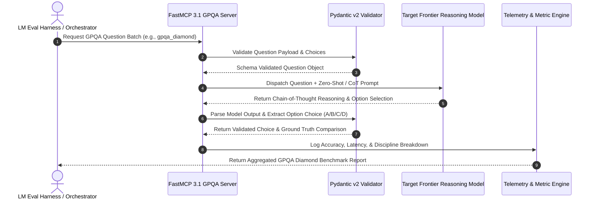

# GPQA (Graduate-Level Google-Proof Q&A)

## What it is
GPQA (Graduate-Level Google-Proof Q&A) is an expert-level benchmark dataset designed to evaluate high-order scientific reasoning, complex logic, multi-step problem solving, and domain mastery in frontier Large Language Models (LLMs) and autonomous reasoning agents. First introduced in late 2023 by researchers from NYU, Anthropic, and Alignment Research Center (ARC), GPQA comprises 448 multiple-choice questions written and validated exclusively by PhD-level subject matter experts across Biology, Physics, and Chemistry.

The defining characteristic of GPQA is its "Google-proof" design criteria. Questions are engineered such that non-expert humans (even when given unrestricted high-speed internet search access and 30+ minutes per question) achieve less than 35% accuracy. Conversely, domain experts with PhDs achieve over 74% accuracy. In enterprise AI evaluation and scientific research, GPQA (specifically its `gpqa_diamond` subset of 198 ultra-vetted, consensus-validated questions) remains the definitive benchmark for distinguishing genuine scientific reasoning capabilities from superficial pattern matching and memorization in frontier models like **Claude 3.5 / 3.7**, **GPT-4o / O1 / O3**, **Gemini 2.0 Pro**, and **Llama 4 Maverick**.

## System Architecture & FastMCP 3.1 Benchmark Flow

```
                                    GPQA Expert Evaluation Flow

  +-----------------------+        +------------------------+        +--------------------------+
  |  GPQA Diamond Subset  | ---->  |  FastMCP 3.1 Task      | ---->  | Frontier Reasoning LLM   |
  |  (198 PhD-Level Qs)   |        |  Protocol Orchestrator  |        | (Claude 3.7 / O1 / O3)   |
  +-----------------------+        +------------------------+        +--------------------------+
                                                                                  |
                                                                                  v
  +-----------------------+        +------------------------+        +--------------------------+
  | Expert Score Metrics  | <----  | Pydantic v2 Answer     | <----  | Chain-of-Thought (CoT)   |
  | & Domain Telemetry    |        | Validation Pipeline    |        | Solution & Option Selection|
  +-----------------------+        +------------------------+        +--------------------------+
```

### Detailed Evaluation & Telemetry Sequence



## What problem it solves
Standard multi-subject benchmarks (such as MMLU, TriviaQA, or ARC-Challenge) suffer from severe limitations when evaluating modern frontier reasoning models:
- **Data Contamination & Memorization**: Public multiple-choice datasets are frequently scraped into massive web pre-training corpora, artificially inflating model scores through rote memorization rather than multi-step logical reasoning.
- **Search-Saturated Questions**: Conventional questions can be answered rapidly by querying web search engines or vector databases, making them ineffective at testing autonomous problem-solving and domain logic synthesis.
- **Saturating Performance Ceilings**: Modern models rapidly hit 90%+ scores on standard benchmarks, eliminating granular differentiation between model generations and fine-tuned checkpoints.

GPQA addresses these challenges by:
- **Requiring Multi-Step Expert Reasoning**: Solutions require synthesizing multiple graduate-level domain concepts, performing non-trivial symbolic or quantitative calculations, and reasoning through subtle physical or biochemical mechanisms.
- **Adversarial Distractor Design**: Expert authors explicitly constructed subtle, mathematically plausible incorrect choices ("distractors") that penalize superficial logic leaps, unit mismatches, and hallucinations.
- **Contamination-Resistant Curation**: Maintaining gated release protocols, password-protected evaluation splits, and strict hashing to prevent accidental inclusion in web crawler training datasets.

## Benchmark Datasets & Subset Comparison

| Subset Identifier | Question Count | Curation Level | Primary Target |
| :--- | :--- | :--- | :--- |
| **gpqa_diamond** | 198 Questions | 100% Expert Consensus (Ultra-Vetted) | Primary Frontier Model Leaderboard Comparison |
| **gpqa_main** | 448 Questions | Full Expert Set (Single-expert vetted) | Comprehensive Domain Breakdown & Fine-Tuning Eval |
| **gpqa_extended** | 546 Questions | Includes Experimental & Secondary Questions | Extended Stress-Testing & Robustness Audits |

## Where it fits in the stack
**Category**: [Benchmarking](index.md) / High-Order Reasoning & Scientific Competence.

GPQA functions as the premier evaluation target for reasoning-dense LLM architectures, fine-tuning checkpoints, and extended Chain-of-Thought (CoT) test-time compute systems. It measures whether an AI system possesses true domain expertise required for autonomous scientific discovery, pharmaceutical research, and complex enterprise engineering.

## Key Technical Specifications & Architectural Standards

| Dimension | Standard / Specification | Production Requirement |
| :--- | :--- | :--- |
| **Benchmark Standard** | GPQA Diamond / Main / Extended | Standardized prompt format with strict Option A/B/C/D extraction |
| **Evaluation Harness** | LM Evaluation Harness / FastMCP 3.1 | Microsecond-precision latency and token telemetry tracking |
| **Schema Validation** | Pydantic v2 Models | Strict option string validation and discipline categorization |
| **Metric Calculation** | Normalized Accuracy & Discipline Breakdown | Separate accuracy scoring across Physics, Chemistry, and Biology |

## Typical use cases
- **Frontier Reasoning Model Evaluation**: Differentiating performance between state-of-the-art LLMs on physics, chemistry, and biology reasoning tasks.
- **Chain-of-Thought (CoT) & Test-Time Compute Benchmarking**: Quantifying how extended reasoning tokens and test-time search improve accuracy on expert-level questions.
- **Agentic Research Assistant Validation**: Testing autonomous research tools before deployment in enterprise biotech, chemical, or semiconductor research pipelines.
- **Post-Training Optimization**: Serving as a validation set for RLHF, Direct Preference Optimization (DPO), and Reinforcement Learning from AI Feedback (RLAIF) iterations focused on scientific accuracy.

## Strengths
- **PhD-Level Ground Truth**: Questions written and cross-verified by domain experts with verified PhD credentials in respective fields.
- **Resistant to Search Shortcuts**: Designed so that search engines and retrieval tools do not trivially reveal answers without domain synthesis.
- **Strong Correlation with True Reasoning**: High GPQA scores strongly correlate with real-world capability in technical, scientific, and software engineering disciplines.
- **Clean Subsets**: Offers `gpqa_diamond` (198 highest-quality consensus questions) alongside `gpqa_main` and `gpqa_extended`.

## Limitations
- **Compact Dataset Scale**: 448 total questions (198 in Diamond) limits sub-discipline statistical granularity.
- **Narrow Discipline Range**: Strictly focused on hard natural sciences (Physics, Chemistry, Biology); excludes computer science, law, medicine, and social sciences.
- **Multiple-Choice Format**: Does not evaluate open-ended scientific report writing, multi-step lab protocol execution, or code implementation.
- **High Human Verification Cost**: Creating new questions requires compensating PhD experts, making dataset scaling expensive.

## When to use it
- When evaluating frontier LLMs or reasoning models on graduate-level scientific problem-solving.
- When you require a benchmark resistant to pre-training memorization and simple search engine retrieval.
- To measure the benefits of extended test-time compute, reasoning models, and self-reflection loops.

## When not to use it
- For testing software engineering, repository editing, or code synthesis (use [HumanEval](human-eval.md) or [SWE-bench](swe-bench.md)).
- For general knowledge or multi-disciplinary high-school level tests (use [MMLU](mmlu.md)).
- For assessing live human-preference "vibes" or conversational fluency (use [Chatbot Arena](chatbot-arena.md)).

## System Configuration & Operational Parameters

| Environment Variable | Default Value | Description |
| :--- | :--- | :--- |
| `GPQA_SERVER_PORT` | `8091` | Network listener port for the FastMCP 3.1 GPQA benchmark server. |
| `GPQA_SUBSET` | `gpqa_diamond` | Default dataset split loaded (`gpqa_diamond`, `gpqa_main`, `gpqa_extended`). |
| `GPQA_COT_ENABLED` | `true` | Enable Chain-of-Thought reasoning prompt prefixing. |
| `GPQA_LOG_DIR` | `/var/log/gpqa` | Storage directory for evaluation telemetry and model traces. |

## Getting started

### 1. Install Evaluation Harness & FastMCP
Install LM Evaluation Harness along with Pydantic and FastMCP support:

```bash
pip install "lm-eval[api]>=0.4.0" "pydantic>=2.7.0" "mcp[cli]>=3.1.0"
```

### 2. Download GPQA Dataset
Inspect the dataset directly from Hugging Face Datasets:

```python
from datasets import load_dataset

dataset = load_dataset("Idavidrein/gpqa", "gpqa_diamond")
print(f"Loaded {len(dataset['train'])} GPQA Diamond questions.")
```

## CLI examples

### 1. Evaluate Local Model on GPQA Diamond via LM Evaluation Harness
Run zero-shot evaluation on GPQA Diamond using a local model:

```bash
python3 -m lm_eval --model hf \
    --model_args pretrained=meta-llama/Llama-4-Maverick-70B,trust_remote_code=True \
    --tasks gpqa_diamond \
    --device cuda:0 \
    --batch_size 1
```

### 2. Evaluate API-Based Model with Few-Shot Chain-of-Thought
Run GPQA evaluation against an API endpoint with CoT prompting:

```bash
python3 -m lm_eval --model anthropic \
    --model_args model=claude-3-7-sonnet-20250219 \
    --tasks gpqa_diamond \
    --num_fewshot 0
```

### 3. Inspect Dataset via Hugging Face CLI
Download and cache the dataset locally:

```bash
huggingface-cli download Idavidrein/gpqa --repo-type dataset
```

## API examples

### 1. FastMCP 3.1 Server: GPQA Evaluation Gateway
The following complete FastMCP 3.1 Python server exposes a GPQA task evaluation tool for autonomous benchmark orchestrators:

```python
from typing import List, Dict, Any, Optional
from mcp.server.fastmcp import FastMCP
from pydantic import BaseModel, Field, field_validator
import logging
import json

logging.basicConfig(level=logging.INFO)
logger = logging.getLogger("GPQAEvalServer")

mcp = FastMCP(
    name="GPQA Evaluation Server",
    version="3.1.0",
    description="FastMCP server for orchestrating graduate-level GPQA benchmarks"
)

class EvaluationTask(BaseModel):
    question_id: str = Field(..., description="Unique question ID")
    discipline: str = Field(..., description="Physics, Chemistry, or Biology")
    question_text: str = Field(..., description="The graduate-level question string")
    options: Dict[str, str] = Field(..., description="Multiple choice choices A, B, C, D")
    model_choice: str = Field(..., description="Selected choice from model, e.g. 'A'")
    correct_choice: str = Field(..., description="Ground truth correct option")

    @field_validator("model_choice", "correct_choice")
    def validate_option_letter(cls, v: str) -> str:
        clean = v.strip().upper()
        if clean not in {"A", "B", "C", "D"}:
            raise ValueError(f"Choice must be one of A, B, C, D. Got: {v}")
        return clean

class EvaluationResult(BaseModel):
    question_id: str
    is_correct: bool
    discipline: str
    model_choice: str
    correct_choice: str
    explanation: str

@mcp.tool(description="Evaluates a model response against GPQA ground truth assertions.")
def evaluate_gpqa_answer(task: EvaluationTask) -> str:
    """Validates chosen option and returns telemetry status."""
    logger.info(f"Evaluating question {task.question_id} ({task.discipline})")
    is_correct = (task.model_choice == task.correct_choice)
    result = EvaluationResult(
        question_id=task.question_id,
        is_correct=is_correct,
        discipline=task.discipline,
        model_choice=task.model_choice,
        correct_choice=task.correct_choice,
        explanation="Model selection matched ground truth choice." if is_correct else f"Model selected {task.model_choice}, expected {task.correct_choice}"
    )
    return result.model_dump_json(indent=2)

if __name__ == "__main__":
    mcp.run()
```

### 2. Pydantic v2 GPQA Accuracy & Discipline Breakdown Pipeline
Validate and aggregate GPQA accuracy stats across domains:

```python
from typing import List, Dict
from pydantic import BaseModel, Field, field_validator, ValidationError

class QuestionResult(BaseModel):
    question_id: str
    discipline: str
    is_correct: bool

    @field_validator("discipline")
    def validate_domain(cls, v: str) -> str:
        allowed = {"physics", "chemistry", "biology"}
        if v.lower() not in allowed:
            raise ValueError(f"Discipline must be one of {allowed}")
        return v.lower()

class GPQAReport(BaseModel):
    model_name: str
    evaluations: List[QuestionResult]

    def compute_accuracy(self) -> float:
        if not self.evaluations:
            return 0.0
        correct = sum(1 for e in self.evaluations if e.is_correct)
        return correct / len(self.evaluations)

    def breakdown_by_discipline(self) -> Dict[str, float]:
        stats: Dict[str, List[bool]] = {}
        for e in self.evaluations:
            stats.setdefault(e.discipline, []).append(e.is_correct)
        return {disc: sum(res) / len(res) for disc, res in stats.items()}

if __name__ == "__main__":
    data = {
        "model_name": "Claude 3.7 Sonnet",
        "evaluations": [
            {"question_id": "GPQA_BIO_001", "discipline": "biology", "is_correct": True},
            {"question_id": "GPQA_PHYS_002", "discipline": "physics", "is_correct": True},
            {"question_id": "GPQA_CHEM_003", "discipline": "chemistry", "is_correct": False},
            {"question_id": "GPQA_PHYS_004", "discipline": "physics", "is_correct": True}
        ]
    }
    report = GPQAReport.model_validate(data)
    print(f"Model: {report.model_name}")
    print(f"Overall GPQA Accuracy: {report.compute_accuracy():.2%}")
    print(f"By Discipline: {report.breakdown_by_discipline()}")
```

### 3. Frontier GPQA Diamond Benchmarks (Representative Baseline)

| Model Name | Developer | GPQA Diamond Accuracy (%) | Primary Test Mode |
| :--- | :--- | :--- | :--- |
| **Claude 3.7 Sonnet (Extended CoT)** | Anthropic | 84.2% | CoT (64k Reasoning Tokens) |
| **OpenAI o3-mini / o1** | OpenAI | 78.4% | Extended Reasoning |
| **Gemini 2.0 Flash Thinking** | Google | 72.8% | CoT Reasoning |
| **Llama 4 Maverick (70B)** | Meta AI | 69.2% | Direct Zero-Shot CoT |
| **DeepSeek R1** | DeepSeek | 65.0% | Extended CoT |
| PhD Expert Human | Benchmark Paper | 74.0% | Unrestricted Internet Search |
| Non-Expert Human (Web Access) | Benchmark Paper | 34.0% | 30+ Mins Internet Search |

## Production Systemd Service Unit Configuration

To run the GPQA evaluation gateway as a persistent background daemon for CI/CD model benchmarking, create the systemd unit file at `/etc/systemd/system/gpqa-eval.service`:

```ini
[Unit]
Description=FastMCP 3.1 GPQA Benchmark Evaluation Server
After=network.target

[Service]
Type=simple
User=gpqa
Group=gpqa
WorkingDirectory=/opt/gpqa-eval
Environment="PATH=/opt/gpqa-eval/venv/bin:/usr/local/bin:/usr/bin"
Environment="GPQA_SERVER_PORT=8091"
Environment="GPQA_SUBSET=gpqa_diamond"
Environment="GPQA_LOG_DIR=/var/log/gpqa"
ExecStart=/opt/gpqa-eval/venv/bin/python3 -m gpqa.server
Restart=always
RestartSec=5
LimitNOFILE=65536

# Security Hardening
ProtectSystem=full
ProtectHome=true
NoNewPrivileges=true
PrivateTmp=true

[Install]
WantedBy=multi-user.target
```

Enable and manage the service using standard systemctl commands:
```bash
sudo systemctl daemon-reload
sudo systemctl enable --now gpqa-eval.service
sudo systemctl status gpqa-eval.service
```

## Diagnostic Troubleshooting Matrix

| Symptom / Issue | Primary Cause | Diagnostic Command | Remediation Strategy |
| :--- | :--- | :--- | :--- |
| **Option Extraction Failures** | LLM output contains verbose CoT text without explicit "Choice: X" string. | `python3 -m lm_eval --tasks gpqa_diamond --show_config` | Modify prompt template to end with explicit instruction: "End your answer with 'Option: [A/B/C/D]'". |
| **Data Download Throttling** | Hugging Face rate limiting during automated evaluation runs. | `huggingface-cli env` | Export `HF_TOKEN` environment variable or pre-cache dataset via `huggingface-cli download Idavidrein/gpqa`. |
| **FastMCP Transport Timeout** | Model inference latency during extended CoT exceeds HTTP/SSE timeout. | `journalctl -u gpqa-eval.service -n 50` | Increase client timeout settings in evaluation harness or enable streaming responses. |
| **OutOfMemory (OOM) on Local Eval** | Uncached KV cache or large batch size during deep CoT evaluation. | `nvidia-smi --query-gpu=memory.used --format=csv` | Set `--batch_size 1` in `lm-eval` and enable `--model_args float16=True` or `load_in_4bit=True`. |

## Related tools / concepts
- [MMLU (Massive Multitask Language Understanding)](mmlu.md) — Multi-domain general knowledge benchmark.
- [GSM8K](gsm8k.md) — Grade school math benchmark.
- [HumanEval](human-eval.md) — Python code generation benchmark.
- [SWE-bench](swe-bench.md) — Repository-level software engineering benchmark.
- [LM Evaluation Harness](lm-evaluation-harness.md) — Unified framework for model testing.
- [Model Context Protocol (MCP)](../automation_orchestration/mcp.md) — Open protocol for LLM tool integration.

## Sources / references
- [Arxiv Paper: GPQA: A Graduate-Level Google-Proof Q&A Benchmark](https://arxiv.org/abs/2311.12022)
- [GPQA Dataset on Hugging Face](https://huggingface.co/datasets/Idavidrein/gpqa)
- [LMSYS Org Benchmark Leaderboard](https://arena.lmsys.org/)

---
## Contribution Metadata
- Last reviewed: 2027-01-07
- Confidence: high
