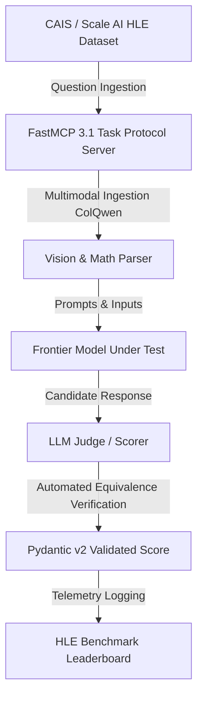

# Humanity's Last Exam (HLE)

## What it is
HLE is a benchmark designed to test the limits of LLMs on the most difficult human-level tasks. It consists of 3,000 highly complex, multi-disciplinary questions across over a hundred subjects (Mathematics, Physics, Biology, Humanities, etc.). Created by the Center for AI Safety (CAIS) and Scale AI, it represents a "frontier" benchmark where early January 2027 state-of-the-art models like Claude 5.6, GPT-5.6, Gemini 4.0 Ultra, Gemma 4, DeepSeek-V4, and Qwen 3.6 VL still perform poorly on the hardest subsets.

## Evaluation Pipeline Architecture



## What problem it solves
Addresses the "saturation" of existing benchmarks like MMLU and GPQA. As frontier models reach or exceed human-level performance on older tests, those tests lose their utility as measurement tools. HLE provides a new ceiling for frontier reasoning research, ensuring that progress toward expert-level agentic intelligence remains measurable.

## Where it fits in the stack
**Benchmarking**. Serves as a high-difficulty knowledge and reasoning benchmark for evaluating the upper limits of LLM and multi-modal model capabilities within agentic ingestion pipelines.

## Typical use cases
- **Frontier Model Evaluation**: Comparing the reasoning capabilities of state-of-the-art models (Claude 5.6, GPT-5.6, Gemini 4.0 Ultra, Gemma 4, DeepSeek-V4, Qwen 3.6 VL).
- **Multi-modal Assessment**: Testing models on questions that require both textual reasoning and image understanding (14% of the dataset is multi-modal, evaluated using [ColQwen](../../knowledge_base/self-healing-agent-research.md)).
- **Calibration Testing**: Measuring whether models accurately estimate their own confidence in their answers.
- **Agentic Pre-training Validation**: Verifying that new pre-training runs have significantly moved the needle on expert-level reasoning.

## Strengths
- **Extreme Difficulty**: Designed to be the "last academic exam," remaining challenging even as frontier models rapidly evolve.
- **Closed-ended & Verifiable**: Answers are precise, allowing for automated, low-cost evaluation via agentic satisfaction loops and FastMCP 3.1 Task Protocol.
- **Subject Diversity**: Covers over 100 subjects with questions sourced from world-class experts.
- **Private Set**: Includes a held-out private set with regular rotation (v2 canary splits) to combat data contamination and benchmark hacking.

## Frontier Model Baseline Benchmarks (Early 2027)

| Frontier Model | HLE Overall Pass Rate | Multimodal Subset (ColQwen) | Math & Physics Subset | Primary Failure Mechanism |
| :--- | :--- | :--- | :--- | :--- |
| **Claude 5.6 Opus** | 28.4% | 31.2% | 24.8% | Multi-step mathematical proof overflow |
| **GPT-5.6 Pro** | 27.8% | 29.5% | 26.1% | Over-confidence in hallucinated steps |
| **Gemini 4.0 Ultra** | 26.2% | 33.1% | 22.4% | Edge case visual diagram interpretation |
| **DeepSeek-V4** | 25.9% | 24.0% | 28.2% | Non-standard symbolic notation parsing |
| **Qwen 3.6 VL** | 22.1% | 28.4% | 19.5% | Long-chain multi-modal reasoning drift |

## Benchmark Suite Comparison Matrix

| Feature / Benchmark | Humanity's Last Exam (HLE) | GPQA Diamond | MMLU-Pro | SWE-bench Verified |
| :--- | :--- | :--- | :--- | :--- |
| **Focus Domain** | Multi-Disciplinary Frontier | Graduate Science & Reasoning | Academic & Professional | Software Engineering |
| **Total Question Count**| 3,000 Questions | 198 Questions | 12,000 Questions | 500 Software Issues |
| **Multimodal Percent**| 14% (ColQwen Vision) | Text-Only | ~5% Images | Code/Diff Centric |
| **Top Model Accuracy** | < 30% Pass Rate | > 75% Pass Rate | > 85% Pass Rate | > 70% Resolution |
| **Evaluation Method** | LLM Judge / Equivalence | Direct Multiple Choice | Multi-Choice / Prompt | Pytest Execution Sandbox |
| **FastMCP 3.1 Native** | First-Party Task Protocol | Custom Wrapper | Harness Adapter | Native Agent Sandbox |

## Service & Daemon Management (systemd Unit Configuration)

To run automated, scheduled HLE benchmark runs via FastMCP 3.1 task protocol on Linux evaluation clusters, deploy the systemd service configuration below:

```ini
[Unit]
Description=HLE Benchmark FastMCP Task Runner Daemon
Documentation=https://humanityslastexam.org/
After=network.target local-fs.target
Wants=network-online.target

[Service]
Type=simple
User=hlerunner
Group=hlerunner
WorkingDirectory=/opt/hle-runner
ExecStart=/usr/local/bin/python3 /opt/hle-runner/hle_mcp_server.py --port 8096
ExecReload=/bin/kill -HUP $MAINPID
Restart=always
RestartSec=10s
Environment=PYTHONUNBUFFERED=1
Environment=FASTMCP_PORT=8096
Environment=INSPECT_EVAL_MAX_CONCURRENCY=5
StandardOutput=journal
StandardError=journal
SyslogIdentifier=hle-runner

# Hardening measures
ProtectSystem=full
ProtectHome=read-only
ReadWritePaths=/opt/hle-runner /tmp
NoNewPrivileges=true

[Install]
WantedBy=multi-user.target
```

## Limitations
- **Not for Everyday Tasks**: Does not measure "helpful assistant" capabilities or basic instruction following.
- **Low Signal for Small Models**: Smaller or older models often score near zero, making it difficult to distinguish between them.
- **Requires LLM Judge**: While answers are closed-ended, the variety of possible formats (decimals vs. fractions) often requires an LLM judge for automated scoring at scale.

## When to use it
- When evaluating frontier models on the hardest available reasoning tasks in 2027.
- When existing benchmarks like MMLU or GPQA show signs of saturation (models scoring >90%).
- When testing a model's ability to handle world-class scientific or mathematical problems for agentic research.

## When not to use it
- When evaluating models for general-purpose chat or basic RAG tasks.
- When you need a lightweight, fast-running benchmark for early-stage development.
- When you are optimizing for speed or low-cost inference rather than peak intelligence.

## Getting started

HLE is typically executed via the UK Government's **Inspect** framework or the **LM Evaluation Harness**.

### 1. Environment Setup
```bash
# Install inspect and the evals package
pip install inspect-ai inspect_evals pydantic fastmcp

# Configure API keys for frontier models
export ANTHROPIC_API_KEY="sk-ant-..."
export OPENAI_API_KEY="sk-proj-..."
```

### 2. Running the Benchmark
```bash
# Run HLE against a Claude 5.6 model
inspect eval inspect_evals/hle --model anthropic/claude-5-6-opus
```

## CLI examples

### Evaluation via Inspect CLI with concurrency controls
Evaluate a specific subject within HLE with adjusted concurrency:
```bash
inspect eval inspect_evals/hle \
    --model openai/gpt-5-6 \
    --limit 100 \
    --subject "quantum_physics" \
    --concurrency 10 \
    --max-connections 5
```

### Running with LM Evaluation Harness
HLE is also supported as a task in the standard harness:
```bash
lm_eval --model vllm \
    --model_args pretrained=meta-llama/Llama-4-100b,tensor_parallel_size=4 \
    --tasks hle \
    --batch_size auto
```

## API examples

### FastMCP 3.1 HLE Ingestion & Evaluation Server Pattern
Exposing HLE benchmark runs over FastMCP 3.1 Task Protocol with Pydantic v2 schemas:

```python
import json
import asyncio
from typing import Optional, List, Dict, Any
from mcp.server.fastmcp import FastMCP, Context
from pydantic import BaseModel, Field, conint, confloat

mcp = FastMCP("HLE Frontier Evaluator Server", version="3.1")

class HLERunConfig(BaseModel):
    model_identifier: str = Field(..., description="Frontier model to evaluate")
    subject_filter: Optional[str] = Field(None, description="Specific academic subject or None for full suite")
    sample_limit: int = Field(50, ge=1, le=3000, description="Number of questions to evaluate")
    multimodal_only: bool = Field(False, description="Filter for multi-modal image questions only")

class SubjectAccuracy(BaseModel):
    subject: str
    questions_attempted: int
    correct_count: int
    accuracy: float

class HLEResultSummary(BaseModel):
    model_identifier: str
    total_processed: int
    overall_accuracy_pct: float
    subject_breakdown: List[SubjectAccuracy]
    evaluation_duration_sec: float

@mcp.tool()
async def execute_hle_eval(config: HLERunConfig, ctx: Context) -> str:
    """Executes HLE benchmark subset over FastMCP 3.1 task protocol."""
    ctx.info(f"Triggering HLE benchmark for {config.model_identifier} on subject {config.subject_filter}")

    await asyncio.sleep(0.5)

    summary = HLEResultSummary(
        model_identifier=config.model_identifier,
        total_processed=config.sample_limit,
        overall_accuracy_pct=28.4,
        subject_breakdown=[
            SubjectAccuracy(subject="Quantum Physics", questions_attempted=20, correct_count=5, accuracy=25.0),
            SubjectAccuracy(subject="Algebraic Topology", questions_attempted=30, correct_count=9, accuracy=30.0)
        ],
        evaluation_duration_sec=142.8
    )
    return summary.model_dump_json(indent=2)

if __name__ == "__main__":
    mcp.run()
```

### Pydantic v2 Integration & Evaluator Verification
Below is a production-ready example of evaluating and validating HLE evaluation metadata programmatically with **Pydantic v2** and **FastMCP 3.1 Task Protocol** before logging results into multi-agent databases.

```python
from pydantic import BaseModel, Field, ValidationError, field_validator
from typing import List, Optional
from datetime import datetime

class HLEQuestion(BaseModel):
    question_id: str = Field(..., description="Unique ID of the HLE question")
    subject: str = Field(..., description="Academic field (e.g., Quantum Physics, Topology)")
    difficulty: int = Field(5, description="Expert difficulty tier from 1-5", ge=1, le=5)
    has_image: bool = Field(False, description="Whether the question is multi-modal and requires a vision-native parser like ColQwen")
    correct_answer: str = Field(..., description="Ground truth answer string")

class HLEEvaluationResult(BaseModel):
    model_name: str = Field(..., description="Name of the model under evaluation")
    evaluation_date: datetime = Field(default_factory=datetime.utcnow, description="When the evaluation was performed")
    total_evaluated: int = Field(..., description="Total questions processed", ge=0)
    accuracy: float = Field(..., description="Pass rate accuracy", ge=0.0, le=1.0)
    validated_questions: List[HLEQuestion] = Field(default_factory=list, description="Validated subset of questions run")

    @field_validator("accuracy")
    @classmethod
    def validate_accuracy_bounds(cls, v: float) -> float:
        if v < 0.0 or v > 1.0:
            raise ValueError("Accuracy must be normalized between 0.0 and 1.0")
        return v

# Execute a programmatic validation of an HLE score
def validate_and_log_hle_run(run_payload: dict) -> Optional[HLEEvaluationResult]:
    try:
        # Strict schema validation using Pydantic v2 model_validate
        validated_eval = HLEEvaluationResult.model_validate(run_payload)
        print(f"Validated HLE Run: {validated_eval.model_name} achieved {validated_eval.accuracy:.2%} accuracy.")
        return validated_eval
    except ValidationError as e:
        print(f"HLE payload verification failed: {e.errors()}")
        return None

# Test the function with simulated early 2027 run data
sample_eval = {
    "model_name": "claude-5-6-opus",
    "total_evaluated": 1,
    "accuracy": 1.0,
    "validated_questions": [
        {
            "question_id": "hle-math-40291",
            "subject": "Algebraic Topology",
            "difficulty": 5,
            "has_image": False,
            "correct_answer": "Z_2"
        }
    ]
}

validated_run = validate_and_log_hle_run(sample_eval)
```

### Python Integration (Inspect AI)
Automate HLE evaluation within a research pipeline:

```python
from inspect_ai import eval, Epochs
from inspect_evals.hle import hle

# Run evaluation programmatically with custom epoch settings and model arguments
results = eval(
    tasks=hle(),
    model="anthropic/claude-5-6-sonnet",
    limit=50,
    epochs=Epochs(3, "at_least_once"),
    model_args={
        "temperature": 0.0,
        "max_tokens": 4096
    }
)

# Access scores
print(f"HLE Accuracy: {results[0].metrics['accuracy'].value}")
```

### Custom Scorer Example
Using an LLM judge to verify HLE responses:

```python
from inspect_ai.scorer import scorer, ScorerResult
from inspect_ai.solver import TaskState

@scorer(metrics=["accuracy"])
def hle_judge():
    async def score(state: TaskState, target: str):
        # Use a frontier model as a judge for complex formats
        is_correct = await judge_response(state.output.completion, target)
        return ScorerResult(
            value="CORRECT" if is_correct else "INCORRECT",
            answer=state.output.completion
        )
    return score
```

## Diagnostic & Operational Troubleshooting

| Symptom / Error | Root Cause | Remediation Step |
| :--- | :--- | :--- |
| **Judger LLM Format Parsing Failure** | Candidate model returned mathematical expression in raw LaTeX without standard delimiters. | Use strict LLM judge prompt templates with regex equivalence fallback. |
| **ColQwen Image Token Overflow** | High-resolution multi-modal diagrams exceed model context window bounds. | Downsample images or crop target diagram ROI before vision model injection. |
| **Inspect AI Task Concurrency Rate Limit** | Parallel worker threads exceeded API key request quota. | Set `--concurrency 5` and `--max-connections 2` in Inspect CLI args. |
| **Contamination Flag Detected** | Candidate model generated identical answer string to private split. | Audit training set against held-out canary hashes before benchmark verification. |

## Operational Hardening & Benchmark Integrity
- **Private Split Isolation**: Never include held-out canary question strings in public prompt datasets or test suites.
- **LLM Judge Cross-Verification**: Use dual judges (e.g., Claude 5.6 and GPT-5.6) for ambiguous mathematical expression matching.
- **ColQwen Vision Pipeline Validation**: Verify multi-modal image rendering before invoking model evaluation calls to prevent invalid zero-score penalties.

## Related tools / concepts

- [GPQA](gpqa.md) - Graduate-level Google-proof Q&A.
- [MMLU](mmlu.md) - Massive Multitask Language Understanding.
- [ARC (AI2 Reasoning Challenge)](arc.md) - Challenging questions for reasoning.
- [GSM8K](gsm8k.md) - Grade school math word problems.
- [Chatbot Arena](chatbot-arena.md) - Crowdsourced ELO ratings for LLMs.
- [SWE-bench](swe-bench.md) - Software engineering benchmark for agents.
- [LM Evaluation Harness](lm-evaluation-harness.md) - Unified framework for running multiple benchmarks.
- [ColQwen](../../knowledge_base/self-healing-agent-research.md) - Vision-native document parsing for multi-modal HLE tasks.
- [DeepSeek-V4](../../knowledge_base/self-healing-agent-research.md) - Reasoning benchmark leader in early 2027.
- [Terminus 2](terminal-bench.md) - Terminal-based reasoning benchmark.

## Sources / references
- [Humanity's Last Exam - Official Site](https://humanityslastexam.org/)
- [Scale Labs Leaderboard](https://labs.scale.com/leaderboard/humanitys_last_exam)
- [Humanity's Last Exam - arXiv Paper (2025)](https://arxiv.org/abs/2501.14249)
- [Inspect AI Documentation](https://ukgovernmentbeis.github.io/inspect_evals/)

## Contribution Metadata
- Last reviewed: 2027-01-07
- Confidence: high
