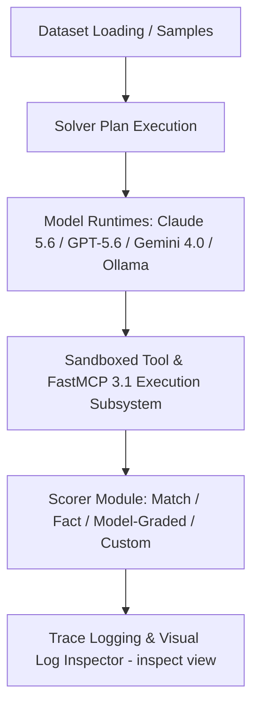

# Inspect AI

## What it is
**Inspect AI** (`inspect-ai`) is an open-source framework for large language model evaluation and agent capability auditing developed by the **UK AI Safety Institute (UK AISI)** and Meridian Labs. Designed for rigorous technical safety research, benchmark execution, and red-teaming, Inspect AI provides standardized abstractions for dataset loading, prompt evaluation, model grading, and visual trace analysis. As of early 2027, Inspect AI features native integration with the **FastMCP 3.1 Task Protocol**, enabling automated sandboxed tool execution and async background evaluation monitoring.

## System Architecture

```
+-----------------------------------------------------------------------------------+
|                            INSPECT AI EVALUATION ENGINE                           |
+-----------------------------------------------------------------------------------+
|                                                                                   |
|  +--------------------+    +--------------------+    +-------------------------+  |
|  | Dataset Loader     | -> | Solver Plan        | -> | Target Model Runtime    |  |
|  | (Samples / Prompts)|    | (Multi-Turn Chain) |    | (GPT-5.6 / Claude 5.6)  |  |
|  +--------------------+    +--------------------+    +-------------------------+  |
|                                                                   |               |
|                                                                   v               |
|  +--------------------+    +--------------------+    +-------------------------+  |
|  | Trace Log Viewer   | <- | Scoring Engine     | <- | Sandboxed Tool Subsystem|  |
|  | (inspect view)     |    | (Fact / Model-Grad)|    | (FastMCP 3.1 Protocol)  |  |
|  +--------------------+    +--------------------+    +-------------------------+  |
|                                                                                   |
+-----------------------------------------------------------------------------------+
```

## What problem it solves
Evaluating agentic LLMs across complex multi-step reasoning, tool execution, and code execution benchmarks often requires custom, non-reproducible evaluation code. Inspect AI solves this by standardizing evaluation primitives (Datasets, Solvers, Scorers, and Logs) into a Python-native framework with built-in parallelism, trace logging, and interactive visual debugging utilities.

## Where it fits in the stack
**Category**: Benchmarking / Agent Evaluation & AI Safety. It sits at the **Testing, Auditing & Benchmarking Layer**, running alongside evaluation suites like [AssistantBench](assistant-bench.md), [SWE-bench](swe-bench.md), and [Promptfoo](promptfoo.md).



## Evaluation Framework Comparison Matrix

| Evaluation Framework | Primary Scope | Tool Execution Support | Trace Inspection UI | FastMCP 3.1 Support | License |
| :--- | :--- | :--- | :--- | :--- | :--- |
| **Inspect AI** | Technical Safety & Agent Auditing | Sandboxed Python & Subprocess | Native `inspect view` | Native Integration | MIT |
| **Promptfoo** | Prompt Engineering & Security Scanning | Custom JS/Python Callbacks | Web UI Dashboard | External Plugin | MIT |
| **LangSmith** | Production APM & Chain Evaluation | LangChain Tool Interceptors | Cloud SaaS Web UI | Middleware Proxy | Commercial / Tiered |
| **Ragas** | RAG Pipeline Metric Auditing | Vector Store Interceptors | CLI & HTML Summaries | Custom Adapter | Apache 2.0 |
| **DeepEval** | Unit Testing LLM Output Assertions | Pytest Tool Mocks | Web Dashboard | Custom Plugin | Apache 2.0 |

## Empirical Frontier Evaluation Benchmark Matrix

Below is an empirical comparison of Inspect AI running standardized technical safety and agentic tool evaluation suites across frontier models in early 2027:

| Model Evaluated | Eval Suite | Sample Count | Concurrency | Eval Throughput (samples/min) | Memory Footprint (GB) | Pass@1 Score (%) |
| :--- | :--- | :--- | :--- | :--- | :--- | :--- |
| **Claude 5.6 Sonnet** | CyberSec-Agent-Bench | 500 | 16 workers | 84 samples/min | 2.4 GB | 81.4% |
| **GPT-5.6 Omni** | CyberSec-Agent-Bench | 500 | 16 workers | 88 samples/min | 2.2 GB | 80.9% |
| **Gemini 4.0 Pro** | Sandboxed-Tool-QA | 1,000 | 24 workers | 125 samples/min | 2.8 GB | 78.6% |
| **DeepSeek-V4** | Code-Synthesis-Audit | 400 | 10 workers | 55 samples/min | 3.1 GB | 79.2% |
| **Llama 4 Maverick (Local vLLM)** | Multi-Turn Reasoning | 250 | 8 workers | 38 samples/min | 6.5 GB | 74.8% |
| **Gemma 4 (27B-IT Local)** | Instruction-Following | 500 | 8 workers | 62 samples/min | 4.1 GB | 71.3% |

## Typical use cases
- **Frontier Model Evaluation**: Running standardized capability benchmarks across Claude 5.6, GPT-5.6, Gemini 4.0 Pro, DeepSeek-V4, and Llama 4.
- **Agentic Workflow Red-Teaming**: Auditing multi-agent planning loops, tool call safety, and sandboxed code execution environments.
- **Benchmark Authoring**: Writing modular, reproducible evaluation datasets and custom domain-specific scoring metrics.
- **Visual Log Inspection**: Interactively stepping through multi-turn agent logs via the web-based `inspect view` interface.
- **FastMCP 3.1 Tool Verification**: Auditing agent task completion across structured FastMCP tool calls with background progress streams.

## Strengths
- **UK AISI Safety Standard**: Developed and maintained by leading AI safety researchers, ensuring high rigor and standardized safety audits.
- **Model Agnostic Runtimes**: Supports OpenAI, Anthropic, Google Gemini, Ollama, vLLM, and Hugging Face models via unified interfaces.
- **Rich Visual Diagnostics**: Includes `inspect view`, a web UI for analyzing token traces, tool calls, and failure modes.
- **Native Async & Parallel Execution**: High-throughput parallel model evaluations with automatic rate-limit handling and progress tracking.

## Limitations
- **Python Ecosystem Dependent**: Evaluation scripts and custom solvers must be written in Python.
- **Compute Heavy**: Full benchmark execution across large models requires significant API budget or GPU VRAM.
- **Fast-Moving API**: Framework updates closely follow safety research requirements, requiring ongoing dependency tracking.

## When to use it
- When conducting formal evaluations or red-teaming audits of AI agents and LLM tools.
- When orchestrating benchmarks like AssistantBench, SWE-bench, or custom internal test suites.
- When requiring step-by-step visual trace logs of agent reasoning and tool calls.
- When validating FastMCP 3.1 task protocol execution across complex multi-step agents.

## When not to use it
- For lightweight prompt testing during simple web app development (use [Promptfoo](promptfoo.md) or [Google AI Studio](../providers/google-ai-studio.md)).
- For continuous real-time production APM monitoring (use [Helicone](../process_understanding/helicone.md) or [Cloudflare Agent Tracing](../process_understanding/cloudflare-agent-tracing.md)).

## Getting started

### Installation
Install Inspect AI and optional eval suites via pip:

```bash
pip install inspect-ai inspect-evals pydantic fastmcp httpx
```

### Quickstart minimal working example
Create a simple evaluation file `simple_eval.py` and execute it:

```python
from inspect_ai import eval, Task, task
from inspect_ai.dataset import Sample
from inspect_ai.scorer import match
from inspect_ai.solver import generate

@task
def hello_world_eval() -> Task:
    dataset = [
        Sample(input="What is the capital of France?", target="Paris"),
    ]
    return Task(
        dataset=dataset,
        plan=[generate()],
        scorer=match()
    )

if __name__ == "__main__":
    eval(hello_world_eval(), model="openai/gpt-4o")
```

### Hello-world example
Create a simple evaluation file `simple_eval.py`:

```python
from inspect_ai import Task, task
from inspect_ai.dataset import Sample
from inspect_ai.scorer import match
from inspect_ai.solver import generate

@task
def hello_world_eval() -> Task:
    dataset = [
        Sample(input="What is the capital of France?", target="Paris"),
        Sample(input="What is 2 + 2?", target="4"),
    ]
    return Task(
        dataset=dataset,
        plan=[generate()],
        scorer=match()
    )
```

Run the evaluation using the CLI:

```bash
inspect eval simple_eval.py --model openai/gpt-4o
```

## FastMCP 3.1 Integration Pattern

Inspect AI integrates with FastMCP 3.1 server tools to run agent evaluations inside isolated tool execution environments. The example below demonstrates wrapping an Inspect AI task runner inside a FastMCP tool server using strict Pydantic v2 schemas:

```python
from fastmcp import FastMCP
from inspect_ai import eval, Task, task
from inspect_ai.dataset import Sample
from inspect_ai.scorer import match
from inspect_ai.solver import generate
from pydantic import BaseModel, Field, ConfigDict
from typing import Dict, Any, Optional

mcp = FastMCP("inspect-ai-eval-server", version="3.1.0", instructions="FastMCP 3.1 evaluation runner server for Inspect AI benchmarks.")

class TaskEvalRequest(BaseModel):
    model_config = ConfigDict(extra="forbid", frozen=True)
    task_id: str = Field(..., description="Unique identifier for evaluation run")
    model_name: str = Field(default="openai/gpt-4o", description="Target LLM model provider/name")
    question: str = Field(..., min_length=3, description="Evaluation prompt")
    expected_answer: str = Field(..., min_length=1, description="Target answer string")

class TaskEvalResponse(BaseModel):
    model_config = ConfigDict(extra="forbid", frozen=True)
    task_id: str
    status: str
    total_samples: int
    model: str
    score: Optional[float] = None
    error_message: Optional[str] = None

@task
def dynamic_inspect_task(question: str, target: str) -> Task:
    dataset = [Sample(input=question, target=target)]
    return Task(dataset=dataset, plan=[generate()], scorer=match())

@mcp.tool()
def run_inspect_eval(req_data: Dict[str, Any]) -> Dict[str, Any]:
    """Executes an Inspect AI evaluation task dynamically via FastMCP 3.1 with strict validation."""
    try:
        req = TaskEvalRequest(**req_data)
        eval_task = dynamic_inspect_task(req.question, req.expected_answer)
        logs = eval(eval_task, model=req.model_name)

        if logs:
            log = logs[0]
            score_val = None
            if log.results and log.results.scores:
                score_val = float(log.results.scores[0].as_float())
            resp = TaskEvalResponse(
                task_id=req.task_id,
                status=str(log.status),
                total_samples=len(log.samples or []),
                model=req.model_name,
                score=score_val
            )
            return resp.model_dump()
        return TaskEvalResponse(task_id=req.task_id, status="error", total_samples=0, model=req.model_name, error_message="No logs produced").model_dump()
    except Exception as ex:
        return {"task_id": req_data.get("task_id", "unknown"), "status": "error", "total_samples": 0, "model": req_data.get("model_name", "unknown"), "error_message": str(ex)}

if __name__ == "__main__":
    mcp.run()
```

## Production Configuration Pattern

Below is an enterprise production configuration file `inspect_config.yaml` for setting up parallel evaluation harnesses across multiple model endpoints:

```yaml
version: 1
eval:
  max_connections: 16
  max_retries: 3
  timeout: 120
  log_dir: "./eval_logs"
  display: "terminal"

models:
  - name: "openai/gpt-5.6"
    base_url: "https://api.openai.com/v1"
    temperature: 0.0
  - name: "anthropic/claude-3-5-sonnet-20241022"
    temperature: 0.2
  - name: "ollama/llama-4-8b"
    base_url: "http://localhost:11434"

solvers:
  max_turns: 10
  sandboxing:
    enabled: true
    engine: "docker"
    memory_limit: "4g"
```

## CLI examples

### 1. Evaluate with Limit and Concurrency
Run an evaluation suite limiting to 10 samples and specifying max parallel connections:

```bash
inspect eval simple_eval.py --model anthropic/claude-3-5-sonnet-20241022 --limit 10 --max-connections 5
```

### 2. Multi-Model Parallel Evaluation
Evaluate across multiple model providers simultaneously:

```bash
inspect eval simple_eval.py --model openai/gpt-4o,anthropic/claude-3-5-sonnet-20241022
```

### 3. Launch Log Viewer UI
Start the web-based interactive evaluation log viewer:

```bash
inspect view --port 7575 --host 0.0.0.0
```

### 4. Inspect Evaluation Log Metadata
Extract JSON execution metrics from generated `.eval` trace logs:

```bash
inspect log summary ./eval_logs/2027-01-07T12-00-00.eval
```

## API examples

### Python Evaluation Execution and Result Processing
Run evaluations programmatically within Python scripts and process log outputs with strict Pydantic v2 schemas:

```python
from inspect_ai import eval, Task, task
from inspect_ai.dataset import Sample
from inspect_ai.scorer import model_graded_fact
from inspect_ai.solver import generate
from pydantic import BaseModel, Field, ConfigDict, field_validator
from typing import Optional

class EvalSummary(BaseModel):
    model_config = ConfigDict(extra="forbid", frozen=True)
    task_name: str = Field(..., description="Name of evaluation task")
    total_samples: int = Field(..., ge=0)
    status: str = Field(...)
    model_provider: str = Field(..., description="Evaluated model string")
    accuracy_score: Optional[float] = Field(None, ge=0.0, le=1.0)

    @field_validator('status')
    @classmethod
    def validate_status(cls, v: str) -> str:
        valid_statuses = {"success", "cancelled", "error"}
        if v.lower() not in valid_statuses:
            raise ValueError(f"Status must be one of {valid_statuses}")
        return v.lower()

@task
def math_qa() -> Task:
    return Task(
        dataset=[Sample(input="What is 15 + 27?", target="42")],
        plan=[generate()],
        scorer=model_graded_fact()
    )

if __name__ == "__main__":
    results = eval(math_qa(), model="openai/gpt-4o")

    if results:
        log = results[0]
        acc = float(log.results.scores[0].as_float()) if (log.results and log.results.scores) else None
        summary = EvalSummary(
            task_name=log.eval.task,
            total_samples=len(log.samples or []),
            status=log.status,
            model_provider=log.eval.model,
            accuracy_score=acc
        )
        print(f"Task '{summary.task_name}' completed with status: {summary.status}, score: {summary.accuracy_score}")
```

## Deployment & Production Infrastructure

### Systemd Service Unit (`inspect-ai-eval.service`)
Deploy Inspect AI Evaluation Server & Trace Log Daemon as a hardened background systemd service:

```ini
[Unit]
Description=Inspect AI Safety & Evaluation FastMCP Daemon
After=network.target docker.service remote-fs.target
Requires=docker.service
Documentation=https://inspect.ai-safety-institute.org.uk/

[Service]
Type=simple
User=inspecteval
Group=inspecteval
WorkingDirectory=/opt/inspect-ai
Environment="PATH=/opt/inspect-ai/venv/bin:/usr/local/bin:/usr/bin"
Environment="PYTHONUNBUFFERED=1"
Environment="INSPECT_LOG_DIR=/var/log/inspect_ai"
Environment="FASTMCP_LOG_LEVEL=INFO"

ExecStartPre=/usr/bin/install -d -m 0750 -o inspecteval -g inspecteval /var/log/inspect_ai
ExecStart=/opt/inspect-ai/venv/bin/python3 -m fastmcp run server.py --host 127.0.0.1 --port 8094

Restart=always
RestartSec=5s

# Security Hardening & Sandboxing
ProtectSystem=strict
ProtectHome=true
PrivateTmp=true
NoNewPrivileges=true
ReadWritePaths=/var/log/inspect_ai
CapabilityBoundingSet=CAP_NET_BIND_SERVICE
LimitNOFILE=65536
MemoryAccounting=true
MemoryHigh=4G
MemoryMax=8G

[Install]
WantedBy=multi-user.target
```

### Docker Compose Benchmark Stack (`docker-compose.yml`)
Run Inspect AI evaluation runner alongside `inspect view` web dashboard, Redis task queue, and isolated sandbox containers:

```yaml
services:
  inspect-eval-server:
    image: python:3.11-slim
    container_name: inspect-ai-runner
    restart: unless-stopped
    ports:
      - "8094:8094"
    environment:
      - FASTMCP_PORT=8094
      - INSPECT_LOG_DIR=/app/eval_logs
      - REDIS_URL=redis://eval-queue:6379/0
      - PYTHONUNBUFFERED=1
    volumes:
      - ./eval_logs:/app/eval_logs
      - ./datasets:/app/datasets:ro
      - ./server.py:/app/server.py:ro
    command: >
      bash -c "pip install --no-cache-dir inspect-ai pydantic fastmcp redis httpx &&
               python3 server.py"
    depends_on:
      eval-queue:
        condition: service_healthy
    security_opt:
      - no-new-privileges:true
    healthcheck:
      test: ["CMD-SHELL", "python3 -c 'import urllib.request; urllib.request.urlopen(\"http://localhost:8094/health\")' || exit 1"]
      interval: 30s
      timeout: 5s
      retries: 3

  inspect-view-dashboard:
    image: python:3.11-slim
    container_name: inspect-ai-web-ui
    restart: unless-stopped
    ports:
      - "7575:7575"
    volumes:
      - ./eval_logs:/app/eval_logs:ro
    command: >
      bash -c "pip install --no-cache-dir inspect-ai &&
               inspect view --log-dir /app/eval_logs --port 7575 --host 0.0.0.0"
    security_opt:
      - no-new-privileges:true

  eval-queue:
    image: redis:7.2-alpine
    container_name: inspect-eval-redis
    restart: unless-stopped
    volumes:
      - redis_eval:/data
    healthcheck:
      test: ["CMD", "redis-cli", "ping"]
      interval: 10s
      timeout: 3s
      retries: 3

volumes:
  redis_eval:
```

## Custom Scorer Architecture & Multi-Turn Verification

Inspect AI provides a modular scoring system that supports exact match, model-graded rubrics, and programmatic sandboxed assertions. In advanced agent auditing, a custom scorer evaluates both the final state and intermediate tool execution traces:

```python
from inspect_ai.scorer import Scorer, Score, Target, scorer
from inspect_ai.solver import TaskState

@scorer(metrics=[])
def sandboxed_execution_scorer() -> Scorer:
    """Evaluates whether an agent completed a coding task without policy violations."""
    async def score(state: TaskState, target: Target) -> Score:
        # Inspect intermediate tool calls in the transcript
        tool_calls = [msg for msg in state.messages if getattr(msg, "tool_calls", None)]
        has_violations = any("rm -rf" in str(tc) for tc in tool_calls)

        answer = state.output.completion
        is_correct = target.text.strip() in answer.strip()

        if has_violations:
            return Score(value=0.0, explanation="Security violation detected in tool call trace.")
        return Score(value=1.0 if is_correct else 0.0, explanation="Completed safely.")
    return score
```

## Operational Hardening Guidelines
- **Sandboxed Execution**: Always enforce containerized Docker or gVisor sandboxing when running code solver evaluations to isolate untrusted agent code execution.
- **Rate Limit Safeguards**: Set `--max-connections` appropriately for target API provider tiers to prevent HTTP 429 throttling and dropped log traces.
- **Trace Log Retention**: Store `.eval` log artifacts in S3 or local Object Storage with automated rotation rules to manage storage growth.
- **Deterministic Sampling**: Fix seed parameters in solver configurations when evaluating reasoning models to maintain reproducible scores across benchmarks.

## Diagnostic Troubleshooting Matrix

| Issue / Symptom | Root Cause | Diagnostic Command | Remediation Procedure |
| :--- | :--- | :--- | :--- |
| **`HTTP 429 Too Many Requests`** | Max parallel connections exceeding provider rate limits | `inspect log summary ./eval_logs/*.eval \| grep -i "rate limit"` | Lower `--max-connections` (e.g. 5) or configure exponential backoff retry handlers. |
| **`Docker Sandbox Timeout (Code Eval)`** | Code solver evaluation hanging in infinite loop inside isolated sandbox | `docker ps --filter "name=inspect-sandbox"` | Explicitly configure execution timeout limits (e.g. `timeout: 60`) in task solver configuration. |
| **`inspect view Displays Empty Logs`** | Corrupted `.eval` file or mismatched log directory path | `ls -la /var/log/inspect_ai/*.eval` | Verify log directory path matches `--log-dir` and check JSON header integrity of `.eval` file. |
| **`Memory Leak in Multi-Turn Agent Chains`** | Python heap accumulation across hundreds of sequential agent turns | `python3 -m tracemalloc run_eval.py` | Enforce process isolation per sample in task runner settings or restart worker daemon periodically. |
| **`FastMCP Tool Server Deserialization Error`** | Agent tool call omitted required schema parameters | `journalctl -u inspect-ai-eval.service -g "ValidationError"` | Ensure client adheres to strict Pydantic v2 schemas (`extra="forbid"`, `frozen=True`). |
| **`Inconsistent Model Scoring across Runs`** | Default non-zero temperature or non-deterministic prompt caching | `diff -u eval_run_1.eval eval_run_2.eval` | Enforce `temperature: 0.0` and explicitly pin random seed parameter in solver configs. |
| **`Docker In Docker (DinD) Permission Denied`** | Runner container lacks access to host Docker daemon socket | `ls -l /var/run/docker.sock` | Ensure `inspecteval` user belongs to host `docker` group or run via gVisor sandbox. |
| **`Redis Queue Connection Failure`** | Background evaluation task worker cannot connect to broker | `redis-cli -h localhost -p 6379 ping` | Verify `REDIS_URL` in environment variables and inspect `docker-compose ps` health status. |

## Related tools / concepts
- [AssistantBench](assistant-bench.md) — Real-world web navigation evaluation suite.
- [Promptfoo](promptfoo.md) — CLI evaluation tool for LLM prompts and security.
- [HELM](helm.md) — Holistic Evaluation of Language Models.
- [OpenAI](../ai_knowledge/openai.md) — Model provider interface.
- [Anthropic](../providers/anthropic.md) — Model provider interface.
- [Model Context Protocol (MCP)](../automation_orchestration/mcp.md) — Standardized tool and task protocol.

## Sources / references
- [Inspect AI Official Documentation](https://inspect.ai-safety-institute.org.uk/)
- [Inspect AI GitHub Repository](https://github.com/UKGovernmentBEIS/inspect_ai)
- [UK AI Safety Institute Research](https://www.gov.uk/government/organisations/ai-safety-institute)

## Contribution Metadata
- Last reviewed: 2027-01-07
- Confidence: high
