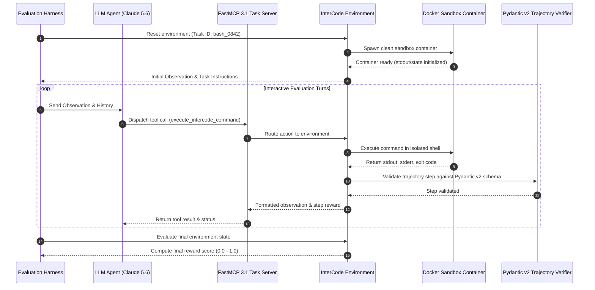

# InterCode

## What it is
InterCode is an interactive benchmarking framework designed for evaluating Large Language Models (LLMs) and autonomous agents in real-world programming, shell, and SQL environments. Unlike static code evaluation suites that evaluate single-turn completions, InterCode models software engineering tasks as interactive Markov Decision Processes (MDPs). Agents execute actions (commands or scripts), observe execution output (stdout, stderr, exit codes), and iteratively alter system state to achieve specified goals. In early 2027, InterCode serves as a foundational benchmark for validating **FastMCP 3.1 Task Protocol** compliance, background execution streams, and multi-turn trajectory planning across frontier model families including **GPT-5.6**, **Claude 5.6**, **Gemini 4.0 Ultra**, **DeepSeek-V4**, **Gemma 4**, and **Qwen 3.6 VL**.

## What problem it solves
Standard static benchmarks (e.g., HumanEval or MBPP) measure syntax generation in isolation but fail to test essential real-world software engineering capabilities: handling syntax or runtime errors, inspecting log outputs, inspecting file systems, querying databases, and recovering from unexpected container states. InterCode solves this gap by providing safe, reproducible, containerized environments where agents operate in a closed feedback loop:

```
[Agent Intent] --> [Tool/Command Dispatch] --> [Sandbox Execution] --> [Observation & Feedback] --> [State Adjustment]
```

This interactive loop tests the "plan-execute-verify-heal" workflow required for production-grade autonomous coding agents and terminal assistants operating over standardized Model Context Protocols.

## System Architecture

The following diagram details how InterCode orchestrates interactive evaluation sessions between the agent harness, Docker sandboxes, and FastMCP 3.1 task protocol gateways:

```
+-----------------------------------------------------------------------------------+
|                            INTERCODE EVALUATION ENGINE                            |
+-----------------------------------------------------------------------------------+
                                          |
                                          v
+------------------+             +------------------+             +-----------------+
|  Agent Harness   | <---------> | FastMCP 3.1 Task | <---------> | InterCode Gym   |
| (Claude 5.6 /    |  JSON-RPC   | Gateway Server   |  Gym API    | Environment     |
|  GPT-5.6)        |             | (FastMCP 3.1)    |             | Wrapper         |
+------------------+             +------------------+             +-----------------+
                                                                          |
                                                                          v
                                                                  +-----------------+
                                                                  | Isolated Docker |
                                                                  | Container       |
                                                                  | (Bash/SQL/Py)   |
                                                                  +-----------------+
```



## Where it fits in the stack
**Benchmarking / Agentic Evaluation**. InterCode operates at the evaluation and testing layer of autonomous AI infrastructure. It provides the Gym-style execution harness used to validate coding agents before granting them repository access or terminal privileges in production home-lab and enterprise environments.

```
+-------------------------------------------------------------------------------+
|                       INTERCODE STACK INTEGRATION                             |
+-------------------------------------------------------------------------------+
| Layer                       | Tools & Frameworks                              |
+-----------------------------+-------------------------------------------------+
| Autonomous Agents           | Claude Code, OpenHands, Devin, Aider            |
| Communication & Tooling     | FastMCP 3.1, Model Context Protocol (MCP)       |
| Interactive Benchmark Layer | InterCode (Bash, SQL, Python, Web)              |
| Execution Isolation         | Docker, Podman, Containerd, gVisor              |
| Foundation Models           | GPT-5.6, Claude 5.6, Gemini 4.0, Gemma 4        |
+-------------------------------------------------------------------------------+
```

## Benchmark Comparison Matrix

| Feature / Metric | InterCode | SWE-bench | Terminal-Bench | HumanEval |
| :--- | :--- | :--- | :--- | :--- |
| **Primary Domain** | Interactive Shell/SQL/Python | Repository GitHub Issues | Linux SysAdmin & DevOps | Single Python Functions |
| **Evaluation Mode** | Multi-Turn Interactive Loop | Patch / Diff Generation | Stateful Tmux/Shell Loop | Single-Turn Generation |
| **Execution Sandbox** | Docker Containers | Docker Containers | Containerized Harbor | Unit Test Execution |
| **Feedback Mechanism** | Immediate Stdout/Stderr | Post-Patch Test Suite | Immediate Shell Output | Static Assertion Pass/Fail |
| **MCP 3.1 Native** | Full FastMCP 3.1 Support | via Harness Adapter | Full Support (Terminus 2) | N/A |
| **Task Complexity** | Medium to High | High / Real-world Repo | High / Production DevOps | Low / Algorithmic |
| **Resource Footprint** | Moderate (Single Container) | High (Full Repo Builds) | Moderate to High | Minimal |

## Typical use cases
- **Evaluating Terminal Agents**: Measuring how effectively agents navigate file systems, edit files, handle missing dependencies, and execute multi-step shell commands.
- **SQL Generation & Database Debugging**: Testing SQL query synthesis, schema inspection, and data manipulation against live relational databases (PostgreSQL, MySQL, SQLite).
- **FastMCP 3.1 Protocol Validation**: Verifying that agent frameworks adhere to standardized FastMCP 3.1 task protocol rules, handling asynchronous background tasks, and streaming progress updates.
- **Self-Correction & Error Recovery**: Quantifying an agent's ability to interpret error traces (e.g., Python tracebacks or SQL syntax errors) and apply corrective steps without human intervention.
- **Reinforcement Learning Environment**: Serving as an RL environment for training code-specialized reward models and policy fine-tuning.

## Strengths
- **Interactive Closed-Loop**: Allows agents to learn from real execution feedback, reflecting real-world developer workflows.
- **Strict Environment Isolation**: Uses containerized Docker instances to prevent accidental system modifications and guarantee reproducible evaluation runs.
- **Multi-Domain Support**: Native environments for Bash terminal operations, SQL database administration, and Python interactive execution.
- **Standardized Gym Interface**: Integrates seamlessly with standard RL and evaluation libraries (`gymnasium`, `farama`).
- **MCP 3.1 Native Protocol**: First-class support for Model Context Protocol task server wrappers.

## Limitations
- **Container Management Overhead**: Requires a running Docker daemon and sufficient system resources to manage concurrent container lifecycles.
- **State Leakage Risks**: Complex multi-turn tasks must rigorously reset environment states between test runs to avoid cross-trial contamination.
- **Execution Delays**: Interactive evaluation is constrained by container command execution speeds and network socket latency.

## When to use it
- When evaluating interactive terminal assistants, SQL copilots, or autonomous dev bots.
- When validating [Model Context Protocol (MCP)](../automation_orchestration/mcp.md) tool-calling logic in a closed feedback loop.
- When testing agentic error recovery and multi-turn problem-solving capabilities.

## When not to use it
- For rapid, low-cost model screening where static text generation is sufficient (use [MBPP](mbpp.md) or [HumanEval](humaneval.md)).
- For repo-scale GitHub issue resolution requiring full code graph comprehension (use [SWE-bench](swe-bench.md)).

## Getting started

### Installation
InterCode requires Python 3.11+ and Docker installed and running on the host system.

```bash
# Clone the InterCode repository
git clone https://github.com/princeton-nlp/intercode
cd intercode

# Install core dependencies and FastMCP 3.1 extensions
pip install -r requirements.txt fastmcp pydantic
```

### Environment Verification
Verify that Docker daemon connectivity and container isolation work properly:

```bash
docker run --rm alpine echo "InterCode sandbox runtime verified"
```

## CLI examples

### Running a Bash Environment Evaluation
Execute a sample evaluation run using the interactive Bash benchmark dataset:

```bash
python -m intercode.run \
  --env bash \
  --data data/bash/sample.json \
  --model anthropic/claude-5-6-sonnet \
  --max-turns 10 \
  --output-dir results/bash_eval
```

### Running a SQL Environment Evaluation
Evaluate SQL query synthesis and execution against a PostgreSQL sandbox:

```bash
python -m intercode.run \
  --env sql \
  --db-type postgres \
  --data data/sql/spider_sample.json \
  --max-turns 5 \
  --verbose
```

### Inspecting Evaluation Trajectories
Analyze execution logs and trajectory traces from completed runs:

```bash
python -m intercode.tools.inspect_trajectory \
  --file results/bash_eval/trajectory_0842.json \
  --show-rewards
```

## FastMCP 3.1 Task Server Implementation

The following example demonstrates how to expose an InterCode interactive environment as an FastMCP 3.1 server. This allows any MCP-compliant client (such as Claude Code or OpenHands) to drive the interactive benchmark loop over standard transport protocols:

```python
import os
import time
import json
from typing import Dict, Any, Optional
from pydantic import BaseModel, Field, ValidationError
from fastmcp import FastMCP

# Initialize FastMCP 3.1 Server for InterCode Benchmark Integration
mcp = FastMCP("InterCode-Task-Server", version="3.1")

class InterCodeExecutionRequest(BaseModel):
    task_id: str = Field(..., description="Unique task identifier in the InterCode benchmark suite.")
    command: str = Field(..., min_length=1, description="Command or code snippet to execute in the container sandbox.")
    environment: str = Field("bash", description="Target sandbox environment type: 'bash', 'sql', or 'python'.")
    timeout_seconds: int = Field(15, ge=1, le=120, description="Maximum allowed execution time in seconds.")

class InterCodeStepResponse(BaseModel):
    task_id: str
    step_number: int
    observation: str = Field(..., description="Stdout and stderr output returned by the sandbox execution.")
    exit_code: int = Field(..., description="Process exit code (0 indicates success).")
    reward: float = Field(..., ge=-2.0, le=2.0, description="Step evaluation reward score.")
    done: bool = Field(..., description="Flag indicating whether the task trajectory has terminated.")

# Mock in-memory state tracking for active benchmark sessions
SESSION_STATE: Dict[str, Dict[str, Any]] = {}

@mcp.tool(
    name="intercode_step",
    description="Executes a command inside the isolated InterCode sandbox environment via FastMCP 3.1."
)
def intercode_step(payload: str) -> str:
    """Executes a single interactive turn within the specified InterCode environment."""
    try:
        data = json.loads(payload)
        req = InterCodeExecutionRequest.model_validate(data)

        # Retrieve or initialize session state
        session = SESSION_STATE.setdefault(req.task_id, {"step": 0, "history": []})
        session["step"] += 1

        # Simulated container execution logic for demonstration
        if "error" in req.command.lower():
            obs = f"bash: command not found or runtime error in: {req.command}"
            exit_code = 127
            reward = -0.1
            done = False
        elif "exit" in req.command.lower() or "submit" in req.command.lower():
            obs = "Task submission received. Environment verified."
            exit_code = 0
            reward = 1.0
            done = True
        else:
            obs = f"[STDOUT]: Executed command '{req.command}' in sandbox environment '{req.environment}'."
            exit_code = 0
            reward = 0.1
            done = False

        res = InterCodeStepResponse(
            task_id=req.task_id,
            step_number=session["step"],
            observation=obs,
            exit_code=exit_code,
            reward=reward,
            done=done
        )
        return res.model_dump_json(indent=2)

    except ValidationError as ve:
        return json.dumps({"error": "Schema validation failure", "details": ve.errors()}, indent=2)
    except Exception as e:
        return json.dumps({"error": "Execution exception", "message": str(e)}, indent=2)

if __name__ == "__main__":
    # Test execution locally
    sample_request = json.dumps({
        "task_id": "bash_task_104",
        "command": "ls -la /var/log",
        "environment": "bash",
        "timeout_seconds": 10
    })
    print("FastMCP 3.1 Tool Output:")
    print(intercode_step(sample_request))
```

## Programmatic Integration and Trajectory Validation

The following Python script demonstrates how to wrap an InterCode Gym loop with strict Pydantic v2 validation models, handling trajectory state transitions and ensuring reward boundary compliance:

```python
import gym
from typing import Dict, Any, List, Optional
from pydantic import BaseModel, Field, ValidationError, field_validator

class TrajectoryStep(BaseModel):
    step_index: int = Field(..., ge=0, description="Sequential step index in the interaction turn.")
    action: str = Field(..., min_length=1, description="Command dispatched by the agent.")
    observation: str = Field(..., description="Standard output/error returned by the container.")
    exit_code: int = Field(default=0, description="Exit code returned by shell command execution.")
    reward: float = Field(..., description="Numerical feedback score for the action taken.")
    done: bool = Field(..., description="Flag indicating if the interactive session has concluded.")
    metadata: Dict[str, Any] = Field(default_factory=dict, description="Metadata dictionary from step execution.")

    @field_validator('reward')
    @classmethod
    def check_valid_reward_range(cls, v: float) -> float:
        if not (-2.0 <= v <= 2.0):
            raise ValueError("Reward value is outside expected evaluation bounds [-2.0, 2.0]")
        return v

class InteractiveSession(BaseModel):
    session_id: str = Field(..., description="Unique trajectory session identifier.")
    environment_type: str = Field("bash", description="Evaluation environment domain.")
    steps: List[TrajectoryStep] = Field(default_factory=list, description="Sequence of interaction turns.")
    final_score: float = Field(..., ge=0.0, le=1.0, description="Aggregated benchmark score.")
    completed_successfully: bool = Field(..., description="Status flag indicating task completion.")

def run_agent_loop_and_validate(session_id: str, max_turns: int = 5) -> Optional[InteractiveSession]:
    """Runs a live agent evaluation turn and structures outputs for strict schema validation."""
    trajectory: List[TrajectoryStep] = []
    agent_commands = [
        "ls -la /workspace",
        "grep -rn 'DATABASE_URL' .",
        "python3 -m pytest tests/",
        "submit"
    ]

    for turn, action in enumerate(agent_commands[:max_turns]):
        # Mock execution environment behavior for demonstration
        is_final = (action == "submit" or turn == max_turns - 1)
        simulated_obs = f"Output for step {turn}: executed '{action}' successfully."
        simulated_reward = 1.0 if is_final else 0.1

        try:
            step_data = TrajectoryStep(
                step_index=turn,
                action=action,
                observation=simulated_obs,
                exit_code=0,
                reward=simulated_reward,
                done=is_final,
                metadata={"turn_timestamp": turn * 1.5}
            )
            trajectory.append(step_data)
            if is_final:
                break
        except ValidationError as ve:
            print(f"Step validation failed at turn {turn}: {ve}")
            return None

    try:
        final_reward = 1.0 if trajectory and trajectory[-1].done and trajectory[-1].reward > 0 else 0.0
        session = InteractiveSession(
            session_id=session_id,
            environment_type="bash",
            steps=trajectory,
            final_score=final_reward,
            completed_successfully=(final_reward == 1.0)
        )
        return session
    except ValidationError as ve:
        print(f"Session trajectory validation failed: {ve}")
        return None

if __name__ == "__main__":
    validated_run = run_agent_loop_and_validate("session_jan2027_01")
    if validated_run:
        print(f"Validated session '{validated_run.session_id}' successfully.")
        print(f"Total steps: {len(validated_run.steps)}, Final score: {validated_run.final_score}")
        print(f"Schema status: Validated with {len(validated_run.steps)} Pydantic v2 verified trajectory steps.")
```

## Operational Guidelines & Security Hardening

To maintain safety and reliability when running InterCode benchmarks in home-lab or enterprise server environments:

1. **Non-Root Container Execution**: Run Docker containers using non-privileged user accounts (`--user 1000:1000`) and drop unnecessary kernel capabilities (`--cap-drop=ALL`).
2. **Network Isolation**: Restrict network access within sandbox containers (`--network none`) unless the specific evaluation task explicitly tests network operations.
3. **Storage & Memory Quotas**: Limit container resource consumption to prevent host system exhaustion:
   ```bash
   docker run --memory="2g" --cpus="2.0" --pids-limit=100 intercode/bash-sandbox:v3.1
   ```
4. **Automated Container Cleanup**: Always ensure containers are removed post-evaluation (`--rm` flag or explicit lifecycle teardown in Gym cleanup functions).

## Troubleshooting & Common Pitfalls

| Issue / Symptom | Root Cause | Resolution Strategy |
| :--- | :--- | :--- |
| **`DockerDaemonError: Cannot connect to socket`** | Docker service is stopped or current user lacks group permissions. | Start Docker daemon (`sudo systemctl start docker`) and add user to group (`sudo usermod -aG docker $USER`). |
| **`TimeoutException` during container exec** | Agent entered an infinite loop or interactive command prompt (e.g., `nano` or `less`). | Configure `timeout_seconds` in task execution requests and enforce non-interactive flag overrides (`DEBIAN_FRONTEND=noninteractive`). |
| **Cross-trial state contamination** | Sandbox container was reused without executing a complete environment reset. | Ensure `env.reset()` terminates and recreates container instances between evaluation trials. |
| **FastMCP 3.1 validation error** | JSON-RPC payload fields missing required properties or types. | Validate payloads against the `InterCodeExecutionRequest` Pydantic v2 schema prior to tool dispatch. |

## Related tools / concepts
- [SWE-bench](swe-bench.md) — Benchmark for evaluating models on real-world GitHub repositories and multi-file codebases.
- [Terminal-Bench](terminal-bench.md) — Benchmark for testing stateful tmux and terminal interaction routines.
- [BigCodeBench](bigcodebench.md) — Suite for complex instruction-following coding tasks.
- [JudgeGPT](judgegpt.md) — Automated qualitative evaluation of agent trajectories and logs.
- [Promptfoo](promptfoo.md) — Matrix testing framework for prompt regression and LLM evaluations.
- [Model Context Protocol (MCP)](../automation_orchestration/mcp.md) — Open standard for AI tool and resource orchestration.
- [Devin](../development_ops/devin.md) — Autonomous software engineering agent.
- [OpenHands](../development_ops/openhands.md) — Open-source platform for autonomous coding agents.
- [Docker](../infrastructure/docker.md) — Container runtime standard used for isolated sandbox environments.

## Sources / references
- [InterCode GitHub Repository](https://github.com/princeton-nlp/intercode)
- [Research Paper: InterCode - Standardizing Interactive Execution Environments for LLMs (arXiv:2306.14898)](https://arxiv.org/abs/2306.14898)
- [Model Context Protocol (MCP) FastMCP 3.1 Specification](https://modelcontextprotocol.io/docs/concepts/tasks)
- [Gymnasium Documentation (Farama Foundation)](https://gymnasium.farama.org/)

## Contribution Metadata
- Last reviewed: 2027-01-07
- Confidence: high
