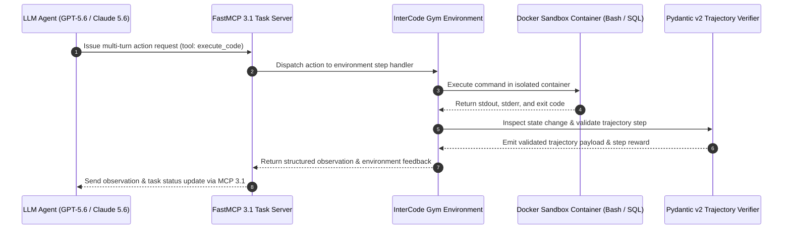
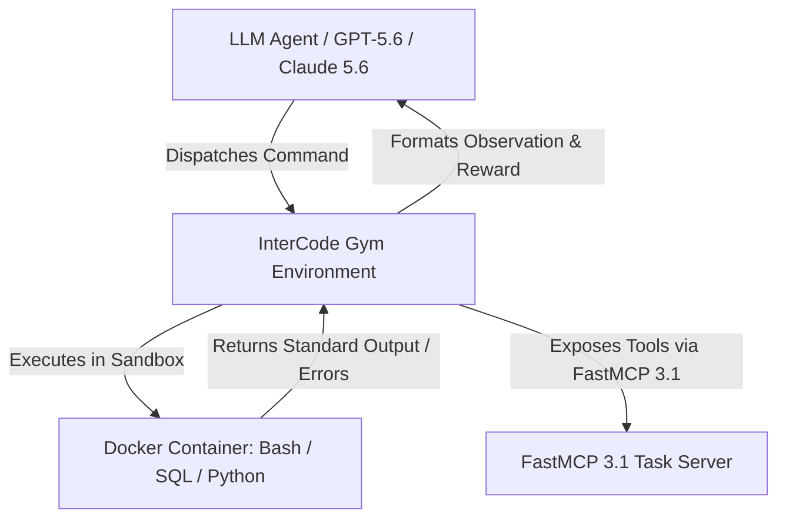

# InterCode

## What it is
InterCode is an interactive benchmarking framework designed for evaluating Large Language Models (LLMs) in real-world programming, shell, and SQL environments. It focuses on multi-turn interactions where the model can execute code or commands and receive feedback from the environment. In early January 2027, it serves as a foundational environment for testing **FastMCP 3.1 Task Protocol** compliance in autonomous coding agents.

## System Architecture

The following diagram details the multi-turn interaction loop between the agent, the FastMCP 3.1 Task Gateway, the Docker container sandboxes, and the Pydantic v2 execution trajectory verifier:



## What problem it solves
Standard static benchmarks often fail to capture the interactive nature of software development. InterCode addresses this by providing an environment where models must reason over multiple steps, handle errors, and adapt based on actual execution results. It tests the "plan-execute-verify" loop essential for self-healing agents and advanced coding assistants like **GPT-5.6**, **Claude 5.6**, **Gemini 4.0 Ultra**, **DeepSeek-V4**, **Gemma 4**, and **Qwen 3.6 VL**.

## Where it fits in the stack
**Benchmarking / Agentic Evaluation**. It sits in the "agentic" evaluation space, testing the model's ability to act as a coding assistant or terminal agent. It is a critical validation layer for the [Model Context Protocol (MCP)](../automation_orchestration/mcp.md) ecosystem and autonomous platforms like [Devin](../development_ops/devin.md) and [OpenHands](../development_ops/openhands.md).



## Comparative Feature Matrix

| Feature / Metric | InterCode (v3.1) | SWE-bench | Terminal-Bench (Terminus 2) | BigCodeBench |
| :--- | :--- | :--- | :--- | :--- |
| **Primary Domain** | Multi-turn Bash / SQL / Python | GitHub Issue Resolution | Terminal / SysAdmin / SRE | Single-turn Code Generation |
| **Execution Environment** | Docker Sandboxes | Docker Repositories | Harbor / Docker Containers | Isolated Python Runtimes |
| **Interactive Multi-Turn** | Native (Gym-like interface) | Multi-step agent patch loops | Native (tmux control channels) | Single-turn / Few-turn |
| **Protocol Integration** | FastMCP 3.1 Task Protocol | Custom Benchmark Harnesses | FastMCP 3.1 Task Protocol | Standard Execution Harness |
| **Feedback Mechanism** | Live REPL / Environment Observation | Test Suite Execution | Terminal Output & Exit Codes | Unit Test Assertions |
| **Reward Granularity** | Step-level & Episode-level | Binary Pass/Fail | Trajectory & Task Completion | Binary / Function Pass |

## Typical use cases
- **Evaluating Terminal Agents**: Measuring how well models handle multi-step Bash/Shell tasks in a sandboxed environment.
- **SQL Generation Benchmarking**: Testing SQL generation and execution capabilities against live databases.
- **FastMCP 3.1 Protocol Validation**: Ensuring agents correctly use standardized tool-calling, background task progress notifications, and resource-sharing patterns to complete interactive tasks.
- **Iterative Debugging**: Benchmarking models on tasks that require multiple rounds of execution and log analysis to solve.

## Strengths
- **Interactivity**: Models can "try and fail," mirroring human developer workflows and allowing for self-correction.
- **Environment Fidelity**: Uses actual [Docker](../infrastructure/docker.md) containers for safe, reproducible, and realistic execution environments.
- **Multi-domain Support**: Benchmarks across Bash, SQL, Python, and web-based interaction layers.
- **Standardized API**: Provides a Gym-like interface for easy integration with reinforcement learning and automated evaluation pipelines like [JudgeGPT](judgegpt.md).

## Limitations
- **Complexity**: Harder to set up and maintain than static, text-only benchmarks.
- **Resource Intensive**: Requires significant compute to run multiple containers for evaluation.
- **State Leakage**: Ensuring a completely clean environment between turns can be challenging in complex multi-step tasks.

## When to use it
- When developing coding agents or terminal-based AI assistants that need to interact with a system.
- When you need to measure how well a model handles and recovers from real-world execution errors.
- For evaluating [MCP](../automation_orchestration/mcp.md) tool-calling performance in a realistic feedback loop.

## When not to use it
- For quick, "shallow" evaluations of general model intelligence (use [MMLU](mmlu.md) or [ARC](arc.md) instead).
- When you don't have the infrastructure or permissions to run Docker-based evaluations safely.

## Getting started

### Installation
InterCode requires [Docker](../infrastructure/docker.md) and Python 3.11+.

```bash
git clone https://github.com/princeton-nlp/intercode
cd intercode
pip install -r requirements.txt fastmcp pydantic
```

### Running an Evaluation with FastMCP 3.1
1. Ensure the Docker daemon is running.
2. Initialize an InterCode environment with an FastMCP-compliant agent.
3. Execute a task using the standardized FastMCP 3.1 Task Protocol.

## CLI examples

### Bash Environment Evaluation
```bash
python -m intercode.run --env bash --data data/bash/sample.json
```

### SQL Environment Evaluation
```bash
python -m intercode.run --env sql --data data/sql/sample.json
```

## API examples

### Environment Interaction Loop (Python)
A typical interaction involves the agent receiving an observation and issuing a command.

```python
import gym
import intercode

# Initialize the Bash environment
env = gym.make('intercode-bash-v0')
observation = env.reset()

# Agent issues a command (e.g., from GPT-5.6)
action = "ls -la"
observation, reward, done, info = env.step(action)

print(f"Shell Output: {observation}")
```

### FastMCP 3.1 Task Integration
```python
import json
from fastmcp import FastMCP
from pydantic import BaseModel, Field, ValidationError

# Expose InterCode environment as an MCP 3.1 tool server using FastMCP
mcp = FastMCP("InterCode Execution Server", version="3.1.0")

class ExecutionRequest(BaseModel):
    command: str = Field(..., min_length=1, description="Bash command to execute in sandbox")
    environment: str = Field("bash", description="Target environment type (bash/sql/python)")
    timeout_seconds: int = Field(30, ge=1, le=300, description="Execution timeout limit")

class ExecutionResult(BaseModel):
    status: str = Field(..., description="Execution status code")
    environment: str = Field(..., description="Target execution environment")
    stdout: str = Field(..., description="Output capture from container")
    exit_code: int = Field(0, description="Process exit status code")

@mcp.tool()
def execute_intercode_command(req: ExecutionRequest) -> str:
    """Executes a command within the isolated InterCode sandbox environment via FastMCP 3.1."""
    # Internal execution logic mapping to the Docker container
    result = ExecutionResult(
        status="SUCCESS",
        environment=req.environment,
        stdout=f"[{req.environment.upper()} Output]: Executed successfully: {req.command}",
        exit_code=0
    )
    return result.model_dump_json()

if __name__ == "__main__":
    mcp.run()
```

## Programmatic Integration and Validation Example
The following script wraps the InterCode interactive Gym loop, invoking an LLM-guided agent and utilizing Pydantic v2 to strictly validate execution trajectories and reward boundaries before logging the results.

```python
import gym
from typing import Dict, Any, List, Optional
from pydantic import BaseModel, Field, ValidationError, field_validator

class TrajectoryStep(BaseModel):
    action: str = Field(..., min_length=1, description="The CLI/SQL action string dispatched by the agent.")
    observation: str = Field(..., description="The standard output/error response returned by the sandbox.")
    reward: float = Field(..., description="Numerical feedback score for the action taken.")
    done: bool = Field(..., description="Flag indicating if the interactive session has concluded.")
    info: Dict[str, Any] = Field(default_factory=dict, description="Metadata dictionary from the step execution.")

    @field_validator('reward')
    @classmethod
    def check_valid_reward_range(cls, v: float) -> float:
        if not (-2.0 <= v <= 2.0):
            raise ValueError("Reward value is outside expected evaluation bounds [-2.0, 2.0]")
        return v

class InteractiveSession(BaseModel):
    session_id: str
    steps: List[TrajectoryStep]
    final_score: float = Field(..., ge=0.0, le=1.0)

def run_agent_loop_and_validate(session_id: str, max_turns: int = 5) -> Optional[InteractiveSession]:
    """Runs a live agent evaluation turn and structures outputs for strict schema validation."""
    try:
        # Initialize gym container backend (mocked representation for standard run)
        env = gym.make('intercode-bash-v0')
        obs = env.reset()
    except Exception as e:
        print(f"Failed to boot InterCode environment: {e}")
        return None

    trajectory = []
    # Simulated agent commands for demonstrating interactive evaluation loop
    agent_commands = ["ls -la", "cat requirements.txt", "exit"]

    for turn in range(min(max_turns, len(agent_commands))):
        action = agent_commands[turn]
        try:
            obs, reward, done, info = env.step(action)
            # Structure into Pydantic model
            step_data = TrajectoryStep(
                action=action,
                observation=str(obs),
                reward=float(reward),
                done=bool(done),
                info=info or {}
            )
            trajectory.append(step_data)
            if done:
                break
        except ValidationError as ve:
            print(f"Step validation failed at turn {turn}: {ve}")
            return None
        except Exception as e:
            print(f"Execution error on step {turn}: {e}")
            return None

    try:
        session = InteractiveSession(
            session_id=session_id,
            steps=trajectory,
            final_score=1.0 if trajectory and trajectory[-1].done else 0.0
        )
        return session
    except ValidationError as ve:
        print(f"Session trajectory validation failed: {ve}")
        return None

if __name__ == "__main__":
    validated_run = run_agent_loop_and_validate("session_jan2027_01")
    if validated_run:
        print(f"Validated session {validated_run.session_id} successfully.")
        print(f"Total steps: {len(validated_run.steps)}, Final score: {validated_run.final_score}")
```

## Operational Best Practices & Troubleshooting

### Sandbox Isolation & Security Rules
1. **Container Ephemerality**: Always configure Docker containers with `--rm` and strict memory/CPU limits (`--memory=2g --cpus=1.0`) to prevent agent runaway processes.
2. **Network Scramble**: Disable network access (`--network none`) for code execution sandboxes unless the specific evaluation task mandates internet connectivity.
3. **Volume Mount Safety**: Read-only mount (`ro`) all host filesystem dependencies into the sandbox container.

### Troubleshooting Common Evaluation Errors

| Issue / Symptom | Root Cause | Resolution Strategy |
| :--- | :--- | :--- |
| `Docker Daemon Connection Refused` | Docker daemon is not running or socket permissions are missing | Run `sudo systemctl start docker` and grant non-root socket access (`usermod -aG docker $USER`). |
| `Gym Environment Reset Timeout` | Container initialization stalled waiting for lock files | Prune dangling containers (`docker container prune -f`) and increase setup timeout in `intercode.run`. |
| `FastMCP 3.1 Task Protocol Error` | Mismatched JSON schema in tool response | Ensure `ExecutionResult` is validated using Pydantic v2 before returning string payloads to FastMCP. |
| `Trajectory Step Reward NaN` | Division by zero in environment evaluation logic | Enforce custom Pydantic validators on `TrajectoryStep.reward` to catch non-finite floats. |

## Related tools / concepts
- [SWE-bench](swe-bench.md) — for evaluating models on real-world GitHub issues.
- [BigCodeBench](bigcodebench.md) — benchmark for instruction-following coding tasks.
- [JudgeGPT](judgegpt.md) — for automated qualitative evaluation of agent traces.
- [Promptfoo](promptfoo.md) — for test-driven prompt engineering.
- [Model Context Protocol (MCP)](../automation_orchestration/mcp.md) — standard for agent-tool communication.
- [Devin](../development_ops/devin.md) — autonomous software engineering agent.
- [OpenHands](../development_ops/openhands.md) — open-source autonomous agent platform.
- [Docker](../infrastructure/docker.md) — the standard for isolated execution environments.

## Sources / references
- [GitHub Repository](https://github.com/princeton-nlp/intercode)
- [Research Paper: InterCode (arXiv:2306.14898)](https://arxiv.org/abs/2306.14898)
- [MCP 3.1 Task Protocol Specification](https://modelcontextprotocol.io/docs/concepts/tasks)

## Contribution Metadata
- Last reviewed: 2027-01-07
- Confidence: high
