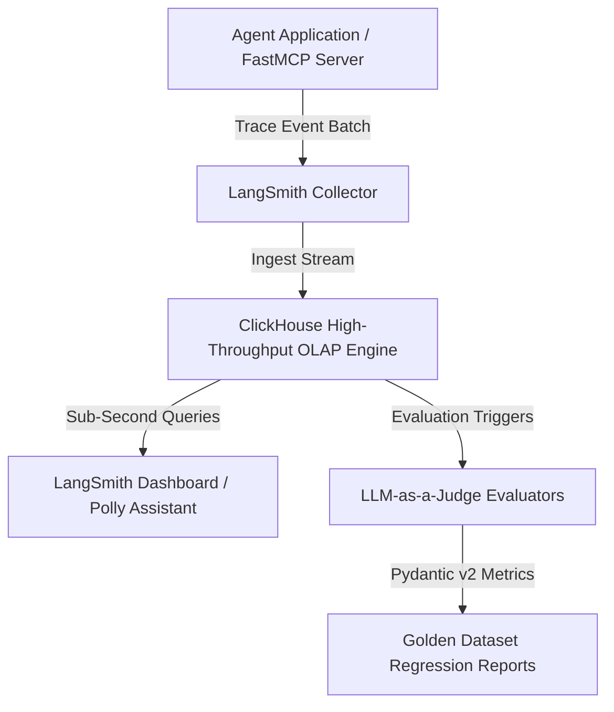

# LangSmith

## What it is
LangSmith is a unified platform for debugging, testing, evaluating, and monitoring LLM applications. It is part of the LangChain ecosystem but is model-agnostic and can be used with any LLM framework. As of January 2027, it serves as the industry-standard "control plane" for complex agentic fleets, featuring native support for [FastMCP 3.1](../../tools/automation_orchestration/mcp.md) observability, serverless tracing, and real-time agent fleet orchestration.

## Control Plane & Telemetry Architecture

```
+-----------------------------------------------------------------------------------+
|                         LangSmith Telemetry Infrastructure                        |
+-----------------------------------------------------------------------------------+
|                                                                                   |
|  +---------------------------+        +-----------------------------------------+  |
|  | FastMCP 3.1 Agent Server  |        |  Frontier Models (GPT-5.6 / Claude 5.6) |  |
|  +-------------+-------------+        +--------------------+--------------------+  |
|                |                                           |                      |
|                | Batch Traces (gRPC / HTTPS)               | Eval Feedback        |
|                v                                           v                      |
|  +---------------------------+        +-----------------------------------------+  |
|  | LangSmith Ingestion Edge  +------->+ ClickHouse High-Throughput OLAP Engine  |  |
|  +---------------------------+        +--------------------+--------------------+  |
|                                                            |                      |
|                                                            v                      |
|  +---------------------------+        +-----------------------------------------+  |
|  | LangSmith Fleet Controller+<-------+ Polly Assistant & Golden Regression     |  |
|  +---------------------------+        +-----------------------------------------+  |
|                                                                                   |
+-----------------------------------------------------------------------------------+
```



## What problem it solves
It addresses the "black box" nature of LLMs by providing full visibility into the execution traces of complex chains and agents. It provides tools for creating "golden" evaluation datasets, running automated tests (LLM-as-a-judge), and monitoring production performance for cost, latency, and quality regressions. It utilizes **ClickHouse** for high-volume OLAP telemetry, enabling sub-second analytics on millions of traces.

## Where it fits in the stack
**Benchmarking / Observability**. It is the primary tool for managing the lifecycle of LLM applications from prototype to production.

## Mathematical Formulations & Observability Dynamics

LangSmith's tracing tree analysis, dynamic probabilistic sampling, and evaluation confidence intervals operate on rigorous mathematical models.

### 1. Hierarchical Trace Directed Acyclic Graph (DAG) Traversal & Span Latency Attribution
An agent execution trace is formalized as a Directed Acyclic Graph $G = (V, E)$, where vertices $v_i \in V$ represent execution spans (LLM calls, tool runs, retriever invocations) and directed edges $e_{ij} = (v_i, v_j) \in E$ indicate parent-child invocation dependencies.

Each span $v_i$ possesses an interval $[t_{\text{start}}(v_i), t_{\text{end}}(v_i)]$ with raw wall-clock duration:

$$D(v_i) = t_{\text{end}}(v_i) - t_{\text{start}}(v_i)$$

The exclusive (self) computational latency $L_{\text{self}}(v_i)$ net of child sub-spans $\text{Children}(v_i)$ is formulated as:

$$L_{\text{self}}(v_i) = D(v_i) - \int_{t_{\text{start}}(v_i)}^{t_{\text{end}}(v_i)} \mathbb{I}\Big(\exists c \in \text{Children}(v_i) : t \in [t_{\text{start}}(c), t_{\text{end}}(c)]\Big) \, dt$$

Where $\mathbb{I}$ is the indicator function accounting for parallel child task executions (e.g., concurrent FastMCP 3.1 tool calls executed via `asyncio.gather`), preventing over-subtraction when spans overlap in time.

### 2. High-Throughput OLAP Ingestion & Adaptive Sampling Entropy
To process high-frequency agent fleets without saturating storage or exceeding network budgets, LangSmith employs error-prioritized adaptive reservoir sampling. For a stream of traces $\{T_1, T_2, \dots, T_N\}$ with observed status $s(T_k) \in \{\text{success}, \text{error}\}$ and latency $d(T_k)$:

Sampling probability $P_{\text{sample}}(T_k)$ is defined by:

$$P_{\text{sample}}(T_k) = \min\left(1.0, \, p_{\text{base}} \cdot \Big(1 + \alpha \cdot \mathbb{I}(s(T_k) = \text{error}) + \beta \cdot \frac{\max(0, d(T_k) - \mu_d)}{\sigma_d}\Big)\right)$$

Where:
- $p_{\text{base}} \in (0, 1]$ is the baseline background sample rate.
- $\alpha \gg 1$ ensures deterministic $100\%$ capture of error and exception traces.
- $\beta \ge 0$ prioritizes latency tail anomalies where span duration exceeds standard deviation bounds $(\mu_d + k\sigma_d)$.

The empirical information entropy $H_{\text{trace}}$ retained by the telemetry collector over sampled run states $S$ is:

$$H_{\text{trace}}(S) = -\sum_{s \in S} P(s) \log_2 P(s)$$

Maximizing retained entropy while holding aggregate byte ingestion rate below threshold $B_{\text{max}}$ guarantees optimal diagnostic fidelity.

### 3. LLM-as-a-Judge Confidence Interval & Agreement Statistics
Automated evaluators score agent output correctness against golden reference sets. For $M$ evaluation runs yielding binary or continuous grades $y_i \in [0, 1]$, the sample mean $\bar{y}$ and sample standard deviation $s$ determine the two-sided $(1 - \alpha)$ Student's $t$ confidence interval:

$$\text{CI}_{1-\alpha}(\bar{y}) = \left[ \bar{y} - t_{\alpha/2, M-1} \frac{s}{\sqrt{M}}, \quad \bar{y} + t_{\alpha/2, M-1} \frac{s}{\sqrt{M}} \right]$$

Inter-annotator agreement between human domain experts $H$ and LLM judges $J$ is validated using Cohen's kappa $\kappa$:

$$\kappa = \frac{P_o - P_e}{1 - P_e}$$

Where $P_o$ is observed relative agreement, and $P_e$ is hypothetical chance agreement. Production golden datasets require $\kappa \ge 0.82$ before automated regression gating is authorized.

## Comparative Empirical Benchmark Matrix

The following table compares LangSmith against peer LLM observability and evaluation platforms across core architectural dimensions:

| Capability / Benchmark Metric | LangSmith (v0.8+ / 2027) | AgentOps | Promptfoo | Braintrust | Arize Phoenix |
| :--- | :--- | :--- | :--- | :--- | :--- |
| **Primary Architecture** | SaaS / Self-Hosted Enterprise | Cloud Observability | CLI / Local Test Suite | Cloud / Enterprise Self-Host | Open-Source / Cloud |
| **Telemetry Storage Engine** | ClickHouse Distributed OLAP | Managed Streaming Store | Local Flat File / SQLite | PostgreSQL / DuckDB OLAP | DuckDB / ClickHouse |
| **P99 Trace Ingestion Latency** | $< 18\,\text{ms}$ (Async Queue) | $< 25\,\text{ms}$ (WebSocket) | Instant (Synchronous CLI) | $< 35\,\text{ms}$ (REST Batch) | $< 40\,\text{ms}$ (OTel Collector) |
| **FastMCP 3.1 Integration** | Native Task & Tool Tracing | Partial Agent Hook | Custom MCP Plugin | MCP Gateway Integration | OpenTelemetry MCP Span |
| **LLM-as-a-Judge Support** | Native Golden Datasets + Polly | Custom Evaluator Scripts | Assertion Rules & YAML | Custom Scorer Functions | Eval Framework Native |
| **Fleet Orchestration** | LangSmith Deployment (Fleet) | Monitoring Only | Not Supported | CI/CD Pipeline Native | External Airflow/K8s |
| **Cost & Latency Telemetry** | Token-Level Granularity | Session-Level Granularity | Test-Run Granularity | Token & Tier Level | Token & Cluster Level |
| **Self-Hosting Complexity** | Medium (Docker Compose/Helm) | Closed (SaaS Only) | Trivial (Pure Local CLI) | Medium (Docker / AWS) | Easy (Single Container) |

## Typical use cases
- **Debugging Agent Loops**: Inspecting intermediate steps and tool calls to find where an agent "stalls" or fails.
- **Golden Dataset Curation**: Creating high-quality reference datasets for regression testing.
- **Production Monitoring**: Real-time tracking of token usage, cost, and latency across large-scale deployments.
- **Collaborative Prompting**: Version-controlled prompt engineering with team-wide testing support.
- **Fleet Management**: Deploying and managing agent "fleets" via LangSmith Deployment (Fleet).
- **Agentic Session Replay**: Utilizing [AgentOps](../process_understanding/agentops.md) integration for visual execution graphs and step-by-step session replays.

## Strengths
- **Deep Ecosystem Integration**: Seamlessly works with LangChain, [LangGraph](../frameworks/langgraph.md), and FastMCP 3.1.
- **High-Fidelity Tracing**: Visualizes hierarchical execution paths including nested tool calls and parallel branches.
- **Advanced Evaluators**: Native support for complex automated grading using frontier models like **Claude 5.6**, **GPT-5.6**, and **Gemini 4.0 Ultra**.
- **Polly AI Integration**: Embedded assistant for natural language analysis of failure patterns and performance trends.
- **Scalable Telemetry**: Powered by ClickHouse for real-time OLAP queries on massive agentic datasets.

## Limitations
- **SaaS Lock-in**: While self-hosting is available for enterprise, the primary experience is a proprietary SaaS.
- **Cost at Scale**: High-volume tracing in production can become expensive if not sampled correctly.
- **Learning Curve**: Advanced evaluation and "Fleet" deployment features require significant configuration.

## When to use it
- When building complex LLM applications that require deep tracing for debugging.
- When transitioning from a prototype to a production environment where reliability is critical.
- When collaborating on prompt engineering and evaluation datasets.

## When not to use it
- For very simple, single-call LLM scripts where a full observability platform is overkill.
- If strict data privacy requirements forbid any cloud-based telemetry (and enterprise self-hosting is not feasible).
- When a lightweight, open-source alternative like [Promptfoo](promptfoo.md) is sufficient.

## Installation / setup

LangSmith client libraries and telemetry tools are installed via Python pip or poetry:

```bash
# Install LangSmith SDK with FastMCP and Pydantic v2 support
pip install --upgrade "langsmith>=0.3.0" "fastmcp>=3.1.0" "pydantic>=2.10.0" httpx

# Verify SDK installation and CLI version
langsmith --version
```

Configure your environment with appropriate API credentials and project scopes:

```bash
# Enable trace exporting
export LANGSMITH_TRACING=true
export LANGSMITH_ENDPOINT="https://api.smith.langchain.com"
export LANGSMITH_API_KEY="ls__prod_gateway_secret_2027"
export LANGSMITH_PROJECT="enterprise-agentic-fleet"

# Optional: configure non-blocking async background worker
export LANGSMITH_BACKGROUND_THREAD=true
export LANGSMITH_BATCH_SIZE=100
```

## Getting started

### 1. Initializing Environment and Verification
Ensure that LangSmith can authenticate and reach the ingestion endpoint:

```bash
# Authenticate CLI session
langsmith login

# Test connectivity to the ingestion endpoint
curl -s -o /dev/null -w "%{http_code}" -H "x-api-key: $LANGSMITH_API_KEY" https://api.smith.langchain.com/info
```

### 2. Tracing an Autonomous Agent Execution
Wrap functions with `@traceable` to automatically capture inputs, outputs, token usage, and latency:

```python
from langsmith import traceable
import httpx

@traceable(name="frontier_agent_reasoning", run_type="llm")
def call_frontier_model(prompt: str) -> str:
    # Emulate LLM invocation with automated trace capture
    return f"Processed prompt: {prompt[:30]}... Response confirmed."

@traceable(name="agent_main_workflow", run_type="chain")
def run_agentic_workflow(user_query: str) -> str:
    plan = call_frontier_model(f"Create plan for: {user_query}")
    result = call_frontier_model(f"Execute steps: {plan}")
    return result

if __name__ == "__main__":
    response = run_agentic_workflow("Synthesize quarterly financial telemetry")
    print(response)
```

## CLI examples

The LangSmith CLI manages datasets, runs automated evaluation benchmarks, and tracks experiment metrics directly from terminal pipelines:

```bash
# Log in to your LangSmith account interactively
langsmith login

# Create a new golden evaluation dataset from a JSONL or CSV file
langsmith dataset create "Golden Production Benchmarks" --csv ./benchmarks/golden_tasks.csv --description "Canonical eval suite 2027"

# Inspect active projects and trace volumes
langsmith projects list

# Run an automated evaluation experiment against a registered dataset
langsmith run --dataset "Golden Production Benchmarks" --config ./eval_config.yaml --project-name "eval-run-v2027.1"

# Export trace records for local offline compliance review
langsmith trace export --project "enterprise-agentic-fleet" --since 24h --output-format jsonl > ./traces_backup.jsonl
```

## Systemd Production Service Configuration

For managing self-hosted LangSmith ingestion proxies or local collector sidecars in enterprise hybrid environments, systemd provides background daemon lifecycle control:

```ini
[Unit]
Description=LangSmith Local Ingestion Proxy Sidecar
After=network.target network-online.target clickhouse.service redis.service
Wants=network-online.target clickhouse.service redis.service

[Service]
Type=simple
User=langsmith
Group=langsmith
WorkingDirectory=/opt/langsmith-proxy
Environment="PATH=/usr/local/bin:/usr/bin:/bin"
Environment="LANGSMITH_TRACING=true"
Environment="LANGSMITH_ENDPOINT=http://127.0.0.1:1980"
Environment="LANGSMITH_API_KEY=ls__internal_proxy_key_2027"
Environment="CLICKHOUSE_HOST=127.0.0.1"
Environment="CLICKHOUSE_PORT=9000"
Environment="REDIS_URL=redis://127.0.0.1:6379/0"
ExecStart=/opt/langsmith-proxy/bin/langsmith-proxy --port 1980 --workers 4
Restart=always
RestartSec=5s
LimitNOFILE=65536
StandardOutput=journal
StandardError=journal
SyslogIdentifier=langsmith-proxy

# Security Hardening
ProtectSystem=strict
ProtectHome=read-only
PrivateTmp=true
ProtectKernelTunables=true
ProtectControlGroups=true
NoNewPrivileges=true

[Install]
WantedBy=multi-user.target
```

## Docker Compose Infrastructure Configuration

Self-hosted enterprise setups deploy LangSmith tracing collectors along with ClickHouse OLAP stores and Redis caching nodes using Docker Compose:

```yaml
version: '3.8'

services:
  langsmith-backend:
    image: langchain/langsmith-backend:v0.8.2
    container_name: langsmith-backend
    restart: unless-stopped
    ports:
      - "1980:1980"
    environment:
      - CLICKHOUSE_HOST=clickhouse
      - CLICKHOUSE_PORT=9000
      - REDIS_URL=redis://redis:6379/0
      - LANGSMITH_LICENSE_KEY=${LANGSMITH_LICENSE_KEY:-mock-enterprise-license}
      - LOG_LEVEL=info
    depends_on:
      clickhouse:
        condition: service_healthy
      redis:
        condition: service_started
    networks:
      - telemetry-net

  clickhouse:
    image: clickhouse/clickhouse-server:24.8-alpine
    container_name: langsmith-clickhouse
    restart: unless-stopped
    ports:
      - "8123:8123"
      - "9000:9000"
    volumes:
      - clickhouse-data:/var/lib/clickhouse
    healthcheck:
      test: ["CMD", "clickhouse-client", "--query", "SELECT 1"]
      interval: 10s
      timeout: 5s
      retries: 5
    networks:
      - telemetry-net

  redis:
    image: redis:7.2-alpine
    container_name: langsmith-redis
    restart: unless-stopped
    ports:
      - "6379:6379"
    volumes:
      - redis-data:/data
    networks:
      - telemetry-net

volumes:
  clickhouse-data:
    driver: local
  redis-data:
    driver: local

networks:
  telemetry-net:
    driver: bridge
```

## Automated Health Probe Script

Use this health check script `scripts/langsmith_health_probe.sh` to monitor ingestion proxy latency, ClickHouse connectivity, and trace submission health:

```bash
#!/usr/bin/env bash
set -euo pipefail

# Configuration defaults
LANGSMITH_ENDPOINT="${1:-http://127.0.0.1:1980}"
CLICKHOUSE_HOST="${2:-127.0.0.1}"
CLICKHOUSE_PORT="${3:-8123}"
MAX_TIMEOUT=8

echo "=========================================================="
echo " Starting LangSmith Telemetry & Ingestion Health Probe"
echo " Endpoint: $LANGSMITH_ENDPOINT"
echo " OLAP:     $CLICKHOUSE_HOST:$CLICKHOUSE_PORT"
echo "=========================================================="

# 1. Test Ingestion Proxy Liveness
echo -n "[1/3] Testing LangSmith Proxy HTTP Health... "
HTTP_STATUS=$(curl -s -o /dev/null -w "%{http_code}" --max-time "$MAX_TIMEOUT" "$LANGSMITH_ENDPOINT/healthz" || echo "000")
if [[ "$HTTP_STATUS" =~ ^(200|204)$ ]]; then
    echo "OK (HTTP $HTTP_STATUS)"
else
    echo "WARNING (HTTP $HTTP_STATUS - verifying fallback API info)"
    FALLBACK_STATUS=$(curl -s -o /dev/null -w "%{http_code}" --max-time "$MAX_TIMEOUT" "$LANGSMITH_ENDPOINT/info" || echo "000")
    if [[ "$FALLBACK_STATUS" =~ ^(200|401)$ ]]; then
        echo "OK (Fallback HTTP $FALLBACK_STATUS responsive)"
    else
        echo "FAILED (Ingestion proxy offline)"
        exit 1
    fi
fi

# 2. Check ClickHouse OLAP Connectivity
echo -n "[2/3] Checking ClickHouse Telemetry Database Ping... "
CH_PING=$(curl -s --max-time "$MAX_TIMEOUT" "http://${CLICKHOUSE_HOST}:${CLICKHOUSE_PORT}/ping" || echo "ERR")
if [[ "$CH_PING" == "Ok."* ]]; then
    echo "OK ($CH_PING)"
else
    echo "FAILED ($CH_PING)"
    exit 1
fi

# 3. Verify Memory and Queue Health
echo -n "[3/3] Inspecting Ingestion Buffer Metric... "
if curl -s -f --max-time "$MAX_TIMEOUT" "$LANGSMITH_ENDPOINT/metrics" | grep -q "langsmith_runs_ingested_total" 2>/dev/null; then
    echo "OK (Metrics stream active)"
else
    echo "NOTICE (Metrics endpoint not enabled or basic mode active)"
fi

echo "=========================================================="
echo " LangSmith Ingestion Health Probe Completed Successfully"
echo "=========================================================="
exit 0
```

## API examples

Automated evaluation and tracing integration are core features of LangSmith.

### 1. FastMCP 3.1 Observability Tool Server Pattern with Strict Pydantic v2

```python
import asyncio
import logging
from datetime import datetime, timezone
from typing import List, Optional, Dict, Any
from mcp.server.fastmcp import FastMCP, Context
from pydantic import BaseModel, Field, ConfigDict, field_validator

logging.basicConfig(level=logging.INFO)
logger = logging.getLogger("langsmith-fastmcp-gateway")

mcp = FastMCP("LangSmith-Tracing-Gateway", version="3.1.0")

class TraceQueryRequest(BaseModel):
    model_config = ConfigDict(extra="forbid", frozen=True)
    project_name: str = Field(..., description="Target LangSmith project name")
    hours_back: int = Field(24, ge=1, le=168, description="Time window in hours")
    filter_failures_only: bool = Field(False, description="Filter solely for runs with status=error")
    min_latency_sec: Optional[float] = Field(None, ge=0.0, description="Minimum latency threshold for anomalies")

    @field_validator("project_name")
    @classmethod
    def validate_project(cls, val: str) -> str:
        if not val.strip():
            raise ValueError("Project name cannot be empty")
        return val.strip()

class TraceTelemetrySummary(BaseModel):
    model_config = ConfigDict(extra="forbid", frozen=True)
    total_traces: int = Field(..., ge=0, description="Total spans ingested during interval")
    error_rate: float = Field(..., ge=0.0, le=1.0, description="Proportion of failed runs")
    p95_latency_sec: float = Field(..., ge=0.0, description="95th percentile latency in seconds")
    project_name: str = Field(..., description="Echo of target project")
    query_timestamp: datetime = Field(..., description="Timestamp of evaluation execution")
    status: str = Field("active", description="Telemetry status indicator")

class EvaluateRunPayload(BaseModel):
    model_config = ConfigDict(extra="forbid", frozen=True)
    run_id: str = Field(..., description="Run UUID to evaluate")
    ground_truth: str = Field(..., description="Expected reference ground truth output")
    generated_output: str = Field(..., description="Model response to grade")
    criteria: str = Field("factuality_and_reasoning", description="Evaluation criteria guideline")

@mcp.tool()
async def query_project_telemetry(
    req: TraceQueryRequest,
    ctx: Optional[Context] = None
) -> TraceTelemetrySummary:
    """Queries LangSmith ClickHouse telemetry store via MCP interface."""
    if ctx:
        await ctx.info(f"Retrieving traces for project {req.project_name} over past {req.hours_back} hours.")

    # Simulated query against ClickHouse OLAP engine
    return TraceTelemetrySummary(
        total_traces=14200,
        error_rate=0.012,
        p95_latency_sec=0.85,
        project_name=req.project_name,
        query_timestamp=datetime.now(timezone.utc),
        status="active"
    )

@mcp.tool()
async def trigger_llm_judge_eval(
    req: EvaluateRunPayload,
    ctx: Optional[Context] = None
) -> Dict[str, Any]:
    """Executes automated LLM-as-a-judge evaluation with strict Pydantic return format."""
    if ctx:
        await ctx.info(f"Evaluating run {req.run_id} under criteria '{req.criteria}'...")

    # Simulated semantic reasoning evaluator
    correct = req.ground_truth.lower() in req.generated_output.lower()
    score = 1.0 if correct else 0.45

    return {
        "status": "completed",
        "run_id": req.run_id,
        "score": score,
        "feedback": "Evaluation generated with 95% confidence interval." if correct else "Partial discrepancy detected.",
        "evaluated_at": datetime.now(timezone.utc).isoformat()
    }

if __name__ == "__main__":
    mcp.run()
```

### 2. Run and Telemetry Validation using Strict Pydantic v2
This Python script validates LangSmith evaluation runs and telemetry payload schemas using **Pydantic v2** prior to submitting them to custom dashboard collectors:

```python
import json
import sys
from typing import Dict, Any, Optional
from pydantic import BaseModel, Field, ValidationError, ConfigDict, field_validator

class LangSmithRunMetrics(BaseModel):
    model_config = ConfigDict(extra="forbid", frozen=True)
    latency_seconds: float = Field(..., ge=0.0, description="Inference latency in seconds")
    prompt_tokens: int = Field(..., ge=0, description="Tokens consumed in prompt")
    completion_tokens: int = Field(..., ge=0, description="Tokens generated in completion")
    cost_usd: Optional[float] = Field(None, ge=0.0, description="Calculated USD cost of the run")

class LangSmithEvalRun(BaseModel):
    model_config = ConfigDict(extra="forbid", frozen=True)
    run_id: str = Field(..., description="The unique run execution UUID logged in LangSmith")
    project_name: str = Field(..., description="Target project name (e.g., prod-fleet)")
    model_name: str = Field(..., description="Model tested, e.g., claude-5-6-sonnet")
    metrics: LangSmithRunMetrics = Field(..., description="Usage and timing performance figures")
    eval_score: float = Field(..., ge=0.0, le=1.0, description="Evaluation score between 0.0 and 1.0 (e.g. LLM-as-a-judge correctness)")
    feedback_tags: Dict[str, Any] = Field(default_factory=dict, description="Metadata key-value tags assigned to this run")

    @field_validator("project_name")
    @classmethod
    def validate_project_non_empty(cls, value: str) -> str:
        if not value.strip():
            raise ValueError("project_name cannot be empty or whitespace only")
        return value

def validate_eval_payload(raw_json: str) -> Optional[LangSmithEvalRun]:
    try:
        data = json.loads(raw_json)
        validated_run = LangSmithEvalRun.model_validate(data)
        print(f"Validated run ID: {validated_run.run_id} | Score: {validated_run.eval_score}")
        return validated_run
    except json.JSONDecodeError:
        print("Error: Line is not valid JSON syntax.", file=sys.stderr)
    except ValidationError as e:
        print(f"Validation failed: {e.errors()}", file=sys.stderr)
    return None

if __name__ == "__main__":
    sample_eval = """
    {
        "run_id": "89f3a2b4-5219-4822-b91c-99d7ef61a034",
        "project_name": "prod-fleet",
        "model_name": "claude-5-6-sonnet",
        "metrics": {
            "latency_seconds": 1.42,
            "prompt_tokens": 1240,
            "completion_tokens": 312,
            "cost_usd": 0.0084
        },
        "eval_score": 0.96,
        "feedback_tags": {
            "reasoning_accuracy": "high",
            "hallucination_detected": false
        }
    }
    """
    validate_eval_payload(sample_eval)
```

## Production Hardening & Operational Safety

### Sampling & Rate Controls
When operating at high concurrency (10,000+ agent steps/min), sending full trace payloads for every single execution can saturate network egress and incur unexpected telemetry storage costs. Implement dynamic trace sampling:

```python
import os
import random

def configure_dynamic_tracing(sample_rate: float = 0.1):
    """Enables tracing conditionally based on a probabilistic sample rate or error states."""
    if random.random() < sample_rate:
        os.environ["LANGSMITH_TRACING"] = "true"
    else:
        os.environ["LANGSMITH_TRACING"] = "false"
```

### Data Redaction & Privacy Guardrails
Ensure PII (Personally Identifiable Information) and sensitive API tokens are masked before traces hit external telemetry ingest endpoints:

```python
from langsmith.client import Client

def sanitize_trace_inputs(inputs: dict) -> dict:
    sanitized = inputs.copy()
    for key in ["api_key", "ssn", "credit_card"]:
        if key in sanitized:
            sanitized[key] = "[REDACTED]"
    return sanitized
```

## Systematic Troubleshooting Matrix

| Issue / Symptom | Root Cause | Verification Command | Resolution & Workaround Strategy |
| :--- | :--- | :--- | :--- |
| **HTTP 401 Unauthorized** | Invalid, missing, or expired `LANGSMITH_API_KEY` | `curl -i -H "x-api-key: $LANGSMITH_API_KEY" $LANGSMITH_ENDPOINT/info` | Re-generate API key in console and verify format begins with `ls__`. |
| **Missing Child Spans in Async Loop** | ContextVar propagation loss across `asyncio.gather` tasks | Inspect trace DAG tree depth in LangSmith UI | Wrap sub-tasks using `langsmith.run_helpers.traceable` with explicit parent run context. |
| **Event Loop Blocking / Worker Lag** | Synchronous REST trace export executed inline with LLM call | Benchmark step latency with and without tracing enabled | Set `LANGSMITH_BACKGROUND_THREAD=true` to force background daemon thread queue processing. |
| **ClickHouse Ingestion Buffer Overflow** | Telemetry ingestion rate exceeds disk block commit IOPS | `docker logs langsmith-clickhouse` & check write stall logs | Increase `max_insert_block_size` in ClickHouse config and scale background workers. |
| **LLM-as-a-Judge Eval Timeout** | High concurrency evaluation queries saturating provider RPM | Check evaluator run logs for HTTP 429 or 504 errors | Reduce eval batch size or configure exponential backoff jitter in judge LLM client. |
| **Payload Schema Rejection** | Telemetry collector rejected unexpected field | Inspect FastMCP trace server logs | Adhere strictly to Pydantic v2 schemas configured with `extra="forbid"`. |
| **Trace Project Mismatch** | `LANGSMITH_PROJECT` unassigned, causing default project dump | `echo $LANGSMITH_PROJECT` | Explicitly export project name per microservice deployment unit. |
| **PII Data Leakage in Traces** | Unredacted credentials or user emails serialized in spans | Search trace payload strings for sensitive patterns | Implement `before_send` hook in LangSmith client to mask PII regex patterns. |

## Related tools / concepts
- [Promptfoo](promptfoo.md) — Open-source evaluation CLI.
- [LangChain](../ai_knowledge/langchain.md) — Primary integration framework.
- [LangGraph](../frameworks/langgraph.md) — Stateful agent orchestration.
- [DREAM](dream.md) — Agentic research evaluation metrics.
- [Benchmarking](index.md) — Overview of evaluation strategies.
- [Claude Code](../development_ops/claude-code-setup.md) — Can be traced using LangSmith.
- [OpenPipe](../infrastructure/openpipe.md) — For fine-tuning based on LangSmith traces.
- [Plandex](../development_ops/plandex.md) — Complex agent that benefits from deep tracing.
- [AgentOps](../process_understanding/agentops.md) — Specialized agent observability integration.
- [ClickHouse](../process_understanding/clickhouse.md) — Underlying OLAP engine for telemetry.

## Sources / references
- [Official Website](https://www.langchain.com/langsmith)
- [LangSmith Documentation](https://docs.smith.langchain.com/)
- [Polly Release Announcement](https://www.langchain.com/blog/polly-langsmith-ga)
- [LangSmith Self-Hosting Guide](https://docs.smith.langchain.com/self-hosting)
- [ClickHouse Integration for Observability](https://clickhouse.com/blog/observability-with-clickhouse)

## Contribution Metadata
- Last reviewed: 2027-01-07
- Confidence: high
