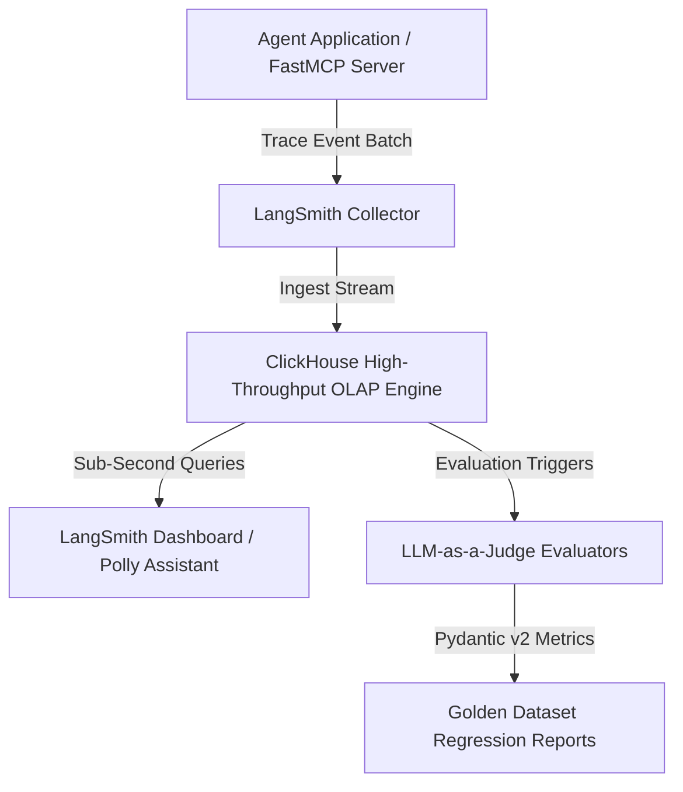

# LangSmith

## What it is
LangSmith is a unified platform for debugging, testing, evaluating, and monitoring LLM applications. It is part of the LangChain ecosystem but is model-agnostic and can be used with any LLM framework. As of January 2027, it serves as the industry-standard "control plane" for complex agentic fleets, featuring native support for [FastMCP 3.1](../../tools/automation_orchestration/mcp.md) observability, serverless tracing, and real-time agent fleet orchestration.

## Control Plane & Telemetry Architecture

```
+-----------------------------------------------------------------------------------+
|                         LangSmith Telemetry Infrastructure                        |
+-----------------------------------------------------------------------------------+
|                                                                                   |
|  +---------------------------+        +-----------------------------------------+  |
|  | FastMCP 3.1 Agent Server  |        |  Frontier Models (GPT-5.6 / Claude 5.6) |  |
|  +-------------+-------------+        +--------------------+--------------------+  |
|                |                                           |                      |
|                | Batch Traces (gRPC / HTTPS)               | Eval Feedback        |
|                v                                           v                      |
|  +---------------------------+        +-----------------------------------------+  |
|  | LangSmith Ingestion Edge  +------->+ ClickHouse High-Throughput OLAP Engine  |  |
|  +---------------------------+        +--------------------+--------------------+  |
|                                                            |                      |
|                                                            v                      |
|  +---------------------------+        +-----------------------------------------+  |
|  | LangSmith Fleet Controller+<-------+ Polly Assistant & Golden Regression     |  |
|  +---------------------------+        +-----------------------------------------+  |
|                                                                                   |
+-----------------------------------------------------------------------------------+
```



## What problem it solves
It addresses the "black box" nature of LLMs by providing full visibility into the execution traces of complex chains and agents. It provides tools for creating "golden" evaluation datasets, running automated tests (LLM-as-a-judge), and monitoring production performance for cost, latency, and quality regressions. It utilizes **ClickHouse** for high-volume OLAP telemetry, enabling sub-second analytics on millions of traces.

## Where it fits in the stack
**Benchmarking / Observability**. It is the primary tool for managing the lifecycle of LLM applications from prototype to production.

## Feature & Observability Platform Comparison Matrix

| Capability / Feature | LangSmith | AgentOps | Promptfoo | Braintrust |
| :--- | :--- | :--- | :--- | :--- |
| **Primary Architecture** | SaaS / Self-Hosted Enterprise | Cloud Observability | CLI / Local Test Suite | Cloud / Enterprise Self-Host |
| **Tracing Engine** | ClickHouse Distributed OLAP | Real-Time WebSocket | Static File / CI Output | PostgreSQL / DuckDB OLAP |
| **FastMCP 3.1 Integration** | Native Task & Tool Tracing | Partial Agent Hook | Custom MCP Plugin | MCP Gateway Integration |
| **LLM-as-a-Judge Support** | Native Golden Datasets | Custom Evaluators | Assertion-Based Rules | Custom Scorer Functions |
| **Fleet Orchestration** | Supported (LangSmith Deployment) | Monitoring Only | Not Supported | CI/CD Pipeline Native |
| **Cost & Latency Tracking** | Token-Level Granularity | Session-Level Granularity | Test-Run Granularity | Token & API Tier Level |

## Typical use cases
- **Debugging Agent Loops**: Inspecting intermediate steps and tool calls to find where an agent "stalls" or fails.
- **Golden Dataset Curation**: Creating high-quality reference datasets for regression testing.
- **Production Monitoring**: Real-time tracking of token usage, cost, and latency across large-scale deployments.
- **Collaborative Prompting**: Version-controlled prompt engineering with team-wide testing support.
- **Fleet Management**: Deploying and managing agent "fleets" via LangSmith Deployment (Fleet).
- **Agentic Session Replay**: Utilizing [AgentOps](../process_understanding/agentops.md) integration for visual execution graphs and step-by-step session replays.

## Strengths
- **Deep Ecosystem Integration**: Seamlessly works with LangChain, [LangGraph](../frameworks/langgraph.md), and FastMCP 3.1.
- **High-Fidelity Tracing**: Visualizes hierarchical execution paths including nested tool calls and parallel branches.
- **Advanced Evaluators**: Native support for complex automated grading using frontier models like **Claude 5.6**, **GPT-5.6**, and **Gemini 4.0 Pro**.
- **Polly AI Integration**: Embedded assistant for natural language analysis of failure patterns and performance trends.
- **Scalable Telemetry**: Powered by ClickHouse for real-time OLAP queries on massive agentic datasets.

## Limitations
- **SaaS Lock-in**: While self-hosting is available for enterprise, the primary experience is a proprietary SaaS.
- **Cost at Scale**: High-volume tracing in production can become expensive if not sampled correctly.
- **Learning Curve**: Advanced evaluation and "Fleet" deployment features require significant configuration.

## When to use it
- When building complex LLM applications that require deep tracing for debugging.
- When transitioning from a prototype to a production environment where reliability is critical.
- When collaborating on prompt engineering and evaluation datasets.

## When not to use it
- For very simple, single-call LLM scripts where a full observability platform is overkill.
- If strict data privacy requirements forbid any cloud-based telemetry (and enterprise self-hosting is not feasible).
- When a lightweight, open-source alternative like [Promptfoo](promptfoo.md) is sufficient.

## Getting started
LangSmith requires an API key and the `langsmith` Python package.

### 1. Installation
```bash
pip install langsmith
```

### 2. Configuration
Set your environment variables to enable tracing:
```bash
export LANGSMITH_TRACING=true
export LANGSMITH_API_KEY="ls__..."
export LANGSMITH_PROJECT="my-agent-v1"
```

### 3. Hello-World Trace
```python
from langsmith import traceable
from openai import OpenAI

client = OpenAI()

@traceable
def my_agent(question: str):
    return client.chat.completions.create(
        model="gpt-5.6",
        messages=[{"role": "user", "content": question}]
    )

my_agent("What is the state of MCP in January 2027?")
```

## CLI examples
The LangSmith CLI helps manage datasets and experiments from the terminal.

```bash
# Log in to your LangSmith account
langsmith login

# Create a new dataset from a CSV file
langsmith dataset create "Golden Tasks" --csv ./tasks.csv

# Run an evaluation experiment against a dataset
langsmith run --dataset "Golden Tasks" --config ./eval_config.yaml
```

## API examples
Automated evaluation and tracing integration are core features of LangSmith.

### FastMCP 3.1 Observability Tool Server Pattern
Exposing trace telemetry extraction over FastMCP 3.1 Task Protocol:

```python
from mcp.server.fastmcp import FastMCP, Context
from pydantic import BaseModel, Field
from typing import List, Optional

mcp = FastMCP("LangSmith Tracing Gateway")

class TraceQueryRequest(BaseModel):
    project_name: str = Field(..., description="Target LangSmith project")
    hours_back: int = Field(24, ge=1, le=168)
    filter_failures_only: bool = Field(False)

class TraceTelemetrySummary(BaseModel):
    total_traces: int
    error_rate: float
    p95_latency_sec: float

@mcp.tool()
async def query_project_telemetry(req: TraceQueryRequest, ctx: Context) -> TraceTelemetrySummary:
    """Queries LangSmith ClickHouse telemetry store via MCP."""
    ctx.info(f"Retrieving traces for project {req.project_name} over past {req.hours_back} hours.")

    return TraceTelemetrySummary(
        total_traces=14200,
        error_rate=0.012,
        p95_latency_sec=0.85
    )

if __name__ == "__main__":
    mcp.run()
```

### Programmatic Trace Analysis (Polly)
Polly can be queried via the SDK to analyze traces.
```python
from langsmith import Client

client = Client()
# Ask Polly to summarize failures in the last 24 hours
summary = client.analyze_traces(
    project_name="prod-fleet",
    query="Why did 5% of traces fail with tool-calling errors?"
)
print(summary.findings)
```

### Run and Telemetry Validation using Pydantic v2
This Python script validates LangSmith evaluation runs and telemetry payload schemas using **Pydantic v2** prior to submitting them to custom dashboard collectors:

```python
import json
from typing import Dict, Any, Optional
from pydantic import BaseModel, Field, ValidationError, field_validator

class LangSmithRunMetrics(BaseModel):
    latency_seconds: float = Field(..., ge=0.0, description="Inference latency in seconds")
    prompt_tokens: int = Field(..., ge=0, description="Tokens consumed in prompt")
    completion_tokens: int = Field(..., ge=0, description="Tokens generated in completion")
    cost_usd: Optional[float] = Field(None, ge=0.0, description="Calculated USD cost of the run")

class LangSmithEvalRun(BaseModel):
    run_id: str = Field(..., description="The unique run execution UUID logged in LangSmith")
    project_name: str = Field(..., description="Target project name (e.g., prod-fleet)")
    model_name: str = Field(..., description="Model tested, e.g., claude-5-6-sonnet")
    metrics: LangSmithRunMetrics = Field(..., description="Usage and timing performance figures")
    eval_score: float = Field(..., ge=0.0, le=1.0, description="Evaluation score between 0.0 and 1.0 (e.g. LLM-as-a-judge correctness)")
    feedback_tags: Dict[str, Any] = Field(default_factory=dict, description="Metadata key-value tags assigned to this run")

    @field_validator("project_name")
    @classmethod
    def validate_project_non_empty(cls, value: str) -> str:
        if not value.strip():
            raise ValueError("project_name cannot be empty or whitespace only")
        return value

def validate_eval_payload(raw_json: str) -> Optional[LangSmithEvalRun]:
    try:
        data = json.loads(raw_json)
        # Validate run object using Pydantic v2
        validated_run = LangSmithEvalRun.model_validate(data)
        return validated_run
    except json.JSONDecodeError:
        print("Error: Line is not valid JSON syntax.")
    except ValidationError as e:
        print(f"Validation failed: {e.errors()}")
    return None
```

## Production Hardening & Operational Safety

### Sampling & Rate Controls
When operating at high concurrency (10,000+ agent steps/min), sending full trace payloads for every single execution can saturate network egress and incur unexpected telemetry storage costs. Implement dynamic trace sampling:

```python
import os
import random

def configure_dynamic_tracing(sample_rate: float = 0.1):
    """Enables tracing conditionally based on a probabilistic sample rate or error states."""
    if random.random() < sample_rate:
        os.environ["LANGSMITH_TRACING"] = "true"
    else:
        os.environ["LANGSMITH_TRACING"] = "false"
```

### Data Redaction & Privacy Guardrails
Ensure PII (Personally Identifiable Information) and sensitive API tokens are masked before traces hit external telemetry ingest endpoints:

```python
from langsmith.client import Client

def sanitize_trace_inputs(inputs: dict) -> dict:
    sanitized = inputs.copy()
    for key in ["api_key", "ssn", "credit_card"]:
        if key in sanitized:
            sanitized[key] = "[REDACTED]"
    return sanitized
```

## Troubleshooting & Common Issues

| Issue / Error | Root Cause | Remediation Procedure |
| :--- | :--- | :--- |
| `HTTP 401 Unauthorized` on trace export | Invalid or expired `LANGSMITH_API_KEY`. | Verify the key format begins with `ls__` and is exported in the runtime environment. |
| Missing child trace nodes in async agent loops | Loss of context propagation across `asyncio.gather`. | Wrap async tasks using `langsmith.run_helpers.traceable` with explicit parent run context. |
| High trace submission latency / worker lag | Synchronous export blocking the event loop. | Set `LANGSMITH_BACKGROUND_THREAD=true` to process trace exports asynchronously. |
| Evaluator timeout on large datasets | Golden dataset test cases exceeding LLM-as-a-judge timeout. | Adjust evaluation batch size or increase judge model timeout in the evaluation runner configuration. |

## Related tools / concepts
- [Promptfoo](promptfoo.md) — Open-source evaluation CLI.
- [LangChain](../ai_knowledge/langchain.md) — Primary integration framework.
- [LangGraph](../frameworks/langgraph.md) — Stateful agent orchestration.
- [DREAM](dream.md) — Agentic research evaluation metrics.
- [Benchmarking](index.md) — Overview of evaluation strategies.
- [Claude Code](../development_ops/claude-code-setup.md) — Can be traced using LangSmith.
- [OpenPipe](../infrastructure/openpipe.md) — For fine-tuning based on LangSmith traces.
- [Plandex](../development_ops/plandex.md) — Complex agent that benefits from deep tracing.
- [AgentOps](../process_understanding/agentops.md) — Specialized agent observability integration.
- [ClickHouse](../process_understanding/clickhouse.md) — Underlying OLAP engine for telemetry.

## Sources / references
- [Official Website](https://www.langchain.com/langsmith)
- [LangSmith Documentation](https://docs.smith.langchain.com/)
- [Polly Release Announcement](https://www.langchain.com/blog/polly-langsmith-ga)
- [LangSmith Self-Hosting Guide](https://docs.smith.langchain.com/self-hosting)
- [ClickHouse Integration for Observability](https://clickhouse.com/blog/observability-with-clickhouse)

## Contribution Metadata
- Last reviewed: 2027-01-07
- Confidence: high
