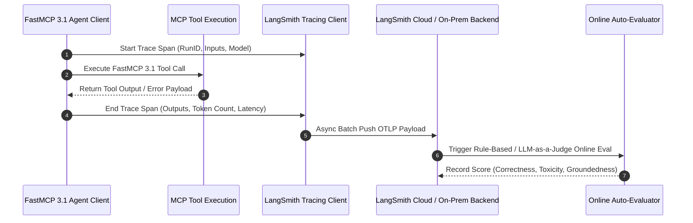

# LangSmith

## What it is
LangSmith is an enterprise LLM observability, evaluation, trace monitoring, and prompt engineering platform developed by LangChain. In early 2027, it serves as a central control plane for production AI applications, providing full visibility into multi-agent workflows, tool execution chains, prompt iteration loops, and model regression benchmarks across frontier LLM providers (including Claude 5.6, GPT-5.6, Gemini 4.0 Ultra, and DeepSeek-V4). LangSmith supports native **FastMCP 3.1** protocol tracing, enabling continuous inspection of agentic tool calling and structured payload validation.

## System Architecture

The following diagram illustrates LangSmith's trace ingestion pipeline, telemetry storage architecture, and FastMCP 3.1 tool call tracking framework:

```
┌─────────────────────────────────────────────────────────────────────────────┐
│                   Agent Application / FastMCP 3.1 Server                    │
│           (Python / TypeScript LangChain & OpenTelemetry Traces)            │
└──────────────────────────────────────┬──────────────────────────────────────┘
                                       │ Async OpenTelemetry gRPC / OTLP HTTP
┌──────────────────────────────────────▼──────────────────────────────────────┐
│                     LANGSMITH INGESTION & TRACE ENGINE                      │
│  ┌──────────────────────────────┐        ┌───────────────────────────────┐  │
│  │   OTLP Ingestion Receiver    │        │   Run Tree & Span Assembler   │  │
│  │   (High-Throughput Gateway)  │        │   (Parent-Child Span Match)   │  │
│  └──────────────┬───────────────┘        └──────────────┬────────────────┘  │
│                 │                                       │                   │
│  ┌──────────────▼───────────────────────────────────────▼────────────────┐  │
│  │                   Token Usage & Latency Evaluator                     │  │
│  │  - Cost calculations & latency histogram generation                  │  │
│  │  - Automated online feedback & evaluation triggers                   │  │
│  └──────────────────────────────┬────────────────────────────────────────┘  │
└─────────────────────────────────┼───────────────────────────────────────────┘
                                  │ Direct Stream Ingestion
┌─────────────────────────────────▼───────────────────────────────────────────┐
│                    ClickHouse / Postgres Analytical Store                   │
│         (Span Traces, Golden Evaluation Datasets, Prompt Hub Matrix)        │
└─────────────────────────────────────────────────────────────────────────────┘
```



## What problem it solves
Developing agentic AI systems introduces severe debugging challenges due to non-deterministic model outputs, multi-turn tool calling loops, hidden latency spikes, and silent failure cascades. Standard application performance monitoring (APM) tools are ill-equipped to parse nested LLM chains or calculate per-step prompt token costs.

LangSmith solves these problems by:
- **Nested Trace Visibility**: Rendering full visual hierarchy trees for complex multi-agent interactions, tool calls, and RAG retrieval steps.
- **Automated Online Evaluation**: Running "LLM-as-a-Judge" feedback loops in real time to rate response groundedness, accuracy, and compliance.
- **Golden Dataset Regression Testing**: Enabling engineering teams to curate test suites from live production traces to catch regressions before deploying updated system prompts or model configurations.
- **Token & Cost Tracking**: Aggregating token consumption and latency metrics across diverse LLM providers.

## Where it fits in the stack
**Category**: Benchmarking / Observability & Evaluation. LangSmith functions as the observability umbrella sitting across the entire agent lifecycle, recording inputs and outputs from client applications down to FastMCP 3.1 servers and LLM gateways ([LiteLLM](../../services/litellm.md), [Ollama](../infrastructure/ollama.md), [vLLM](../infrastructure/vllm.md)).

## Typical use cases
- **Multi-Agent Diagnostics**: Tracing complex interactions where an orchestrator agent delegates tasks to sub-agents via FastMCP 3.1.
- **Prompt Hub & Versioning**: Storing, testing, and versioning system prompts in a centralized registry with A/B rollout controls.
- **Continuous Golden Dataset Curation**: Filtering production traces with user feedback to expand test benchmarks.
- **Compliance & Audit Logging**: Archiving raw model inputs and outputs for security and privacy compliance audits.

## Strengths
- **Native Ecosystem Alignment**: Flawless, zero-boilerplate integration with LangChain, LangGraph, OpenTelemetry, and FastMCP 3.1.
- **High-Throughput Async Ingestion**: Minimal application overhead due to background thread buffering and batch OTLP streaming.
- **Comprehensive Evaluation Tools**: Built-in support for exact match, regex, semantic distance, and LLM-as-a-judge evaluation scoring.
- **Enterprise Deployment Options**: Available as SaaS, single-tenant dedicated cloud, or self-hosted Kubernetes deployments.

## Limitations
- **Ecosystem Bias**: While supporting OpenTelemetry, advanced features are tightly optimized for LangChain/LangGraph abstractions.
- **Cost Scaling at High Volume**: Ingesting raw token payloads for ultra-high-volume production applications requires careful trace sampling to manage storage costs.

## Comparison Matrix

| Feature / Dimension | LangSmith | Weights & Biases (W&B Weave) | Phoenix (Arize) | Datadog LLM Observability |
| :--- | :--- | :--- | :--- | :--- |
| **Primary Focus** | Agent Tracing & Evaluation | ML Experimentation & LLM | Open-Source Evals | Enterprise Infrastructure APM |
| **LangGraph / LangChain** | Native Zero-Config | Plugin / Adapter | OpenInference Adapter | Custom Integration |
| **FastMCP 3.1 Support** | Native Trace Spans | Custom Wrapper | OpenTelemetry Spans | APM Span Wrappers |
| **Evaluation Suite** | Native Online/Offline Evals | Custom Metric Logging | Deep Evals & RAG Triad | Basic Rule Evaluators |
| **Self-Hosted Option** | Kubernetes / Enterprise | SaaS / Hybrid | Fully Open-Source / Local | Cloud SaaS Only |

## When to use it
- When building, debugging, or deploying multi-step agent workflows using LangChain, LangGraph, or FastMCP 3.1.
- When you need a golden benchmark dataset to evaluate prompt changes against past production runs.
- When requiring granular cost and latency telemetry per user, prompt version, or tenant ID.

## When not to use it
- For standard traditional microservice monitoring without LLM components (where Prometheus/Grafana or Datadog is preferred).
- When strict offline data isolation prevents transmitting trace payloads to third-party endpoints (unless deploying LangSmith Self-Hosted).

## Getting started

To begin tracing Python applications with LangSmith, set the environment variables and wrap your code using standard decorators or OpenTelemetry handlers:

```bash
# Set LangSmith configuration environment variables
export LANGCHAIN_TRACING_V2="true"
export LANGCHAIN_API_KEY="ls__your_api_key_here"
export LANGCHAIN_PROJECT="production-agent-v1"
```

## CLI examples

```bash
# Inspect LangSmith CLI environment status
langsmith status

# Pull a versioned system prompt from LangSmith Prompt Hub
langsmith prompt pull agent-system-prompt:v2 --output prompt.json

# Execute an offline benchmark evaluation against a curated dataset
langsmith eval run --dataset "golden-customer-support-v1" --evaluators correctness,toxicity
```

## API examples

### FastMCP 3.1 Server Implementation

Below is a complete FastMCP 3.1 server implementation in Python using Pydantic v2 schemas and the `langsmith` SDK to trace tool execution and push online evaluation metrics:

```python
import json
import os
import time
from typing import Literal, Optional, List, Dict, Any
from pydantic import BaseModel, Field, ValidationError
from mcp.server.fastmcp import FastMCP
from langsmith import Client, traceable

# Configure environment defaults for LangSmith tracing
os.environ["LANGCHAIN_TRACING_V2"] = "true"

# Initialize FastMCP 3.1 Server
mcp = FastMCP("LangSmith-Observability-Server", version="3.1")
ls_client = Client()

class PromptEvalInput(BaseModel):
    prompt_id: str = Field(..., description="Unique prompt identifier in Prompt Hub")
    test_inputs: Dict[str, Any] = Field(..., description="Key-value variable map for prompt template")
    expected_output: Optional[str] = Field(None, description="Golden output string for comparison")

class TraceSpanResponse(BaseModel):
    run_id: str
    prompt_id: str
    latency_ms: float
    token_usage: Dict[str, int]
    status: Literal["SUCCESS", "FAILED"]

@mcp.tool(name="run_traced_prompt_eval", description="Executes a traced prompt evaluation loop and records metrics in LangSmith.")
@traceable(name="mcp_traced_prompt_tool", run_type="tool")
def run_traced_prompt_eval(raw_json: str) -> str:
    """Validates input payload, executes model call, and returns traced result payload."""
    start_time = time.time()
    try:
        data = json.loads(raw_json)
        payload = PromptEvalInput.model_validate(data)

        # Simulated LLM execution span
        time.sleep(0.15)  # Simulate execution latency
        simulated_response = f"Processed template '{payload.prompt_id}' successfully."

        elapsed_ms = (time.time() - start_time) * 1000

        response = TraceSpanResponse(
            run_id="run_ls_99481a82",
            prompt_id=payload.prompt_id,
            latency_ms=elapsed_ms,
            token_usage={"prompt_tokens": 128, "completion_tokens": 42, "total_tokens": 170},
            status="SUCCESS"
        )
        return json.dumps(response.model_dump(), indent=2)
    except json.JSONDecodeError:
        return json.dumps({"error": "INVALID_JSON", "message": "Failed to parse input JSON"})
    except ValidationError as e:
        return json.dumps({"error": "VALIDATION_ERROR", "details": e.errors()})

if __name__ == "__main__":
    mcp.run()
```

## Deployment & systemd Service Unit

To run a self-hosted LangSmith trace ingestion forwarder or local agent trace proxy as a resilient system service at `/etc/systemd/system/langsmith-agent.service`:

```ini
[Unit]
Description=LangSmith Agent Trace Proxy Service
After=network.target
Wants=network-online.target

[Service]
Type=simple
User=langsmith
Group=langsmith
WorkingDirectory=/opt/langsmith
ExecStart=/usr/local/bin/python3 /opt/langsmith/server.py
Restart=always
RestartSec=5s
Environment=PYTHONUNBUFFERED=1
Environment=LANGCHAIN_TRACING_V2=true
Environment=LANGCHAIN_PROJECT=production-mcp-agents
Environment=LANGCHAIN_API_KEY=ls__secret_key_here
LimitNOFILE=65536
MemoryMax=2G
CPUQuota=200%

# Security Isolation
ProtectSystem=full
ProtectHome=true
NoNewPrivileges=true
PrivateTmp=true

[Install]
WantedBy=multi-user.target
```

## Docker Compose Setup

For local multi-container development featuring a FastMCP 3.1 agent and local trace collector setup:

```yaml
version: "3.8"

services:
  agent-server:
    build:
      context: .
      dockerfile: Dockerfile
    container_name: mcp-traced-agent
    restart: unless-stopped
    ports:
      - "8080:8080"
      - "8090:8090"
    environment:
      - LANGCHAIN_TRACING_V2=true
      - LANGCHAIN_API_KEY=${LANGSMITH_API_KEY}
      - LANGCHAIN_PROJECT=local-docker-evals
      - LANGCHAIN_ENDPOINT=https://api.smith.langchain.com
    networks:
      - observability-net

networks:
  observability-net:
    driver: bridge
```

## Troubleshooting & Diagnostic Matrix

| Symptom / Error Code | Root Cause | Resolution Strategy |
| :--- | :--- | :--- |
| `HTTP 401 Unauthorized` | Missing or invalid `LANGCHAIN_API_KEY` environment variable | Verify API key signature starting with `ls__` in system configuration |
| `Traces Missing in UI` | Background batch thread exited before process termination | Ensure `ls_client.flush()` is invoked on process shutdown |
| `High Ingestion Latency` | Synchronous trace transmission blocking main application loop | Verify `LANGCHAIN_TRACING_V2="true"` is set to use async batching |
| `OTLP Connection Timeout` | Self-hosted LangSmith Kubernetes ingestion endpoint unreachable | Check cluster firewall rules and gRPC ingress proxy routing on port 4317 |

## Related tools / concepts
- [Promptfoo](promptfoo.md) — CLI evaluation tool for security and prompt testing.
- [Inspect AI](inspect-ai.md) — Open-source LLM evaluation framework.
- [LiteLLM](../../services/litellm.md) — Unified LLM proxy gateway with trace streaming.
- [Ollama](../infrastructure/ollama.md) — Local model serving runtime monitored via LangSmith.
- [vLLM](../infrastructure/vllm.md) — Enterprise model serving infrastructure.
- [Model Context Protocol](../automation_orchestration/mcp.md) — Protocol specifications for FastMCP 3.1.
- [Prometheus](../process_understanding/prometheus.md) — Time-series metrics collector for system metrics.

## Sources / references
- [LangSmith Official Documentation](https://docs.smith.langchain.com/)
- [LangSmith Conceptual Architecture & Tracing Guide](https://docs.smith.langchain.com/concepts/tracing)
- [OpenTelemetry Integration with LangSmith](https://docs.smith.langchain.com/how_to_guides/tracing/open_telemetry)

## Contribution Metadata
- Last reviewed: 2027-01-07
- Confidence: high
