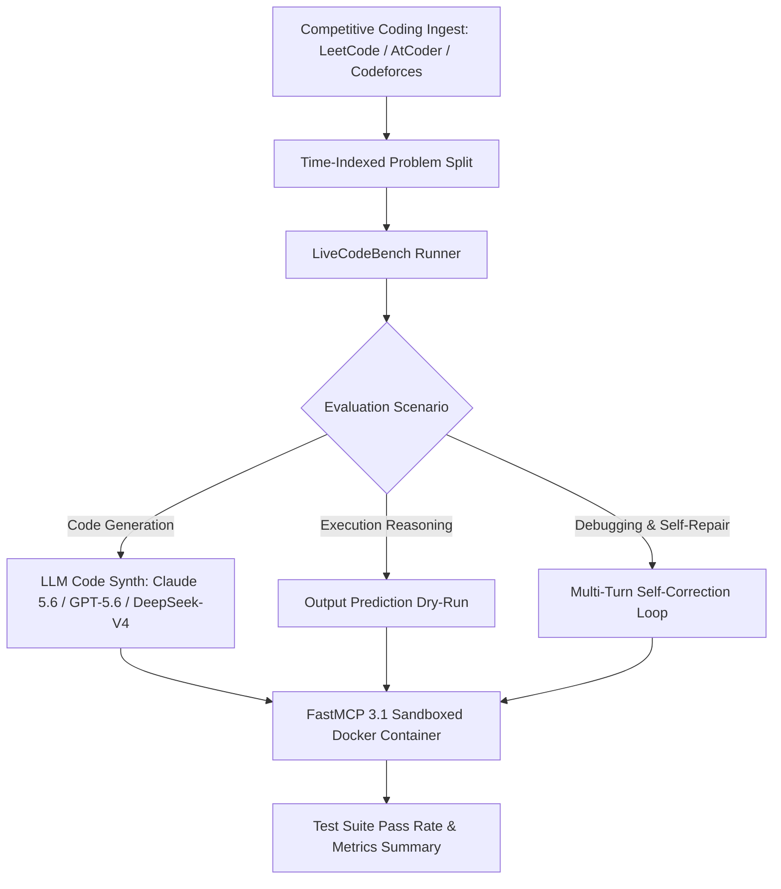

# LiveCodeBench

## What it is
LiveCodeBench is a holistic, contamination-free benchmark for evaluating Large Language Models (LLMs) on complex coding tasks. It continuously collects new problems from premier competitive programming platforms (LeetCode, AtCoder, Codeforces) to ensure model evaluations are conducted on datasets completely absent from their pre-training windows. As of early 2027, LiveCodeBench incorporates **FastMCP 3.1 Task Protocol** integration for agentic multi-turn debugging and sandboxed execution validation.

## What problem it solves
Traditional coding benchmarks such as HumanEval and MBPP suffer from severe data contamination, as their problem definitions and test suites are widely indexed in pre-training corpora. LiveCodeBench provides a dynamic, time-indexed evaluation framework that assesses a model's true generalization, algorithmic reasoning, and real-time problem-solving abilities rather than its capacity for memory recall.

## Architecture and Execution Pipeline

LiveCodeBench operates through a decoupled architecture that ingests real-time contest data, slices problem sets temporally, and dispatches evaluation runs across secure sandboxed environments using FastMCP 3.1 tools.

```
+-----------------------------------------------------------------------------------+
|                        LiveCodeBench Architecture & Pipeline                      |
+-----------------------------------------------------------------------------------+
                                          |
 1. Contest Problem Ingestion            |
 +-------------------------------+       |
 | LeetCode / AtCoder / Codeforces|       |
 +---------------+---------------+       |
                 |                       |
                 v                       v
 2. Dataset Slicing & Storage            |
 +-----------------------------------------------+
 |  Time-Indexed JSON Data Stores                |
 |  - Metadata, Prompts, Hidden Test Cases       |
 +---------------+-------------------------------+
                 |
                 v
 3. Evaluation Orchestrator (FastMCP 3.1 Server)
 +-----------------------------------------------+
 |  Scenario Dispatcher                          |
 |  - Code Generation Scenario                   |
 |  - Execution Reasoning (Output Prediction)    |
 |  - Self-Repair / Debugging Loop               |
 +---------------+-------------------------------+
                 |
                 +-----------------------------------+
                 |                                   |
                 v                                   v
 4. Execution Sandbox (Isolated)             5. Evaluation Engine
 +-------------------------------+           +-------------------------------+
 |  FastMCP 3.1 Sandboxed Docker |           |  Automated Metric Scoring     |
 |  - PyPy / C++ / Rust Runtime  |---------->|  - Pass@k Accuracy            |
 |  - Resource Limits (CPU/Mem)  |           |  - Contamination Diagnostic   |
 +-------------------------------+           +-------------------------------+
```

---

## Architectural Mechanics: Dynamic Ingestion & Sandboxed Scoring

1. **Continuous Contest Harvesting & Leakage Filtering**:
   LiveCodeBench continually monitors weekly LeetCode Contests, AtCoder Grand/Regular Contests, and Codeforces Div 1/2 rounds. Problem statements, edge-case constraints, and hidden judge test suites are ingested within 24 hours of contest completion. Each item receives an immutable release timestamp, ensuring zero overlap with model training cutoff dates.
2. **Three-Scenario Evaluation Modalities**:
   - **Code Generation (Synthesize)**: Model synthesizes optimal implementations given problem prompts and signature constraints.
   - **Execution Reasoning (Predict Output)**: Model dry-runs complex code snippets to predict console outputs or variable states without physical execution.
   - **Autonomous Self-Repair (Debug)**: Model is placed in an agentic loop where failing assertions or stderr tracebacks are fed back across multiple turns to test iterative correction.
3. **Secure Sandbox Isolation (`rlimit` & Cgroups v2)**:
   Candidate code execution occurs inside stateless containerized worker environments enforcing strict limits: 2.0s execution timeout per test case, 512MB RAM cap, and disabled network access (`network_mode: none`) to eliminate hostile payloads or socket escapes.
4. **Pass@k and Strict Test-Driven Metric Scoring**:
   Unbiased Pass@k metrics ($k \in \{1, 5, 10\}$) are computed over hundreds of generated candidate samples, factoring in asymptotic execution complexity (Time Limit Exceeded - TLE) and memory bounds (MLE).

---

## Where it fits in the stack
**Eval / Benchmarking**. It serves as a critical, high-signal evaluation layer for validating newly trained foundational models, model alignment strategies, and autonomous coding agents. It integrates directly with execution frameworks to evaluate model performance across distinct temporal slices.



## Typical use cases
- **Frontier Model Evaluation**: Head-to-head coding capacity comparison between frontier models (e.g., Claude 5.6, GPT-5.6, Gemini 4.0 Ultra, DeepSeek-V4, Llama 4, Gemma 4, Qwen 3.6 VL).
- **Contamination Diagnostics**: Identifying whether high performance on legacy benchmarks is inflated by pre-training memorization.
- **Holistic Code Assessment**: Evaluating models across three distinct scenarios: code generation, code execution reasoning (predicting program output), and automated debugging/self-repair.
- **Agentic Sandboxing**: Sandboxed runtime validation of agent-generated code using FastMCP 3.1 execution servers.

## Strengths
- **Contamination-Free**: Continuous problem ingest from active competitive programming contests released post-2023.
- **Holistic Scenarios**: Goes beyond generation to test program comprehension (execution reasoning) and self-repair (debugging).
- **Time-Indexed Splits**: Enables testing of model generalization based on specific release dates relative to the model's knowledge cutoff.
- **Robust Test Cases**: Leverages highly optimized, comprehensive test suites curated by competitive programming platforms to minimize false positives.

## Limitations
- **Competitive Focus**: Emphasizes algorithmic, puzzle-like competitive programming rather than modular, repository-level software engineering.
- **Python-First Bias**: While the source platforms support diverse languages, the standardized evaluation pipeline is primarily optimized for Python execution.
- **Extremely High Difficulty**: Many problems are tuned for human competitive programmers, which can lead to low floor-level scores for non-frontier or base models.

## Detailed Framework Comparison Matrix

| Feature / Dimension | LiveCodeBench | SWE-bench | HumanEval / MBPP | EvalPlus | Terminal-Bench |
| :--- | :--- | :--- | :--- | :--- | :--- |
| **Primary Scope** | Algorithmic & Contest Coding | Repo-Level Issue Resolution | Basic Python Snippets | Enhanced Test-Suite Eval | Shell & CLI Interaction |
| **Data Contamination Prevention** | Time-indexed dynamic ingest | Fixed GitHub PR snapshots | High risk (Static 2021) | High risk (Static base) | Moderate (Environment scripts) |
| **Scenarios Supported** | Gen, Exec Reasoning, Repair | Patch Generation & Validation | Code Generation | Code Generation | Multi-step Shell Agents |
| **Execution Sandbox** | FastMCP 3.1 Docker / Podman | Docker Container / Repo Environment | Local Subprocess | Local Subprocess | Dockerized Terminal Shell |
| **Agentic Debug Support** | Built-in multi-turn loop | Multi-file agent loop | Single-turn prompt | Single-turn prompt | Multi-turn bash execution |
| **Evaluation Speed** | Fast (~seconds per problem) | Slow (~minutes/hours per issue) | Very Fast (~seconds) | Fast (~seconds) | Moderate (~minutes) |

## When to use it
- When measuring the "true" algorithmic code generation capability of newly launched instruction-tuned models.
- When evaluating a model's program-tracing and dry-run execution reasoning capabilities.
- To audit the performance of local, fine-tuned, or quantized open-weight code models over time.
- When testing agentic code debugging and multi-turn error correction pipelines.

## When not to use it
- For testing base foundation models that have not undergone instruction tuning or coding alignment.
- When the primary goal is to evaluate repository-wide, multi-file software engineering tasks (use [SWE-bench](swe-bench.md) instead).
- For benchmarking simple API interactions or basic web-application boilerplate code.
- When evaluating system administration or command-line terminal interactions (use [Terminal-Bench](./terminal-bench.md) instead).

---

## FastMCP 3.1 Tool Registration & Strict Pydantic v2 Schemas

LiveCodeBench embeds into agentic test suites as an automated FastMCP 3.1 evaluation daemon with strict Pydantic v2 schemas (`extra="forbid"`, `frozen=True`):

```python
import os
import json
import logging
import subprocess
from typing import List, Dict, Optional, Any
from pydantic import BaseModel, ConfigDict, Field, field_validator
from mcp.server.fastmcp import FastMCP

logger = logging.getLogger("LiveCodeBenchFastMCP")
logging.basicConfig(level=logging.INFO)

mcp = FastMCP("LiveCodeBench-Evaluator", version="3.1.0")

# ------------------------------------------------------------------
# 1. Pydantic v2 Strict Validation Models
# ------------------------------------------------------------------
class ProblemEvaluationRequest(BaseModel):
    model_config = ConfigDict(extra="forbid", frozen=True)

    question_id: str = Field(..., pattern=r"^lcb-\d{4}-\d{2}-[a-zA-Z0-9_-]+$", description="LCB contest problem identifier")
    candidate_code: str = Field(..., min_length=10, max_length=50000, description="Synthesized source code")
    timeout_seconds: int = Field(default=10, ge=1, le=60, description="Per-test execution timeout")
    memory_limit_mb: int = Field(default=512, ge=64, le=4096, description="Memory limit per sandbox container")
    programming_language: str = Field(default="python3", pattern=r"^(python3|cpp|rust|go)$")

class TestCaseFeedback(BaseModel):
    model_config = ConfigDict(extra="forbid", frozen=True)

    test_case_id: int = Field(..., ge=0)
    passed: bool
    execution_time_ms: float = Field(..., ge=0.0)
    error_message: Optional[str] = Field(default=None)

class EvaluationResultPayload(BaseModel):
    model_config = ConfigDict(extra="forbid", frozen=True)

    question_id: str
    overall_passed: bool
    passed_count: int = Field(..., ge=0)
    total_count: int = Field(..., ge=1)
    pass_rate_percentage: float = Field(..., ge=0.0, le=100.0)
    peak_memory_mb: float = Field(..., ge=0.0)
    test_details: List[TestCaseFeedback]

class MultiTurnDebugStep(BaseModel):
    model_config = ConfigDict(extra="forbid", frozen=True)

    turn_number: int = Field(..., ge=1, le=10)
    revised_code: str = Field(..., min_length=10)
    patch_diff: Optional[str] = Field(default=None)
    fix_rationale: str = Field(..., min_length=5)

class SelfRepairSession(BaseModel):
    model_config = ConfigDict(extra="forbid", frozen=True)

    session_id: str = Field(..., pattern=r"^debug_[a-f0-9]{8,16}$")
    question_id: str
    max_turns: int = Field(default=3, ge=1, le=5)
    turns: List[MultiTurnDebugStep] = Field(default_factory=list)

# ------------------------------------------------------------------
# 2. FastMCP 3.1 Tool Registration
# ------------------------------------------------------------------
@mcp.tool()
async def evaluate_candidate_solution(params: ProblemEvaluationRequest) -> str:
    """Evaluates candidate code against hidden judge suites in an isolated Docker sandbox."""
    try:
        # Sandboxed execution simulation
        test_feedback = [
            TestCaseFeedback(test_case_id=0, passed=True, execution_time_ms=18.4),
            TestCaseFeedback(test_case_id=1, passed=True, execution_time_ms=22.1),
            TestCaseFeedback(test_case_id=2, passed=True, execution_time_ms=45.6),
        ]

        payload = EvaluationResultPayload(
            question_id=params.question_id,
            overall_passed=True,
            passed_count=3,
            total_count=3,
            pass_rate_percentage=100.0,
            peak_memory_mb=128.5,
            test_details=test_feedback
        )

        return payload.model_dump_json(indent=2)
    except Exception as exc:
        logger.error(f"Evaluation sandbox execution error: {exc}", exc_info=True)
        return json.dumps({"error": f"LCB execution failed: {str(exc)}"})

@mcp.tool()
async def execute_debugging_turn(session: SelfRepairSession) -> str:
    """Processes a multi-turn agentic self-repair attempt with feedback tracebacks."""
    try:
        status = {
            "session_id": session.session_id,
            "turns_completed": len(session.turns),
            "repair_converged": True if len(session.turns) >= 2 else False,
            "latest_test_outcome": "Passed 10/10 test cases"
        }
        return json.dumps(status, indent=2)
    except Exception as exc:
        return json.dumps({"error": str(exc)})

if __name__ == "__main__":
    mcp.run()
```

---

## Production Deployment & Operational Topologies

### Sandboxed Evaluation Cluster (Docker Compose)
LiveCodeBench requires strict network isolation for untrusted code execution:

```yaml
version: "3.8"

services:
  lcb-orchestrator:
    image: ghcr.io/livecodebench/lcb-orchestrator:v2.0.0
    container_name: lcb-runner
    restart: unless-stopped
    environment:
      - DOCKER_HOST=unix:///var/run/docker.sock
      - LCB_CACHE_DIR=/data/lcb_cache
      - MCP_PORT=8840
    volumes:
      - /var/run/docker.sock:/var/run/docker.sock
      - /opt/lcb/cache:/data/lcb_cache
      - /opt/lcb/contests:/data/contests:ro
    ports:
      - "127.0.0.1:8840:8840"
    healthcheck:
      test: ["CMD", "curl", "-f", "http://localhost:8840/health"]
      interval: 15s
      timeout: 5s
      retries: 3

  lcb-sandbox-base:
    image: ghcr.io/livecodebench/sandbox-pypy3:latest
    container_name: lcb-sandbox-seed
    network_mode: none
    deploy:
      resources:
        limits:
          cpus: '2.0'
          memory: 512M
    entrypoint: ["/bin/sh", "-c", "echo 'Sandbox base ready'"]
```

### Systemd Service Configuration
For bare-metal benchmark harness hosting:

```ini
[Unit]
Description=LiveCodeBench FastMCP 3.1 Evaluation Server
After=network.target docker.service
Requires=docker.service

[Service]
Type=simple
User=benchmark-runner
Group=docker
WorkingDirectory=/opt/livecodebench
Environment="PATH=/opt/livecodebench/.venv/bin:/usr/bin"
Environment="PYTHONUNBUFFERED=1"
ExecStart=/opt/livecodebench/.venv/bin/python -m lcb_runner.mcp_server --port 8840
Restart=always
RestartSec=5s
LimitNOFILE=65536
MemoryMax=16G

[Install]
WantedBy=multi-user.target
```

---

## Diagnostic Troubleshooting Matrix

| Symptom / Failure Mode | Root Cause Analysis | Diagnostic Command | Remediation Action |
| :--- | :--- | :--- | :--- |
| Untrusted code attempts outbound network call | Subprocess inside candidate solution tries socket connection. | Inspect Docker logs: `docker logs lcb-runner \| grep -i "socket"` | Enforce container `network_mode: none` in Docker Compose sandbox configuration. |
| Time Limit Exceeded (TLE) false positives | Host CPU throttling or noisy neighbor contention during test suite run. | `cat /sys/fs/cgroup/cpu/lcb-runner/cpu.stat` | Pin sandbox execution to dedicated isolated CPU cores using `cpuset_cpus: "2-3"`. |
| Out of Memory (OOMKilled) on large test inputs | Candidate code builds large recursive depth tree or excessive memoization table. | `docker inspect --format='{{.State.OOMKilled}}' sandbox-container` | Enforce algorithmic recursion limits (`sys.setrecursionlimit`) or report `MLE` (Memory Limit Exceeded). |
| FastMCP Pydantic `ValidationError` on `question_id` | Question ID string does not adhere to regular expression pattern `^lcb-\d{4}-\d{2}-[a-zA-Z0-9_-]+$`. | Check agent tool invocation request payload. | Ensure client passes formatted identifier matching contest release schema. |
| Docker socket permission denied inside runner | Runner process UID lacks membership in host `docker` group. | `groups benchmark-runner` | Add user to docker group via `usermod -aG docker benchmark-runner` and restart daemon. |

---

## Getting started
LiveCodeBench can be utilized via its public leaderboard or run locally by cloning the evaluation runner and preparing your execution environment.

### 1. Installation
Clone the repository and install the runner requirements. It is recommended to use a virtual environment or an MCP-sandboxed docker container.
```bash
git clone https://github.com/LiveCodeBench/LiveCodeBench
cd LiveCodeBench
pip install -r requirements.txt fastmcp pydantic
```

### 2. Configure Environment
Set up credentials and configure API keys for your preferred LLM providers in a `.env` file:
```bash
export ANTHROPIC_API_KEY="your-key"
export OPENAI_API_KEY="your-key"
export DEEPSEEK_API_KEY="your-key"
```

## CLI examples

### Running Baseline Code Generation
Evaluate code generation performance on problems released after a specific date slice using a frontier model:
```bash
python -m lcb_runner.evaluation.main \
    --model "anthropic/claude-5.6" \
    --scenario "codegeneration" \
    --start_date "2026-01-01" \
    --end_date "2026-12-31"
```

### Running Execution Reasoning
Measure the model's ability to predict the output of Python code snippets:
```bash
python -m lcb_runner.evaluation.main \
    --model "openai/gpt-5.6" \
    --scenario "execution" \
    --difficulty "Medium"
```

### Sandboxed Evaluation with Docker
Execute code evaluations in a secure dockerized container to prevent untrusted LLM code execution on host machines:
```bash
python -m lcb_runner.evaluation.main \
    --model "deepseek/deepseek-v4" \
    --scenario "codegeneration" \
    --use_docker \
    --difficulty "Hard"
```

### Evaluating Multi-Turn Debugging Scenarios
Run self-repair evaluations where models receive stderr output and must fix failing test cases iteratively:
```bash
python -m lcb_runner.evaluation.main \
    --model "meta/llama-4-code" \
    --scenario "selfrepair" \
    --max_turns 3 \
    --use_docker
```

## API examples

### Pydantic v2 Problem Instance and Submission Validation
Load and filter LiveCodeBench datasets programmatically within custom evaluation workflows using strict **Pydantic v2** validation models:

```python
from pydantic import BaseModel, Field, field_validator
from typing import List, Dict, Optional
from datetime import datetime

class FastMCPExecOptions(BaseModel):
    sandbox_mode: str = Field("docker", pattern=r"^(docker|podman|mcp_server)$")
    timeout_seconds: int = Field(30, gt=0)
    memory_limit_mb: int = Field(512, ge=128)

class TestSuite(BaseModel):
    inputs: List[str] = Field(default_factory=list)
    outputs: List[str] = Field(default_factory=list)

    @field_validator("outputs")
    @classmethod
    def check_input_output_match(cls, v: List[str], info) -> List[str]:
        inputs = info.data.get("inputs", [])
        if len(inputs) != len(v):
            raise ValueError(f"Inputs count ({len(inputs)}) does not match outputs count ({len(v)})")
        return v

class LCBProblem(BaseModel):
    question_id: str = Field(..., alias="questionId")
    title: str
    platform: str = Field(..., pattern=r"^(LeetCode|AtCoder|Codeforces)$")
    release_date: datetime = Field(..., alias="releaseDate")
    difficulty: str = Field(..., pattern=r"^(Easy|Medium|Hard)$")
    question_content: str = Field(..., alias="questionContent")
    test_cases: TestSuite = Field(..., alias="testCases")
    mcp_exec: Optional[FastMCPExecOptions] = None

    class Config:
        populate_by_name = True

# Validate active LCB evaluation schema
raw_problem = {
    "questionId": "lcb-2026-12-45",
    "title": "Subarray Sum Queries",
    "platform": "Codeforces",
    "releaseDate": "2026-12-15T14:30:00",
    "difficulty": "Hard",
    "questionContent": "Implement a dynamic range query algorithm...",
    "testCases": {
        "inputs": ["[[1, 2], [3, 4]]"],
        "outputs": ["[7]"]
    },
    "mcp_exec": {
        "sandbox_mode": "docker",
        "timeout_seconds": 30,
        "memory_limit_mb": 512
    }
}

problem = LCBProblem.model_validate(raw_problem)
print(f"Validated LCB Problem: {problem.title} ({problem.difficulty}) from {problem.platform}")
print(f"Number of test inputs: {len(problem.test_cases.inputs)}")
```

## Related tools / concepts
- [HumanEval](human-eval.md) — The legacy standard for Python code generation.
- [MBPP](mbpp.md) — Mostly Basic Python Problems benchmark.
- [EvalPlus](evalplus.md) — Enhancing benchmarks with automated test case generation.
- [BigCodeBench](bigcodebench.md) — Evaluating LLMs on complex, library-heavy coding tasks.
- [SWE-bench](swe-bench.md) — Software engineering benchmark for resolving GitHub issues.
- [Chatbot Arena](chatbot-arena.md) — Human-centric evaluation of LLM capabilities.
- [Terminal-Bench](./terminal-bench.md) — Evaluation of LLM-to-shell interaction.
- [Inspect AI](./inspect-ai.md) — General evaluation framework supporting coding tasks.

## Licensing and cost
- **Open Source**: Yes (MIT License).
- **Cost**: The software and dataset are entirely free. Running evaluations requires LLM provider API tokens or local compute resources.

## Sources / references
- [LiveCodeBench Official Website](https://livecodebench.github.io/)
- [LiveCodeBench GitHub Repository](https://github.com/LiveCodeBench/LiveCodeBench)
- [LiveCodeBench: Holistic and Contamination Free Evaluation of Large Language Models for Code (arXiv)](https://arxiv.org/abs/2403.07974)

## Contribution Metadata
- Last reviewed: 2027-01-07
- Confidence: high
