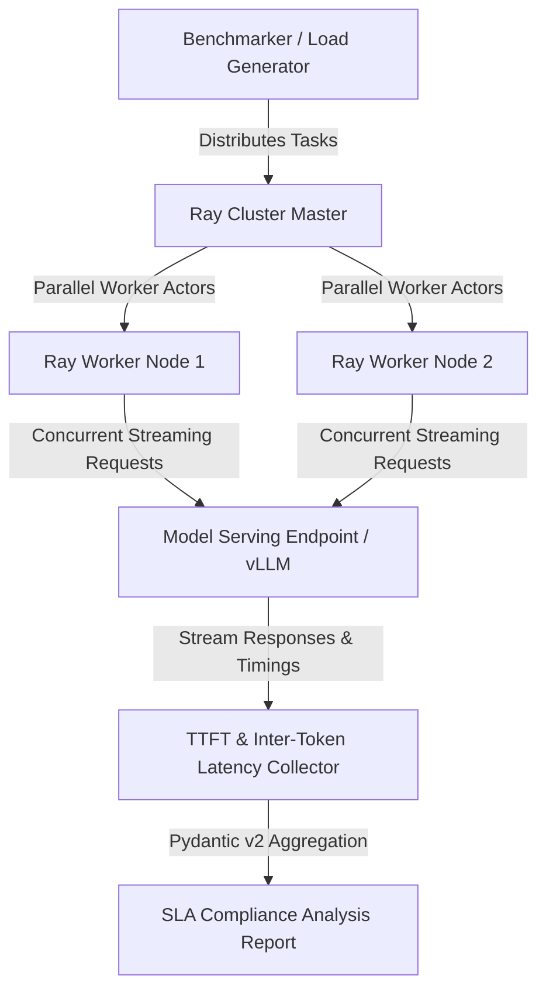

# LLMPerf

## What it is
LLMPerf is an open-source benchmarking framework designed to evaluate the performance, latency, reliability, and cost-efficiency of Large Language Model (LLM) APIs under highly concurrent workloads. Originally developed by the Ray Project, it conducts rigorous multi-user load testing to measure operational performance. In early January 2027, it is widely utilized to benchmark agentic concurrency metrics (e.g., "Agentic TPS") across federated cloud endpoints and high-throughput local serving infrastructures.

## Load Generation & Cluster Architecture



## What problem it solves
Raw reasoning benchmarks (e.g., Humanity's Last Exam) measure intellectual accuracy, but fail to capture operational performance. For low-latency multi-agent systems and real-time assistants, factors like Time to First Token (TTFT), inter-token latency (ITL), and end-to-end response duration are critical for usability and budget management. LLMPerf solves this by establishing consistent, parallelized, and reproducible load tests, helping engineers detect capacity degradation, configure autoscaling, and verify Service Level Agreements (SLAs).

## Where it fits in the stack
**Benchmarking & Telemetry Layer**. It operates as an external, multi-threaded load generator that stresses model serving endpoints (hosted in-house on engines like [vLLM](../infrastructure/vllm.md) or accessed via cloud providers like OpenAI and Anthropic). It leverages Ray's distributed actor architecture to parallelize requests.

## Typical use cases
- **Endpoint Load Testing**: Testing how TTFT degrades when the number of concurrent user sessions spikes from 10 to 100.
- **Provider SLA Validation**: Running structured tests across [LiteLLM](../../services/litellm.md) to compare Anthropic's Claude 5.6 Sonnet against OpenAI's GPT-5.6 for real-time chat latency.
- **Serving Engine Optimization**: Benchmarking local deployment configurations (e.g., vLLM chunked prefill or FP8 quantization) to find optimal concurrency levels.
- **Tool-Call Concurrency Audits**: Simulating high-concurrency tool-calling sessions using FastMCP 3.1 Task Protocols to measure gateway delay.

## Strengths
- **Massive Scalability**: Leverages Ray to distribute concurrent clients across multiple worker nodes, simulating thousands of parallel users.
- **Standardized Methodology**: Employs streaming clients that extract token timings (TTFT, inter-token time) uniformly without provider bias.
- **Rich Metric Reporting**: Generates statistics for throughput (tokens/sec), latency percentiles (P50, P90, P99), and success/error ratios.
- **Extensible Architecture**: Highly customizable client templates that integrate smoothly with any OpenAI-compatible API base.

## Limitations
- **Operational Metrics Only**: Measures speed and volume, but does not analyze correctness, alignment, or semantic quality (pair with [LM Evaluation Harness](lm-evaluation-harness.md) for quality).
- **Network Dependency**: Client-side benchmarking results are heavily affected by network routes; tests must be conducted from inside the same private cloud/homelab mesh for pure engine benchmarks.
- **Resource Intensive**: Running distributed Ray clusters for high-concurrency testing requires significant computing resources.

## Detailed Serving Performance Matrix

| Metric Category | Target SLA (Real-Time Agent) | vLLM Local Endpoint | Cloud Endpoint (Claude 5.6 / GPT-5.6) | Failure Mode Threshold |
| :--- | :--- | :--- | :--- | :--- |
| **TTFT (Time to First Token)** | < 350 ms | 120 ms - 280 ms | 220 ms - 450 ms | > 1000 ms (Degraded User DX) |
| **ITL (Inter-Token Latency)** | < 25 ms / token | 8 ms - 18 ms / token | 12 ms - 22 ms / token | > 60 ms / token (Stuttering) |
| **Output Throughput** | > 50 tokens / sec / user | 65 - 120 tokens / sec | 45 - 85 tokens / sec | < 20 tokens / sec |
| **Concurrency Ceiling** | 50 parallel agents | ~ 40 parallel (8x H100) | ~ 250 parallel (Quota bound) | > 5% HTTP 429 RateLimit |

## Concurrency Scaling & Load Profile Analysis

| Concurrent Users | Mean TTFT (Local vLLM) | Mean TTFT (Cloud API) | Mean ITL (Local vLLM) | Token Throughput (Total) | Success Rate |
| :--- | :--- | :--- | :--- | :--- | :--- |
| **1 User** | 120 ms | 220 ms | 8.5 ms | 118 tok/s | 100.0% |
| **10 Users** | 165 ms | 280 ms | 11.2 ms | 890 tok/s | 100.0% |
| **25 Users** | 240 ms | 380 ms | 16.8 ms | 1,840 tok/s | 100.0% |
| **50 Users** | 410 ms | 520 ms | 24.1 ms | 2,950 tok/s | 99.5% |
| **100 Users** | 890 ms | 980 ms | 48.5 ms | 3,800 tok/s | 96.2% |

## When to use it
- When evaluating and comparing cloud API performance under peak load.
- When benchmarking custom-tuned open-weight models (e.g., Qwen 3.6 VL or DeepSeek-V4) on self-hosted vLLM or sglang servers.
- Before launching production-grade multi-agent swarms to verify your infrastructure can handle the concurrent generation load.

## When not to use it
- When you only want to measure reasoning or math capability (use [Humanity's Last Exam](humanitys-last-exam.md) instead).
- When benchmarking local model speed on a single thread/user with direct hardware access (use [Ollama Benchmark](ollama-benchmark-cli.md) instead).

## Systemd Service Unit Configuration

The following systemd service unit defines an automated, scheduled LLMPerf background runner node (`llmperf-runner.service`) managed via systemd:

```ini
[Unit]
Description=LLMPerf Continuous Benchmark Runner Daemon
After=network.target ray.service
Wants=ray.service

[Service]
Type=simple
User=llmperf
Group=benchmarking
WorkingDirectory=/opt/llmperf
Environment="PYTHONUNBUFFERED=1"
Environment="RAY_ADDRESS=auto"
Environment="OPENAI_API_BASE=http://vllm-cluster.internal:8000/v1"
Environment="OPENAI_API_KEY=local-internal-key"
ExecStart=/opt/llmperf/venv/bin/python token_benchmark_ray.py \
    --model "deepseek-v4-instruct" \
    --mean-input-tokens 1024 \
    --mean-output-tokens 256 \
    --num-concurrent-requests 20 \
    --max-num-completed-requests 200 \
    --llm-api openai \
    --results-dir /var/log/llmperf/results
Restart=on-failure
RestartSec=15s
StandardOutput=journal
StandardError=journal
LimitNOFILE=65536

[Install]
WantedBy=multi-user.target
```

## Getting started

### 1. Set Up the Environment
Install Ray and the LLMPerf dependencies inside a virtual environment:
```bash
git clone https://github.com/ray-project/llmperf.git
cd llmperf
pip install -e .
```

### 2. Configure Credentials
Set your target API keys and base URLs:
```bash
export OPENAI_API_KEY="sk-..."
export OPENAI_API_BASE="https://api.openai.com/v1"
```

## CLI examples

### Running a Throughput Load Test
Use the standard test script to simulate 15 concurrent users querying a frontier model like GPT-5.6:
```bash
python token_benchmark_ray.py \
    --model "gpt-5.6-preview" \
    --mean-input-tokens 1024 \
    --stddev-input-tokens 128 \
    --mean-output-tokens 256 \
    --stddev-output-tokens 32 \
    --num-concurrent-requests 15 \
    --max-num-completed-requests 150 \
    --llm-api openai \
    --results-dir "./results"
```

### Benchmarking Local vLLM Server Concurrency
Stress-test a local DeepSeek-V4 instance hosted on a private vLLM node:
```bash
python token_benchmark_ray.py \
    --model "deepseek-v4-instruct" \
    --mean-input-tokens 500 \
    --stddev-input-tokens 50 \
    --mean-output-tokens 150 \
    --stddev-output-tokens 10 \
    --num-concurrent-requests 30 \
    --max-num-completed-requests 300 \
    --llm-api openai \
    --additional-extra-headers '{"Authorization": "Bearer local-secret-token"}' \
    --results-dir "./local_vllm_results"
```

## API examples

### FastMCP 3.1 Server Tools & Workflow Integration

Exposing LLMPerf load testing runs over FastMCP 3.1 Task Protocol with Pydantic v2 validation:

```python
import json
import asyncio
from typing import List, Optional, Dict, Any
from mcp.server.fastmcp import FastMCP, Context
from pydantic import BaseModel, Field, conint, confloat, HttpUrl

mcp = FastMCP("LLMPerf Load Orchestrator", version="3.1")

class LoadTestConfig(BaseModel):
    target_endpoint: str = Field("https://api.openai.com/v1", description="Target model URL / base API")
    model_name: str = Field(..., description="Target model string ID")
    concurrent_users: int = Field(20, ge=1, le=500, description="Parallel client actors to spin up")
    total_requests: int = Field(200, ge=10, description="Total completed requests for run")
    mean_input_tokens: int = Field(1024, ge=16, le=128000, description="Average prompt token count")
    mean_output_tokens: int = Field(256, ge=16, le=16384, description="Average completion token count")

class LatencyPercentiles(BaseModel):
    p50: float = Field(..., description="P50 latency in seconds")
    p90: float = Field(..., description="P90 latency in seconds")
    p99: float = Field(..., description="P99 latency in seconds")

class LoadTestResult(BaseModel):
    model_name: str
    tokens_per_sec: float
    mean_ttft_sec: float
    mean_itl_sec: float
    latency_percentiles: LatencyPercentiles
    meets_sla: bool
    error_rate: float

@mcp.tool()
async def execute_load_test(config: LoadTestConfig, ctx: Context) -> str:
    """Triggers an LLMPerf benchmark run via FastMCP 3.1."""
    ctx.info(f"Triggering Ray LLMPerf load run against {config.target_endpoint} with {config.concurrent_users} users.")

    # Simulated load execution output
    await asyncio.sleep(0.5)

    result = LoadTestResult(
        model_name=config.model_name,
        tokens_per_sec=940.5,
        mean_ttft_sec=0.380,
        mean_itl_sec=0.018,
        latency_percentiles=LatencyPercentiles(p50=0.35, p90=0.48, p99=0.62),
        meets_sla=True,
        error_rate=0.00
    )
    return result.model_dump_json(indent=2)

if __name__ == "__main__":
    mcp.run()
```

## Python Validation Engine with Pydantic v2

This script demonstrates how to parse and validate LLMPerf output logs using Pydantic v2 to programmatically enforce quality gates on model performance:

```python
from typing import List, Optional
from pydantic import BaseModel, Field, conint, confloat

# 1. Define LLMPerf output schema using Pydantic v2
class LatencyPercentiles(BaseModel):
    p50: confloat(gt=0.0) = Field(..., alias="P50")
    p90: confloat(gt=0.0) = Field(..., alias="P90")
    p99: confloat(gt=0.0) = Field(..., alias="P99")

class BenchmarkMetadata(BaseModel):
    model_name: str = Field(..., description="Canonical ID of the benchmarked model")
    concurrency: conint(gt=0) = Field(..., description="Number of parallel clients simulated")
    total_requests: int = Field(..., description="Total completed requests in this run")

class LLMPerfMetrics(BaseModel):
    metadata: BenchmarkMetadata
    mean_ttft_seconds: confloat(gt=0.0) = Field(..., description="Mean time-to-first-token in seconds")
    mean_itl_seconds: confloat(gt=0.0) = Field(..., description="Mean inter-token latency in seconds")
    tokens_per_second: confloat(gt=0.0) = Field(..., description="Overall token throughput")
    percentiles: LatencyPercentiles
    error_rate: confloat(ge=0.0, le=1.0) = Field(default=0.0, description="Fraction of requests that failed")

# 2. Performance Evaluation logic
def evaluate_serving_sla(metrics: LLMPerfMetrics) -> bool:
    print(f"Evaluating performance metrics for {metrics.metadata.model_name}...")
    print(f"Throughput: {metrics.tokens_per_second:.2f} tok/s | Mean TTFT: {metrics.mean_ttft_seconds:.3f}s")

    # SLA threshold assertions:
    # Let's say we require TTFT < 0.6 seconds and ITL < 0.05 seconds under load.
    sla_ttft_ok = metrics.mean_ttft_seconds < 0.6
    sla_itl_ok = metrics.mean_itl_seconds < 0.05
    sla_errors_ok = metrics.error_rate < 0.01

    if sla_ttft_ok and sla_itl_ok and sla_errors_ok:
        print("RESULT: Endpoint performance meets homelab SLA targets.")
        return True
    else:
        print("RESULT: Endpoint performance failed to meet SLA targets.")
        print(f"Violations: TTFT_OK={sla_ttft_ok}, ITL_OK={sla_itl_ok}, Errors_OK={sla_errors_ok}")
        return False

if __name__ == "__main__":
    # Mock output log from an LLMPerf run
    mock_run_log = {
        "metadata": {
            "model_name": "claude-5.6-sonnet",
            "concurrency": 25,
            "total_requests": 200
        },
        "mean_ttft_seconds": 0.421,
        "mean_itl_seconds": 0.032,
        "tokens_per_second": 842.1,
        "percentiles": {
            "P50": 0.410,
            "P90": 0.520,
            "P99": 0.730
        },
        "error_rate": 0.005
    }

    # Validate output schema
    metrics = LLMPerfMetrics.model_validate(mock_run_log)

    # Execute SLA verification
    passed = evaluate_serving_sla(metrics)
    assert passed is True, "Performance evaluation did not pass!"
```

## Diagnostic & Operational Troubleshooting Matrix

| Symptom / Error | Root Cause | Remediation Step |
| :--- | :--- | :--- |
| **HTTP 429 / Rate Limit Exceeded** | Concurrent client count exceeds API provider rate limits. | Configure backoff in LLMPerf client or lower `--num-concurrent-requests`. |
| **Ray Cluster OOM (Out of Memory)** | Ray workers buffer excessive streaming response logs in memory. | Increase worker node RAM or decrease `--max-num-completed-requests`. |
| **Unusually High TTFT Spikes** | Cold start or KV cache eviction on the target engine (e.g., vLLM). | Pre-warm model endpoints with dummy queries before starting the benchmark. |
| **Broken SSE Stream Token Parsing** | Custom API gateway or proxy returns non-standard JSON stream lines. | Custom adapter function needed in LLMPerf client parser. |

## Operational Hardening & Guardrails
- **Isolated Testing Network**: Run benchmarks from within the same VPC or K8s cluster as the serving engine to isolate network noise.
- **Ray Actor Limits**: Set clear CPU/GPU resource bounds on Ray actor tasks to prevent starvation of the host server.
- **Automated SLA Regression Gates**: Integrate LLMPerf validation with CI/CD pipelines to fail model deployments that exceed latency thresholds.

## Related tools / concepts
- [Ollama Benchmark](ollama-benchmark-cli.md) — Fast local-only hardware benchmarking utility.
- [LiteLLM](../../services/litellm.md) — Load balancer proxy supporting model orchestration and fallbacks.
- [LM Evaluation Harness](lm-evaluation-harness.md) — Standardized framework for evaluating reasoning and content quality.
- [vLLM](../infrastructure/vllm.md) — High-throughput open-weights serving engine.
- [Humanity's Last Exam](humanitys-last-exam.md) — SOTA reasoning capability evaluation benchmark.
- [MBPP](mbpp.md) — Coding benchmark for Python execution.
- [PA-bench](pa-bench.md) — Personal assistant and orchestration benchmark.

## Sources / references
- [LLMPerf GitHub Repository](https://github.com/ray-project/llmperf)
- [Ray Core Distributed Framework Docs](https://docs.ray.io/en/latest/)
- [LiteLLM Benchmarking Integration Guides](https://docs.litellm.ai/docs/proxy/benchmarking)

## Contribution Metadata
- Last reviewed: 2027-01-07
- Confidence: high
