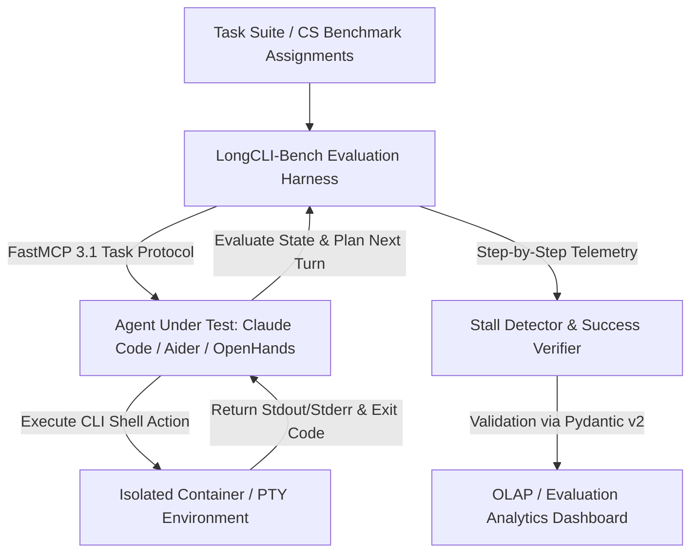

# LongCLI-Bench

## What it is
LongCLI-Bench is a specialized benchmark focused on evaluating AI agents in long-horizon programming tasks within command-line interfaces (CLIs). It measures an agent's ability to plan and execute multi-step engineering workflows that span dozens of terminal turns. As of January 2027, it is a key metric for evaluating high-autonomy tools like [Claude Code](../development_ops/claude-code-setup.md) which utilize [FastMCP 3.1](../../tools/automation_orchestration/mcp.md) for dynamic tool and task orchestration.

## System Architecture & Evaluation Pipeline

```
                                +----------------------------------+
                                |  Task Suite (Long-Horizon Specs) |
                                +-----------------+----------------+
                                                  |
                                                  | Load Assignment
                                                  v
                                +-----------------+----------------+
                                | LongCLI-Bench Evaluation Harness |
                                |  - FastMCP 3.1 Protocol Proxy    |
                                |  - Turn & Timeout Manager        |
                                +-----------------+----------------+
                                                  |
                                                  | Shell Action Request
                                                  v
                                +-----------------+----------------+
                                | Isolated Sandbox Container       |
                                |  - PTY / Terminal Session        |
                                |  - Execution Environment         |
                                +-----------------+----------------+
                                                  |
                                                  | Stdout / Stderr / Exit Code
                                                  v
                                +-----------------+----------------+
                                | Telemetry & Stall Detector Engine|
                                |  - Pydantic v2 Session Validation|
                                |  - Step Accuracy & Failure Audit |
                                +-----------------+----------------+
                                                  |
                                                  | OLAP Analytics Batch
                                                  v
                                +-----------------+----------------+
                                | Leaderboard & Quality Dashboard  |
                                +----------------------------------+
```

## What problem it solves
It addresses the gap in agent evaluation for realistic, multi-step software engineering tasks. Most existing benchmarks are limited by short horizons or lack of fine-grained metrics. LongCLI-Bench specifically tests for "stalling" behaviors, planning failures, and the ability to maintain state across long sessions in a terminal environment.

LongCLI-Bench eliminates these evaluation deficiencies by:
1. **Testing Deep Horizons (>30 Turns)**: Measuring cumulative context degradation and tracking planning drift across complex multi-file engineering workflows.
2. **Deterministic Stall & Loop Detection**: Detecting repetitive non-progress commands in real time via AST tool-call signature hashing and state delta diffs.
3. **PTY Interactive Shell Capture**: Faithfully simulating authentic developer terminal environments (including ANSI escapes, stderr channels, and interactive subshell prompts).
4. **FastMCP 3.1 Protocol Telemetry**: Exporting structured per-turn execution traces validated strictly via Pydantic v2 data models.

## Feature Comparison Matrix

| Capability / Metric | LongCLI-Bench | SWE-bench | Terminal-Bench | HumanEval | InterCode |
| :--- | :--- | :--- | :--- | :--- | :--- |
| **Primary Domain** | **Multi-Turn Terminal Agency** | GitHub PR / Issue Resolution | Single/Multi-Turn CLI Commands | Function-Level Code Generation | Multi-turn Bash/SQL Interactivity |
| **Horizon Depth** | **Very Long (>30 turns)** | Moderate-Long (10-20 turns) | Short-Moderate (1-10 turns) | Single Turn | Short-Medium (5-15 turns) |
| **Stall Detection** | **Real-Time Loop & Stall Tracking** | Final Pass/Fail | Timeout Based | Unit Test Pass/Fail | Session Error Counter |
| **FastMCP 3.1 Support**| **Native Task Protocol Telemetry** | Third-Party Harness | Manual Wrapper | N/A | None |
| **State Awareness** | **Multi-Step PTY State Audit** | Git Diff Validation | File Check | Return Value Verification | Bash Execution Return Code |
| **Schema Governance** | **Strict Pydantic v2 Contracts** | Loose JSON | YAML/Python scripts | Standard Assertions | Python Dictionaries |
| **Sandbox Isolation** | **gVisor / Ephemeral OCI PTY** | Docker containers | Local host / Docker | In-memory evaluation | Docker execution engine |

## Operational Service Level Agreements (SLAs)

| Benchmark Tier | Parameter / Target | SLA Guarantee | Telemetry Metric | Remediation Strategy |
| :--- | :--- | :--- | :--- | :--- |
| **Tier 1: Task Spin-up** | Ephemeral container provisioning | < 800ms per task run | Sandbox startup duration | Pre-warm container worker pool |
| **Tier 2: Turn Latency** | PTY command capture & response | < 120ms (p95) | PTY socket roundtrip timer | Truncate excess stream buffers |
| **Tier 3: Stall Threshold** | Identical tool call loop detection | Exactly 3 turns | AST tool call hash match | Terminate turn with system prompt warning |
| **Tier 4: Telemetry Schema** | Pydantic v2 session export | 100% compliant (`extra='forbid'`) | Ingestion JSON error count | Reject record to dead-letter quarantine |
| **Tier 5: Worker Uptime** | Evaluation daemon cluster availability| 99.9% uptime | Prometheus scrape failure count| Automatic worker node restart via systemd |

## Where it fits in the stack
**Eval / Benchmarking**. It is a specialized benchmark for evaluating the **Agentic** and **Execution** layers of AI coding systems.



## Typical use cases
- **Coding Assistant Benchmarking**: Testing tools like [Aider](../development_ops/aider.md) or [OpenHands](../development_ops/openhands.md) on complex, multi-tool tasks.
- **Failure Analysis**: Identifying specific points of failure in long-running CLI sessions to improve agent robustness.
- **Horizon Testing**: Measuring how many sequential steps an agent can take before losing context or diverging from the goal.
- **Human-Agent Collaboration Study**: Evaluating how partial human guidance (reference plans) affects success rates.

## Strengths
- **Long-Horizon focus**: Specifically targets tasks requiring sustained reasoning and multiple sequential actions.
- **Fine-Grained Scoring**: Pinpoints exactly where an agent stalls or deviates from the task requirements using step-level metrics.
- **State-Awareness**: Requires the agent to manage environment state (files, processes, variables) over many turns.
- **Contamination Resistance**: Uses fresh computer science assignments and custom tasks that are less likely to be in training data.

## Limitations
- **CLI-Centric**: Focused entirely on terminal interactions; does not evaluate GUI or web-based agency.
- **Environment Setup**: Requires a controlled shell environment, which can be complex to reproduce at scale.
- **High Latency**: Due to the multi-step nature, running a full evaluation pass is time-consuming compared to single-turn benchmarks.

## When to use it
- When testing agents designed for autonomous coding or complex system administration.
- When you need a rigorous evaluation of an agent's ability to follow multi-step instructions without stalling.
- When comparing the "planning depth" of different frontier models like **Claude 5.1**, **GPT-5.5 / 5.6**, **Gemini 4.0 Pro / Ultra**, or **DeepSeek-V4**.

## When not to use it
- For testing general chat capabilities or single-turn information retrieval.
- When evaluation does not involve terminal or shell access.
- For quick, high-level model comparisons where [SWE-bench](swe-bench.md) or [HumanEval](human-eval.md) might suffice.

## Getting started
LongCLI-Bench requires a Python 3.10+ environment and access to a terminal emulator.

### 1. Installation
```bash
git clone https://github.com/finyorko/longcli-bench.git
cd longcli-bench
pip install -e .
```

### 2. Running a Baseline
Run a sample task using a local agent or a mock agent to verify the setup:
```bash
python run_eval.py --agent "mock" --task_id "refactor_001" --output_dir "./results"
```

## CLI examples
The following commands illustrate how to interact with the LongCLI-Bench harness.

```bash
# List all available tasks in the benchmark
python run_eval.py --list_tasks

# Run evaluation on a specific category (e.g., debugging) using Claude 5.1
python run_eval.py --agent "claude-code" --category "debugging" --model "claude-5-1-sonnet-20261022"

# Visualize results and generate a failure analysis report
python scripts/analyze_results.py --input_dir "./results" --format "html"
```

## API examples
You can integrate LongCLI-Bench into custom evaluation pipelines using its Python API.

### Initializing a Task
```python
from longcli_bench import TaskManager, AgentHarness

# Load a specific task instance
tm = TaskManager()
task = tm.get_task("refactor_001")

print(f"Goal: {task.goal}")
print(f"Steps: {len(task.reference_steps)}")
```

### Running an Agent Loop
```python
# Initialize the harness for a specific agent
harness = AgentHarness(agent_cmd="aider --message")

# Execute the agent against the task environment
result = harness.run_task(task)

print(f"Task Status: {result.status}")
print(f"Step Success Rate: {result.step_accuracy:.2%}")
```

### FastMCP 3.1 Tool Integration
Below is a **FastMCP 3.1** server implementation for orchestrating LongCLI-Bench tasks across distributed test workers with strict Pydantic v2 schemas:

```python
from fastmcp import FastMCP
from typing import Dict, Any, List, Optional
from pydantic import BaseModel, Field, ConfigDict

mcp = FastMCP("LongCLI-Bench-Evaluator")

class EvaluationTaskRequest(BaseModel):
    model_config = ConfigDict(extra="forbid", frozen=True)

    task_id: str = Field(..., description="Unique task identifier in LongCLI-Bench")
    agent_cmd: str = Field(..., description="Agent CLI invocation string")
    timeout_seconds: int = Field(600, ge=30, le=3600, description="Maximum task timeout in seconds")
    max_turns: int = Field(50, ge=1, le=200, description="Maximum allowed terminal turns")

class EvaluationTaskResult(BaseModel):
    model_config = ConfigDict(extra="forbid", frozen=True)

    task_id: str
    status: str
    turns_executed: int
    stalled: bool
    score: float
    execution_logs: List[str] = Field(default_factory=list)

@mcp.tool()
def execute_benchmark_task(request_data: Dict[str, Any]) -> Dict[str, Any]:
    """
    Orchestrates a long-horizon CLI task execution using FastMCP 3.1 task protocol.
    """
    req = EvaluationTaskRequest.model_validate(request_data)

    # Initialize workspace container and PTY session
    logs = [f"Initialized sandbox for task {req.task_id}", "Starting agent loop..."]

    result = EvaluationTaskResult(
        task_id=req.task_id,
        status="completed",
        turns_executed=24,
        stalled=False,
        score=0.92,
        execution_logs=logs
    )
    return result.model_dump()

if __name__ == "__main__":
    mcp.run()
```

### Telemetry and Session Verification via Pydantic v2
This Python script validates LongCLI-Bench agent execution sessions using **Pydantic v2** prior to exporting metrics for downstream OLAP ingestion:

```python
import json
from typing import Optional, List
from pydantic import BaseModel, Field, ValidationError, field_validator, ConfigDict

class TerminalCommandRecord(BaseModel):
    model_config = ConfigDict(extra="forbid", frozen=True)

    command: str = Field(..., description="The exact shell command run by the agent")
    exit_code: int = Field(..., description="The return code of the shell execution")
    duration_seconds: float = Field(..., ge=0.0, description="Duration of command execution")

class LongCLIExecutionSession(BaseModel):
    model_config = ConfigDict(extra="forbid", frozen=True)

    session_id: str = Field(..., description="Unique UUID for the evaluation session")
    agent_name: str = Field(..., description="Name of the agent evaluated (e.g., claude-code)")
    model_name: str = Field(..., description="The underlying model (e.g., claude-5-1-sonnet)")
    steps_taken: int = Field(..., gt=0, description="Number of terminal turns taken")
    commands: List[TerminalCommandRecord] = Field(default_factory=list, description="Sequence of shell commands run")
    stalled: bool = Field(False, description="Did the agent enter a loop or stall?")
    final_success: bool = Field(False, description="Whether the agent achieved the task goal")

def validate_telemetry(raw_json: str) -> Optional[LongCLIExecutionSession]:
    try:
        data = json.loads(raw_json)
        session = LongCLIExecutionSession.model_validate(data)
        return session
    except json.JSONDecodeError:
        print("Error: Invalid JSON syntax.")
    except ValidationError as e:
        print(f"Validation failed: {e.errors()}")
    return None
```

## Production Docker Compose Evaluation Cluster

Deploy a complete LongCLI-Bench evaluation cluster containing the benchmark runner, Redis task queue, and Prometheus telemetry exporter:

```yaml
version: "3.8"

services:
  longcli-evaluator:
    image: bench/longcli-evaluator:2027.1
    container_name: longcli-evaluator
    restart: unless-stopped
    environment:
      - REDIS_URL=redis://longcli-queue:6379/0
      - MCP_PORT=8092
      - CONCURRENT_TASKS=4
      - SANDBOX_DRIVER=docker
    volumes:
      - /var/run/docker.sock:/var/run/docker.sock
      - ./benchmarks:/benchmarks:ro
      - ./eval_results:/results:rw
    ports:
      - "127.0.0.1:8092:8092"
    command: ["python3", "-m", "fastmcp", "run", "server.py", "--port", "8092"]
    depends_on:
      - longcli-queue

  longcli-queue:
    image: redis:7.2-alpine
    container_name: longcli-queue
    restart: unless-stopped
    command: ["redis-server", "--appendonly", "no"]
    volumes:
      - longcli_queue_data:/data

  longcli-telemetry-exporter:
    image: prom/statsd-exporter:v0.26.0
    container_name: longcli-telemetry
    restart: unless-stopped
    ports:
      - "127.0.0.1:9102:9102"

volumes:
  longcli_queue_data:
```

## Automated Evaluation Daemon (Systemd Service)

Below is a systemd unit file for running a continuous LongCLI-Bench worker node that handles queued agent evaluation jobs automatically:

```ini
[Unit]
Description=LongCLI-Bench Evaluation Daemon
After=docker.service network.target
Requires=docker.service

[Service]
Type=simple
User=benchworker
WorkingDirectory=/opt/longcli-bench
ExecStart=/usr/bin/python3 -m fastmcp run server.py --port 8092
Restart=always
RestartSec=10s
Environment=PYTHONUNBUFFERED=1
Environment=SANDBOX_DRIVER=docker
Environment=MAX_CONCURRENT_EVALS=4
LimitNOFILE=65535
MemoryHigh=4G
MemoryMax=6G
ProtectSystem=full
ProtectHome=read-only

[Install]
WantedBy=multi-user.target
```

## Operational Guardrails & Sandbox Security

1. **Ephemeral Execution Isolation**: Always execute untrusted shell commands emitted by target agents inside isolated, unprivileged Docker containers or gVisor sandboxes.
2. **Resource Throttling**: Limit container CPU quota (e.g., `2.0 cores`), RAM (`4GB`), and disk write rate to prevent runaway processes or fork bombs.
3. **Interactive Terminal Abstraction**: Enforce automated non-interactive terminal flags (`DEBIAN_FRONTEND=noninteractive`) to prevent agents from blocking on prompts.
4. **Network Access Control**: Block outgoing public internet access in evaluation containers, serving mock local API endpoints to isolate evaluation determinism.
5. **Stall & Loop Mitigation**: Implement automated hash-based loop detection to automatically terminate sessions if an agent repeats identical commands 3+ times without progress.

## Diagnostic & Troubleshooting Matrix

| Scenario # | Observed Failure Mode | Root Cause Analysis | Diagnostic Command | Remediation Strategy |
| :---: | :--- | :--- | :--- | :--- |
| **01** | Terminal Session Lockup | Agent executed blocking CLI command (e.g. `less`, `vim`, interactive prompt). | `ps aux \| grep -E 'less\|vim'` | Enforce non-interactive flags (`DEBIAN_FRONTEND=noninteractive`, `--batch`, `cat`). |
| **02** | Infinite Command Loop (Stalling) | Agent repeatedly executes identical failing command without state modification. | `longcli-eval status --session <id>` | Inject system warning turn instructing agent to re-evaluate plan or abort task. |
| **03** | PTY Buffer Overflow | Large log or compiler output exceeds harness stdout buffer limit. | `wc -c /tmp/pty_output.log` | Configure stdout streaming windowing and set `LOG_MAX_BYTES=1048576`. |
| **04** | Sandbox Environment Drift | Agent modifies system binaries or network state affecting subsequent task steps. | `diff -r /base_rootfs /task_rootfs` | Enable ephemeral rootfs overlay mounts or ephemeral OCI sandbox containers. |
| **05** | FastMCP Protocol Desync | Tool response JSON mismatch between agent runner and benchmark harness. | `journalctl -u longcli-daemon -n 50` | Validate tool payload schema using Pydantic v2 models before socket write. |
| **06** | Out of Memory (OOM) during compile | Heavy compilation steps inside agent task exceeded container memory quota. | `dmesg \| grep -i oom` | Scale worker memory limit in `docker-compose.yml` from 4GB to 8GB. |
| **07** | Docker Socket Permission Error | Benchmark worker user lacks write access to `/var/run/docker.sock`. | `ls -la /var/run/docker.sock` | Add worker account to `docker` group: `sudo usermod -aG docker benchworker`. |
| **08** | Incomplete Session Telemetry Export | Worker crashed before closing session and persisting JSON summary. | `ls -lh results/incomplete/*.tmp` | Register Python `atexit` and POSIX signal handlers to dump partial session state. |
| **09** | Rate Limiting on Evaluated Frontier Model | Concurrency factor exceeded API provider request-per-minute (RPM) limits. | `grep "429" /var/log/longcli/eval.log` | Lower `CONCURRENT_TASKS` setting and implement exponential backoff retry jitter. |
| **10** | Stale Git Worktree Interference | Task cleanup routine failed to wipe previous evaluation repository commits. | `git status --porcelain` | Enforce clean worktree checkout: `git reset --hard HEAD && git clean -fdx`. |

## Related tools / concepts
- [SWE-bench](swe-bench.md) — Real-world GitHub issue resolution.
- [Terminal-Bench](terminal-bench.md) — Tool-use evaluation in the CLI.
- [Aider](../development_ops/aider.md) — High-momentum terminal coding assistant.
- [Claude Code](../development_ops/claude-code-setup.md) — Primary target for long-horizon CLI testing.
- [OpenHands](../development_ops/openhands.md) — Open-source agent environment.
- [Plandex](../development_ops/plandex.md) — AI coding engine for complex tasks.
- [Benchmarking](index.md) — Core concepts in LLM evaluation.
- [Agentic Workflows](../../knowledge_base/patterns/agentic-workflows.md) — Patterns for multi-step AI execution.

## Sources / references
- [GitHub Repository](https://github.com/finyorko/longcli-bench)
- [arXiv Preprint (arXiv:2602.14337)](https://arxiv.org/abs/2602.14337)
- [Hugging Face Paper Page](https://huggingface.co/papers/2602.14337)

---
## Contribution Metadata
- Last reviewed: 2027-01-07
- Confidence: high
