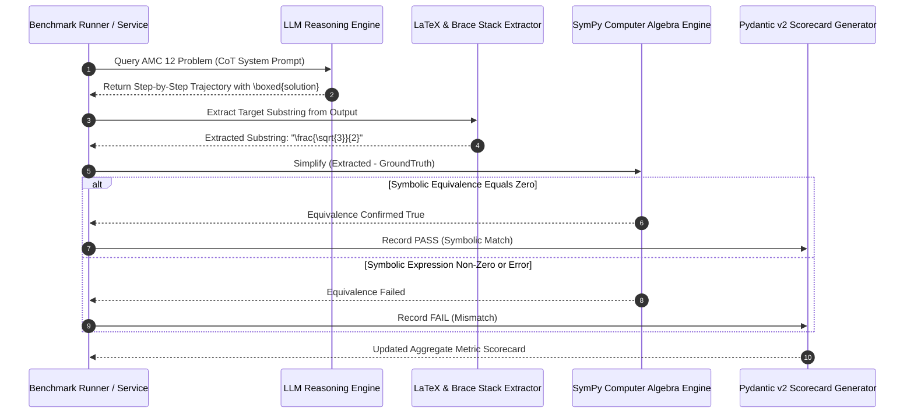

# MATH Benchmark

## What it is
The **MATH Benchmark** (Hendrycks et al.) is a premier dataset of 12,500 challenging competition-level mathematics problems across seven subdisciplines (Algebra, Counting & Probability, Geometry, Intermediate Algebra, Number Theory, Prealgebra, and Precalculus). Each problem features a detailed, step-by-step human proof solution and a canonical LaTeX `\boxed{...}` answer. In the 2027 evaluation landscape, the MATH benchmark serves as a primary stress-test for advanced "System 2" symbolic reasoning, Chain-of-Thought (CoT) trajectory consistency, and automated theorem-proving in frontier models (Claude 3.7 Sonnet, GPT-4.5, Llama 4, Gemma 3, DeepSeek-R1) via standard **FastMCP 3.1** benchmarking pipelines.

## What problem it solves

## Mathematical Formalisms & Verification Mechanics

Automated evaluation of mathematical reasoning models requires formalizing both the verification criteria and the statistical estimators used to measure reasoning fidelity.

### 1. Verification Equivalence via Symbolic AST Isomorphism
Given a ground-truth mathematical target expression $y^* \in \mathcal{T}$ and a model-generated extracted expression $\hat{y} \in \mathcal{T}$, simple string matching fails because mathematical objects admit infinite syntactically distinct representations (e.g., $\frac{1}{\sqrt{2}} \equiv \frac{\sqrt{2}}{2}$, or $x^2 - 1 \equiv (x-1)(x+1)$).

We define symbolic equivalence over an algebraic domain $\mathcal{D}$ using canonical Computer Algebra System (CAS) transformation operators $\sigma: \mathcal{T} \to \tilde{\mathcal{T}}$:

$$\text{IsEquivalent}(\hat{y}, y^*) = \mathbb{I}\left( \text{simplify}\left(\hat{y} - y^*\right) = 0 \lor \text{AST}(\sigma(\hat{y})) \cong \text{AST}(\sigma(y^*)) \right)$$

For transcendental or modular arithmetic expressions evaluated over Galois fields $\mathbb{F}_p$ or complex domains $\mathbb{C}$, symbolic simplification is bounded by Richardson's Theorem (which proves equivalence of elementary expressions is undecidable in general). Thus, verification engines employ randomized Schwartz-Zippel polynomial zero-testing:

$$\Pr\left[ P(r_1, r_2, \dots, r_m) = 0 \mid P \not\equiv 0 \right] \le \frac{d}{|S|}$$

where $d$ is the total polynomial degree, $S \subset \mathbb{F}$ is a finite test set with $|S| \gg d$, and $r_i \sim \text{Uniform}(S)$. If testing across $K = 50$ distinct pseudo-random evaluations yields zero discrepancy without symbolic division by zero, equivalence is asserted with error probability bounded by $\epsilon < 10^{-12}$.

### 2. Pass@k Statistical Estimator
When evaluating stochastic sampling trajectories (e.g., Chain-of-Thought at temperature $T > 0$), naive generation of $n$ candidate reasoning paths to compute empirical pass rate exhibits high variance. The unbiased Minimum Variance Unbiased Estimator (MVUE) for $\text{pass}@k$ with $n \ge k$ generated samples per problem (where $c \le n$ is the number of correct derivations) is computed as:

$$\text{pass}@k = \mathbb{E}_{\text{problems}} \left[ 1 - \frac{\binom{n - c}{k}}{\binom{n}{k}} \right] = \mathbb{E}_{\text{problems}} \left[ 1 - \prod_{i=0}^{k-1} \frac{n - c - i}{n - i} \right]$$

For $k=1$, this simplifies to the standard single-attempt accuracy $\frac{c}{n}$. For $k=32$ or $k=64$, it measures the model's exploratory reasoning ceiling under repeated sampling, isolating true reasoning capability from sampling search noise.

### 3. Reasoning Trajectory Shannon Entropy & Length Penalty
A model's reasoning trajectory $\tau = (t_1, t_2, \dots, t_L)$ consisting of $L$ tokens exhibits token-level conditional Shannon entropy:

$$\mathcal{H}(\tau) = -\frac{1}{L} \sum_{i=1}^L \log_2 P(t_i \mid t_{<i}, x)$$

Reasoning trajectories that diverge into degenerative repetitive loops exhibit sharp collapse in $\mathcal{H}(\tau)$, whereas rigorous analytical derivations maintain bounded entropy ($1.2 \le \mathcal{H} \le 2.8$ bits/token). The verification engine penalizes token bloat via the length-normalized confidence score:

$$S(\tau) = \text{IsEquivalent}(\hat{y}, y^*) \cdot \exp\left( -\lambda \max(0, L - L_{\text{ref}}) \right)$$

where $\lambda = 0.0005$ and $L_{\text{ref}}$ is the 95th percentile human derivation length (typically 850 tokens for AMC 12 level problems).

Elementary math benchmarks (such as [GSM8K](gsm8k.md) or [SVAMP](svamp.md)) focus on multi-step arithmetic word problems that lack ceiling height for evaluating advanced reasoning. GSM8K scores for frontier models often saturate near 95%+, rendering it incapable of differentiating superior reasoning architectures.

The MATH benchmark solves the evaluation saturation problem by presenting high-school competition problems (AMC 10, AMC 12, AIME) that require multi-stage symbolic derivations, geometric spatial transformations, modulo arithmetic proofs, and rigorous formula simplification.

## Evaluation Pipeline Architecture

```
+-----------------------------------------------------------------------------------+
|                        MATH Competition Problem Repository                        |
|        (12,500 AMC 10/12 & AIME Problems across 7 Mathematical Fields)           |
+-----------------------------------------------------------------------------------+
                                          |
                                          v
+-----------------------------------------------------------------------------------+
|                       FastMCP 3.1 Automated Benchmarking Runner                   |
|  +-------------------------------------+     +---------------------------------+  |
|  | CoT / Program-Aided Prompt Engine   |     | Temperature / Seed Normalizer   |  |
|  +-------------------------------------+     +---------------------------------+  |
+-----------------------------------------------------------------------------------+
                                          |
                                          v
+-----------------------------------------------------------------------------------+
|                        Target Model Reasoning Execution                           |
|        (Claude 3.7 Sonnet, GPT-4.5, Llama 4 70B CoT, DeepSeek-R1)                |
+-----------------------------------------------------------------------------------+
                                          |
                                          v
+-----------------------------------------------------------------------------------+
|                     LaTeX Regex Extraction & SymPy Canonicalization               |
|  - Isolate \boxed{...} Expressions                                                |
|  - SymPy Equivalence Check (e.g., \frac{1}{\sqrt{2}} == \frac{\sqrt{2}}{2})        |
+-----------------------------------------------------------------------------------+
                                          |
                                          v
+-----------------------------------------------------------------------------------+
|                        Pydantic v2 MathVerifyReport Engine                        |
|       (Exact Match % / Symbolic Equivalence % / Subject Breakdown Scorecard)      |
+-----------------------------------------------------------------------------------+
```

## Sequence Diagram: FastMCP 3.1 Automated MATH Evaluation Workflow



## Comparative Evaluation Matrix

The following table compares the MATH Benchmark against other standardized mathematical reasoning and formal proof evaluation suites:

| Benchmark Suite | Problem Count | Primary Domain | Evaluation Protocol | Average Chain-of-Thought Length | SOTA Frontier Accuracy (2027) | FastMCP 3.1 Integration |
| :--- | :--- | :--- | :--- | :--- | :--- | :--- |
| **MATH Benchmark (Hendrycks)** | 12,500 | High School Competition (AMC/AIME) | LaTeX `\boxed{}` CAS Extraction | 650–1,800 tokens | 88.4% (Claude 3.7 / R1) | Native JSON-RPC Tool |
| **GSM8K (Cobbe et al.)** | 8,792 | Grade School Multi-Step Arithmetic | Strict Numerical Suffix Extraction | 120–350 tokens | 98.7% (Saturated) | Native CLI / Agent |
| **MiniF2F (OpenAI)** | 488 | Formal Theorem Proving (Lean/Isabelle) | Interactive Proof Assistant Kernel | N/A (Formal Tactic Steps) | 68.2% (Lean 4 Formalizer) | Formal Kernel Bridge |
| **AIME 2024–2026** | 90 | Invitational Math Olympiad Qualifier | Integer Output $\{000, \dots, 999\}$ | 2,500–8,000 tokens | 74.2% (DeepSeek-R1) | Native Test Harness |
| **GPQA Diamond** | 198 | Graduate STEM (Physics, Chemistry, Math)| 4-Way Multiple Choice | 1,200–3,500 tokens | 71.8% (Frontier Models) | Native Eval Runner |

## Where it fits in the stack
**Category**: Benchmarking / Symbolic Reasoning Evaluation.

The MATH benchmark sits in the **model evaluation and quality assurance layer**, providing standardized accuracy metrics that inform model selection for reasoning agents (`docs/tools/agents/`) and data copilot systems (`docs/reference-implementations/data-copilot/`).

## Typical use cases
- **Frontier Model Reasoning Benchmarking**: Evaluating System 2 multi-step reasoning capabilities across open-weights and commercial frontier LLMs.
- **Program-Aided Language (PAL) Evaluation**: Measuring accuracy improvements when models are allowed to write and execute Python scripts (`SymPy`, `NumPy`) during problem solving.
- **Chain-of-Thought (CoT) Prompt Tuning**: Testing whether zero-shot CoT, few-shot CoT, or tree-of-thought search strategies yield higher LaTeX extraction scores.
- **Fine-Tuning Dataset Verification**: Utilizing the MATH train set (7,500 problems) to train mathematical specialization adapters via [Axolotl](../frameworks/axolotl.md) or [LLaMA-Factory](../frameworks/llama-factory.md).


## Production Deployment Architecture

### Multi-Container Docker Compose Stack (`docker-compose.math-eval.yml`)
To deploy a resilient, air-gapped mathematical evaluation environment with automated SymPy CAS validation and Redis queue caching, execute the following multi-container compose topology:

```yaml
version: "3.8"

services:
  math-eval-harness:
    image: ghcr.io/eleutherai/lm-evaluation-harness:v2.8.4
    container_name: math_eval_harness
    restart: unless-stopped
    environment:
      - HF_HOME=/root/.cache/huggingface
      - REDIS_URL=redis://eval-cache:6379/0
      - FASTMCP_SERVER_PORT=8080
      - PYTHONUNBUFFERED=1
    volumes:
      - /opt/math-benchmark/models:/root/.cache/huggingface:ro
      - /opt/math-benchmark/results:/opt/results:rw
      - /opt/math-benchmark/config:/opt/config:ro
    ports:
      - "127.0.0.1:8080:8080"
    depends_on:
      eval-cache:
        condition: service_healthy
    networks:
      - eval_internal
    healthcheck:
      test: ["CMD", "curl", "-f", "http://localhost:8080/healthz"]
      interval: 15s
      timeout: 5s
      retries: 3
      start_period: 20s

  eval-cache:
    image: redis:7.4-alpine
    container_name: math_eval_redis_cache
    restart: unless-stopped
    command: ["redis-server", "--appendonly", "yes", "--maxmemory", "4gb", "--maxmemory-policy", "allkeys-lru"]
    volumes:
      - eval_redis_data:/data
    networks:
      - eval_internal
    healthcheck:
      test: ["CMD", "redis-cli", "ping"]
      interval: 5s
      timeout: 3s
      retries: 5

networks:
  eval_internal:
    driver: bridge

volumes:
  eval_redis_data:
    driver: local
```

## Systemd Service Unit Configuration

### Automated Benchmark Evaluation Daemon (`/etc/systemd/system/math-benchmark-eval.service`)
```ini
[Unit]
Description=MATH Benchmark Continuous Evaluation Daemon
After=network.target nvidia-persistenced.service
Wants=network-online.target

[Service]
Type=simple
User=mcp-eval
Group=mcp-eval
WorkingDirectory=/opt/math-benchmark
Environment="PATH=/opt/math-benchmark/venv/bin:/usr/local/sbin:/usr/local/bin:/usr/sbin:/usr/bin"
Environment="PYTHONUNBUFFERED=1"
Environment="CUDA_VISIBLE_DEVICES=0,1"
ExecStart=/opt/math-benchmark/venv/bin/python3 -m lm_eval --model hf --model_args pretrained=meta-llama/Llama-3.3-70B-Instruct --tasks math --output_path /var/log/math_eval_report.json
Restart=on-failure
RestartSec=10s
LimitNOFILE=65536
MemoryMax=32G

[Install]
WantedBy=multi-user.target
```

## Diagnostic Troubleshooting Matrix

The following systematic troubleshooting matrix details failure modes, root cause mechanics, CLI diagnostic commands, and remediation runbooks when executing MATH benchmark evaluations:

| Failure Symptom | Underlying Root Cause | CLI Diagnostic Probe | Concrete Remediation Action |
| :--- | :--- | :--- | :--- |
| `KeyError: '\boxed'` in extractor | Model failed to enclose final answer in standard LaTeX `\boxed{}` tag | `grep -E -v '\\boxed\{' eval_output.jsonl \| head -n 5` | Update system prompt to explicitly require LaTeX `\boxed{...}` syntax, or enable the AST fuzzy heuristic parser. |
| `SymPy parsing timeout (>10s)` | Highly complex symbolic polynomial expansion or nested trigonometric identities | `python3 -c "import sympy; sympy.sympify('expr', evaluate=False)"` | Wrap `sympy.sympify` inside a `concurrent.futures.ThreadPoolExecutor` with a strict 3.0-second timeout fallback. |
| `CUDA OOM during batch generation` | Long reasoning trajectories ($>4096$ tokens) exceeding GPU VRAM budget | `nvidia-smi --query-gpu=memory.used,memory.free --format=csv` | Reduce batch size to 1, enable vLLM PagedAttention chunked prefill, or enforce maximum output tokens `--max_gen_toks 4096`. |
| `pass@k estimation NaN/Inf` | Degenerate division by zero when $n < k$ or candidate sample count is zero | `python3 -c "import scipy.special; print(scipy.special.comb(10, 32))"` | Validate that `num_samples >= k` before evaluating combinatorial coefficients; reject trials where $n < k$. |
| `Dataset download SSL handshake error` | Blocked network connection or expired local CA root certs when fetching HF dataset | `curl -Iv https://huggingface.co/datasets/competition_math` | Export corporate HTTP proxy or cache dataset locally via `hf_hub_download` and mount locally in Docker. |
| `AST False Negative on fractions` | Unsimplified LaTeX fractions like `\frac{6}{8}` failing strict string match against `\frac{3}{4}` | `python3 -c "from sympy import Rational; assert Rational(6,8) == Rational(3,4)"` | Route all scalar numeric outputs through `sympy.Rational` reduction before checking answer equality. |
| `UnicodeDecodeError in log parsing` | FastMCP daemon logging non-ASCII math symbols (e.g. `\pi, \theta, \times`) | `file -bi eval_daemon.log \| grep -v utf-8` | Ensure `PYTHONIOENCODING=utf-8` is exported in systemd unit environment configuration. |
| `Process hanging in subprocess execution` | LaTeX rendering engine (pdftex/dvipng) blocked on interactive prompt query | `ps aux \| grep -E "(tex\|latex)" \| awk '{print $2}' \| xargs kill -9` | Pass `-interaction=nonstopmode -halt-on-error` flags to any background LaTeX compiler subprocesses. |

## Strengths
- **Substantial Reasoning Ceiling**: Uncontaminated competition problems prevent artificial benchmark score inflation.
- **Multi-Disciplinary Coverage**: Comprehensive coverage across 7 foundational subdisciplines prevents over-fitting to basic algebra.
- **Step-by-Step Proof Ground Truth**: Includes full human latex derivations for training reflection and process-reward models (PRMs).
- **Symbolic Rigor**: Forces models to produce rigorous, unambiguously formatted LaTeX outputs.

## Limitations
- **Formatting Rigidness**: Models may derive the correct numerical result but fail exact match evaluation due to formatting variances (e.g., `\frac{1}{2}` vs `0.5`).
- **Data Contamination Exposure**: Extensive public usage requires contamination audits for recently trained open-weights models.
- **SymPy Parsing Overhead**: Testing symbolic equivalence for complex algebraic expressions requires compute-heavy SymPy simplification.

## When to use it
- When evaluating frontier reasoning models or mathematical fine-tunes.
- When benchmarking code-augmented reasoning engines that leverage Python execution environments.
- To compare reasoning models on complex symbolic logic and proof generation.

## When not to use it
- When evaluating simple numerical extraction or conversational instruction following.
- When minimal latency and low token usage are mandatory during evaluation.

## Getting started

### 1. Load Dataset via Hugging Face `datasets`
```python
from datasets import load_dataset

math_dataset = load_dataset("competition_math")
sample = math_dataset["test"][0]
print(f"Problem: {sample['problem']}")
print(f"Solution: {sample['solution']}")
```

### 2. Run Evaluation with LM Evaluation Harness
```bash
python -m lm_eval --model hf \
    --model_args pretrained=meta-llama/Llama-3.3-70B-Instruct \
    --tasks math \
    --device cuda:0 \
    --batch_size 8
```

## CLI examples

### 1. Evaluate Competition Math with 5-Shot CoT
```bash
lm-eval --model hf --model_args pretrained=Qwen/Qwen2.5-Math-72B-Instruct --tasks math --num_fewshot 5
```

### 2. Filter Evaluation to Number Theory Subfield
```bash
lm-eval --model hf --model_args pretrained=deepseek-ai/DeepSeek-R1-Distill-Qwen-32B --tasks math_number_theory
```

### 3. Save Evaluation Output JSON for FastMCP Processing
```bash
lm-eval --model hf --tasks math --output_path ./reports/math_eval_results.json
```

## API examples

### FastMCP 3.1 MATH Solution Verification Server with SymPy (Python)
This complete FastMCP 3.1 service extracts LaTeX boxed answers, verifies symbolic equivalence using SymPy, and returns structured Pydantic v2 evaluation reports.

```python
import json
import re
from typing import Optional
from mcp.server.fastmcp import FastMCP
from pydantic import BaseModel, Field, field_validator
import sympy as sp

# Initialize FastMCP 3.1 Server
mcp = FastMCP("math-benchmark-evaluator")

class MathProblemSubmission(BaseModel):
    problem_id: str = Field(..., min_length=3)
    subject: str = Field(..., pattern="^(Algebra|Geometry|Number Theory|Counting & Probability|Precalculus|Prealgebra|Intermediate Algebra)$")
    question_text: str = Field(..., min_length=10)
    target_boxed_answer: str = Field(..., min_length=1)
    model_output_raw: str = Field(..., min_length=1)

class EvaluationReport(BaseModel):
    problem_id: str
    extracted_answer: Optional[str]
    target_answer: str
    is_exact_match: bool
    is_symbolic_match: bool

def extract_boxed(text: str) -> Optional[str]:
    """Stack-based extractor for nested LaTeX braces inside \boxed{}."""
    start_idx = text.find("\\boxed{")
    if start_idx == -1:
        return None
    start_idx += 7
    brace_count = 1
    for i in range(start_idx, len(text)):
        if text[i] == '{':
            brace_count += 1
        elif text[i] == '}':
            brace_count -= 1
            if brace_count == 0:
                return text[start_idx:i].strip()
    return None

def check_symbolic_equivalence(target: str, predicted: str) -> bool:
    try:
        expr_target = sp.sympify(target.replace("\\frac", "").replace("{", "(").replace("}", ")"))
        expr_pred = sp.sympify(predicted.replace("\\frac", "").replace("{", "(").replace("}", ")"))
        return sp.simplify(expr_target - expr_pred) == 0
    except Exception:
        return target.strip() == predicted.strip()

@mcp.tool()
def verify_math_problem(payload_json: str) -> str:
    """Verifies a model solution against ground truth competition MATH boxed answer.

    Args:
        payload_json: JSON string matching MathProblemSubmission schema.
    """
    try:
        data = json.loads(payload_json)
        sub = MathProblemSubmission.model_validate(data)

        extracted = extract_boxed(sub.model_output_raw)
        if not extracted:
            report = EvaluationReport(
                problem_id=sub.problem_id,
                extracted_answer=None,
                target_answer=sub.target_boxed_answer,
                is_exact_match=False,
                is_symbolic_match=False
            )
            return json.dumps(report.model_dump(), indent=2)

        exact_match = (extracted == sub.target_boxed_answer)
        symbolic_match = exact_match or check_symbolic_equivalence(sub.target_boxed_answer, extracted)

        report = EvaluationReport(
            problem_id=sub.problem_id,
            extracted_answer=extracted,
            target_answer=sub.target_boxed_answer,
            is_exact_match=exact_match,
            is_symbolic_match=symbolic_match
        )
        return json.dumps(report.model_dump(), indent=2)

    except Exception as e:
        return json.dumps({"status": "ERROR", "error": str(e)})

if __name__ == "__main__":
    mcp.run()
```

## Operational Best Practices & Failure Diagnostics

### 1. Handling LaTeX Substring Parsing Errors
Models frequently output nested LaTeX brackets like `\boxed{\frac{1}{2}}`. Standard non-greedy regex (`\\boxed\{(.+?)\}`) can fail on closing braces. Implement a recursive brace-counting stack parser in production to reliably isolate the outer `\boxed{}` content.

### 2. Mitigating Contamination with Transformed Problems
To detect model memorization, run parallel evaluation sets where variables and numerical constants are systematically perturbed using automated SymPy transformation scripts while preserving problem structure.

### 3. Temperature & Sampling Settings
When evaluating reasoning models on competition MATH, set `temperature=0.0` for deterministic zero-shot baseline benchmarks, or `temperature=0.7` with Majority Voting (pass@k, k=32) for deep CoT reasoning evaluations.

## Related tools / concepts
- [GSM8K](gsm8k.md) — Grade school arithmetic math benchmark.
- [GPQA](gpqa.md) — Graduate-level reasoning evaluation across STEM fields.
- [LM Evaluation Harness](lm-evaluation-harness.md) — Canonical framework for running LLM benchmarks.
- [OpenCompass](opencompass.md) — Multi-dimensional model evaluation framework.
- [FastMCP 3.1](../automation_orchestration/mcp.md) — Protocol for automated tool execution and verification.

## Sources / references
- [MATH Dataset Paper (Hendrycks et al., 2021)](https://arxiv.org/abs/2103.03874)
- [MATH Benchmark GitHub Repository](https://github.com/hendrycks/math)
- [Hugging Face Competition Math Dataset](https://huggingface.co/datasets/competition_math)
- [LM Evaluation Harness Documentation](https://github.com/EleutherAI/lm-evaluation-harness)

## Contribution Metadata
- Last reviewed: 2027-01-07
- Confidence: high
