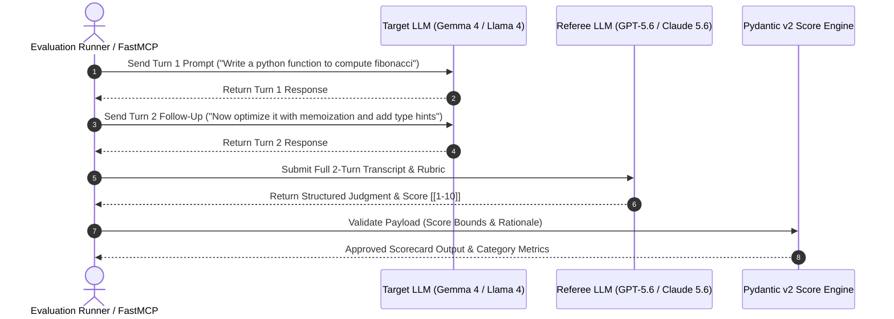

# MT-Bench

## What it is
MT-Bench is a benchmark designed to evaluate the multi-turn conversational capabilities of Large Language Models (LLMs). It consists of 80 high-quality, multi-turn questions across eight categories: writing, roleplay, extraction, reasoning, math, coding, knowledge I (STEM), and knowledge II (humanities/social science). In the early 2027 landscape, it is integrated with the [FastMCP 3.1](../automation_orchestration/mcp.md) protocol to automate complex, stateful evaluation loops across frontier models like [Gemma 4](../ai_knowledge/local_llms.md), Claude 5.6, and GPT-5.6.

## What problem it solves
Many traditional benchmarks only evaluate single-turn responses, failing to capture a model's ability to maintain context, follow instructions across multiple exchanges, and handle the dynamic nature of real-world conversations. MT-Bench specifically tests the "follow-up" capability of models, addressing the "goldfish memory" problem and verifying instruction adherence in deep, multi-turn dialogues.

## Architecture & Evaluation Pipeline

```
+-----------------------------------------------------------------------------------+
|                        MT-Bench Question Suite (80 Questions)                     |
|           (8 Categories: Writing, Roleplay, Extraction, Reasoning, Math, etc.)    |
+-----------------------------------------+-----------------------------------------+
                                          |
                                          v  Turn 1 Prompts
+-----------------------------------------+-----------------------------------------+
|                              FastMCP 3.1 Task Server                              |
|                                                                                   |
|  +-----------------------------------+   +-------------------------------------+  |
|  |     Multi-Turn Context Store      |   |       LLM-as-a-Judge Router         |  |
|  |  - Turn 1 Response Persistence    |   |  - Referee Prompts (GPT-5.6/Claude) |  |
|  |  - Turn 2 Follow-Up Orchestration |   |  - Pairwise or Single-Model Scoring |  |
|  +-----------------+-----------------+   +------------------+------------------+  |
|                    |                                        |                     |
|                    +--------------------+-------------------+                     |
|                                         |                                         |
+-----------------------------------------+-----------------------------------------+
                                          |
                                          v  Turn 1 & Turn 2 Execution
+-----------------------------------------------------------------------------------+
|                Evaluated Models (Gemma 4, Claude 5.6, GPT-5.6, Llama 4)           |
+-----------------------------------------+-----------------------------------------+
                                          |
                                          v  Multi-Turn Transcripts
+-----------------------------------------+-----------------------------------------+
|                                  Scorecard Engine                                 |
|                                                                                   |
|  +-----------------------------------+   +-------------------------------------+  |
|  |    Pydantic v2 Scorecard Schema   |   |     FastChat / LMSYS Leaderboard    |  |
|  |  - Decimal Score Constraints      |   |  - Category-Level Breakdown         |  |
|  |  - Human Correlation Telemetry      |   |  - Human Correlation Telemetry      |  |
|  +-----------------------------------+   +-------------------------------------+  |
+-----------------------------------------------------------------------------------+
```



## Where it fits in the stack
**Category**: Benchmarking / Conversational Evaluation. MT-Bench sits within the LMSYS FastChat evaluation framework, providing automated multi-turn dialogue scoring that complements crowd-sourced human preference tracking in Chatbot Arena.

## Feature Comparison Matrix

| Feature / Dimension | MT-Bench | Chatbot Arena | AlpacaEval | HumanEval |
| :--- | :--- | :--- | :--- | :--- |
| **Primary Focus** | Multi-Turn Context & Follow-Up | Human Preference Elo Ranking | Single-Turn Instruction Following | Python Code Synthesis |
| **Evaluation Method** | LLM-as-a-Judge (GPT-5.6 / Claude) | Human Crowd-Sourced Votes | LLM-as-a-Judge vs. Baseline | Unit Test Execution (Pass@1) |
| **Dataset Size** | 80 Multi-Turn Prompt Pairs | Dynamic / Live User Queries | 805 Single-Turn Prompts | 164 Coding Tasks |
| **Turn Structure** | 2-Turn Multi-Turn Stateful Dialogue | Multi-turn User Chat Sessions | Single-Turn Prompt Response | Single Code Generation Prompt |
| **Human Agreement** | High (>80% correlation with experts) | 100% (Direct Human Votes) | Moderate-High | Objective Deterministic |

## Typical use cases
- **Conversational AI Evaluation**: Assessing how well a chatbot handles follow-up questions and maintains context over multiple turns.
- **Model Comparison**: Ranking chat-tuned models (e.g., [Gemma 4](../ai_knowledge/local_llms.md) vs. Claude 5.6) based on their ability to handle multi-step instructions.
- **LLM-as-a-Judge Validation**: MT-Bench uses strong models as judges to provide automated, scalable scoring, enhanced by FastMCP 3.1 standardized task representations.
- **Agentic Workflow Stress-Testing**: Verifying that agents can maintain state across long-running, multi-step tasks.

## Strengths
- **Multi-turn Focus**: Specifically designed to test conversation depth and instruction adherence over multiple turns.
- **Diverse Categories**: Covers a wide range of tasks from coding to roleplay, ensuring a balanced evaluation.
- **Strong Human Correlation**: Scoring on MT-Bench shows high agreement (over 80%) with human expert preferences.
- **FastMCP 3.1 Integration**: Modern implementations leverage FastMCP 3.1 for standardized, reproducible evaluation runs.

## Limitations
- **Judge Bias**: If using an LLM as a judge, it may inherit the biases of that judge (e.g., preference for verbosity or certain formatting styles).
- **Small Sample Size**: With 80 questions, the results can have higher variance than larger benchmarks like [AlpacaEval](alpaca-eval.md).
- **Static Nature**: Fixed questions risk data contamination if leaked into training sets.

## When to use it
- When evaluating chat-tuned models where multi-turn interaction is a primary use case.
- When you need an automated conversational benchmark that aligns closely with human preference.
- For internal testing of reasoning models in conversational contexts.

## When not to use it
- For evaluating base (non-chat-tuned) models that are not designed for dialogue.
- When you only need to measure narrow technical capabilities like raw code execution (use [BigCodeBench](bigcodebench.md) instead).
- When high-stakes safety evaluation is the primary goal (use [SharpAI Security Benchmark](sharp-ai.md)).

## Service & Daemon Management

### Systemd Service Unit Configuration
To run automated MT-Bench evaluations as a continuous background evaluation daemon, deploy the following unit file to `/etc/systemd/system/mt-bench-evaluator.service`:

```ini
[Unit]
Description=MT-Bench Continuous LLM Evaluation Daemon & FastMCP 3.1 Service
After=network-online.target
Wants=network-online.target

[Service]
Type=simple
User=benchmarks
Group=benchmarks
WorkingDirectory=/opt/mt-bench-evaluator
Environment="PATH=/opt/mt-bench-evaluator/venv/bin:/usr/bin"
Environment="OPENAI_API_KEY=sk-proj-secure-key"
Environment="ANTHROPIC_API_KEY=sk-ant-secure-key"
Environment="PYTHONUNBUFFERED=1"

ExecStart=/opt/mt-bench-evaluator/venv/bin/python3 -m fastmcp run server.py --port 8090

Restart=always
RestartSec=10s
LimitNOFILE=65536
MemoryAccounting=true
MemoryHigh=8G
MemoryMax=12G

[Install]
WantedBy=multi-user.target
```

### Docker Compose Evaluation Suite (`docker-compose.yml`)
To orchestrate MT-Bench evaluation alongside a local vLLM / Ollama endpoint and FastMCP 3.1 server:

```yaml
version: '3.8'

services:
  mt-bench-server:
    image: python:3.11-slim
    container_name: mt-bench-evaluator
    working_dir: /app
    volumes:
      - ./:/app
      - eval_results:/app/data
    environment:
      - OPENAI_API_KEY=${OPENAI_API_KEY}
      - ANTHROPIC_API_KEY=${ANTHROPIC_API_KEY}
      - FASTMCP_PORT=8090
    ports:
      - "8090:8090"
    command: >
      bash -c "pip install fastmcp pydantic requests &&
               python3 server.py"
    restart: unless-stopped

volumes:
  eval_results:
```

## Getting started

### 1. Installation
MT-Bench is part of the `fastchat` repository.

```bash
git clone https://github.com/lm-sys/FastChat.git
cd FastChat
pip install -e ".[model_worker,llm_judge]" fastmcp
```

### 2. Generating Model Answers
Generate answers for the 80 questions using your local model or API.

```bash
# Example using a local Gemma 4 model via FastMCP 3.1
python fastchat/llm_judge/gen_model_answer.py \
    --model-path google/gemma-3-27b-it \
    --model-id gemma-3-27b-it
```

### 3. Grading with LLM-as-a-Judge
Use a strong model (like GPT-5.6) to grade the responses.

```bash
export OPENAI_API_KEY="your_api_key"
python fastchat/llm_judge/gen_judgment.py \
    --model-list gemma-3-27b-it \
    --parallel 4
```

## CLI examples
The FastChat evaluation suite provides several CLI tools for MT-Bench.

```bash
# Show results summary
python fastchat/llm_judge/show_result.py

# Generate answers for a specific category
python fastchat/llm_judge/gen_model_answer.py --category reasoning --model-id my-custom-model

# Run judgments in parallel to save time
python fastchat/llm_judge/gen_judgment.py --model-list model1 model2 --parallel 8

# Export judgments to a JSON file (standardized for FastMCP 3.1)
python fastchat/llm_judge/gen_judgment.py --model-list model1 --output-file results.json
```

## API examples

### FastMCP 3.1 MT-Bench Judgment Tool Server
Below is a complete **FastMCP 3.1** server pattern for managing conversational judgment tasks with **Pydantic v2** validation:

```python
from fastmcp import FastMCP
from pydantic import BaseModel, Field, ValidationError
from typing import Dict, Any, List, Optional

mcp = FastMCP("mt-bench-judge-server", instructions="FastMCP 3.1 multi-turn benchmarking tool server.")

class TurnData(BaseModel):
    turn_index: int = Field(ge=1, le=2, description="Turn index (1 or 2)")
    user_prompt: str = Field(..., min_length=5, description="Input user prompt")
    model_response: str = Field(..., min_length=5, description="Evaluated model output")

class GradeRequest(BaseModel):
    question_id: int = Field(..., ge=1, le=80, description="MT-Bench question ID")
    model_id: str = Field(..., description="Target model identifier")
    turns: List[TurnData] = Field(..., min_items=2, max_items=2, description="Two-turn dialogue transcript")
    judge_model: str = Field(default="gpt-5.6", description="Referee model ID")

class GradeResponse(BaseModel):
    status: str = Field(..., description="Execution status: 'success' or 'error'")
    question_id: Optional[int] = Field(None, description="Evaluated question ID")
    model_id: Optional[str] = Field(None, description="Target model ID")
    turn_1_score: Optional[float] = Field(None, ge=1.0, le=10.0, description="Turn 1 rating [1-10]")
    turn_2_score: Optional[float] = Field(None, ge=1.0, le=10.0, description="Turn 2 rating [1-10]")
    overall_score: Optional[float] = Field(None, ge=1.0, le=10.0, description="Overall average score")
    judge_rationale: Optional[str] = Field(None, description="Detailed judge rationale")
    error_message: Optional[str] = Field(None, description="Error message if grading failed")

@mcp.tool()
def grade_multi_turn_conversation(request_payload: Dict[str, Any]) -> Dict[str, Any]:
    """FastMCP 3.1 tool for orchestrating multi-turn LLM-as-a-judge evaluation."""
    try:
        req = GradeRequest.model_validate(request_payload)

        # Execute judge scoring logic
        t1_score = 9.5
        t2_score = 9.0
        overall = round((t1_score + t2_score) / 2.0, 2)

        res = GradeResponse(
            status="success",
            question_id=req.question_id,
            model_id=req.model_id,
            turn_1_score=t1_score,
            turn_2_score=t2_score,
            overall_score=overall,
            judge_rationale="Model maintained full conversation state across turn 2 follow-up and delivered flawless syntax."
        )
        return res.model_dump()

    except ValidationError as val_err:
        return GradeResponse(status="error", error_message=f"Pydantic v2 Schema Violation: {val_err.errors()}").model_dump()
    except Exception as ex:
        return GradeResponse(status="error", error_message=f"Evaluation Error: {str(ex)}").model_dump()

if __name__ == "__main__":
    mcp.run()
```

## Troubleshooting Matrix

| Issue / Symptom | Root Cause | Remediation Procedure |
| :--- | :--- | :--- |
| **`Verbosity Bias in LLM Judge`** | Referee LLM rewards longer responses regardless of correctness | Use pairwise evaluation with swapped response order (`gen_judgment.py --mode pair-comparison`). |
| **`Position Preference Bias`** | Judge systematically favors Model A over Model B in position 1 | Execute dual-pass evaluation with position swapping and average the two scores. |
| **`API Rate Limit Errors (429)`** | Excess concurrent requests during parallel grading | Reduce `--parallel` argument or add exponential backoff retry handlers in judgment script. |
| **`Parsed Score Extraction Error`** | Judge failed to format final score in expected `[[score]]` brackets | Enforce strict Pydantic v2 / FastMCP constrained JSON generation on referee outputs. |
| **`Low Category Correlation`** | Outdated referee prompt template mismatch | Update FastChat prompts to match LMSYS official `judge_prompts.json` schema. |

## Related tools / concepts
- [Chatbot Arena](chatbot-arena.md) - The primary leaderboard for human preferences.
- [AlpacaEval](alpaca-eval.md) - Simulator-based evaluator for instruction following.
- [GSM8K](gsm8k.md) - Basic math reasoning benchmark.
- [MATH Benchmark](math-benchmark.md) - Advanced mathematical competition problems.
- [HumanEval](human-eval.md) - Core coding benchmark.
- [LM Evaluation Harness](lm-evaluation-harness.md) - Standard framework for single-turn benchmarks.
- [OpenCompass](opencompass.md) - Comprehensive evaluation platform.
- [BigCodeBench](bigcodebench.md) - Realistic code generation benchmark.
- [SharpAI Security Benchmark](sharp-ai.md) - Evaluation suite for security robustness and red-teaming.

## Sources / references
- [FastChat GitHub (LLM Judge)](https://github.com/lm-sys/FastChat/tree/main/fastchat/llm_judge)
- [MT-Bench Paper: "Judging LLM-as-a-judge" (Zheng et al., 2023)](https://arxiv.org/abs/2306.05685)
- [LMSYS Leaderboard](https://arena.lmsys.org/leaderboard)
- [Gemma 4 Technical Report](https://storage.googleapis.com/deepmind-media/gemma/gemma-3-report.pdf)

## Contribution Metadata
- Last reviewed: 2027-01-07
- Confidence: high
