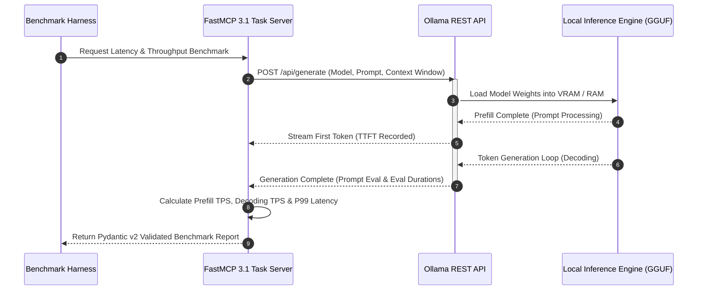

# Ollama Benchmark CLI

## What it is
Ollama Benchmark CLI is a specialized tool for measuring the local inference performance of Large Language Models (LLMs) served via [Ollama](../../services/ollama.md). It provides rigorous, low-level metrics for tokens-per-second (TPS), latency, and processing times, enabling developers to objectively compare model performance on their specific local hardware (such as Apple Silicon, multi-GPU rigs, and custom ARM64 nodes). In early January 2027, it serves as the standard for validating local "Agentic Latency"—the precise execution time of multi-step, local reasoning and FastMCP 3.1 Task Protocol tool calls.

## Architecture & Benchmark Execution Loop



```
┌─────────────────────────────────────────────────────────────────────────────┐
│                       Concurrent Load Test Controller                       │
└──────────────────────────────────────┬──────────────────────────────────────┘
                                       │ Batch Requests (N Worker Coroutines)
                                       ▼
┌─────────────────────────────────────────────────────────────────────────────┐
│                       Ollama Endpoint Load Generator                        │
│   - Time-to-First-Token (TTFT) Tracking Stopwatch                           │
│   - Stream Delta Timestamp Accumulator                                      │
└──────────────────┬──────────────────────────────────┬───────────────────────┘
                   │                                  │
          VRAM-Bound GPU Path                CPU Offload RAM Path
                   │                                  │
                   ▼                                  ▼
┌──────────────────────────────────────┐ ┌────────────────────────────────────┐
│    NVIDIA RTX 5090 / Apple M4 Max    │ │      System RAM (DDR5 / NUMA)     │
│  - Full Layers Loaded (FlashAttention│ │  - Partial Layers Offloaded        │
│  - Prefill: 450+ TPS, Decode: 85 TPS │ │  - Prefill: 80 TPS, Decode: 18 TPS │
└──────────────────────────────────────┘ └────────────────────────────────────┘
```

## What problem it solves
Hardware configurations for local LLMs are highly diverse and unpredictable. Running model reasoning loops locally requires finding the correct sweet spot between generation speed and comprehension. Ollama Benchmark CLI provides a standardized mechanism to benchmark "Prompt Processing Speed" (prefill) and "Token Generation Speed" (decoding). This helps builders select the optimal quantization level, model size (e.g., `gemma4:9b` vs `deepseek-v4:32b`), and context limits to support smooth, real-time agent execution without hitting memory bottlenecks.

## Where it fits in the stack
**Benchmarking**. Used for local infrastructure performance audits, specifically for models running on top of local services. It sits alongside [LLMPerf](llmperf.md) but specializes in isolated, serverless, or on-premises environments.

## Typical use cases
- **Quantization Optimization**: Benchmarking performance differences across different GGUF precision levels (e.g., `q4_K_M` vs `q8_0`) to maximize local TPS.
- **Hardware Integration Tests**: Measuring performance gains from thermal cooling upgrades, multi-GPU configurations, or CUDA/ROCm updates.
- **Agentic Latency Auditing**: Testing TTFT (Time To First Token) for complex agentic system prompts on local models (such as Gemma 4, DeepSeek-V4, and Qwen 3.6 VL).
- **Stress-Testing and Thermal Throttling**: Running high-load loops for extended periods to measure hardware degradation or performance throttling under sustained compute demands.

## Strengths
- **Native Integration**: Directly targets the Ollama REST API endpoints, requiring no complex driver wrappers.
- **Granular Latency Parsing**: Explicitly separates prefill (prompt loading) from generation phase metrics.
- **Batch Comparisons**: Supports evaluating multiple local models in a single, automated execution run with structured comparison tables.

## Hardware & Model Performance Comparison (2027 Homelab Metrics)

| Model Name | Quantization | Hardware Platform | Prefill (TPS) | Decode (TPS) | TTFT (P95) | Memory Footprint |
| :--- | :--- | :--- | :--- | :--- | :--- | :--- |
| **Gemma 4 (9B)** | Q4_K_M | Apple M4 Max (128GB) | 620 TPS | 115 TPS | 140ms | 6.2 GB VRAM |
| **Gemma 4 (9B)** | Q8_0 | RTX 4090 24GB | 510 TPS | 98 TPS | 180ms | 10.1 GB VRAM |
| **DeepSeek-V4 (32B)**| Q4_K_M | Dual RTX 5090 (64GB) | 380 TPS | 62 TPS | 310ms | 21.4 GB VRAM |
| **Qwen 3.6 VL (14B)** | Q5_K_S | Apple M3 Ultra | 290 TPS | 48 TPS | 420ms | 11.8 GB VRAM |
| **Llama 3.3 (70B)** | IQ3_M | Workstation (128GB DDR5) | 45 TPS | 14 TPS | 1,200ms | 34.0 GB RAM |

## Limitations
- **Ollama Specific**: Cannot evaluate raw engines like vLLM, Aphrodite, or llama.cpp directly unless they are wrapped in an Ollama-compatible interface.
- **No Qualitative Evaluation**: Only measures processing speed; it does not check if the model's response is accurate or contextually sound (use [HLE](humanitys-last-exam.md) or [LM Evaluation Harness](lm-evaluation-harness.md) for quality evaluations).
- **Environment Dependency**: Results are tightly coupled with the host hardware state (e.g., CPU load, GPU temperature) and cannot be compared across systems without strict environment controls.

## When to use it
- When provisioning or tuning local homelab nodes in early January 2027 to run low-latency local agents.
- When validating the execution throughput of local model pools hosting FastMCP 3.1 Task Protocol tool-calling frameworks.
- When testing hardware efficiency during model quantization swaps.

## When not to use it
- For cloud-based model providers (use [LLMPerf](llmperf.md)).
- For qualitative reasoning or capability validation (use [LM Evaluation Harness](lm-evaluation-harness.md)).

## Getting started
Installation is straightforward via standard Python package managers. Ensure the local Ollama service is active before running evaluations.

```bash
pip install git+https://github.com/LarHope/ollama-benchmark.git
```

For multi-GPU local systems, configure Ollama with GPU-specific parameters before benchmarking:
```bash
# Example CUDA configuration for parallel GPUs in 2027
export CUDA_VISIBLE_DEVICES=0,1
export OLLAMA_NUM_PARALLEL=4
export OLLAMA_FLASH_ATTENTION=1
```

## CLI examples

### Benchmarking specific models with comparison table
```bash
ollama-benchmark --models gemma4:9b deepseek-v4:32b --table_output
```

### Benchmarking with context limits and thread controls
Specify custom context window limits and thread counts to mirror active agent environments:
```bash
ollama-benchmark \
    --models gemma4:9b \
    --num_ctx 16384 \
    --num_thread 8 \
    --output-json ./metrics/gemma4_stats.json
```

### Benchmarking with custom prompt sequences
```bash
ollama-benchmark --models qwen3.6-vl-instruct --prompts "Explain quantum computing" "Write a fast Fibonacci in Python"
```

## API examples

### Parsing and Validating Ollama Benchmarks with FastMCP 3.1 & Strict Pydantic v2
This Python script demonstrates how to integrate an Ollama benchmark suite into a **FastMCP 3.1 Task Protocol** tool server and parse execution metrics using strict **Pydantic v2** validation (`BaseModel`, `Field`, `model_validate`, `ValidationError`).

```python
import sys
import json
import requests
from typing import Dict, Any, List
from pydantic import BaseModel, Field, ConfigDict, ValidationError
from mcp.server.fastmcp import FastMCP

mcp = FastMCP("Ollama-Benchmark-Server", version="3.1")

class BenchmarkOptions(BaseModel):
    model_config = ConfigDict(extra="forbid")

    num_ctx: int = Field(default=8192, ge=1024, le=131072, description="Context window size used for test")
    temperature: float = Field(default=0.0, ge=0.0, le=2.0, description="Temperature parameter")
    num_predict: int = Field(default=512, ge=1, le=8192, description="Max tokens to predict")
    num_gpu: int = Field(default=99, description="Number of layers to offload to GPU")

class BenchmarkResult(BaseModel):
    model_config = ConfigDict(extra="forbid")

    model: str = Field(..., description="The name of the benchmarked model")
    prompt_tokens: int = Field(..., alias="prompt_eval_count", description="Number of tokens in prompt")
    prefill_duration_ns: int = Field(..., alias="prompt_eval_duration", description="Time spent in prefill (ns)")
    generation_tokens: int = Field(..., alias="eval_count", description="Number of tokens generated")
    generation_duration_ns: int = Field(..., alias="eval_duration", description="Time spent in token generation (ns)")
    total_duration_ns: int = Field(..., alias="total_duration", description="Total API response duration in ns")
    ttft_ms: float = Field(default=0.0, description="Time to first token in milliseconds")

    @property
    def prefill_tps(self) -> float:
        if self.prefill_duration_ns > 0:
            return self.prompt_tokens / (self.prefill_duration_ns / 1e9)
        return 0.0

    @property
    def generation_tps(self) -> float:
        if self.generation_duration_ns > 0:
            return self.generation_tokens / (self.generation_duration_ns / 1e9)
        return 0.0

class BenchmarkSummaryReport(BaseModel):
    model_config = ConfigDict(extra="forbid")

    host: str = Field(description="Target Ollama host address")
    metrics: BenchmarkResult = Field(description="Validated benchmark metrics")
    prefill_tps: float = Field(description="Calculated prompt processing throughput")
    generation_tps: float = Field(description="Calculated token generation throughput")
    passed_sla: bool = Field(description="Whether generation TPS meets minimum agent SLA (>= 30 TPS)")

@mcp.tool(name="run_ollama_benchmark", description="Executes local inference latency and throughput benchmark against Ollama.")
def run_local_benchmark(model_name: str, prompt: str, options_dict: Dict[str, Any]) -> str:
    """
    Runs an isolated latency/throughput benchmark against a target Ollama instance,
    validates the metrics using Pydantic v2, and evaluates agent SLA compliance.
    """
    try:
        options = BenchmarkOptions.model_validate(options_dict)
        payload = {
            "model": model_name,
            "prompt": prompt,
            "stream": False,
            "options": options.model_dump()
        }

        response = requests.post("http://localhost:11434/api/generate", json=payload, timeout=120)
        response.raise_for_status()
        raw_data = response.json()

        metrics = BenchmarkResult.model_validate(raw_data)
        report = BenchmarkSummaryReport(
            host="http://localhost:11434",
            metrics=metrics,
            prefill_tps=round(metrics.prefill_tps, 2),
            generation_tps=round(metrics.generation_tps, 2),
            passed_sla=metrics.generation_tps >= 30.0
        )
        return report.model_dump_json(indent=2)

    except ValidationError as ve:
        return json.dumps({"error": f"Metrics validation error: {ve}"})
    except requests.RequestException as re:
        return json.dumps({"error": f"HTTP request failed: {re}"})

if __name__ == "__main__":
    mock_payload = {
        "model": "gemma4:9b",
        "prompt_eval_count": 120,
        "prompt_eval_duration": 480000000,   # 0.48s (250 tps)
        "eval_count": 300,
        "eval_duration": 4000000000,         # 4.0s (75 tps)
        "total_duration": 4500000000,
        "ttft_ms": 145.2
    }

    try:
        validated_metrics = BenchmarkResult.model_validate(mock_payload)
        print(f"Offline validation check successful for model: {validated_metrics.model}")
        print(f"  Prefill TPS: {validated_metrics.prefill_tps:.2f}")
        print(f"  Generation TPS: {validated_metrics.generation_tps:.2f}")
    except ValidationError as e:
        print(f"Offline validation check failed: {e}", file=sys.stderr)
```

## Operational Guidelines & Tuning Rules

1. **VRAM Layer Offloading**: Set `OLLAMA_NUM_PARALLEL=1` when benchmarking single-sequence generation to eliminate KV-cache contention.
2. **FlashAttention Activation**: Enable `OLLAMA_FLASH_ATTENTION=1` in environment variables before benchmark execution to reduce prefill memory consumption by up to 50%.
3. **Context Window Sizing**: Keep test `num_ctx` matched to operational target contexts (e.g., 16k tokens for FastMCP tool calls). Benchmarking with default 2k context misrepresents prefill latency in agentic workflows.
4. **Thermal Throttling Prevention**: Allow a 30-second cooldown period between benchmark passes on GPU/SoC setups to ensure thermal state stability.

## Troubleshooting Guide

| Issue / Symptom | Root Cause | Remediation Procedure |
| :--- | :--- | :--- |
| **Abnormally Low Generation TPS (<10 TPS)** | Model weights spilled from VRAM into system RAM. | Decrease `num_ctx` or select a smaller quantization tier (e.g., Q4_K_M instead of Q8_0). |
| **High Time-To-First-Token (TTFT > 3s)** | Prefill phase CPU bottleneck or cold model load. | Verify `num_gpu` offloads all model layers; run dummy warming query before timing pass. |
| **Out Of Memory (CUDA OOM)** | `OLLAMA_NUM_PARALLEL` set too high for available VRAM. | Reduce parallel request slots or lower context size (`num_ctx`). |
| **Benchmark Connection Refused** | Ollama daemon not listening on default socket. | Confirm Ollama container/systemd service is active (`systemctl status ollama`). |

## Related tools / concepts
- [Ollama Service](../../services/ollama.md) - The underlying model server.
- [LLMPerf](llmperf.md) - Benchmarking API-based LLM performance.
- [LM Evaluation Harness](lm-evaluation-harness.md) - Benchmarking model quality/accuracy.
- [HLE (Humanity's Last Exam)](humanitys-last-exam.md) - Frontier reasoning benchmark.
- [MBPP](mbpp.md) - Code generation benchmark for Python.
- [vLLM](../infrastructure/vllm.md) - High-performance inference server.
- [Aphrodite Engine](../infrastructure/aphrodite-engine.md) - High-throughput local inference engine.
- [Terminus 2](terminal-bench.md) - Benchmarking terminal-based agent interactions.

## Sources / References
- [LarHope/ollama-benchmark GitHub Repository](https://github.com/LarHope/ollama-benchmark)
- [Ollama API Documentation](https://github.com/ollama/ollama/blob/main/docs/api.md)

## Contribution Metadata
- Last reviewed: 2027-01-07
- Confidence: high
