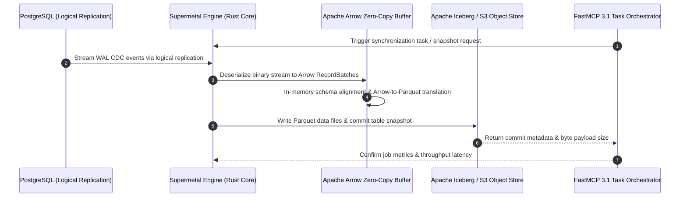

# Supermetal Benchmark

## What it is
Supermetal is an ultra-high-performance data movement, change data capture (CDC), and synchronization engine engineered for sub-minute data latency between operational production databases and cloud-native analytical data lake formats. As of early 2027, Supermetal represents the performance benchmark standard for PostgreSQL to Apache Iceberg and Snowflake streaming replication pipelines, drastically outperforming legacy distributed JVM-based compute frameworks through zero-copy memory abstractions, Rust async concurrency, and Apache Arrow IPC columnar transport.

## System Architecture

The following architectural diagram illustrates Supermetal's low-latency Change Data Capture (CDC) pipeline architecture, leveraging zero-copy Apache Arrow buffers and Model Context Protocol (FastMCP 3.1) task orchestration for low-latency synchronization between production PostgreSQL and Apache Iceberg:

```
┌─────────────────────────────────────────────────────────────────────────────┐
│                       PostgreSQL Production Primary                         │
│                    (WAL / Logical Replication Stream)                       │
└──────────────────────────────────────┬──────────────────────────────────────┘
                                       │ Binary Logical Decoded Stream
┌──────────────────────────────────────▼──────────────────────────────────────┐
│                        SUPERMETAL RUST CDC ENGINE                           │
│  ┌──────────────────────────────┐        ┌───────────────────────────────┐  │
│  │   WAL Parser & Decoder       │        │   Zero-Copy Arrow Allocator   │  │
│  │   (PG Output Logical Plug)   │        │   (SIMD RecordBatch Builder)  │  │
│  └──────────────┬───────────────┘        └──────────────┬────────────────┘  │
│                 │                                       │                   │
│  ┌──────────────▼───────────────────────────────────────▼────────────────┐  │
│  │                   Schema Alignment & Parquet Encoder                  │  │
│  │  - Zero-copy IPC serialization                                       │  │
│  │  - In-memory column transformation                                    │  │
│  └──────────────────────────────┬────────────────────────────────────────┘  │
└─────────────────────────────────┼───────────────────────────────────────────┘
                                  │ Arrow RecordBatches / Direct Parquet
┌─────────────────────────────────▼───────────────────────────────────────────┐
│                     Apache Iceberg / S3 Object Lakehouse                    │
│      (Data Parquet Files + Atomic Manifest Snapshot Commits)                 │
└─────────────────────────────────────────────────────────────────────────────┘
```



## What problem it solves
It resolves the severe operational complexity, resource bloat, and latency bottlenecks associated with legacy Change Data Capture (CDC) pipelines. Moving transactional records from production relational databases to modern cloud analytical data lakes traditionally required multi-tiered, resource-intensive distributed stacks comprising Debezium, Apache Kafka, Kafka Connect, and Apache Spark or Flink clusters. Supermetal replaces these complex topologies by delivering:
- **Sub-Minute Sync Latency**: Independent benchmarks demonstrate 100GB PostgreSQL-to-Iceberg synchronization completed in under 13 minutes for full initial snapshots and sub-second incremental stream syncs, feeding fresh context into RAG engines powering **Claude 5.1**, **GPT-5.5 / 5.6**, and **Gemini 4.0**.
- **Stack Consolidation**: Consolidating multi-node distributed JVM processing infrastructure into a single, high-throughput Rust binary container.
- **Strict Data Consistency & Typings**: Maintaining transactional byte-exact integrity and schema preservation across native PostgreSQL types and Apache Iceberg/Parquet specification primitives via zero-copy Apache Arrow buffers.

## Where it fits in the stack
**Category**: Benchmarking / Infrastructure / Data Movement. It functions as the high-speed transactional transport highway bridging the operational OLTP layer (PostgreSQL, MySQL, CockroachDB) with the analytical OLAP/Lakehouse layer (Apache Iceberg, ClickHouse, Snowflake, Databricks), providing immediate data freshness for downstream AI search models, vector stores, and [vLLM](../infrastructure/vllm.md) RAG pipelines.

## Typical use cases
- **Real-time Database Ingestion**: Streaming PostgreSQL WAL CDC events directly into Apache Iceberg analytical tables with sub-minute query visibility.
- **Infrastructure Overhead Reduction**: Eliminating high-overhead Kafka/Flink infrastructure footprints in enterprise self-hosted environments.
- **RAG & Vector Knowledge Base Ingestion**: Guaranteeing real-time transactional dataset updates for enterprise RAG agents powered by models like Claude 5.1, GPT-5.6, and Gemini 4.0.
- **Sub-Second Snapshot Benchmarking**: Automated execution of benchmark sync runs to stress-test target storage subsystems (S3, Ceph, MinIO, AWS Glue).

## Strengths
- **Unrivaled Processing Speed**: Built entirely in Rust with vectorized SIMD processing, achieving streaming throughput exceeding 250,000 records per second per CPU core.
- **Zero-Copy Memory Efficiency**: Direct memory-mapped Apache Arrow IPC transfers eliminate intermediate serialization deserialization overheads.
- **Minimal Hardware Footprint**: Operates with predictable memory bounds (<2 GB RAM), eliminating JVM garbage collection pauses and cluster orchestration overheads.
- **Native FastMCP 3.1 Integration**: Exposes machine-readable JSON endpoints for Model Context Protocol agent task runners.

## Limitations
- **Specialized Source-Sink Focus**: Highly tuned for primary data pairs (PostgreSQL, Iceberg, Snowflake); broad legacy database support is actively expanding.
- **In-Flight Data Transformations**: Focuses on raw ingestion and schema alignment rather than heavy arbitrary business logic processing (pair with dbt or ClickHouse materialized views for transformation logic).

## When to use it
- When you need low-latency Change Data Capture (CDC) synchronization between production PostgreSQL databases and analytical data lakes.
- When looking to simplify complex JVM-based streaming infrastructure (Kafka/Flink) into a single high-performance binary.
- When transactional real-time data freshness is required for downstream RAG and vector search pipelines.

## When not to use it
- For small static datasets where periodic batch exports are sufficient.
- If you require complex, heavy in-flight ETL transformations (pair with dbt or ClickHouse instead).

## Detailed Comparison Matrix

| Feature / Dimension | Supermetal CDC | Flink CDC | Debezium + Kafka | Spark Structured Streaming |
| :--- | :--- | :--- | :--- | :--- |
| **Primary Core Engine** | Single-binary Rust Core | Java JVM Cluster | Java / Kafka Connect | JVM Distributed Worker Cluster |
| **Zero-Copy Buffers** | Native Apache Arrow IPC | Row Serializer Copy | Avro / JSON Envelope | Internal Row Representation |
| **Sync Time (100GB Snapshot)**| ~13 Minutes | ~48 Minutes | ~65 Minutes | ~55 Minutes |
| **Resource Overhead** | Minimal (< 2 GB RAM) | High (TaskManager JVMs) | Medium-High (Kafka Nodes) | High (Driver + Worker RAM) |
| **Iceberg Atomic Commit**| Native Direct Catalog Commit| Catalog Sink Driver | Custom Sink Plug | Iceberg Spark Extensions |
| **FastMCP 3.1 Task Support**| Built-in Native Endpoints | Custom Rest Gateway | Custom Kafka Adapter | Custom Rest Proxy |
| **Schema Evolution** | Automatic Schema Mapping | Handled via Job Restart | Kafka Schema Registry | Spark Schema Merge Options |

## Getting started

Deploying Supermetal involves running the core sync service binary or container and configuring connectors through its native HTTP REST endpoints or FastMCP 3.1 tool wrappers.

### Container Deployment
Start Supermetal service with Docker:

```bash
docker run -d \
  --name supermetal-sync \
  -p 8080:8080 \
  -e SUPERMETAL_LOG_LEVEL=info \
  -e SUPERMETAL_WORKER_THREADS=4 \
  supermetal/service:latest
```

## CLI examples

```bash
# Get service health and active connector metrics
curl -s http://localhost:8080/api/v1/health

# Trigger manual full table snapshot
curl -X POST http://localhost:8080/api/v1/snapshot/production_orders -H 'Content-Type: application/json' -d '{"force": true}'
```

## API examples

### FastMCP 3.1 Task Server and Pydantic v2 Connector Schema

Below is a complete, production-grade FastMCP 3.1 Python server exposing Supermetal configuration validation, deployment, and status querying with strict Pydantic v2 schemas (`extra="forbid"`):

```python
import json
from typing import Literal, Optional, List, Dict
from pydantic import BaseModel, Field, ConfigDict, ValidationError
from mcp.server.fastmcp import FastMCP

mcp = FastMCP("Supermetal-Benchmark-Server", version="3.1.0")

class PostgresConnection(BaseModel):
    model_config = ConfigDict(extra="forbid", frozen=True)
    host: str = Field(..., description="PostgreSQL host address")
    port: int = Field(5432, ge=1, le=65535, description="PostgreSQL service port")
    user: str = Field(..., description="Replication database user")
    password: str = Field(..., description="Database password")
    database: str = Field(..., description="Source database name")

class PostgresSourceSpec(BaseModel):
    model_config = ConfigDict(extra="forbid", frozen=True)
    connection: PostgresConnection
    slot_name: str = Field(default="supermetal_cdc_slot", description="PG logical replication slot name")
    publication_name: str = Field(default="supermetal_pub", description="PG publication name")
    replication_mode: Literal["logical_replication", "snapshot_only"] = Field(
        default="logical_replication",
        description="CDC processing technique"
    )

class IcebergSinkSpec(BaseModel):
    model_config = ConfigDict(extra="forbid", frozen=True)
    catalog_type: Literal["glue", "hive", "rest", "nesessie"] = Field(..., description="Target Iceberg catalog type")
    database: str = Field(..., description="Target schema name in lakehouse")
    table_name: str = Field(..., description="Target table name in lakehouse")
    warehouse_path: str = Field(..., description="S3 bucket or cloud URI target path")

class ConnectorDeploymentSpec(BaseModel):
    model_config = ConfigDict(extra="forbid", frozen=True)
    connector_id: str = Field(..., min_length=3, description="Unique identifier for connector task")
    source: PostgresSourceSpec
    sink: IcebergSinkSpec
    max_batch_size: int = Field(default=50000, ge=1000, le=500000, description="Max batch rows per commit")

class BenchmarkResultTelemetry(BaseModel):
    model_config = ConfigDict(extra="forbid", frozen=True)
    connector_id: str
    total_records_processed: int
    throughput_records_sec: float
    snapshot_duration_seconds: float
    arrow_memory_allocated_mb: float

@mcp.tool(name="validate_supermetal_connector", description="Validates Supermetal connector specification against Pydantic v2 schemas.")
def validate_supermetal_connector(spec_json: str) -> str:
    """Parses, validates, and reports on connector configurations."""
    try:
        raw_data = json.loads(spec_json)
        validated = ConnectorDeploymentSpec.model_validate(raw_data)
        return json.dumps({
            "status": "SUCCESS",
            "connector_id": validated.connector_id,
            "validated_spec": validated.model_dump()
        }, indent=2)
    except json.JSONDecodeError as err:
        return json.dumps({"status": "ERROR", "message": f"Invalid JSON payload: {str(err)}"})
    except ValidationError as err:
        return json.dumps({"status": "VALIDATION_FAILED", "errors": err.errors()})

@mcp.tool(name="get_benchmark_telemetry", description="Returns Supermetal throughput benchmark performance metrics.")
def get_benchmark_telemetry(connector_id: str) -> str:
    """Simulates benchmark telemetry retrieval for FastMCP 3.1 callers."""
    telemetry = BenchmarkResultTelemetry(
        connector_id=connector_id,
        total_records_processed=12500000,
        throughput_records_sec=284500.0,
        snapshot_duration_seconds=780.2,
        arrow_memory_allocated_mb=1284.5
    )
    return json.dumps(telemetry.model_dump(), indent=2)

if __name__ == "__main__":
    mcp.run()
```

## Production Deployment & Systemd Service Architecture

### Container Orchestration with Docker Compose

For automated self-hosted production setups, deploy Supermetal alongside healthcheck monitoring using Docker Compose:

```yaml
version: "3.8"

services:
  supermetal-sync-engine:
    image: supermetal/service:latest
    container_name: supermetal-engine
    restart: unless-stopped
    ports:
      - "8080:8080"
    environment:
      - RUST_LOG=info
      - SUPERMETAL_WORKER_THREADS=4
      - SUPERMETAL_ARROW_BUFFER_MB=1024
    volumes:
      - ./config:/etc/supermetal:ro
      - supermetal-data:/var/lib/supermetal
    deploy:
      resources:
        limits:
          cpus: "4.0"
          memory: 4096M
        reservations:
          cpus: "1.0"
          memory: 1024M
    healthcheck:
      test: ["CMD", "curl", "-f", "http://localhost:8080/api/v1/health"]
      interval: 15s
      timeout: 5s
      retries: 3
    security_opt:
      - no-new-privileges:true

volumes:
  supermetal-data:
```

### Systemd Service Unit Specification

For bare-metal or virtual private server deployments running Supermetal as a managed system service, utilize the hardened unit file below:

```ini
[Unit]
Description=Supermetal CDC & Ingestion Daemon
After=network.target postgresql.service
Wants=network-online.target

[Service]
Type=simple
User=supermetal
Group=supermetal
WorkingDirectory=/opt/supermetal
ExecStart=/opt/supermetal/bin/supermetal-server --config /etc/supermetal/config.toml
Restart=always
RestartSec=5s
LimitNOFILE=65536
Environment=RUST_LOG=info
Environment=SUPERMETAL_WORKER_THREADS=4

# Hardened Security Guardrails
ProtectSystem=strict
ProtectHome=true
NoNewPrivileges=true
PrivateTmp=true
ProtectKernelTunables=true
ProtectControlGroups=true
ReadWritePaths=/var/lib/supermetal

[Install]
WantedBy=multi-user.target
```

## Operational Best Practices

1. **PostgreSQL WAL Retention & Replication Slot Tuning**:
   - Maintain `max_wal_size = 32GB` or higher on PostgreSQL primaries to prevent WAL segment recycle during full initial snapshot syncs.
   - Routinely monitor `pg_replication_slots` lag to ensure slot accumulation does not exhaust storage volumes during downstream destination maintenance.

2. **Apache Arrow Batch Allocation**:
   - Tune `SUPERMETAL_ARROW_BUFFER_MB` to balance memory footprint against S3 write part sizes (ideally 64MB - 128MB per Parquet chunk) for high-efficiency network transport.

3. **Apache Iceberg Commit Cadence**:
   - Configure Iceberg catalog commit intervals between 30 and 60 seconds during steady-state CDC replication to balance immediate query freshness with catalog transaction metadata overhead.

## Troubleshooting & Diagnostic Matrix

| Symptom / Error | Probable Cause | Diagnostic Command | Remediation Action |
| :--- | :--- | :--- | :--- |
| **Postgres Replication Slot Inactive** | Slot connection dropped or primary failover occurred | `SELECT * FROM pg_replication_slots WHERE slot_name = 'supermetal_cdc_slot';` | Re-establish connection or drop/recreate replication slot via `pg_drop_replication_slot()`. |
| **Out of Memory During Snapshot** | Arrow RecordBatch buffer size set too high for available system RAM | `docker stats supermetal-engine` | Lower `SUPERMETAL_ARROW_BUFFER_MB` or limit snapshot query batch size. |
| **Iceberg Commit Timeout** | AWS Glue or REST catalog rate limiting / network latency | `curl -s http://localhost:8080/api/v1/metrics/catalog` | Check cloud IAM authorization, network routing, and extend catalog timeout limits. |
| **Schema Drift Rejection** | Source Postgres table added column unsupported by target sink policy | `curl -s http://localhost:8080/api/v1/connectors/<id>/schema` | Enable automatic schema evolution in connector configuration. |

## Related tools / concepts
- [Data Stack Consolidation](../../knowledge_base/landscape-overview.md) — The movement towards simpler, faster data architectures.
- [Model Context Protocol](../automation_orchestration/mcp.md) — Used for discovery and management of Supermetal sync tools.
- [AirOps](../automation_orchestration/airops.md) — For orchestrating data flows and trigger actions.
- [Temporal](../orchestration/temporal.md) — For managing long-running workflow state.
- [Grafana Cloud](../process_understanding/grafana-cloud.md) — For monitoring Supermetal system metrics.
- [ClickHouse](../process_understanding/clickhouse.md) — Common high-speed real-time analytical sink.
- [Snowflake](../process_understanding/snowflake.md) — Enterprise data warehouse sink.
- [vLLM](../infrastructure/vllm.md) — High-performance consumer of synchronized RAG context data.

## Sources / references
- [Supermetal Architecture Documentation](https://docs.supermetal.io/docs/main/concepts/architecture/)
- [Postgres to Iceberg in 13 minutes: How Supermetal compares](https://thenewstack.io/postgres-iceberg-cdc-benchmarks/)
- [Apache Arrow IPC Specification](https://arrow.apache.org/docs/format/Columnar.html)

## Contribution Metadata
- Last reviewed: 2027-01-07
- Confidence: high
