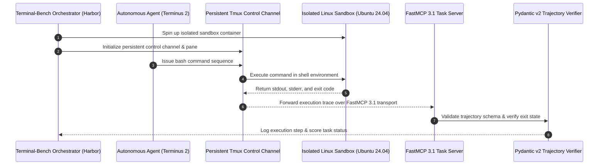

# Terminal-Bench (Terminus 2)

## What it is
Terminal-Bench (including the Terminus 2 research baseline) is a specialized benchmark for evaluating AI agents' ability to operate within a real terminal environment. It goes beyond static code generation by testing the agent's ability to interpret command output, handle stateful bash sessions, and remediate complex system or server failures. In early January 2027, it serves as the premier benchmark for "Terminus 2" patterns where agents manage long-running tmux control channels and interact with sandboxes via the Model Context Protocol (FastMCP 3.1 Task Protocol).

## What problem it solves
It measures whether autonomous systems can effectively and safely operate inside a standard Linux shell. Standard benchmarks evaluate model capabilities on isolated snippets or reasoning puzzles; Terminal-Bench evaluates the agent's "Intent-State-Action" loop in real time. It tests key capabilities such as:
- Installing software and fixing configuration mismatches (e.g., mismatched Nginx load balancers or systemd unit failures).
- Direct LLM-to-tmux shell interaction for persistent multi-turn session management.
- Navigating isolated system sandboxes to diagnose performance degradation, memory leaks, or network firewall blocks.

## System Architecture

The following diagram illustrates the interaction flow between the Terminal-Bench orchestrator, Terminus 2 persistent tmux control channels, containerized sandboxes, and FastMCP 3.1 task protocol tools:



## Where it fits in the stack
**Benchmarking**. Positioned in the **Agent Evaluation Layer** of the homelab, used to rigorously evaluate the terminal proficiency of autonomous agent frameworks before they are granted administrative access to self-hosted server environments.

## Comparative Feature Matrix

| Metric / Feature | Terminal-Bench (Terminus 2) | InterCode | SWE-bench | OSWorld |
| :--- | :--- | :--- | :--- | :--- |
| **Target Operating Layer** | Linux Shell / Terminal CLI | Multi-turn Bash/SQL REPL | Git Repository / Python Code | GUI / Desktop / OS Level |
| **Control Interface** | Tmux Control Channel / FastMCP 3.1 | Gym Step API / FastMCP 3.1 | Patch Submission Harness | Screen Pixels & Mouse/Keyboard |
| **Sandbox Environment** | Harbor / Ubuntu 24.04 | Docker Containers | Containerized Repos | Virtual Machines / QEMU |
| **State Persistence** | Continuous tmux sessions | Multi-turn environment state | Single-turn issue state | Full OS persistent disk |
| **Evaluation Metrics** | System Exit Codes / State Verifiers | Unit Test & State Rewards | Git Test Suite Assertions | Task Completion / Visual State |
| **FastMCP 3.1 Integration** | Native Task Telemetry Server | Custom Socket Adapter | File Patch Harness | API Overlay Layer |

## Benchmark Task Taxonomy & Scenario Matrix

| Task Category | Scenario Focus | Primary Shell Commands Tested | Success Criterion |
| :--- | :--- | :--- | :--- |
| **SysAdmin / DevOps** | Nginx & Systemd Service Debugging | `systemctl`, `journalctl`, `nginx -t` | Active HTTP 200 response on local socket |
| **Network Security** | Firewall & iptables Configuration | `iptables`, `ufw`, `netstat`, `curl` | Port traffic unblocked & policy verified |
| **SRE Performance** | C Memory Leak & Process Diagnostics | `valgrind`, `gdb`, `htop`, `kill` | Process memory stability under stress load |
| **Package Management** | Dependency & Mismatched Shared Libs | `apt`, `dpkg`, `ldconfig`, `pip` | Binary executes cleanly with 0 exit code |
| **Disk & File System** | Storage Quota & File System Corruption | `df -h`, `fsck`, `mount`, `rsync` | Mount point restored & clean write status |

## Typical use cases
- **DevOps Agent Evaluation**: Benchmarking developer-focused agents (such as Aider, OpenHands, or Claude Code) on software configuration and package installation before granting production repository access.
- **Autonomous SysAdmin Research**: Evaluating frontier reasoning models (Claude 5.6, GPT-5.6, Gemini 4.0 Ultra, Gemma 4, DeepSeek-V4, Qwen 3.6 VL) on their ability to execute multi-step scripts, manage process states, and debug networking failures.
- **Persistent tmux Multi-Session Coordination**: Researching the stability of agentic control channels when multiple long-running tasks are handled in parallel.

## Strengths
- **Practical Realism**: Replaces abstract coding challenges with real-world DevOps, site reliability engineering (SRE), and system administration scenarios.
- **Stateful Interaction**: Requires the agent to maintain state and recover from cascading errors in real time.
- **FastMCP 3.1 Protocol Compatibility**: Fully integrates with FastMCP 3.1 Task Protocol server definitions, allowing modern agents to access sandboxes using standard, type-safe JSON schema tool definitions.

## Limitations
- **High Resource Overhead**: Demands a containerized Docker or Harbor environment to safely execute arbitrary agent-generated commands.
- **Environment Flakiness**: Changes in base images, pinned package repositories, or hardware drivers can lead to inconsistent benchmarking scores.
- **OS Specificity**: Scenarios are often optimized for specific Linux distributions (e.g., Ubuntu 24.04 or Alpine), making comparisons across diverse hosting architectures challenging.

## When to use it
- When evaluating the safety, accuracy, and efficiency of autonomous agents executing command-line instructions.
- When configuring sandbox environments for local models (Gemma 4, DeepSeek-V4, Qwen 3.6 VL) to run self-healing scripts.
- When validating persistent agent control loops via tmux sessions.

## When not to use it
- For quick, lightweight model evaluations (use [LM Evaluation Harness](lm-evaluation-harness.md)).
- For purely language-focused or code-synthesizing evaluations (use [MBPP](mbpp.md) or [Humanitys Last Exam](humanitys-last-exam.md)).

## Getting started

Terminal-Bench (TB-2) is typically orchestrated using the **Harbor** framework to provide a consistent, containerized execution environment.

### 1. Installation
```bash
pip install terminal-bench harbor-framework pydantic fastmcp
# Verify Docker is active on the host machine
```

### 2. Sandbox Setup
Initialize an isolated benchmarking environment with specific resource constraints:
```bash
harbor init --benchmark terminal-bench --memory-limit 4g --cpu-shares 1024
```

## CLI examples

### Running a specific DevOps task with strict limits
Evaluate an agent's ability to set up an Nginx load balancer under strict execution constraints:
```bash
tb run \
    --task_id "nginx-lb-config" \
    --model "anthropic/claude-5-6-sonnet" \
    --timeout 300 \
    --sandbox-image "harbor/ubuntu-24.04-dev:v3"
```

### Managing tmux sessions via Terminus 2
Terminus 2 allows for direct shell interaction via persistent tmux control channels:
```bash
terminus2 connect \
    --session "devops-audit-2027" \
    --agent "my-devops-droid" \
    --pane-size "80x24"
```

## API examples

This complete implementation provides a FastMCP 3.1 server to capture terminal execution telemetry, manage tmux sessions, and validate agent trajectories using Pydantic v2 models.

```python
import sys
import json
import logging
from typing import List, Optional, Dict, Any
from datetime import datetime
from pydantic import BaseModel, Field, ValidationError
from fastmcp import FastMCP

# Configure logging for Terminal-Bench Evaluator
logging.basicConfig(level=logging.INFO)
logger = logging.getLogger("Terminal-Bench-Evaluator")

# Initialize FastMCP 3.1 Server for Terminal-Bench Trajectory Telemetry
mcp = FastMCP("Terminal-Bench-Evaluator", version="3.1.0")

class SandboxConfig(BaseModel):
    image: str = Field(default="harbor/ubuntu-24.04-dev:v3", description="Docker image for sandbox")
    network_isolated: bool = Field(default=True, description="Enforce strict network isolation")
    memory_limit: str = Field(default="4g", description="Memory allocation limit for container")
    timeout_seconds: int = Field(default=600, ge=10, description="Max execution duration in seconds")

class ExecutionTrajectory(BaseModel):
    step_number: int = Field(..., ge=1, description="Sequential command step number")
    command: str = Field(..., description="The command executed by the agent")
    exit_code: int = Field(..., description="The resulting exit code from the shell")
    stdout_preview: str = Field(..., description="First 200 characters of stdout")
    stderr_preview: Optional[str] = Field(None, description="First 200 characters of stderr")
    execution_duration_ms: float = Field(default=0.0, ge=0.0)

class TerminalEvaluationResult(BaseModel):
    task_id: str = Field(..., description="The unique identifier of the benchmark task")
    target_agent: str = Field(..., description="Agent or LLM model name being benchmarked")
    success: bool = Field(..., description="Indicates if the agent satisfied the goal criteria")
    final_status_code: int = Field(..., description="The final status code returned by sandbox")
    trajectories: List[ExecutionTrajectory] = Field(default_factory=list, description="Sequence of commands executed")
    timestamp: datetime = Field(default_factory=datetime.utcnow)

@mcp.tool(
    name="evaluate_terminal_trajectory",
    description="Validates terminal execution telemetry against Pydantic v2 schemas and computes summary stats."
)
def evaluate_terminal_trajectory(raw_json: str) -> str:
    """Parses raw evaluation payload, verifies against Pydantic v2, and outputs status summary."""
    try:
        data = json.loads(raw_json)
        result = TerminalEvaluationResult.model_validate(data)

        passed_steps = sum(1 for t in result.trajectories if t.exit_code == 0)
        failed_steps = len(result.trajectories) - passed_steps

        logger.info(f"Task {result.task_id} completed for agent {result.target_agent}. Success: {result.success}")

        return json.dumps({
            "status": "VALIDATED",
            "task_id": result.task_id,
            "target_agent": result.target_agent,
            "success": result.success,
            "total_commands_executed": len(result.trajectories),
            "passed_steps": passed_steps,
            "failed_steps": failed_steps,
            "timestamp": result.timestamp.isoformat()
        }, indent=2)
    except json.JSONDecodeError:
        logger.error("Failed to parse input JSON")
        return json.dumps({"error": "Invalid JSON format"})
    except ValidationError as e:
        logger.error(f"Pydantic v2 Validation Failed: {e}")
        return json.dumps({"error": "Validation failed", "details": e.errors()})

@mcp.tool(
    name="send_tmux_command",
    description="Dispatches a shell command to persistent tmux control channel inside Terminal-Bench sandbox."
)
def send_tmux_command(session_name: str, command: str) -> str:
    """Simulates sending a command to Terminus 2 tmux control channel."""
    logger.info(f"Dispatching to tmux session '{session_name}': {command}")

    # Simulated execution response
    traj = ExecutionTrajectory(
        step_number=1,
        command=command,
        exit_code=0,
        stdout_preview="Nginx reloaded successfully. [OK]",
        execution_duration_ms=142.5
    )
    return traj.model_dump_json(indent=2)

if __name__ == "__main__":
    sample_data = json.dumps({
        "task_id": "debug-c-memory-leak",
        "target_agent": "claude-5.6-sonnet",
        "success": True,
        "final_status_code": 0,
        "trajectories": [
            {
                "step_number": 1,
                "command": "gcc -o debug_app main.c -fsanitize=address",
                "exit_code": 0,
                "stdout_preview": "Compilation finished successfully.",
                "execution_duration_ms": 350.0
            },
            {
                "step_number": 2,
                "command": "./debug_app",
                "exit_code": 1,
                "stdout_preview": "AddressSanitizer: heap-use-after-free",
                "stderr_preview": "ERROR: AddressSanitizer: heap-use-after-free",
                "execution_duration_ms": 120.0
            }
        ]
    })
    print(evaluate_terminal_trajectory(sample_data))
```

## Production Systemd Service Unit (`terminal-bench-harness.service`)

Deploy the Terminal-Bench evaluation runner as a background systemd service for automated continuous benchmarking:

```ini
[Unit]
Description=Terminal-Bench (Terminus 2) Evaluation Harness Service
After=network.target docker.service
Requires=docker.service
Documentation=https://github.com/harbor-framework/terminal-bench

[Service]
Type=simple
User=harbor
Group=harbor
WorkingDirectory=/opt/terminal-bench
ExecStartPre=/usr/local/bin/harbor pull-images
ExecStart=/usr/local/bin/tb-runner \
    --port 8085 \
    --sandbox-dir /var/lib/terminal-bench/sandboxes \
    --results-dir /var/log/terminal-bench/results \
    --max-concurrent-tasks 4
ExecStop=/bin/kill -s TERM $MAINPID
Restart=always
RestartSec=10s
LimitNOFILE=65536

# Hardening Measures
NoNewPrivileges=true
ProtectSystem=full
ProtectHome=true
ReadWritePaths=/var/lib/terminal-bench /var/log/terminal-bench

[Install]
WantedBy=multi-user.target
```

## Operational Best Practices & Troubleshooting

### Sandbox Security & Execution Rules
1. **Host Isolation**: Never run Terminal-Bench execution tasks directly on the bare-metal host; always execute within Harbor / Docker isolated sandboxes.
2. **Resource Constraints**: Pinned cgroups rules (`--memory=4g --cpus=2`) prevent fork bombs or memory-leak benchmarks from crashing the host node.
3. **Tmux Pane Cleanup**: Automatically terminate detached tmux panes upon evaluation completion to release system process handles (`tmux kill-session -t <session>`).

### Diagnostic Troubleshooting Matrix

| Symptom / Error | Root Cause | Remediation Strategy |
| :--- | :--- | :--- |
| `Harbor Sandbox Initialization Failed` | Missing base container image or Docker socket unreadable | Run `docker pull harbor/ubuntu-24.04-dev:v3` and check socket permissions. |
| `Tmux Session Connection Dropped` | Pane crashed due to unhandled segfault in command | Inspect `/var/log/harbor/sandbox.log` for kernel panic or out-of-memory triggers. |
| `Exit Code Mismatch` | Non-zero exit code due to missing environment variable | Verify sandbox initialization flags and pass required env vars in `SandboxConfig`. |
| `Pydantic Trajectory Schema Failure` | Command stderr output exceeded max string length | Ensure `stderr_preview` is sliced to first 200 chars before validating model. |
| `Tmux Process Handle Leak` | Stale background tmux sessions accumulating | Execute `/usr/local/bin/tb-cleanup.sh` to send `SIGHUP` to detached panes. |

## Related tools / concepts
- [SWE-bench](swe-bench.md) - Software engineering repository-wide benchmark.
- [BigCodeBench](./bigcodebench.md) - Advanced code generation benchmark.
- [OpenHands](../development_ops/openhands.md) - Open-source platform for agentic dev.
- [Aider](../development_ops/aider.md) - Terminal-native AI pair programmer.
- [Claude Code — Project Setup Guide](../development_ops/claude-code-setup.md) - Modern terminal agentic workflows.
- [LM Evaluation Harness](lm-evaluation-harness.md) - Unified benchmark runner.
- [OSWorld](./os-world.md) - Operating system-wide agent evaluation.
- [PA-bench](./pa-bench.md) - Web-based personal assistant benchmark.

## Sources / references
- [Terminal-Bench GitHub Repository](https://github.com/harbor-framework/terminal-bench)
- [Harbor Framework Documentation](https://github.com/harbor-framework/harbor)

## Contribution Metadata
- Last reviewed: 2027-01-07
- Confidence: high
