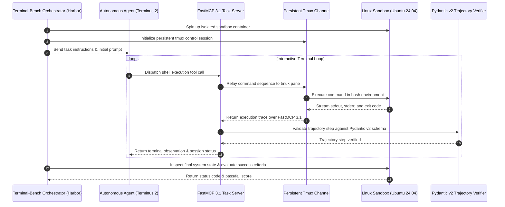

# Terminal-Bench (Terminus 2)

## What it is
Terminal-Bench (including the Terminus 2 research baseline) is a specialized benchmark suite designed to evaluate AI agents' ability to operate within real-world, stateful Linux terminal environments. Moving beyond static code snippet generation, Terminal-Bench measures an agent's capability to execute complex shell commands, parse stdout/stderr streams, manage long-running terminal sessions (via persistent tmux channels), and remediate cascading system, network, and application failures. In early 2027, Terminal-Bench serves as the premier evaluation standard for validating **FastMCP 3.1 Task Protocol** compliance in autonomous DevOps and SRE agents powered by frontier models such as **Claude 5.6**, **GPT-5.6**, **Gemini 4.0 Ultra**, **DeepSeek-V4**, **Gemma 4**, and **Qwen 3.6 VL**.

## What problem it solves
Traditional code generation benchmarks (e.g., HumanEval or MBPP) test isolated algorithmic synthesis but fail to evaluate real-world system administration skills: navigating file hierarchies, configuring web servers, managing process states, diagnosing memory leaks, and recovering from syntax or permissions errors. Terminal-Bench solves this gap by evaluating agents in isolated, containerized Linux sandboxes through a continuous "Intent-State-Action" feedback loop:

```
[Agent Intent] --> [Tmux Shell Command] --> [Linux Container Execution] --> [Stdout/Stderr Observation] --> [State Remediation]
```

This interactive loop tests the persistence, self-correction, and terminal proficiency required before granting autonomous agents administrative privileges in production server environments.

## System Architecture

The following diagram details how the Terminal-Bench evaluation harness (Harbor) coordinates persistent tmux control channels, isolated container sandboxes, and FastMCP 3.1 task protocol gateways:

```
+-----------------------------------------------------------------------------------+
|                        TERMINAL-BENCH EVALUATION HARNESS                          |
+-----------------------------------------------------------------------------------+
                                          |
                                          v
+------------------+             +------------------+             +-----------------+
| Autonomous Agent | ----------> | FastMCP 3.1 Task | ----------> | Persistent Tmux |
| (Terminus 2 /    |             | Server Gateway   |             | Control Channel |
|  Claude 5.6)     |             +------------------+             +-----------------+
+------------------+                      |                                |
                                          v                                v
                                 +------------------+             +-----------------+
                                 | Pydantic v2      |             | Isolated Linux  |
                                 | Trajectory Guard |             | Sandbox Container|
                                 +------------------+             +-----------------+
```



## Where it fits in the stack
**Benchmarking / Agent Evaluation**. Terminal-Bench operates at the evaluation and testing layer of autonomous systems. It provides the verification gate used to measure terminal proficiency before deploying autonomous agents to manage self-hosted home-lab services or cloud infrastructure.

```
+-------------------------------------------------------------------------------+
|                    TERMINAL-BENCH STACK INTEGRATION                         |
+-------------------------------------------------------------------------------+
| Layer                       | Tools & Frameworks                              |
+-----------------------------+-------------------------------------------------+
| Autonomous Terminal Agents  | Terminus 2, Claude Code, OpenHands, Aider       |
| Protocol & Tooling          | FastMCP 3.1 Task Protocol, Model Context Protocol|
| Benchmark Execution Harness | Terminal-Bench, Harbor Framework                |
| Isolation Runtime           | Docker, Podman, Containerd                      |
| Foundation Models           | Claude 5.6, GPT-5.6, Gemini 4.0, Gemma 4        |
+-------------------------------------------------------------------------------+
```

## Benchmark Comparison Matrix

| Feature / Metric | Terminal-Bench (Terminus 2) | SWE-bench | InterCode | OSWorld |
| :--- | :--- | :--- | :--- | :--- |
| **Primary Domain** | Linux SysAdmin & DevOps | GitHub Repository Issues | Interactive Shell/SQL/Py | Desktop OS & GUI Tasks |
| **Interaction Mode** | Stateful Tmux / Terminal | Diff / Patch Generation | Interactive Gym Loop | GUI & OS Environment |
| **Execution Environment** | Isolated Linux Sandbox | Docker Container Suite | Docker Containers | OS Virtual Machines |
| **State Persistence** | Persistent Tmux Session | Post-Patch Run | Per-Step Reset | Stateful OS Machine |
| **FastMCP 3.1 Native** | Full FastMCP 3.1 Support | via Harness Adapter | Full Support | Custom Adapters |
| **Evaluation Focus** | SysAdmin, Nginx, Systemd | Repo Bug Fixing | Code Syntax & Logic | GUI & Multimodal OS |
| **Resource Overhead** | Moderate to High | High | Moderate | Very High |

## Typical use cases
- **DevOps Agent Evaluation**: Benchmarking developer-focused agents (e.g., Aider, OpenHands, or Claude Code) on Nginx load balancer configuration, systemd service setup, and SSL certificate installation.
- **Autonomous SysAdmin Research**: Evaluating frontier reasoning models (Claude 5.6, GPT-5.6, Gemini 4.0 Ultra, DeepSeek-V4, Gemma 4) on their ability to execute multi-step shell scripts, manage process trees, and debug networking failures.
- **Persistent tmux Session Management**: Testing agentic control loops when managing long-running tasks across multiple parallel tmux panes.
- **Self-Healing Infrastructure Testing**: Evaluating agents' ability to inspect log files (e.g., `/var/log/syslog`), identify memory leaks, and execute remediation scripts without human intervention.

## Strengths
- **Practical Realism**: Replaces abstract coding puzzles with real-world DevOps, Site Reliability Engineering (SRE), and system administration scenarios.
- **Stateful Tmux Integration**: Maintains true state across command executions using persistent tmux channels.
- **FastMCP 3.1 Compatibility**: Native support for FastMCP 3.1 task protocol definitions, ensuring type-safe tool invocations.
- **Strict Environment Isolation**: Runs evaluations inside containerized environments to ensure safety and reproducibility.

## Limitations
- **High Compute Overhead**: Demands a containerized Docker or Harbor environment to safely execute arbitrary agent-generated commands.
- **Environment Flakiness**: Package repository updates or hardware driver variations can introduce evaluation noise.
- **OS Specificity**: Scenarios are primarily optimized for Debian/Ubuntu environments, requiring adaptation for other Linux distributions.

## When to use it
- When evaluating the safety, accuracy, and efficiency of autonomous agents executing command-line instructions.
- When configuring sandbox environments for local models (Gemma 4, DeepSeek-V4) to run self-healing scripts.
- When validating persistent agent control loops via tmux sessions.

## When not to use it
- For quick, lightweight model evaluations (use [LM Evaluation Harness](lm-evaluation-harness.md)).
- For purely language-focused or code-synthesizing evaluations (use [MBPP](mbpp.md) or [HumanEval](humaneval.md)).

## Getting started

### Installation
Terminal-Bench (TB-2) is orchestrated using the **Harbor** framework:

```bash
# Install Terminal-Bench and Harbor framework
pip install terminal-bench harbor-framework fastmcp pydantic

# Verify Docker service status
docker info
```

### Sandbox Initialization
Initialize an isolated Harbor environment for benchmarking:

```bash
harbor init \
  --benchmark terminal-bench \
  --memory-limit 4g \
  --cpu-shares 1024
```

## CLI examples

### Running a DevOps Task Benchmark
Evaluate an agent's ability to configure an Nginx load balancer under strict execution constraints:

```bash
tb run \
  --task_id "nginx-lb-config-v2" \
  --model "anthropic/claude-5-6-sonnet" \
  --timeout 300 \
  --sandbox-image "harbor/ubuntu-24.04-dev:v3.1"
```

### Managing Tmux Sessions via Terminus 2
Connect an agent to a persistent tmux control session:

```bash
terminus2 connect \
  --session "devops-audit-2027" \
  --agent "devops-droid-v1" \
  --pane-size "80x24"
```

## FastMCP 3.1 Task Server Implementation

The following example demonstrates how to implement a FastMCP 3.1 server for managing Terminal-Bench task trajectories:

```python
import os
import json
import time
from typing import List, Optional
from pydantic import BaseModel, Field, ValidationError
from fastmcp import FastMCP

# Initialize FastMCP 3.1 Server for Terminal-Bench Trajectory Management
mcp = FastMCP("Terminal-Bench-Task-Server", version="3.1")

class TerminalExecutionRequest(BaseModel):
    task_id: str = Field(..., description="Unique Terminal-Bench task identifier.")
    command: str = Field(..., min_length=1, description="Shell command string to execute in tmux pane.")
    session_name: str = Field("tb_default_session", description="Persistent tmux session identifier.")
    timeout_seconds: int = Field(30, ge=1, le=300, description="Command execution timeout in seconds.")

class TerminalTrajectoryStep(BaseModel):
    task_id: str
    step_number: int
    command_executed: str
    stdout_preview: str = Field(..., description="First 200 characters of stdout.")
    exit_code: int = Field(..., description="Process exit code.")
    session_status: str = Field(..., description="State of the persistent tmux channel.")

@mcp.tool(
    name="execute_terminal_command",
    description="Executes a shell command in a persistent tmux session via FastMCP 3.1 and returns validated telemetry."
)
def execute_terminal_command(payload_json: str) -> str:
    """Executes command in tmux channel and returns Pydantic v2 validated trajectory telemetry."""
    try:
        data = json.loads(payload_json)
        req = TerminalExecutionRequest.model_validate(data)

        # Simulated execution result for demonstration
        stdout_text = f"Executed '{req.command}' in session '{req.session_name}' successfully."
        exit_code = 0 if "error" not in req.command.lower() else 1

        step = TerminalTrajectoryStep(
            task_id=req.task_id,
            step_number=1,
            command_executed=req.command,
            stdout_preview=stdout_text[:200],
            exit_code=exit_code,
            session_status="ACTIVE"
        )

        return step.model_dump_json(indent=2)

    except ValidationError as ve:
        return json.dumps({"error": "Schema validation failed", "details": ve.errors()}, indent=2)
    except Exception as e:
        return json.dumps({"error": "Execution exception", "message": str(e)}, indent=2)

if __name__ == "__main__":
    sample_request = json.dumps({
        "task_id": "task_nginx_01",
        "command": "systemctl status nginx",
        "session_name": "devops_session_2027"
    })
    print("FastMCP 3.1 Terminal Tool Output:")
    print(execute_terminal_command(sample_request))
```

## Programmatic Integration and Trajectory Validation

The following Python script demonstrates how to parse and validate Terminal-Bench trajectories using **Pydantic v2**:

```python
import json
from typing import List, Optional
from pydantic import BaseModel, Field, ValidationError

class ExecutionStep(BaseModel):
    command: str = Field(..., description="Executed command string.")
    exit_code: int = Field(..., description="Process exit code.")
    stdout_preview: str = Field(..., description="Preview of stdout response.")
    stderr_preview: Optional[str] = Field(None, description="Preview of stderr response.")

class TerminalEvaluationResult(BaseModel):
    task_id: str = Field(..., description="Unique task ID.")
    success: bool = Field(..., description="Pass/fail completion indicator.")
    final_status_code: int = Field(..., description="Final container exit code.")
    trajectories: List[ExecutionStep] = Field(default_factory=list, description="Executed step sequence.")

def validate_terminal_trajectory(raw_json: str) -> Optional[TerminalEvaluationResult]:
    """Validates terminal telemetry payload against Pydantic v2 data contract."""
    try:
        res = TerminalEvaluationResult.model_validate_json(raw_json)
        return res
    except ValidationError as ve:
        print(f"Trajectory validation error: {ve}")
        return None

if __name__ == "__main__":
    sample_payload = """
    {
        "task_id": "debug-memory-leak-01",
        "success": true,
        "final_status_code": 0,
        "trajectories": [
            {
                "command": "gcc -o app main.c -fsanitize=address",
                "exit_code": 0,
                "stdout_preview": "Compilation finished."
            },
            {
                "command": "./app",
                "exit_code": 1,
                "stdout_preview": "AddressSanitizer detected heap leak.",
                "stderr_preview": "ERROR: LeakSanitizer: detected memory leaks"
            }
        ]
    }
    """
    validated = validate_terminal_trajectory(sample_payload)
    if validated:
        print(f"Validated task '{validated.task_id}' successfully!")
        print(f"Success Status: {validated.success}")
        print(f"Total Trajectory Steps: {len(validated.trajectories)}")
```

## Operational Guidelines & Security Hardening

To ensure safe execution during terminal benchmarks:

1. **Non-Root Container Runtime**: Run sandbox containers as unprivileged users (`--user 1000:1000`) and drop kernel capabilities (`--cap-drop=ALL`).
2. **Resource Constraints**: Impose strict memory and CPU quotas on benchmark containers (`--memory 4g --cpus 2.0`).
3. **Network Isolation**: Disable container internet connectivity (`--network none`) unless network functionality is explicitly required by the task.
4. **Automatic Teardown**: Ensure tmux sessions and Docker containers are terminated and destroyed immediately upon task completion.

## Troubleshooting & Common Pitfalls

| Issue / Symptom | Root Cause | Resolution Strategy |
| :--- | :--- | :--- |
| **`TmuxSessionError: Session lost`** | Tmux server crashed or container memory limit exceeded. | Increase sandbox container memory allocation (`--memory 8g`) and inspect system dmesg logs. |
| **Command Timeout in Tmux** | Command triggered an interactive prompt (e.g., `apt-get` asking for confirmation). | Supply non-interactive environment flags (`DEBIAN_FRONTEND=noninteractive`) and `-y` flags. |
| **Flaky Evaluation Scores** | Stale state inherited from previous benchmark trial. | Ensure complete container recreation (`harbor reset`) between benchmark trials. |
| **FastMCP 3.1 Tool Disconnect** | Terminal output stream exceeded maximum JSON-RPC message size. | Truncate stdout/stderr buffers prior to returning payloads over FastMCP 3.1 transport. |

## Related tools / concepts
- [SWE-bench](swe-bench.md) — Benchmark for repository-level software engineering tasks.
- [InterCode](intercode.md) — Interactive benchmark framework for shell, SQL, and Python.
- [BigCodeBench](bigcodebench.md) — Suite for evaluating complex code generation.
- [OpenHands](../development_ops/openhands.md) — Open-source platform for autonomous coding agents.
- [Aider](../development_ops/aider.md) — Terminal-native AI pair programming tool.
- [Model Context Protocol (MCP)](../automation_orchestration/mcp.md) — Open standard for AI tool and resource orchestration.

## Sources / references
- [Terminal-Bench Official GitHub Repository](https://github.com/harbor-framework/terminal-bench)
- [Harbor Framework Documentation](https://github.com/harbor-framework/harbor)
- [Model Context Protocol (MCP) FastMCP 3.1 Specification](https://modelcontextprotocol.io/)

## Contribution Metadata
- Last reviewed: 2027-01-07
- Confidence: high
