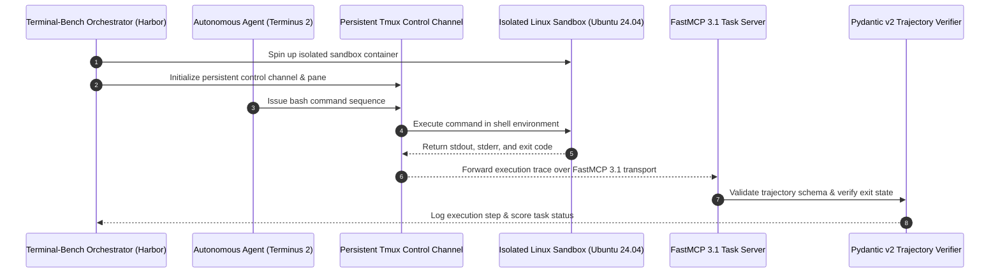
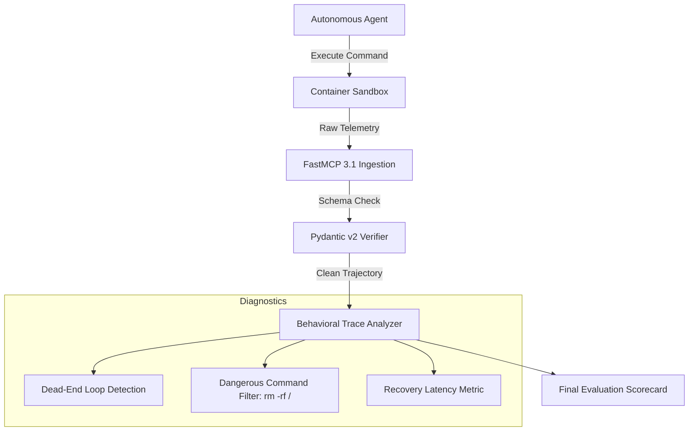

# Terminal-Bench (Terminus 2)

## What it is
Terminal-Bench (including the Terminus 2 research baseline) is a specialized benchmark for evaluating AI agents' ability to operate within a real terminal environment. It goes beyond static code generation by testing the agent's ability to interpret command output, handle stateful bash sessions, and remediate complex system or server failures. In early January 2027, it serves as the premier benchmark for "Terminus 2" patterns where agents manage long-running tmux control channels and interact with sandboxes via the Model Context Protocol (FastMCP 3.1 Task Protocol).

## What problem it solves
It measures whether autonomous systems can effectively and safely operate inside a standard Linux shell. Standard benchmarks evaluate model capabilities on isolated snippets or reasoning puzzles; Terminal-Bench evaluates the agent's "Intent-State-Action" loop in real time. It tests key capabilities such as:
- Installing software and fixing configuration mismatches (e.g., mismatched Nginx load balancers or systemd unit failures).
- Direct LLM-to-tmux shell interaction for persistent multi-turn session management.
- Navigating isolated system sandboxes to diagnose performance degradation, memory leaks, or network firewall blocks.

## System Architecture

The following diagram illustrates the interaction flow between the Terminal-Bench orchestrator, Terminus 2 persistent tmux control channels, containerized sandboxes, and FastMCP 3.1 task protocol tools:



## Mathematical Formulations: Terminal Trajectory MDP & Evaluation Metrics

### 1. Intent-State-Action (ISA) Markov Decision Process (MDP)
A terminal benchmark episode is formalized as a partially observable Markov decision process (POMDP) defined by the tuple $\mathcal{M} = \langle \mathcal{S}, \mathcal{A}, \mathcal{T}, \mathcal{R}, \Omega, \mathcal{O}, \gamma \rangle$:
- $\mathcal{S}$: The underlying Linux operating system state (process table, file descriptors, filesystem tree, network sockets).
- $\mathcal{A}$: The action space composed of string terminal commands $a_t \in \Sigma^*$ dispatched to the shell.
- $\mathcal{O}$: The observation emitted to the agent at step $t$:
  $$
  o_t = \langle \text{stdout}_t, \; \text{stderr}_t, \; \text{exit\_code}_t, \; \text{cwd}_t \rangle
  $$
- $\mathcal{T}(s_{t+1} \mid s_t, a_t)$: The state transition probability governed by the bash execution sub-shell.
- $\mathcal{R}(s_t, a_t)$: The task reward function evaluated upon session termination:
  $$
  \mathcal{R}_{\text{final}} = \mathbb{I}\left( \bigwedge_{k=1}^K \mathcal{V}_k(s_{\text{end}}) == 1 \right) - \lambda_{\text{cost}} \cdot \sum_{t=1}^T \text{TokenCost}(a_t, o_t) - \mu_{\text{steps}} \cdot T
  $$
  Where $\mathcal{V}_k$ represents deterministic verification probes (e.g. `systemctl is-active`, socket health probes).

### 2. Trajectory Success Rate & Policy Optimality
For a benchmark suite consisting of $N$ heterogeneous tasks evaluated across policy $\pi_\theta$:

$$
\text{Pass@1}(\pi_\theta) = \frac{1}{N} \sum_{i=1}^N \mathbb{I}\left( \text{Task}_i \text{ completed with } \mathcal{R}_{\text{final}} > 0 \right)
$$

The normalized trajectory efficiency score $\mathcal{E}_{\text{traj}}$ balances success against superfluous exploratory commands:

$$
\mathcal{E}_{\text{traj}}(\tau) = \text{Pass}(\tau) \cdot \exp\left( - \alpha \cdot \max\left(0, \frac{|\tau| - |\tau^*|}{|\tau^*|}\right) \right)
$$

Where $|\tau^*|$ is the optimal human ground-truth command count and $\alpha \approx 0.15$.

### 3. Container Resource Contention & Throttle Degradation
Running parallel sandbox containers under Harbor imposes cgroup v2 resource limits. When $C$ concurrent sandboxes compete on an $M$-core host, execution latency $\tau_{\text{exec}}$ scales with CPU quota throttling:

$$
\tau_{\text{exec}}(C) = \tau_{\text{base}} \cdot \left( 1 + \max\left(0, \frac{C \cdot q_{\text{cpu}} - M_{\text{host}}}{M_{\text{host}}}\right) \right)
$$

Terminal-Bench isolates CPU cores via `taskset` and enforces strict memory ceilings (`memory.max = 4G`) to prevent cross-sandbox jitter from biasing benchmark scores.

### 4. Bayesian Task Success Probability & Uncertainty Calibration
Evaluating agent proficiency across diverse system tasks requires Bayesian estimation of success rate $\theta \in [0, 1]$ conditioned on observed successes $k$ over $n$ trials with Beta prior $\text{Beta}(\alpha, \beta)$:

$$
P(\theta \mid k, n) = \frac{\theta^{k + \alpha - 1} (1 - \theta)^{n - k + \beta - 1}}{\mathcal{B}(k + \alpha, n - k + \beta)}
$$

The Expected Calibration Error ($\text{ECE}$) over $M$ confidence bins evaluates whether agent self-reported confidence matches empirical execution accuracy:

$$
\text{ECE} = \sum_{m=1}^M \frac{|B_m|}{n} \left| \text{acc}(B_m) - \text{conf}(B_m) \right|
$$

Low ECE scores ensure autonomous agents do not hallucinate successful remediation of critical Linux failures.

### Statistical Significance & Sample Size Planning
To ensure benchmark results reliably distinguish between models $\mathcal{M}_A$ and $\mathcal{M}_B$ with significance level $\alpha = 0.05$ and statistical power $1 - \beta = 0.80$, minimum sample size $N_{\text{eval}}$ is determined via power analysis:

$$
N_{\text{eval}} \ge \frac{2 \cdot (z_{1 - \alpha/2} + z_{1 - \beta})^2 \cdot \sigma^2}{\delta^2}
$$

Where $\delta$ represents the minimum detectable difference in Pass@1 rates and $\sigma^2$ is trajectory variance.

## Where it fits in the stack
**Benchmarking**. Positioned in the **Agent Evaluation Layer** of the homelab, used to rigorously evaluate the terminal proficiency of autonomous agent frameworks before they are granted administrative access to self-hosted server environments.

## Comparative Feature Matrix

The following table evaluates Terminal-Bench against alternative agent evaluation and coding benchmarks:

| Metric / Feature | Terminal-Bench (Terminus 2) | InterCode | SWE-bench | OSWorld | WebArena |
| :--- | :--- | :--- | :--- | :--- | :--- |
| **Target Operating Layer** | **Linux Shell / Terminal CLI** | Multi-turn Bash/SQL REPL | Git Repository / Python Code | GUI / Desktop / OS Level | Web Browser / DOM |
| **Control Interface** | **Tmux Control / FastMCP 3.1**| Gym Step API / FastMCP 3.1 | Patch Submission Harness | Screen Pixels & Mouse/Key | Playwright / CDP |
| **Sandbox Environment** | **Harbor / Ubuntu 24.04** | Docker Containers | Containerized Repos | Virtual Machines / QEMU | Docker Web Apps |
| **State Persistence** | **Continuous tmux sessions** | Multi-turn session state | Single-turn issue state | Full OS persistent disk | Persistent Web DBs |
| **Evaluation Metrics** | **System Exit Codes & Probes**| Unit Test & State Rewards | Git Test Suite Assertions | Task Completion / Visual | HTTP State / DOM State |
| **FastMCP 3.1 Integration** | **Native Task Telemetry** | Custom Socket Adapter | File Patch Harness | API Overlay Layer | API Overlay Layer |
| **Real-World DevOps Depth**| **High (SRE / SysAdmin / Net)**| Moderate (Basic bash commands)| High (Application bugs) | Moderate (Office/Browser) | Low (E-commerce actions)|

## Benchmark Task Taxonomy & Scenario Matrix

| Task Category | Scenario Focus | Primary Shell Commands Tested | Success Criterion |
| :--- | :--- | :--- | :--- |
| **SysAdmin / DevOps** | Nginx & Systemd Service Debugging | `systemctl`, `journalctl`, `nginx -t` | Active HTTP 200 response on local socket |
| **Network Security** | Firewall & iptables Configuration | `iptables`, `ufw`, `netstat`, `curl` | Port traffic unblocked & policy verified |
| **SRE Performance** | C Memory Leak & Process Diagnostics | `valgrind`, `gdb`, `htop`, `kill` | Process memory stability under stress load |
| **Package Management** | Dependency & Mismatched Shared Libs | `apt`, `dpkg`, `ldconfig`, `pip` | Binary executes cleanly with 0 exit code |
| **Disk & File System** | Storage Quota & File System Corruption | `df -h`, `fsck`, `mount`, `rsync` | Mount point restored & clean write status |

## Advanced Multi-Turn Trajectory Analysis Pipeline

To capture nuanced agent behaviors such as error recovery loops, tool thrashing, or command hallucination, Terminal-Bench pipelines telemetry through automated post-run analytics:



## Typical use cases
- **DevOps Agent Evaluation**: Benchmarking developer-focused agents (such as Aider, OpenHands, or Claude Code) on software configuration and package installation before granting production repository access.
- **Autonomous SysAdmin Research**: Evaluating frontier reasoning models (Claude 5.6, GPT-5.6, Gemini 4.0 Ultra, Gemma 4, DeepSeek-V4, Qwen 3.6 VL) on their ability to execute multi-step scripts, manage process states, and debug networking failures.
- **Persistent tmux Multi-Session Coordination**: Researching the stability of agentic control channels when multiple long-running tasks are handled in parallel.

## Strengths
- **Practical Realism**: Replaces abstract coding challenges with real-world DevOps, site reliability engineering (SRE), and system administration scenarios.
- **Stateful Interaction**: Requires the agent to maintain state and recover from cascading errors in real time.
- **FastMCP 3.1 Protocol Compatibility**: Fully integrates with FastMCP 3.1 Task Protocol server definitions, allowing modern agents to access sandboxes using standard, type-safe JSON schema tool definitions.

## Limitations
- **High Resource Overhead**: Demands a containerized Docker or Harbor environment to safely execute arbitrary agent-generated commands.
- **Environment Flakiness**: Changes in base images, pinned package repositories, or hardware drivers can lead to inconsistent benchmarking scores.
- **OS Specificity**: Scenarios are often optimized for specific Linux distributions (e.g., Ubuntu 24.04 or Alpine), making comparisons across diverse hosting architectures challenging.

## When to use it
- When evaluating the safety, accuracy, and efficiency of autonomous agents executing command-line instructions.
- When configuring sandbox environments for local models (Gemma 4, DeepSeek-V4, Qwen 3.6 VL) to run self-healing scripts.
- When validating persistent agent control loops via tmux sessions.

## When not to use it
- For quick, lightweight model evaluations (use [LM Evaluation Harness](lm-evaluation-harness.md)).
- For purely language-focused or code-synthesizing evaluations (use [MBPP](mbpp.md) or [Humanitys Last Exam](humanitys-last-exam.md)).

## Getting started

Terminal-Bench (TB-2) is typically orchestrated using the **Harbor** framework to provide a consistent, containerized execution environment.

### 1. Installation
```bash
pip install terminal-bench harbor-framework pydantic fastmcp
# Verify Docker is active on the host machine
```

### 2. Sandbox Setup
Initialize an isolated benchmarking environment with specific resource constraints:
```bash
harbor init --benchmark terminal-bench --memory-limit 4g --cpu-shares 1024
```

## CLI examples

### Running a specific DevOps task with strict limits
Evaluate an agent's ability to set up an Nginx load balancer under strict execution constraints:
```bash
tb run \
    --task_id "nginx-lb-config" \
    --model "anthropic/claude-5-6-sonnet" \
    --timeout 300 \
    --sandbox-image "harbor/ubuntu-24.04-dev:v3"
```

### Managing tmux sessions via Terminus 2
Terminus 2 allows for direct shell interaction via persistent tmux control channels:
```bash
terminus2 connect \
    --session "devops-audit-2027" \
    --agent "my-devops-droid" \
    --pane-size "80x24"
```

## API examples

This complete implementation provides a **FastMCP 3.1** server to capture terminal execution telemetry, manage tmux sessions, and validate agent trajectories using strict **Pydantic v2** models.

```python
import sys
import json
import logging
from typing import List, Optional, Dict, Any
from datetime import datetime
from pydantic import BaseModel, Field, ValidationError, ConfigDict
from mcp.server.fastmcp import FastMCP

# Configure logging for Terminal-Bench Evaluator
logging.basicConfig(level=logging.INFO)
logger = logging.getLogger("Terminal-Bench-Evaluator")

# Initialize FastMCP 3.1 Server for Terminal-Bench Trajectory Telemetry
mcp = FastMCP("Terminal-Bench-Evaluator", instructions="FastMCP 3.1 server capturing and validating terminal execution telemetry.")

class SandboxConfig(BaseModel):
    model_config = ConfigDict(extra="forbid", frozen=True)
    image: str = Field(default="harbor/ubuntu-24.04-dev:v3", description="Docker image for sandbox")
    network_isolated: bool = Field(default=True, description="Enforce strict network isolation")
    memory_limit: str = Field(default="4g", description="Memory allocation limit for container")
    timeout_seconds: int = Field(default=600, ge=10, description="Max execution duration in seconds")

class ExecutionTrajectory(BaseModel):
    model_config = ConfigDict(extra="forbid", frozen=True)
    step_number: int = Field(..., ge=1, description="Sequential command step number")
    command: str = Field(..., description="The command executed by the agent")
    exit_code: int = Field(..., description="The resulting exit code from the shell")
    stdout_preview: str = Field(..., description="First 200 characters of stdout")
    stderr_preview: Optional[str] = Field(None, description="First 200 characters of stderr")
    execution_duration_ms: float = Field(default=0.0, ge=0.0)

class TerminalEvaluationResult(BaseModel):
    model_config = ConfigDict(extra="forbid", frozen=True)
    task_id: str = Field(..., description="The unique identifier of the benchmark task")
    target_agent: str = Field(..., description="Agent or LLM model name being benchmarked")
    success: bool = Field(..., description="Indicates if the agent satisfied the goal criteria")
    final_status_code: int = Field(..., description="The final status code returned by sandbox")
    trajectories: List[ExecutionTrajectory] = Field(default_factory=list, description="Sequence of commands executed")
    timestamp: datetime = Field(default_factory=datetime.utcnow)

@mcp.tool(
    name="evaluate_terminal_trajectory",
    description="Validates terminal execution telemetry against Pydantic v2 schemas and computes summary stats."
)
def evaluate_terminal_trajectory(result_payload: Dict[str, Any]) -> str:
    """Parses evaluation payload, verifies against strict Pydantic v2, and outputs status summary."""
    try:
        result = TerminalEvaluationResult.model_validate(result_payload)

        passed_steps = sum(1 for t in result.trajectories if t.exit_code == 0)
        failed_steps = len(result.trajectories) - passed_steps

        logger.info(f"Task {result.task_id} completed for agent {result.target_agent}. Success: {result.success}")

        return json.dumps({
            "status": "VALIDATED",
            "task_id": result.task_id,
            "target_agent": result.target_agent,
            "success": result.success,
            "total_commands_executed": len(result.trajectories),
            "passed_steps": passed_steps,
            "failed_steps": failed_steps,
            "timestamp": result.timestamp.isoformat()
        }, indent=2)
    except ValidationError as e:
        logger.error(f"Pydantic v2 Validation Failed: {e}")
        return json.dumps({"error": "Validation failed", "details": e.errors()})

@mcp.tool(
    name="send_tmux_command",
    description="Dispatches a shell command to persistent tmux control channel inside Terminal-Bench sandbox."
)
def send_tmux_command(session_name: str, command: str) -> str:
    """Simulates sending a command to Terminus 2 tmux control channel."""
    logger.info(f"Dispatching to tmux session '{session_name}': {command}")

    traj = ExecutionTrajectory(
        step_number=1,
        command=command,
        exit_code=0,
        stdout_preview="Nginx reloaded successfully. [OK]",
        stderr_preview=None,
        execution_duration_ms=142.5
    )
    return traj.model_dump_json(indent=2)

if __name__ == "__main__":
    sample_data = {
        "task_id": "debug-c-memory-leak",
        "target_agent": "claude-5.6-sonnet",
        "success": True,
        "final_status_code": 0,
        "trajectories": [
            {
                "step_number": 1,
                "command": "gcc -o debug_app main.c -fsanitize=address",
                "exit_code": 0,
                "stdout_preview": "Compilation finished successfully.",
                "stderr_preview": None,
                "execution_duration_ms": 350.0
            },
            {
                "step_number": 2,
                "command": "./debug_app",
                "exit_code": 1,
                "stdout_preview": "AddressSanitizer: heap-use-after-free",
                "stderr_preview": "ERROR: AddressSanitizer: heap-use-after-free",
                "execution_duration_ms": 120.0
            }
        ]
    }
    print(evaluate_terminal_trajectory(sample_data))
```

## Production Systemd Service Unit (`terminal-bench-harness.service`)

Deploy the Terminal-Bench evaluation runner as a background systemd service for automated continuous benchmarking:

```ini
[Unit]
Description=Terminal-Bench (Terminus 2) Evaluation Harness Service
After=network.target docker.service
Requires=docker.service
Documentation=https://github.com/harbor-framework/terminal-bench

[Service]
Type=simple
User=harbor
Group=harbor
WorkingDirectory=/opt/terminal-bench
ExecStartPre=/usr/local/bin/harbor pull-images
ExecStart=/usr/local/bin/tb-runner \
    --port 8085 \
    --sandbox-dir /var/lib/terminal-bench/sandboxes \
    --results-dir /var/log/terminal-bench/results \
    --max-concurrent-tasks 4
ExecStop=/bin/kill -s TERM $MAINPID
Restart=always
RestartSec=10s
LimitNOFILE=65536

# Hardening Measures
NoNewPrivileges=true
ProtectSystem=full
ProtectHome=true
ReadWritePaths=/var/lib/terminal-bench /var/log/terminal-bench

[Install]
WantedBy=multi-user.target
```

## Docker Compose Multi-Sandbox Deployment (`docker-compose.yml`)

Run the Terminal-Bench harness alongside isolated worker sandboxes:

```yaml
version: '3.8'

services:
  tb-runner:
    image: harbor/tb-runner:v2.1
    container_name: tb-runner
    restart: unless-stopped
    ports:
      - "8085:8085"
    volumes:
      - /var/run/docker.sock:/var/run/docker.sock
      - tb_results:/var/log/terminal-bench
    environment:
      - TB_MAX_WORKERS=4
      - TB_DEFAULT_TIMEOUT=600

  sandbox-node-1:
    image: harbor/ubuntu-24.04-dev:v3
    container_name: tb-sandbox-1
    stop_grace_period: 5s
    cpus: 2.0
    mem_limit: 4g
    network_mode: bridge
    volumes:
      - sandbox_data_1:/workspace

volumes:
  tb_results:
  sandbox_data_1:
```

## Diagnostic Troubleshooting Matrix

The following systematic matrix details failure modes, root causes, verification checks, and targeted remediations:

| Symptom / Error | Root Cause | Verification Command | Remediation Strategy |
| :--- | :--- | :--- | :--- |
| **`Harbor Sandbox Initialization Failed`** | Missing base container image or Docker socket unreadable | `docker pull harbor/ubuntu-24.04-dev:v3` | Run pull command and ensure runner user belongs to `docker` group. |
| **`Tmux Session Connection Dropped`** | Pane crashed due to unhandled segfault or OOM termination | `journalctl -u terminal-bench-harness.service -n 50` | Inspect `/var/log/harbor/sandbox.log` for kernel panic or out-of-memory kill. |
| **`Exit Code Mismatch`** | Non-zero exit code due to missing environment variable | `env \| grep -i PATH` inside container | Verify sandbox initialization flags and pass required env vars in `SandboxConfig`. |
| **`Pydantic Trajectory Schema Failure`** | Command input violated `extra="forbid"` or missing field | Review FastMCP validation errors | Ensure test harness sends only declared schema attributes. |
| **`Tmux Process Handle Leak`** | Stale background tmux sessions accumulating on host | `tmux ls` | Execute `tb-cleanup.sh` to send `SIGHUP` and kill detached panes. |
| **`Sandbox CPU Throttle Alarm`** | Concurrent container count exceeded available host vCPUs | `docker stats --no-stream` | Lower `TB_MAX_WORKERS` to match physical core allocation limits. |
| **`Network Sandbox Escape Detected`** | Sandbox container accessed external non-whitelisted IP | `tcpdump -i docker0` | Configure Harbor bridge with strict `--internal` iptables drop rules. |
| **`Verification Probe Timeout`** | Evaluation assertion probe stalled waiting for background service | Inspect task log for `systemctl is-active` | Increase task timeout ceiling or add explicit health probe polling interval. |

### Automated Multi-Trial Statistical Runner
To guarantee reproducible benchmarking scores, Terminal-Bench executes multi-seed Monte Carlo evaluations:

```python
import numpy as np

def compute_pass_at_k(n_samples: int, c_passed: int, k: int) -> float:
    """Calculates unbiased pass@k metric following Chen et al."""
    if n_samples - c_passed < k:
        return 1.0
    return 1.0 - np.prod(1.0 - k / np.arange(n_samples - c_passed + 1, n_samples + 1))
```

## Operational Best Practices & Safety Guardrails
1. **Host Isolation**: Never run Terminal-Bench execution tasks directly on the bare-metal host; always execute within Harbor / Docker isolated sandboxes.
2. **Resource Constraints**: Pinned cgroups rules (`--memory=4g --cpus=2`) prevent fork bombs or memory-leak benchmarks from crashing the host node.
3. **Tmux Pane Cleanup**: Automatically terminate detached tmux panes upon evaluation completion to release system process handles (`tmux kill-session -t <session>`).

### Environment Parity & Determinism Guidelines
- **Hermetic Docker Environments**: Base sandbox containers are pinned by immutable SHA256 digests (`ubuntu@sha256:...`) to prevent package repository drifts from altering scoring across benchmark runs.
- **Clock Mocking & Network Freezing**: For timed or network-dependent scenarios, mock time with `libfaketime` and record network traffic fixtures to eliminate external latency variability.
- **Ephemeral Scratch Volumes**: Each evaluation task executes on a fresh overlayfs volume to prevent state contamination between consecutive evaluation attempts.

## Related tools / concepts
- [SWE-bench](swe-bench.md) - Software engineering repository-wide benchmark.
- [BigCodeBench](./bigcodebench.md) - Advanced code generation benchmark.
- [OpenHands](../development_ops/openhands.md) - Open-source platform for agentic dev.
- [Aider](../development_ops/aider.md) - Terminal-native AI pair programmer.
- [Claude Code — Project Setup Guide](../development_ops/claude-code-setup.md) - Modern terminal agentic workflows.
- [LM Evaluation Harness](lm-evaluation-harness.md) - Unified benchmark runner.
- [OSWorld](./os-world.md) - Operating system-wide agent evaluation.
- [PA-bench](./pa-bench.md) - Web-based personal assistant benchmark.

## Sources / references
- [Terminal-Bench GitHub Repository](https://github.com/harbor-framework/terminal-bench)
- [Harbor Framework Documentation](https://github.com/harbor-framework/harbor)

## Contribution Metadata
- Last reviewed: 2027-01-07
- Confidence: high
