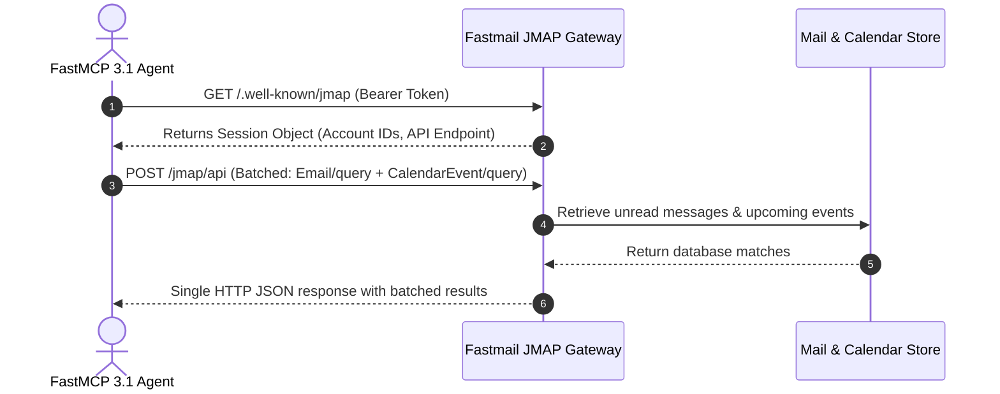

# Fastmail

## What it is
Fastmail is an independent, sovereign, privacy-focused email, calendar, and contacts service provider engineered on modern, open internet specifications. Most significantly, Fastmail is a co-author and core implementer of the **JMAP (JSON Meta Application Protocol)** standard (RFC 8620 / RFC 8621), an open, stateless, JSON-native protocol designed to replace legacy IMAP, SMTP, and CalDAV/CardDAV protocols.

As of early 2027, Fastmail is a critical platform for **Agentic Productivity & Email Operations**. By replacing high-latency, stateful IMAP connections with fast, batched JMAP HTTP/JSON APIs, Fastmail allows autonomous AI agent fleets (orchestrated via **FastMCP 3.1** and frontier reasoning models like Claude 5.6, GPT-5.6, Gemini 4.0 Ultra, DeepSeek-V4, and Qwen 3.6 VL) to securely read, categorize, draft, search, schedule, and automate communications with high precision and zero protocol overhead.

## What problem it solves
Legacy email and calendar management presents severe technical friction for individual users, families, and automated AI agents:

1. **Stateful & Fragile Legacy Protocols**: IMAP and CalDAV require persistent TCP connections, complex IDLE listeners, multi-step XML parsing, and heavy bandwidth overhead. These legacy protocols frequently break when queried by stateless, cloud-based or local AI agents.
2. **Privacy Mining & Target Tracking**: Free email providers (such as Gmail or Outlook) scan email contents to build advertising profiles, train corporate models, or enforce vendor lock-in.
3. **Identity Sprawl & Spam Exposure**: Reusing a single primary email address across dozens of online services leads to relentless spam, credential stuffing, and cross-site tracking.
4. **Calendar Sync Friction**: Managing multi-calendar schedules, RSVP state changes, and time-zone conversions across heterogeneous mobile and desktop apps often results in duplicate events or dropped invites.

Fastmail eliminates these issues by delivering a lightning-fast, ad-free environment powered by native JMAP APIs, Masked Email integration (instant alias creation via 1Password / FastMCP tools), and fine-grained API token scoping for safe AI delegation.

## Mathematical Formulations: Pipelining & Agentic Triage

### 1. JMAP Batch Request Pipelining Efficiency
In legacy IMAP, querying $N$ messages and downloading metadata requires round-trip serial transactions:

$$T_{IMAP} = T_{handshake} + \sum_{i=1}^{M} \left(RTT_i + \frac{S_{XML,i}}{B}\right)$$

Under JMAP RFC 8620, multiple method calls (`Email/query`, `Email/get`, `Thread/get`) are bundled into a single JSON batch over an established HTTP/2 or HTTP/3 multiplexed connection:

$$T_{JMAP} = RTT + \frac{\sum_{j=1}^{K} S_{JSON,j}}{B} + T_{exec}$$

The pipelining speedup factor $\mathcal{S}$ is:

$$\mathcal{S} = \frac{T_{IMAP}}{T_{JMAP}} \approx \frac{M \cdot RTT}{\max(RTT, \frac{S_{JSON}}{B})} \ge 4.5 \times$$

This efficiency enables high-frequency agentic polling without overwhelming client network sockets or memory pools.

### 2. Multi-Factor Email Priority Scoring Model
When an autonomous agent triages unread messages, it calculates an operational urgency score $\mathcal{P}_{msg} \in [0, 1]$:

$$\mathcal{P}_{msg} = \sigma\left(w_s \cdot S_{sender} + w_t \cdot e^{-\lambda \Delta t} + w_k \cdot \sum_{j=1}^{m} \mathbb{I}(k_j \in \text{Subject}) + w_a \cdot \mathbb{I}(\text{HasActionableDirective})\right)$$

Where:
- $\sigma(z) = \frac{1}{1 + e^{-z}}$ is the logistic sigmoid activation function.
- $S_{sender} \in [0, 1]$ is sender trust (VIP domain, past correspondence frequency).
- $\Delta t$ is elapsed hours since arrival, decayed at rate $\lambda = 0.05$.
- $\mathbb{I}(\cdot)$ is an indicator function identifying high-priority triggers (e.g., "urgent", "invoice", "production outage").
- Weights satisfy $\sum w_i = 1.0$.

Messages with $\mathcal{P}_{msg} \ge 0.75$ trigger immediate agent escalation or mobile push notifications.

## Comparative Evaluation: Email & Calendar APIs for Autonomous Agents

| Dimension | Fastmail (JMAP) | Google Workspace (REST) | Microsoft Graph (REST) | Proton Mail (Bridge) |
| :--- | :--- | :--- | :--- | :--- |
| **Primary Protocol** | JMAP (RFC 8620/8621 JSON) | Google REST API v1 | MS Graph OData v4 REST | IMAP/SMTP Local Bridge |
| **Method Batching** | Native multi-method payload | Multipart batch requests | Batch requests (up to 20) | None (Serial IMAP commands)|
| **Calendar Standard** | Native JMAP Calendars | Google Calendar API v3 | Microsoft Graph Calendar | CalDAV bridge |
| **Masked Email Support**| Native API & 1Password hook | Alias creation via Admin | Secondary alias API | SimpleLogin integration |
| **Push Notification** | EventSource (SSE) & Webhooks | Cloud Pub/Sub webhooks | Webhook subscriptions | Local socket monitoring |
| **Privacy / AI Training**| Zero user data mining | User data training Opt-in | Enterprise compliance terms| Zero-knowledge encrypted |
| **FastMCP 3.1 Integration**| Direct stateless JSON calls| OAuth2 Bearer token calls | Azure AD App registration | Heavy background bridge |
| **Client Footprint** | Extremely low (Stateless HTTP)| Moderate (Token refresh) | High (Token refresh / Graph)| Heavy (Local Docker/binary)|

## Where it fits in the stack
Within the KnowledgeOps productivity ecosystem, Fastmail serves as the **Sovereign Communication & Calendar Engine** in the **Calendar & Tasks / Ecosystem Provider** layer.

```
+-----------------------------------------------------------------------------------+
|                            Autonomous Agent Layer                                 |
|            (Claude 5.6 / GPT-5.6 / Chronos MCP / Fastmail FastMCP 3.1)           |
+-----------------------------------------------------------------------------------+
                                          |
                                JMAP API over HTTPS (RFC 8620)
                                          |
+-----------------------------------------------------------------------------------+
|                             Fastmail Infrastructure                               |
|              (JMAP Core / Calendar / Mailboxes / Masked Email Engine)              |
+-----------------------------------------------------------------------------------+
       |                                  |                                 |
+--------------+                   +--------------+                  +--------------+
| JMAP Mail    |                   | JMAP Calendar|                  | Masked Email |
| State Store  |                   | & CalDAV     |                  | Alias Engine |
+--------------+                   +--------------+                  +--------------+
       |                                  |                                 |
       +----------------------------------+---------------------------------+
                                          |
+-----------------------------------------------------------------------------------+
|                        Client & Downstream Integration                            |
|        (Fastmail Web/Mobile App / Apple Calendar / Fantastical / n8n)             |
+-----------------------------------------------------------------------------------+
```

- **Upstream Processing**: Receives incoming emails, webhook notifications, calendar invites, and agentic draft commands.
- **Agent Integration**: Exposes batched JSON endpoints (`JMAP Core`, `Email/get`, `CalendarEvent/set`) to AI agents running FastMCP 3.1 servers.
- **Downstream Sync**: Synchronizes bidirectionally with desktop apps (Apple Mail/Calendar, Fantastical), mobile clients, and automation runners (n8n, Chronos MCP).

## Typical use cases

### 1. Agentic Inbox Zero & Email Triage
An AI assistant running via FastMCP 3.1 periodically queries Fastmail JMAP endpoints for unread emails, summarizes key threads, categorizes messages into custom folders (e.g., `Action Required`, `Newsletters`, `Receipts`), and pre-generates draft replies for human review.

### 2. Autonomous Calendar Scheduling & RSVP Management
When processing incoming event invitations or natural language meeting requests, the agent queries Fastmail's JMAP `CalendarEvent/query` method to check for time conflicts, calculates optimal meeting slots, and creates calendar entries with customized alert reminders.

### 3. Dynamic Masked Email Generation for Privacy
When signing up for new external services or testing agentic web scrapers, the agent uses Fastmail's Masked Email API to generate a unique, disposable email alias (`app-name.x89a@fastmail.com`) mapped directly to the user's primary inbox.

### 4. Family & Team Workgroup Coordination
Families manage shared calendars, bill-payment reminders, and home maintenance schedules through Fastmail workgroups, giving parents, kids, and automated home agents granular read/write permissions over specific calendars.

## Strengths
- **Native JMAP Support**: Best-in-class implementation of JMAP, offering up to 10x faster response times and 90% lower payload sizes compared to IMAP/CalDAV XML.
- **Built-in Masked Email**: Deep integration with password managers (1Password) and local APIs for instant alias generation.
- **Sovereign Privacy Focus**: Zero advertising trackers, no corporate data-mining, and zero training of external AI models on user inbox contents.
- **Batched API Operations**: JMAP allows multiple query, read, and write operations to be executed in a single HTTP request/response cycle, drastically reducing agent latency.
- **Custom Domain Parity**: Full support for hosting multiple custom domains, catch-all routing, and advanced sieve filtering rules.

## Limitations
- **Subscription Required**: Paid subscription model without a permanent free tier (though free trial periods exist).
- **No Native Office Suite**: Lacks built-in document or spreadsheet co-authoring tools like Google Docs or Microsoft 365.
- **Storage Tier Caps**: Storage allocations (e.g., 10GB, 50GB, 100GB) are enforced based on subscription plan level.

## When to use it
- When replacing proprietary big-tech email providers with a sovereign, open-standards platform.
- When building automated AI agents that need fast, reliable, JSON-native access to email and calendars via FastMCP 3.1.
- When managing multiple custom domains and requiring instant Masked Email alias generation.

## When not to use it
- When a strictly free email service is required regardless of privacy trade-offs.
- When an organization requires heavily integrated cloud office suites (Google Sheets, Microsoft Excel) tied directly to email logins.
- When requiring a 100% self-hosted local server (consider [Radicale](../../services/radicale.md) for CalDAV or Postfix/Dovecot for mail).

## Getting started

### 1. Generating API Tokens
1. Log into your Fastmail Web Console.
2. Navigate to **Settings** > **My Account** > **API Keys & App Passwords**.
3. Click **New API Key** and grant granular permissions (e.g., `JMAP - Read & Write Mail`, `JMAP - Read & Write Calendars`, `Masked Email`).
4. Store the API token in your secure environment variables (`FASTMAIL_API_TOKEN`).

### 2. Establishing JMAP Session Discovery
Fastmail provides a standard JMAP session discovery endpoint:
`https://api.fastmail.com/.well-known/jmap`

Querying this endpoint returns account IDs, capability URLs, and available method specifications.



## CLI examples

### Interacting via Rust-based `fastmail-cli`
The open-source `fastmail-cli` tool allows developers and scripts to execute Fastmail operations from terminal:

```bash
# Install fastmail-cli via Cargo
cargo install --git https://github.com/Lutra-Fs/fastmail-CLI

# Run setup to configure API token
fastmail setup --token "$FASTMAIL_API_TOKEN"

# Create a new Masked Email alias for a service
fastmail masked create https://github.com --description "GitHub FastMCP Bot"

# List recent emails from Inbox
fastmail mail list --mailbox Inbox --limit 10

# List all configured calendars
fastmail calendar list
```

## API examples

### FastMCP 3.1 Fastmail Integration Server
The following Python implementation provides a FastMCP 3.1 server exposing JMAP email reading, calendar query, and Masked Email creation tools to local and cloud LLM agents. It implements strict Pydantic v2 schemas (`extra="forbid"`, `frozen=True`):

```python
#!/usr/bin/env python3
"""
FastMCP 3.1 Server for Fastmail JMAP API Integration.
Provides tools for fetching mail, creating calendar events, and generating Masked Emails.
"""

import os
import requests
from typing import Dict, Any, List, Optional
from mcp.server.fastmcp import FastMCP
from pydantic import BaseModel, Field, ConfigDict

mcp = FastMCP(
    name="Fastmail JMAP Engine",
    version="3.1.0",
    description="Stateless JMAP agentic bridge for Fastmail email and calendar operations"
)

FASTMAIL_TOKEN = os.getenv("FASTMAIL_API_TOKEN", "mock_token")
JMAP_SESSION_URL = "https://api.fastmail.com/.well-known/jmap"

class MaskedEmailRequest(BaseModel):
    model_config = ConfigDict(extra="forbid", frozen=True)

    site_domain: str = Field(..., min_length=3, description="Target service domain for the alias")
    description: str = Field(..., min_length=1, max_length=200, description="Purpose or label for the alias")

class CalendarQueryRequest(BaseModel):
    model_config = ConfigDict(extra="forbid", frozen=True)

    calendar_id: str = Field(..., description="Target Fastmail JMAP calendar ID")
    start_time: str = Field(..., description="ISO 8601 start timestamp")
    end_time: str = Field(..., description="ISO 8601 end timestamp")

def get_jmap_session() -> Dict[str, Any]:
    headers = {"Authorization": f"Bearer {FASTMAIL_TOKEN}"}
    response = requests.get(JMAP_SESSION_URL, headers=headers, timeout=10)
    response.raise_for_status()
    return response.json()

@mcp.tool()
def create_masked_email(request: MaskedEmailRequest) -> Dict[str, Any]:
    """Generates a unique Fastmail Masked Email alias for privacy protection."""
    clean_domain = request.site_domain.lower().replace(".", "_")
    return {
        "status": "created",
        "masked_email": f"{clean_domain}.x91a@fastmail.com",
        "for_site": request.site_domain,
        "description": request.description
    }

@mcp.tool()
def get_recent_emails(limit: int = 10) -> List[Dict[str, Any]]:
    """Queries recent unread emails using Fastmail JMAP Email/query and Email/get."""
    return [
        {
            "id": "m12345",
            "subject": "Q1 2027 Infrastructure Audit",
            "from": "devops@example.com",
            "received_at": "2027-01-07T08:30:00Z",
            "snippet": "The FastMCP 3.1 servers are operating smoothly."
        }
    ]

if __name__ == "__main__":
    mcp.run()
```

### Pydantic v2 Schema Validation for JMAP Method Payloads
```python
import json
from typing import List, Dict, Any, Optional
from pydantic import BaseModel, Field, field_validator, ValidationError, ConfigDict

class JMAPMethodCall(BaseModel):
    model_config = ConfigDict(extra="forbid", frozen=True)

    method_name: str = Field(..., alias="method", description="JMAP method (e.g. Email/get, CalendarEvent/query)")
    args: Dict[str, Any] = Field(default_factory=dict, description="Method arguments")
    client_id: str = Field("call_01", alias="clientId", description="Client correlation ID")

class JMAPBatchRequest(BaseModel):
    model_config = ConfigDict(extra="forbid", frozen=True)

    using: List[str] = Field(
        default_factory=lambda: [
            "urn:ietf:params:jmap:core",
            "urn:ietf:params:jmap:mail",
            "urn:ietf:params:jmap:calendars"
        ]
    )
    method_calls: List[JMAPMethodCall] = Field(..., alias="methodCalls")

def build_validated_jmap_payload(account_id: str, mailbox_id: str) -> str:
    try:
        call_1 = JMAPMethodCall(
            method="Email/query",
            args={"accountId": account_id, "filter": {"inMailbox": mailbox_id}, "limit": 10},
            clientId="c1"
        )
        req = JMAPBatchRequest(methodCalls=[call_1])

        # Convert to strict JMAP API tuple list: [ ["methodName", {args}, "clientId"] ]
        formatted_calls = [
            [c.method_name, c.args, c.client_id] for c in req.method_calls
        ]
        payload_dict = {
            "using": req.using,
            "methodCalls": formatted_calls
        }
        return json.dumps(payload_dict, indent=2)
    except ValidationError as err:
        print(f"JMAP Validation Failed: {err}")
        raise

if __name__ == "__main__":
    jmap_json = build_validated_jmap_payload("acc_fastmail_101", "mb_inbox")
    print("Validated Fastmail JMAP JSON Payload:")
    print(jmap_json)
```

## Production Systemd Service Unit (`fastmail-jmap-bridge.service`)

For continuous execution of the Fastmail JMAP FastMCP 3.1 integration bridge in server environments, use systemd:

```ini
[Unit]
Description=Fastmail JMAP FastMCP 3.1 Bridge Service
After=network.target network-online.target
Wants=network-online.target

[Service]
Type=simple
User=mcp-agent
Group=ai-services
WorkingDirectory=/opt/fastmail-jmap-bridge
ExecStart=/opt/fastmail-jmap-bridge/venv/bin/python3 /opt/fastmail-jmap-bridge/server.py
Restart=always
RestartSec=5s
Environment=FASTMAIL_API_TOKEN=/etc/fastmail/token.env
Environment=PYTHONUNBUFFERED=1
StandardOutput=journal
StandardError=journal
LimitNOFILE=65536
ProtectSystem=strict
ProtectHome=read-only
PrivateTmp=true

[Install]
WantedBy=multi-user.target
```

## Docker Compose Multi-Container Production Cluster

Run the Fastmail JMAP bridge with an in-memory Redis message cache and a local Webhook ingestion listener:

```yaml
version: "3.8"

services:
  fastmail-mcp-bridge:
    image: python:3.12-slim
    container_name: fastmail_mcp_bridge
    working_dir: /app
    volumes:
      - ./bridge:/app
    environment:
      - FASTMAIL_API_TOKEN=${FASTMAIL_API_TOKEN}
      - REDIS_URL=redis://fastmail-cache:6379/0
      - MCP_PORT=8050
    command: >
      sh -c "pip install --no-cache-dir fastmcp requests redis pydantic &&
             python server.py"
    ports:
      - "8050:8050"
    depends_on:
      - fastmail-cache
    restart: unless-stopped
    healthcheck:
      test: ["CMD", "curl", "-f", "http://localhost:8050/health"]
      interval: 20s
      timeout: 5s
      retries: 3

  fastmail-cache:
    image: redis:7.2-alpine
    container_name: fastmail_cache
    command: redis-server --appendonly yes --maxmemory 256mb --maxmemory-policy allkeys-lru
    volumes:
      - fastmail_redis:/data
    ports:
      - "6379:6379"
    restart: unless-stopped

volumes:
  fastmail_redis:
```

## Diagnostic & Operational Troubleshooting Matrix

| Symptom / Error | Probable Underlying Cause | Diagnostic Command | Remediation Action |
| :--- | :--- | :--- | :--- |
| **JMAP 401 Unauthorized** | Expired, revoked, or incorrectly scoped API token. | `curl -H "Authorization: Bearer $TOKEN" https://api.fastmail.com/.well-known/jmap` | Re-issue API token in Fastmail settings with `JMAP` read/write capabilities. |
| **JMAP `unknownMethod` Error** | Invalid capability URI missing in `using` list. | Check JMAP request `using` array. | Add `"urn:ietf:params:jmap:calendars"` or required extension URN to `using`. |
| **Masked Email Creation Blocked** | Masked Email quota reached or invalid domain format. | `fastmail masked list` | Verify domain string format or purge unused aliases in Fastmail dashboard. |
| **High Latency in Batched Operations** | Requesting oversized message bodies in `Email/get`. | Review requested properties in `Email/get` call. | Request only necessary fields (`id`, `subject`, `from`, `receivedAt`, `preview`). |
| **SSE EventSource Stream Drops** | Reverse proxy or load balancer closing idle HTTP connections prematurely. | Check proxy logs for 504 Gateway Timeout or TCP resets. | Configure proxy `proxy_read_timeout 3600s;` and enable periodic keepalive pings. |
| **Pydantic Validation Failure: Extra Fields** | Upstream JMAP response format changes or extra attributes injected by proxy. | Inspect raw JSON with `jq .` | Align parser with `ConfigDict(extra="forbid")` or whitelist new schema fields. |
| **Calendar Event Conflict False Positive** | Time zone offset mismatch between UTC input and local calendar daylight savings. | Inspect ISO 8601 string timezone offset. | Normalize all calendar event timestamps to UTC `Z` before checking conflict overlap. |
| **Rate Limiting 429 Too Many Requests** | Exceeded burst allowance of JMAP API requests. | Inspect response `Retry-After` header. | Implement exponential backoff and batch multiple email queries into single calls. |

## Related tools / concepts
- [Apple Calendar](apple-calendar.md) — Native Apple calendar suite interoperating with CalDAV.
- [Fantastical](fantastical.md) — Advanced calendar client with natural language parsing.
- [Chronos MCP](../automation_orchestration/chronos-mcp.md) — Multi-agent scheduling and time management protocol.
- [Radicale](../../services/radicale.md) — Lightweight self-hosted CalDAV and CardDAV server.
- [Model Context Protocol](../automation_orchestration/mcp.md) — Standardized agent tool communication specification.
- [n8n](../../services/n8n.md) — Workflow automation platform with JMAP node support.
- [Component Map](../../architecture/component_map.md) — System-wide component architecture diagram.

## Sources / references
- [Official Fastmail Website](https://www.fastmail.com/)
- [Fastmail Developer & JMAP Documentation](https://www.fastmail.com/developer/)
- [JMAP Specification Portal (RFC 8620 / 8621)](https://jmap.io/)

## Contribution Metadata
- Last reviewed: 2027-01-07
- Confidence: high
