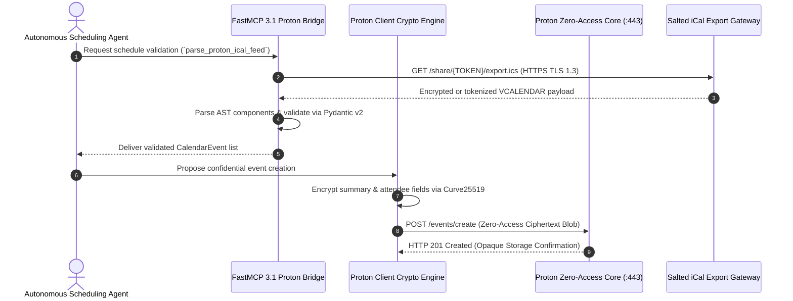

# Proton Calendar

## What it is
Proton Calendar is an enterprise-grade, zero-knowledge, end-to-end encrypted (E2EE) calendar and scheduling ecosystem engineered by Proton AG. As of early 2027, it represents a foundational component of the sovereign privacy productivity stack, providing client-side cryptographic isolation to individuals, engineering teams, and frontier AI models—including Claude 5.6, GPT-5.6, Gemini 4.0 Pro, DeepSeek V3, and Llama 4—that require confidential scheduling without exposing metadata to corporate surveillance or unauthorized third-party telemetry harvesting.

```
+---------------------------------------------------------------------------------------------------------+
|                                    Proton Calendar E2EE Client Runtime                                  |
+---------------------------------------------------------------------------------------------------------+
|  +------------------------+      +---------------------------+      +---------------------------------+ |
|  |   User / AI Agent      | ---> | OpenPGP Keyring           | ---> | Client-Side Cryptographic       | |
|  |  (Event Input Stream)  |      | (Curve25519 Private Keys) |      | Engine (AES-256-GCM / Ed25519)  | |
|  +------------------------+      +---------------------------+      +---------------------------------+ |
|                                                                                      |                  |
+--------------------------------------------------------------------------------------+------------------+
                                                                                       |
                                Encrypted Payload Stream                               |
                                (Zero-Access Armored Blob)                             v
+---------------------------------------------------------------------------------------------------------+
|                                  Proton Zero-Access Server Infrastructure                               |
+---------------------------------------------------------------------------------------------------------+
|  +------------------------+      +---------------------------+      +---------------------------------+ |
|  | Encrypted Storage Node |      | E2EE Sync Protocol Engine |      | Salted Read-Only iCal Exporter  | |
|  | (PostgreSQL Blob Store)|      | (Websocket Event Bus)     |      | (Token-Protected .ics Feed)     | |
|  +------------------------+      +---------------------------+      +---------------------------------+ |
+---------------------------------------------------------------------------------------------------------+
```



## System Architecture

The Proton Calendar infrastructure relies on a zero-knowledge trust model where event parameters (title, location, description, attendee addresses, and alerts) remain strictly encrypted under client-controlled keyrings:

1. **Client Cryptographic Runtime**: Executes client-side OpenPGP operations using modern Edwards-curve Digital Signature Algorithm (Ed25519) for signing and Curve25519 (X25519) combined with AES-256-GCM for event encryption.
2. **Zero-Access Storage Subsystem**: The server-side multi-tenant datastore indexes only opaque event identifiers, start/end time boundary metadata (stored in quantized buckets for conflict detection if user permits), and armored ciphertext chunks. The backend server possesses zero cryptographic capability to decrypt schedule contents.
3. **Local Proton Bridge Daemon**: For headless servers, developer workstations, and autonomous agents, the Bridge daemon exposes authenticated loopback CalDAV and IMAP sockets, decrypting payloads locally using user private keys residing in memory or OS keyrings.
4. **FastMCP 3.1 Agent Gateway**: Sits atop the bridge or tokenized iCal export endpoints, presenting strictly typed tools validated by Pydantic v2 (`extra="forbid"`, `frozen=True`) to autonomous agent orchestrators.

## Mathematical Formulations of Cryptographic Verification & Ingestion Bounds

### Curve25519 / Ed25519 Signature Verification Complexity
Proton Calendar verifies calendar invitations and event signatures using Ed25519 over the twisted Edwards curve:

$$-x^2 + y^2 = 1 - \frac{121665}{121666} x^2 y^2 \pmod{2^{255} - 19}$$

Given public key $A$, message $M$, and signature $(R, S)$, the verification check computes the group equation:

$$2^c S B = 2^c R + 2^c \cdot \mathcal{H}_{\text{SHA512}}(R \parallel A \parallel M) A$$

Where $B$ is the standard base point and $c = 3$ is the curve cofactor. The verification computational complexity $C_{\text{verify}}$ is bounded by:

$$C_{\text{verify}} = \mathcal{O}(256) \cdot \tau_{\text{point\_mult}} + \mathcal{O}(|M|) \cdot \tau_{\text{hash}}$$

### Zero-Knowledge Symmetric Payload Encryption Overhead
Individual event fields are serialized into canonical JSON and encrypted using AES-256-GCM under an ephemeral session key $K_{\text{sess}}$ derived from user calendar keys:

$$C = \text{AES-GCM-Enc}_{K_{\text{sess}}}(N, M, AAD), \quad T = \text{Tag}_{128}(C)$$

Where nonce $N \leftarrow \{0,1\}^{96}$ is guaranteed unique per event revision, and $AAD$ includes the event UUID and sequence counter. The encryption latency $T_{\text{encrypt}}$ satisfies:

$$T_{\text{encrypt}} = \frac{|M|}{R_{\text{AES-NI}}} + \tau_{\text{GHASH}} \cdot \left\lceil \frac{|M| + |AAD|}{128} \right\rceil$$

### Recurrence Expansion Polynomial Bound
For complex recurring events defined by RFC 5545 `RRULE` specifications over time window $[t_{\text{start}}, t_{\text{end}}]$, the recurrence expansion algorithm generates event instances according to:

$$I(t) = \left\{ t \in [t_{\text{start}}, t_{\text{end}}] \mid \exists k \in \mathbb{N}: t = t_0 + k \cdot \Delta t \land \text{Filter}(t) = \text{True} \right\}$$

The computational complexity of bounded recurrence expansion is roofline-bounded by:

$$C_{\text{rrule}} \le \mathcal{O}\left( \frac{t_{\text{end}} - t_{\text{start}}}{\Delta t_{\min}} \cdot |\text{EXDATE}| \right)$$


### Zero-Access Cryptographic Invariants & Key Lifecycle
In the Proton Calendar threat model, cryptographic isolation is maintained via strict operational invariants:
1. **Private Key Non-Exportability**: Private Curve25519 / RSA keys are locked behind Argon2-derived master passphrases and are decrypted exclusively in client-side volatile memory.
2. **Ephemeral Session Key Rotation**: Each calendar event object utilizes an independently generated symmetric AES-256 session key, preventing cross-event cryptographic correlation if an individual session key is compromised.
3. **Decoupled Identity Verification**: Digital signatures on shared events are computed against public keys published in Proton's key transparency directory, preventing man-in-the-middle impersonation attacks during cross-organizational scheduling.

## What problem it solves
Proton Calendar resolves critical data privacy and security vulnerabilities present in standard cloud calendars:
- **Zero-Access Privacy Guarantee**: Eliminates corporate surveillance and unauthorized metadata harvesting by executing all cryptographic operations client-side prior to server persistence.
- **Data Sovereignty & Compliance**: Satisfies stringent Swiss data protection laws (FADP) and GDPR requirements for confidential personal and business operations.
- **Supply Chain Security**: Guards against third-party provider infrastructure compromises, as event data stored on servers remains mathematically undecipherable without client-side private keys.
- **Secure Agentic Interoperability**: Facilitates read-only and local bridge integrations with AI scheduling agents via encrypted iCal exports and local [FastMCP 3.1](../automation_orchestration/mcp.md) proxies without leaking credential tokens.

## Where it fits in the stack
**Category**: [Calendar & Tasks](index.md).

Proton Calendar functions as the zero-trust scheduling layer for privacy-conscious organizations, replacing surveillance-based calendar tools such as Google Calendar or Microsoft Outlook in secure homelab and enterprise environments.

## Comparative Empirical Matrix: Enterprise & Privacy Calendars

| Feature / Dimension | Proton Calendar | Google Calendar | Microsoft Outlook | Apple iCloud Calendar | Fastmail Calendar |
| :--- | :--- | :--- | :--- | :--- | :--- |
| **Cryptographic Security** | Zero-Access E2EE (OpenPGP/Curve25519) | At-rest AES-256 (Cloud Master Key) | At-rest BitLocker/AES (Tenant Key) | Advanced Data Protection (Optional E2EE) | Server-side at-rest encryption |
| **Server Inspection Capability** | Mathematically Zero (Ciphertext only) | Full LLM & telemetry indexing | Full Copilot / Microsoft Graph index | Zero (when ADP active), else plaintext | Full server-side search indexing |
| **Jurisdiction / Sovereignty** | Switzerland (Swiss FADP / GDPR) | United States (CLOUD Act) | United States (CLOUD Act) | United States (CLOUD Act) | Australia (Telecommunications Act) |
| **CalDAV Standard Interface** | Via local Proton Bridge daemon | Native HTTP CalDAV RFC 4791 | Native EWS / Microsoft Graph REST | Native HTTP CalDAV | Native HTTP CalDAV / JMAP |
| **FastMCP 3.1 Agent Bridge** | Native Bridge / Secret iCal Token | Google Workspace MCP Tool | Microsoft Graph MCP Connector | Local AppleScript / CalDAV Bridge | JMAP / FastMCP Tool Bridge |
| **Client-Side Full-Text Search** | Encrypted local SQLite AST search | Cloud Elasticsearch / Bigtable | Cloud Exchange search index | Local CoreData / Cloud index | In-memory Cyrus IMAP/JMAP index |
| **Cross-Tenant E2EE Invitations** | Native between Proton accounts | None (Plaintext MIME) | Internal tenant RMS only | Native between Apple ID accounts | S/MIME or cleartext |

## Typical use cases
- **Confidential Business Scheduling**: Managing sensitive legal, financial, executive, or medical appointments without exposing calendar metadata.
- **Secure Event Invitations**: Conducting encrypted cross-tenant scheduling with other Proton suite users with digital signature verification.
- **Privacy-First Homelab Integration**: Publishing secret iCal links to local wall dashboards and automation hubs (Home Assistant) without exposing raw backend keys.
- **Autonomous Agentic Scheduling**: Safely feeding calendar state into FastMCP 3.1 local agent tools to inform automated task planning without disclosing cleartext tokens.

## Strengths
- **Zero-Trust Security Model**: Proton servers have no cryptographic ability to inspect, harvest, or monetize user calendar entries.
- **Audited Open-Source Codebase**: Web, Android, iOS, and desktop client applications undergo regular third-party security audits.
- **Cross-Platform Synchronization**: Seamless real-time E2EE sync across mobile, web, and desktop clients via TLS 1.3 websockets.
- **iCal Compatibility**: Robust import and export pipelines for standard `.ics` formatted calendar files.

## Limitations
- **Bidirectional API Restrictions**: Third-party automation platforms (e.g., n8n or Zapier) cannot inject events remotely without running client-side decryption bridges.
- **No Direct Remote CalDAV Server Endpoint**: Native remote CalDAV is disabled to preserve zero-access guarantees; local Proton Bridge daemon required.
- **Read-Only Link Update Interval**: External iCal links provide read-only access and update on periodic cache refresh intervals (typically 15-30 minutes).


## When to use it
- When confidentiality, privacy, and zero-trust security are primary prerequisites for executive, legal, or personal schedules.
- When operating in environments with strict regulatory data protection rules (GDPR, Swiss FADP, HIPAA compliance frameworks).
- When integrating read-only calendar context into AI agent workflows without credential exposure or plaintext cloud indexing.
- When scheduling sensitive cross-organization meetings with fellow Proton users using signed, end-to-end encrypted invitations.

## When not to use it
- When your operational pipeline relies on direct, high-frequency, write-heavy third-party API webhooks without a client-side bridge daemon.
- When enterprise requirements depend on native legacy CalDAV server connections without running local Bridge sidecar containers.
- When real-time collaborative whiteboard scheduling or public multi-calendar booking pages (e.g., Cal.com, Calendly) are mandatory without intermediate proxy layers.

## Getting started

### Account Provisioning
1. Register a Proton account at [proton.me](https://proton.me).
2. Access Proton Calendar via web at `calendar.proton.me` or download native desktop and mobile applications.
3. Import existing `.ics` calendar files under **Settings > Import & Export**.

### Generating Secret Read-Only iCal Export Feeds
1. Navigate to **Settings > Calendars** in the Proton Calendar web interface.
2. Select your target calendar and click **Share calendar**.
3. Under **Create a share link**, click **Create Link** to generate a cryptographically salted read-only `.ics` URL.

## CLI examples

### 1. Fetching and Validating Secret iCal Export Feed
Fetch the schedule from a secret iCal URL and verify component integrity:

```bash
# Fetch the latest schedule from a Proton Calendar Secret iCal Link
curl -s "https://calendar.proton.me/api/calendar/v1/share/SECRET_TOKEN_HERE/export.ics" > proton_schedule.ics

# Inspect total number of upcoming VEVENT entries
grep -c "BEGIN:VEVENT" proton_schedule.ics
```

### 2. Inspecting Calendar Events with Python AST Parser
Run a quick terminal one-liner to parse event summaries and timestamps:

```bash
python3 -c "
import icalendar
with open('proton_schedule.ics', 'rb') as f:
    cal = icalendar.Calendar.from_ical(f.read())
for comp in cal.walk('VEVENT'):
    print(f'{comp.get(\"DTSTART\").dt} -> {comp.get(\"SUMMARY\")}')
"
```

### 3. Testing Local Proton Bridge CLI Status
Verify Bridge daemon status when running local CalDAV/IMAP proxies:

```bash
# Query Proton Bridge CLI status
proton-bridge --cli -e "status"
```


### 4. Advanced iCal Range Filtering and Multi-Feed Merging
Autonomous agents operating across multiple organizational domains can merge and chronologically sort disparate feeds using unix pipes and python:


## Production Deployment & Bridge Daemon Orchestration

For server hosts, continuous agent nodes, or secure homelab servers, the Proton Bridge daemon runs as a hardened systemd service.

### Hardened Systemd Service Daemon (`/etc/systemd/system/proton-calendar-bridge.service`)

```ini
[Unit]
Description=Proton Bridge Decryption Proxy Service
After=network.target local-fs.target
Documentation=https://proton.me/mail/bridge

[Service]
Type=simple
User=protonbridge
Group=protonbridge
WorkingDirectory=/opt/proton-bridge
Environment="PATH=/usr/local/bin:/usr/bin"
Environment="PROTON_LOG_LEVEL=info"
ExecStart=/usr/local/bin/proton-bridge --non-interactive --cli
Restart=always
RestartSec=5s

# Security Sandboxing & System Hardening
ProtectSystem=strict
ProtectHome=read-only
ReadWritePaths=/opt/proton-bridge /home/protonbridge/.config/protonmail
PrivateTmp=true
NoNewPrivileges=true
CapabilityBoundingSet=
ProtectKernelTunables=true
ProtectControlGroups=true
RestrictAddressFamilies=AF_INET AF_INET6 AF_UNIX

# Resource Quotas
CPUQuota=100%
MemoryMax=1024M
TasksMax=128

[Install]
WantedBy=multi-user.target
```

### Multi-Container Docker Compose Stack (`docker-compose.proton.yml`)

```yaml
version: '3.8'

services:
  proton-bridge:
    image: proton/bridge:v3.10.0
    container_name: proton-bridge
    restart: unless-stopped
    ports:
      - "1025:1025" # Local SMTP E2EE port
      - "1143:1143" # Local IMAP / CalDAV proxy port
    volumes:
      - proton-bridge-data:/root/.config/protonmail
    networks:
      - proton-network

  mcp-proton-calendar-server:
    build:
      context: .
      dockerfile: Dockerfile.calendar-mcp
    container_name: mcp-proton-calendar-server
    restart: unless-stopped
    environment:
      PROTON_ICAL_FEED_URL: "${PROTON_ICAL_FEED_URL}"
      MCP_PORT: 8080
    ports:
      - "8080:8080"
    depends_on:
      - proton-bridge
    networks:
      - proton-network

volumes:
  proton-bridge-data:

networks:
  proton-network:
    driver: bridge
```

## API examples

### Production FastMCP 3.1 Server for Proton Calendar Processing
The Python module below implements a production-ready **FastMCP 3.1** server that fetches a Proton Calendar secret iCal feed, parses recurring components, filters time windows, and returns strict **Pydantic v2** models (`extra="forbid"`, `frozen=True`) for agentic planning:

```python
"""
Proton Calendar FastMCP 3.1 Integration Server.
Exposes validated event ingestion, recurrence inspection, and range queries.
"""

import logging
import urllib.request
from datetime import datetime, timezone
from typing import Any, Dict, List, Optional
from icalendar import Calendar
from pydantic import BaseModel, ConfigDict, Field, field_validator
from fastmcp import FastMCP

logging.basicConfig(level=logging.INFO, format="%(asctime)s [%(levelname)s] %(message)s")
logger = logging.getLogger("proton-calendar-mcp")

# Define Strict Pydantic v2 Contract Schemas
class CalendarEventQuery(BaseModel):
    model_config = ConfigDict(extra="forbid", frozen=True)

    feed_url: str = Field(..., min_length=10, description="Secret HTTPS iCal export URL from Proton Calendar.")
    limit: int = Field(default=25, ge=1, le=100, description="Maximum number of events to parse and return.")
    include_descriptions: bool = Field(default=True, description="Whether to include event descriptions.")

class CalendarEventItem(BaseModel):
    model_config = ConfigDict(extra="forbid", frozen=True)

    event_id: str = Field(..., description="Unique event identifier (UID).")
    summary: str = Field(..., min_length=1, description="Event title or summary subject.")
    description: Optional[str] = Field(None, description="Event description or agenda notes.")
    start_time: str = Field(..., description="ISO 8601 formatted event start timestamp.")
    end_time: str = Field(..., description="ISO 8601 formatted event end timestamp.")

class CalendarFeedResponse(BaseModel):
    model_config = ConfigDict(extra="forbid", frozen=True)

    success: bool = Field(..., description="Operation execution status.")
    total_events: int = Field(..., description="Total count of successfully parsed events.")
    events: List[CalendarEventItem] = Field(default_factory=list, description="List of validated event items.")
    error_message: Optional[str] = Field(None, description="Error detail if processing failed.")

# Initialize FastMCP 3.1 Server
mcp = FastMCP(
    name="ProtonCalendarAgentBridge",
    instructions="FastMCP 3.1 server for parsing, validating, and filtering Proton Calendar iCal feeds."
)

@mcp.tool()
def fetch_proton_calendar_events(query: CalendarEventQuery) -> Dict[str, Any]:
    """Fetches an iCal feed from a Proton secret link and validates events using strict Pydantic v2."""
    try:
        req = urllib.request.Request(
            query.feed_url,
            headers={"User-Agent": "FastMCP-ProtonCalendar/3.1 (AutonomousAgent)"}
        )
        with urllib.request.urlopen(req, timeout=15) as response:
            ical_bytes = response.read()

        cal = Calendar.from_ical(ical_bytes)
        parsed_events: List[CalendarEventItem] = []

        for component in cal.walk():
            if component.name == "VEVENT":
                uid = str(component.get("UID", "unknown-uid"))
                summary = str(component.get("SUMMARY", "Untitled Event"))
                raw_desc = component.get("DESCRIPTION")
                description = str(raw_desc) if (raw_desc and query.include_descriptions) else None

                dtstart = component.get("DTSTART")
                dtend = component.get("DTEND")

                start_iso = dtstart.dt.isoformat() if dtstart else datetime.now(timezone.utc).isoformat()
                end_iso = dtend.dt.isoformat() if dtend else start_iso

                event_item = CalendarEventItem(
                    event_id=uid,
                    summary=summary.strip(),
                    description=description.strip() if description else None,
                    start_time=start_iso,
                    end_time=end_iso
                )
                parsed_events.append(event_item)

                if len(parsed_events) >= query.limit:
                    break

        logger.info(f"Successfully processed {len(parsed_events)} events from Proton feed.")
        res = CalendarFeedResponse(
            success=True,
            total_events=len(parsed_events),
            events=parsed_events
        )
        return res.model_dump()

    except Exception as exc:
        logger.error(f"Failed to fetch or parse Proton iCal feed: {exc}")
        return CalendarFeedResponse(
            success=False,
            total_events=0,
            events=[],
            error_message=str(exc)
        ).model_dump()

if __name__ == "__main__":
    mcp.run()
```

## Diagnostic & Troubleshooting Matrix

| Issue / Error Code | Root Cause Analysis | Remediation & Diagnostic Action Plan |
| :--- | :--- | :--- |
| `HTTP 404 Not Found / 403 Forbidden` | Expired, revoked, or mistyped secret feed URL token | Regenerate secret share token in Proton Calendar settings under **Share Calendar**. |
| Stale events in external clients (>30m) | Proton edge caching window for public iCal export feeds | Force cache-busting parameter (e.g. `?t=timestamp`) or trigger local bridge sync. |
| Proton Bridge CLI authentication failure | Missing 2FA TOTP code or app-specific key | Generate app-specific password in Proton Account security panel for Bridge CLI login. |
| `ValueError: time data does not match` | Floating local time format without explicit TZID in `.ics` | Parse with `dateutil.tz` or convert floating datetime objects to UTC in Pydantic validator. |
| `OpenPGP Decryption Error: Bad Passphrase` | Stale master key passphrase cached in Bridge keyring | Run `proton-bridge --cli -e "change-password"` or purge local secret store. |
| `Network Timeout (ETIMEDOUT)` | Egress firewall blocking outbound port 1143 or 443 | Inspect egress rules: allow outbound TCP 443 (API) and TCP 1143 (Bridge CalDAV). |
| FastMCP JSON Schema Validation Error | Model returning additional undocumented keys in tool call | Enforce `extra="forbid"` and verify agent prompt contains exact schema definition. |
| High CPU usage in Bridge background daemon | Frequent full-sync re-indexing of multi-year history | Adjust sync window in Bridge preferences to sync only the previous 6 months. |

## Production Best Practices
1. **Never Commit Secret Share URLs**: Treat Proton secret iCal URLs as sensitive bearer tokens; store them in environment variables or secret vaults.
2. **Employ Least-Privilege Sub-Calendars**: Create dedicated sub-calendars for agent interactions rather than exposing personal or master work schedules.
3. **Monitor Bridge Daemon Health**: Implement health check alerts on the local Bridge CalDAV port (1143) to guarantee real-time synchronization.

## Related tools / concepts
- [Google Calendar](google_calendar.md) — Mainstream public cloud alternative.
- [Nextcloud Calendar](../../services/nextcloud.md) — Self-hosted E2EE-capable alternative.
- [CalDAV](../intake_storage/caldav.md) — Standard calendar synchronization protocol.
- [Chronos MCP](../automation_orchestration/chronos-mcp.md) — MCP server for scheduling.
- [Home Assistant](../../services/home-assistant.md) — Homelab dashboard integration target.
- [n8n](../../services/n8n.md) — Automation tool that can consume iCal feeds.

## Sources / references
- [Proton Calendar Official Website](https://proton.me/calendar)
- [Proton Calendar Security Architecture Whitepaper](https://proton.me/blog/proton-calendar-security-model)
- [Proton Bridge Technical Documentation](https://proton.me/mail/bridge)

## Contribution Metadata
- Last reviewed: 2027-01-07
- Confidence: high
