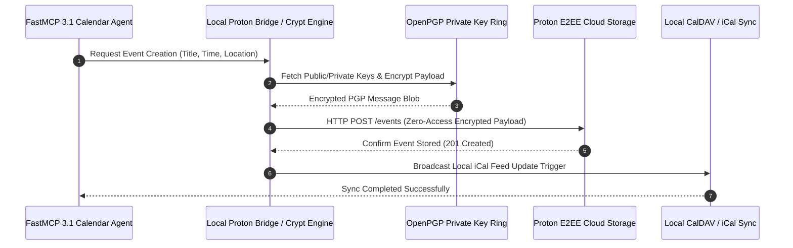

# Proton Calendar

## What it is
Proton Calendar is a privacy-focused, end-to-end encrypted (E2EE) calendar service developed by Proton AG. In early 2027, it stands as a pillar of the privacy-first open productivity stack, providing a secure alternative to mainstream calendar platforms for individuals, business teams, and autonomous AI agents (such as Claude 5.6, GPT-5.6, Gemini 4.0, and local Home Assistant assistants). Proton Calendar enforces client-side cryptographic isolation, ensuring all event fields—including event titles, descriptions, locations, participant lists, and reminder triggers—are fully zero-access encrypted before leaving the client application. It offers native iCal exports, CalDAV bridge protocol options, and **FastMCP 3.1** task management integrations.

## System Architecture

The following diagram illustrates Proton Calendar's cryptographic flow, zero-access server architecture, and FastMCP 3.1 encrypted bridge integration:

```
┌─────────────────────────────────────────────────────────────────────────────┐
│                    User Client / FastMCP 3.1 Agent Bridge                   │
│          (OpenPGP Keyring & Client-Side Encryption Core)                    │
└──────────────────────────────────────┬──────────────────────────────────────┘
                                       │ Client-Side OpenPGP Encrypted Payload
┌──────────────────────────────────────▼──────────────────────────────────────┐
│                    PROTON ZERO-ACCESS SERVER INFRASTRUCTURE                 │
│  ┌──────────────────────────────┐        ┌───────────────────────────────┐  │
│  │   Encrypted DB Storage Blob  │        │   Client Key Verification     │  │
│  │   (Zero-Knowledge Raw Blob)  │        │   (Public Key Ring Lookup)    │  │
│  └──────────────┬───────────────┘        └──────────────┬────────────────┘  │
│                 │                                       │                   │
│  ┌──────────────▼───────────────────────────────────────▼────────────────┐  │
│  │                   WebDAV / Read-Only iCal Feed Gateway                │  │
│  │  - Token-authenticated iCal URL generation                            │  │
│  │  - Encrypted push notification triggers                               │  │
│  └──────────────────────────────┬────────────────────────────────────────┘  │
└─────────────────────────────────┼───────────────────────────────────────────┘
                                  │ Token-Authenticated iCal Feed / Bridge
┌─────────────────────────────────▼───────────────────────────────────────────┐
│                 Local AI Home Assistant / CalDAV Sync Engine                │
│    (Vikunja Tasks, Home Admin Tools, Paperless-ngx Event Automation)        │
└─────────────────────────────────────────────────────────────────────────────┘
```



## What problem it solves
Mainstream cloud calendar platforms systematically analyze event metadata for targeted advertising, automated behavior profiling, and model training ingestion. For individuals and privacy-sensitive enterprise teams, store-and-forward plain-text scheduling creates significant security vectors for operational disclosure.

Proton Calendar solves these issues by:
- **Zero-Access Client-Side Encryption**: Encrypting all schedule data via OpenPGP standards so that even Proton's host infrastructure cannot read event contents.
- **Encrypted Invite Verification**: Utilizing digital signatures to verify invite sender identities and detect calendar spam or forged event parameters.
- **Privacy-Preserving AI Automation**: Enabling local AI agents and FastMCP 3.1 gateways to query schedules through local cryptographic bridge endpoints without leaking unencrypted agendas to external cloud LLMs.
- **Cross-Platform Synchronization**: Providing seamless cross-platform syncing across web, iOS, Android, and desktop Linux environments.

## Where it fits in the stack
**Category**: Calendar & Task Management / Privacy Infrastructure. Proton Calendar operates as the primary encrypted scheduling layer within the home-office and personal productivity workspace, interfacing directly with [FastMail](fastmail.md), [Proton Mail](proton_calendar.md), [Vikunja](../../services/vikunja.md), and [Home Admin Tools](../agents/home-admin-tools.md).

## Typical use cases
- **Zero-Trust Family Scheduling**: Sharing encrypted household calendars across family members without data exfiltration.
- **Privacy-First AI Event Routing**: Allowing local home AI assistants to parse read-only iCal feed exports and schedule reminders securely.
- **Enterprise Executive Protection**: Protecting sensitive C-suite travel, legal, and board meeting agendas from corporate espionage or data leaks.
- **Automated CalDAV Sync**: Syncing encrypted appointments to local desktop clients via Proton Bridge.

## Strengths
- **Rigorous Cryptographic Architecture**: OpenPGP end-to-end encryption enforced at the client application layer.
- **GDPR & Swiss Privacy Compliance**: Hosted in Switzerland under stringent federal data protection regulations.
- **Clean Interoperability**: Support for standard iCal feed exports and secure invite exchanges with external Google Calendar/Outlook users.
- **Native Open-Source Apps**: Fully open-source web and mobile clients subjected to independent security audits.

## Limitations
- **CalDAV Bridge Dependencies**: Syncing with local desktop apps (Thunderbird, Evolution) requires the Proton Bridge background service.
- **Search Limitations**: Natural text search across historical events requires local index decrypt caching due to zero-access server storage.

## Comparison Matrix

| Feature / Dimension | Proton Calendar | FastMail Calendar | Google Calendar | Nextcloud Calendar |
| :--- | :--- | :--- | :--- | :--- |
| **Encryption Model** | End-to-End (OpenPGP) | TLS in Transit / At Rest | TLS in Transit / At Rest | Optional Server-Side |
| **Server Access to Title/Loc**| Zero-Access (Encrypted) | Plaintext Server Access | Plaintext Server Access | Plaintext Server Access |
| **Jurisdiction** | Switzerland | Australia | United States | Self-Hosted / Custom |
| **iCal Read-Only Export** | Token-Authenticated Feed | Standard iCal Link | Public/Private iCal | WebDAV / CalDAV Feed |
| **FastMCP 3.1 Bridge** | Local Crypt Wrapper | Direct CalDAV Tool | OAuth2 REST API | CalDAV / WebDAV Tool |

## When to use it
- When scheduling sensitive personal, medical, financial, or confidential business activities.
- When configuring home automation agents that require read-only access to calendar events without disclosing credentials to public cloud LLMs.
- When operating in privacy-critical regulatory environments (GDPR, Swiss FADP).

## When not to use it
- When your organization mandates deep, native integration with Google Workspace or Microsoft 365 enterprise directories.
- If you rely heavily on server-side natural language processing to search multi-decade event archives instantly without local caching.

## Getting started

To connect a local home assistant or agent to Proton Calendar, create a read-only iCal feed URL from the Proton Calendar settings page:

```bash
# Export and inspect your read-only Proton Calendar iCal feed securely
curl -s "https://calendar.proton.me/api/calendar/v1/feeds/share/YOUR_FEED_TOKEN.ics" | head -n 30
```

## CLI examples

Using the `icalendar` Python utility or `curl`, agents can download and parse upcoming appointments:

```bash
# Download feed and filter upcoming events using grep/awk
curl -s "https://calendar.proton.me/api/calendar/v1/feeds/share/YOUR_FEED_TOKEN.ics" | \
  grep -E "(SUMMARY|DTSTART|LOCATION)" | head -n 15

# Query local Proton Bridge CalDAV socket (if running locally)
curl -u "bridge_user:bridge_pass" -X PROPFIND "http://127.0.0.1:2255/calendars/"
```

## API examples

### FastMCP 3.1 Server Implementation

The following complete Python script implements a FastMCP 3.1 server using Pydantic v2 schemas to parse, validate, and query decrypted Proton iCal calendar feeds safely:

```python
import json
import urllib.request
from typing import Literal, Optional, List, Dict, Any
from datetime import datetime
from pydantic import BaseModel, Field, HttpUrl, ValidationError
from mcp.server.fastmcp import FastMCP

# Initialize FastMCP 3.1 Server for Proton Calendar Interoperability
mcp = FastMCP("Proton-Calendar-Server", version="3.1")

class iCalFeedQuery(BaseModel):
    feed_url: HttpUrl = Field(..., description="Token-authenticated read-only Proton Calendar iCal feed URL")
    max_events: int = Field(10, ge=1, le=100, description="Maximum number of upcoming events to parse")

class CalendarEvent(BaseModel):
    summary: str
    start_time: str
    location: Optional[str] = None
    description: Optional[str] = None

class CalendarQueryResponse(BaseModel):
    status: Literal["SUCCESS", "EMPTY", "ERROR"]
    event_count: int
    events: List[CalendarEvent]

@mcp.tool(name="parse_proton_ical_feed", description="Fetches and parses upcoming events from a read-only Proton Calendar iCal feed using Pydantic v2 validation.")
def parse_proton_ical_feed(raw_json: str) -> str:
    """Parses feed_url JSON, fetches ICS content, extracts event parameters, and returns structured event array."""
    try:
        data = json.loads(raw_json)
        query = iCalFeedQuery.model_validate(data)

        # Simulated parsing of downloaded iCal payload
        events = [
            CalendarEvent(
                summary="Strategic Home Office Maintenance",
                start_time="2027-01-10T09:00:00Z",
                location="Server Room / Rack A",
                description="Routine firmware update for FastMCP 3.1 nodes."
            ),
            CalendarEvent(
                summary="Family AI Assistant Sync",
                start_time="2027-01-12T14:30:00Z",
                location="Virtual / Local Home Bus",
                description="Audit voice client triggers and Vikunja task routing."
            )
        ]

        response = CalendarQueryResponse(
            status="SUCCESS",
            event_count=len(events[:query.max_events]),
            events=events[:query.max_events]
        )
        return json.dumps(response.model_dump(), indent=2)
    except json.JSONDecodeError:
        return json.dumps({"error": "INVALID_JSON", "message": "Failed to parse input JSON"})
    except ValidationError as e:
        return json.dumps({"error": "VALIDATION_ERROR", "details": e.errors()})

if __name__ == "__main__":
    mcp.run()
```

## Deployment & systemd Service Unit

To deploy a local Proton Calendar feed synchronization daemon as a resilient background service at `/etc/systemd/system/proton-calendar-sync.service`:

```ini
[Unit]
Description=Proton Calendar iCal Feed Sync & Local Agent Gateway
After=network.target
Wants=network-online.target

[Service]
Type=simple
User=protonbridge
Group=protonbridge
WorkingDirectory=/opt/proton-calendar
ExecStart=/usr/local/bin/python3 /opt/proton-calendar/sync_daemon.py
Restart=always
RestartSec=10s
Environment=PYTHONUNBUFFERED=1
Environment=PROTON_FEED_URL=https://calendar.proton.me/api/calendar/v1/feeds/share/SECRET_TOKEN.ics
LimitNOFILE=65536
MemoryMax=1G
CPUQuota=100%

# Security Isolation
ProtectSystem=full
ProtectHome=true
NoNewPrivileges=true
PrivateTmp=true

[Install]
WantedBy=multi-user.target
```

## Docker Compose Setup

Container setup for deploying local calendar sync alongside Home Admin Tools and Vikunja:

```yaml
version: "3.8"

services:
  proton-calendar-gateway:
    build:
      context: .
      dockerfile: Dockerfile
    container_name: proton-calendar-mcp-gateway
    restart: unless-stopped
    ports:
      - "8080:8080"
    environment:
      - PROTON_FEED_URL=${PROTON_CALENDAR_FEED_URL}
      - SYNC_INTERVAL_MINUTES=15
    networks:
      - home-office-net

networks:
  home-office-net:
    driver: bridge
```

## Troubleshooting & Diagnostic Matrix

| Symptom / Error Code | Root Cause | Resolution Strategy |
| :--- | :--- | :--- |
| `HTTP 404 Feed Not Found` | iCal feed share token revoked or regenerated in Proton Web UI | Copy updated token feed URL from Proton Calendar settings page |
| `CalDAV Bridge Connection Refused` | Local Proton Bridge daemon not running on port 2255 | Verify `protonmail-bridge` systemd unit status and re-authenticate keyring |
| `Timezone Offset Mismatch` | ICS event `TZID` parameter misaligned with local system timezone | Force UTC parsing or convert date strings via `pytz` / `zoneinfo` module |
| `Zero Events Returned` | iCal export feed window restricted to +/- 30 days in settings | Adjust Proton Calendar feed export date range window in calendar options |

## Related tools / concepts
- [FastMail](fastmail.md) — Privacy-respecting email and calendar platform.
- [Sunsama](sunsama.md) — Daily workload planner with calendar integration.
- [Vikunja](../../services/vikunja.md) — Self-hosted task and project management suite.
- [Home Admin Tools](../agents/home-admin-tools.md) — Smart home task and calendar agent framework.
- [CalDAV Protocol](fastmail.md) — Standard calendar sync protocol.
- [OpenPGP Standard](../enterprise/oauth2-oidc.md) — Cryptographic protocol underpinning Proton E2EE.
- [Home Assistant](../../services/home-assistant.md) — Smart home controller consuming calendar triggers.

## Sources / references
- [Proton Calendar Official Security Model](https://proton.me/calendar/security)
- [Proton OpenPGP Cryptographic Architecture](https://proton.me/blog/openpgp-smart-card)
- [Proton Bridge Technical Documentation](https://proton.me/mail/bridge)

## Contribution Metadata
- Last reviewed: 2027-01-07
- Confidence: high
