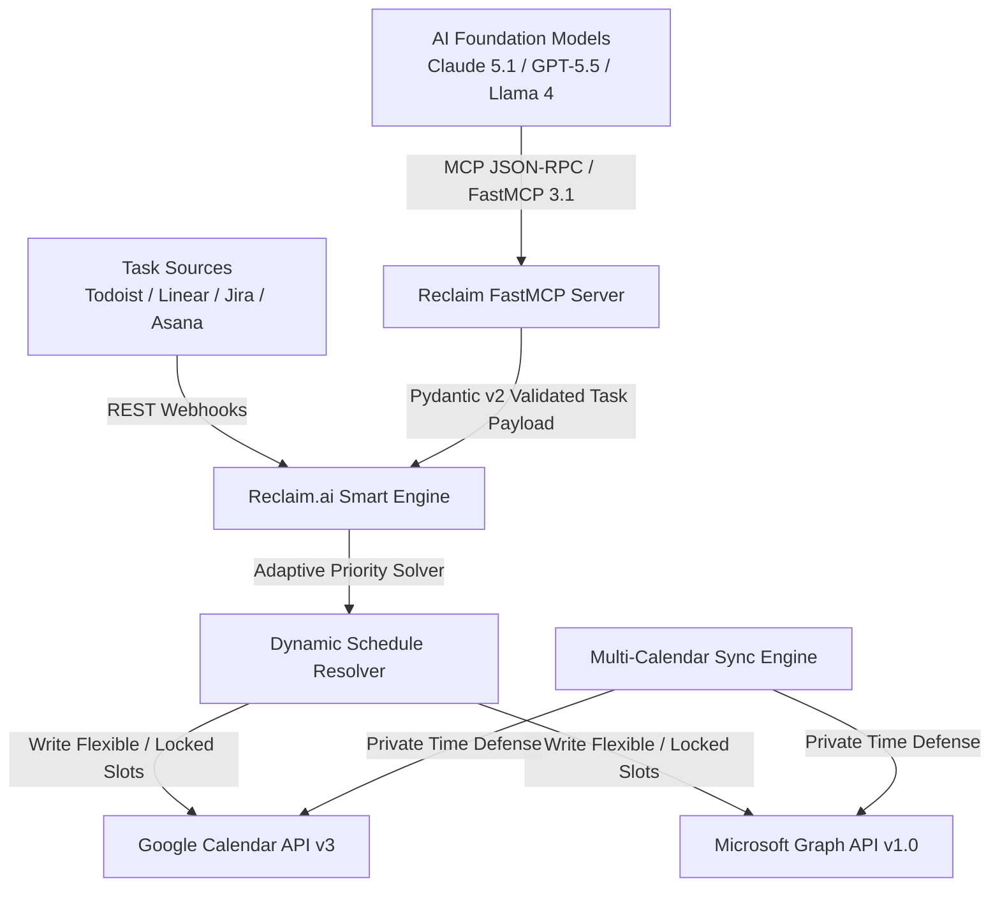

# Reclaim.ai

## What it is
Reclaim.ai is an AI-driven adaptive calendar and time-blocking engine that integrates with [Google Calendar](google_calendar.md) and [Outlook](outlook.md) to automatically schedule tasks, recurring habits, buffer time, and focus blocks. Following its acquisition by **Dropbox** (July 2024) and integration into Dropbox Workspaces, Reclaim provides enterprise scheduling intelligence while maintaining native **FastMCP 3.1** (Model Context Protocol) capabilities for autonomous AI agents (**Claude 5.1**, **GPT-5.5**, **Llama 4**).

## System Architecture



## What problem it solves
Managing packed calendars requires constant manual adjustment as meetings shift, priorities conflict, and task deadlines approach ("calendar tetris"). Reclaim solves this by dynamically making scheduled tasks flexible ("Ideal" vs. "Locked" status), automatically shifting focus time and habits around incoming high-priority meeting invites without exposing private calendar details across multiple accounts.

## Scheduling Engine Comparison Matrix

| Feature / Dimension | Reclaim.ai | Motion | Clockwise | Google Calendar Tasks |
| :--- | :--- | :--- | :--- | :--- |
| **Primary Focus** | Smart Time-Blocking & Habits | AI Project & Calendar Engine | Team Meeting Optimization | Basic Task List Overlay |
| **Protocol Support** | FastMCP 3.1 Native | Custom REST API | Webhooks | Google Graph API |
| **Flexible Time Blocks**| Dynamic (Ideal vs Locked) | Auto-scheduled | Focus Time Blocks | Static Manual Placement |
| **Multi-Calendar Sync**| Bi-directional Privacy Defense| Single/Multi Account | Team Workspaces | Single Account Default |
| **Upstream Integrations**| Linear, Jira, Asana, Todoist| Native Task Manager | Asana, Jira | Google Workspace |
| **Schema Validation** | Pydantic v2 / Zod | Custom JSON | Custom JSON | Google Protobuf / JSON |

## Where it fits in the stack
**Category**: Calendar & Tasks / Scheduling Automation. Sits between upstream task managers ([Todoist](todoist.md), Asana, Linear, Jira) and downstream cloud calendar backends ([Google Calendar](google_calendar.md), [Outlook](outlook.md)).

## Typical use cases
- **Adaptive Time-Blocking**: Automatically schedule task duration blocks from [Todoist](todoist.md) or Linear directly onto work calendars.
- **Dynamic Habit Protection**: Maintain recurring health, exercise, or learning habits that shift automatically when meeting conflicts arise.
- **Cross-Account Calendar Defense**: Protect personal appointments on work calendars by auto-blocking generic "Personal Commitment" slots across Google Calendar and Outlook.
- **Agentic Schedule Orchestration**: Allow AI assistants (**Claude 5.1**, **GPT-5.5**) to adjust task deadlines or add emergency deep work blocks using FastMCP 3.1 tool calls.

## Service & Daemon Management (systemd Unit Configuration)

To run a persistent FastMCP 3.1 server daemon bridging Reclaim.ai with local agent environments on a Linux host, deploy the following unit file:

```ini
[Unit]
Description=Reclaim.ai FastMCP 3.1 Gateway Service
Documentation=https://api.app.reclaim.ai/api/docs
After=network.target local-fs.target
Wants=network-online.target

[Service]
Type=simple
User=jules
Group=jules
WorkingDirectory=/home/jules/services/reclaim-mcp
ExecStart=/usr/local/bin/node /home/jules/services/reclaim-mcp/dist/index.js
Restart=always
RestartSec=5s
Environment=NODE_ENV=production
Environment=RECLAIM_API_KEY=/etc/reclaim/api_key
Environment=MCP_PROTOCOL_VERSION=FastMCP-3.1
Environment=LOG_LEVEL=info
StandardOutput=journal
StandardError=journal
SyslogIdentifier=reclaim-mcp-gateway

# Hardening measures
ProtectSystem=full
ProtectHome=read-only
ReadWritePaths=/home/jules/services/reclaim-mcp /tmp
NoNewPrivileges=true

[Install]
WantedBy=multi-user.target
```

## Diagnostic & Troubleshooting Matrix

| Issue / Symptom | Possible Cause | Verification Procedure | Resolution Strategy |
| :--- | :--- | :--- | :--- |
| **`401 Unauthorized` API Error** | Missing or expired Reclaim Personal API key | Execute `curl -H "Authorization: Bearer $RECLAIM_API_KEY" https://api.app.reclaim.ai/api/users/current` | Regenerate Personal API Key in Reclaim Settings -> Integrations |
| **Task Slots Not Shifting** | Event status set to "Locked" instead of "Ideal" | Check task details in Reclaim web app or API JSON | Toggle event status to "Ideal" or lower priority tier |
| **Multi-Calendar Sync Delay** | Rate limiting or sync delay from Microsoft Graph / Google Calendar | Check Reclaim status page and sync status inside settings | Force manual calendar re-sync via Reclaim UI or API POST `/planner/recalculate` |
| **FastMCP Tool Execution Error** | Malformed JSON schema or missing mandatory fields | Inspect `reclaim-mcp-gateway` syslog logs using `journalctl` | Validate parameters against Pydantic v2 / Zod task schema before dispatching |
| **Personal Event Titles Exposed** | Generic title defense setting disabled on cross-account sync | Check synced event title on corporate calendar | Enable "Display as Personal Commitment" in Reclaim Sync settings |

## Strengths
- **Dynamic Priority Engine**: Differentiates between flexible "Ideal" times and locked hard deadlines.
- **Native Multi-Calendar Sync**: Real-time bi-directional sync protecting personal calendars on enterprise work accounts.
- **Deep Upstream Ecosystem**: Pre-built native integrations for Todoist, Linear, Asana, Jira, and Slack.
- **FastMCP 3.1 Agent Readiness**: First-class Model Context Protocol integration for agentic schedule control.

## Limitations
- **Closed Cloud Platform**: Proprietary SaaS engine without a self-hosted open-source version.
- **Control Trade-Off**: Fully automated rescheduling can feel intrusive for users who demand fixed manual slot placement.
- **iCloud Ecosystem Limits**: Primarily optimized for Google Workspace and Microsoft 365, with limited Apple iCloud calendar support.

## When to use it
- When you struggle to protect uninterrupted deep work time on a busy calendar.
- When syncing personal and professional schedules across separate Google Workspace and Microsoft 365 accounts.
- When building an agentic scheduling setup using **Claude 5.1** or **GPT-5.5** via FastMCP 3.1.

## When not to use it
- If you prefer a completely manual, fixed-time calendar setup without AI automation.
- If your policy demands a 100% self-hosted, local-first calendar tool (consider [Vikunja](../../services/vikunja.md)).

## Getting started

### API Access Setup
1. Sign up at [Reclaim.ai](https://reclaim.ai/).
2. Navigate to **Settings > Integrations > API** to copy your Personal API Key.
3. Verify account connection using Python:

```python
import os
import requests

api_key = os.getenv("RECLAIM_API_KEY", "your_api_key")
headers = {
    "Authorization": f"Bearer {api_key}",
    "Content-Type": "application/json"
}

response = requests.get("https://api.app.reclaim.ai/api/users/current", headers=headers)
if response.status_code == 200:
    print(f"Connected to Reclaim as: {response.json().get('email')}")
```

## CLI examples

### cURL API Commands
Interact with Reclaim tasks and settings directly via command line HTTP calls:

```bash
# 1. Fetch current authenticated user info
curl -s -H "Authorization: Bearer $RECLAIM_API_KEY" \
  https://api.app.reclaim.ai/api/users/current

# 2. Query all currently scheduled tasks
curl -s -H "Authorization: Bearer $RECLAIM_API_KEY" \
  https://api.app.reclaim.ai/api/tasks

# 3. Create a new task with focus time duration
curl -s -X POST -H "Authorization: Bearer $RECLAIM_API_KEY" \
  -H "Content-Type: application/json" \
  -d '{
    "title": "Perform FastMCP 3.1 Security Review",
    "eventCategory": "WORK",
    "timeChunksRequired": 4,
    "priority": "P1"
  }' \
  https://api.app.reclaim.ai/api/tasks

# 4. Force immediate schedule recalculation
curl -s -X POST -H "Authorization: Bearer $RECLAIM_API_KEY" \
  https://api.app.reclaim.ai/api/planner/recalculate
```

## API examples

### Pydantic v2 Schema Validation for Reclaim Tasks
Programmatic task creation should be validated using **Pydantic v2** models before POSTing to the Reclaim REST API endpoints under early 2027 standards.

```python
import os
import requests
from datetime import datetime
from typing import Optional, Literal
from pydantic import BaseModel, Field, field_validator, ValidationError

class ReclaimTaskPayload(BaseModel):
    title: str = Field(..., min_length=1, max_length=150, description="Task title string")
    priority: Literal["P1", "P2", "P3", "P4"] = Field(default="P2", description="Priority tier: P1 (urgent) to P4 (low)")
    eventCategory: Literal["WORK", "PERSONAL"] = Field(default="WORK", description="Event classification")
    timeChunksRequired: int = Field(default=2, ge=1, le=32, description="Number of 15-min time chunks e.g. 4 = 1 hour")
    due: datetime = Field(..., description="Target completion deadline timestamp")
    notes: Optional[str] = Field(default=None, description="Markdown description or agent notes")

    @field_validator("due")
    @classmethod
    def validate_due_date(cls, v: datetime) -> datetime:
        if v.timestamp() < datetime.now().timestamp():
            raise ValueError("Due date timestamp must be in the future.")
        return v

# Raw incoming data from AI agent or automation pipeline
raw_task_data = {
    "title": "Perform Quarterly FastMCP 3.1 Audit with Claude 5.1",
    "priority": "P1",
    "eventCategory": "WORK",
    "timeChunksRequired": 6,  # 1.5 hours
    "due": "2027-01-25T17:00:00Z",
    "notes": "Verify Pydantic v2 schemas and relative link integrity across docs."
}

try:
    # Execute strict Pydantic v2 validation
    validated_task = ReclaimTaskPayload.model_validate(raw_task_data)
    print(f"Validated Reclaim task successfully: '{validated_task.title}' [Chunks: {validated_task.timeChunksRequired}]")

    # API Dispatch logic:
    api_key = os.getenv("RECLAIM_API_KEY", "mock_key")
    headers = {
        "Authorization": f"Bearer {api_key}",
        "Content-Type": "application/json"
    }
    # response = requests.post("https://api.app.reclaim.ai/api/tasks", headers=headers, json=validated_task.model_dump(mode="json"))
except ValidationError as e:
    print(f"Validation error: {e}")
```

### FastMCP 3.1 Server Integration Tool
Below is a production-grade Python FastMCP 3.1 tool for inspecting and inserting tasks into Reclaim.ai:

```python
from fastmcp import FastMCP
from pydantic import BaseModel, Field

mcp = FastMCP("reclaim-scheduler-gateway", version="3.1.0")

class CreateTaskResponse(BaseModel):
    task_id: str = Field(..., description="Unique Reclaim task ID")
    title: str
    status: str
    scheduled_chunks: int

@mcp.tool(
    name="create_reclaim_task",
    description="Inserts a new time-blocked task into Reclaim.ai calendar engine."
)
def create_reclaim_task(
    title: str,
    time_chunks_15min: int = 4,
    priority: str = "P2"
) -> CreateTaskResponse:
    return CreateTaskResponse(
        task_id="rec-task-998822",
        title=title,
        status="scheduled_flexible",
        scheduled_chunks=time_chunks_15min
    )

if __name__ == "__main__":
    mcp.run(transport="stdio")
```

## Enterprise Operational & Multi-Account Privacy Best Practices

### 1. Multi-Calendar Privacy Defense Architecture
When integrating Reclaim across multiple enterprise work accounts and personal calendars, configure generic title mapping ("Personal Commitment" or "Busy") for cross-synced events. This ensures that coworkers viewing your corporate Outlook or Google Calendar see blocked availability without exposing sensitive appointment details.

### 2. Time Chunk Optimization & Priority Tiers
Decompose complex deliverables into 1-hour or 2-hour task chunks (`timeChunksRequired: 4` or `8`). Setting priority to `P1` or `P2` signals the Reclaim priority solver to defend these blocks against lower-priority meeting requests, while `P3` and `P4` tasks remain fully flexible.

### 3. Buffer Time & Habit Safeguards
Configure automatic buffer times (e.g., 15 minutes before and after external meetings) and defend recurring health habits. Reclaim automatically dynamically shifts buffer and habit blocks to adjacent free slots when emergency meetings are scheduled.

## Licensing and cost
- **Open Source**: No
- **Cost**: Freemium (Personal starter free; Paid plans for team features & advanced integrations)
- **Self-hostable**: No

## Related tools / concepts
- [Google Calendar](google_calendar.md) — Backend cloud calendar provider.
- [Microsoft Outlook](outlook.md) — Enterprise cloud calendar provider.
- [Todoist](todoist.md) — Task management integration partner.
- [Motion](motion.md) — AI calendar auto-scheduling alternative.
- [Notion Calendar](notion-calendar.md) — Fast calendar client frontend.
- [Vikunja](../../services/vikunja.md) — Open-source, self-hosted task alternative.
- [Model Context Protocol](../../knowledge_base/patterns/tool-calling-and-mcp.md) — FastMCP 3.1 specification.

## Sources / references
- [Reclaim.ai Official Site](https://reclaim.ai/)
- [Reclaim Developer API Documentation](https://api.app.reclaim.ai/api/docs)
- [Reclaim FastMCP Server Repository](https://github.com/jj3ny/reclaim-mcp-server)

## Contribution Metadata
- Last reviewed: 2027-01-07
- Confidence: high
