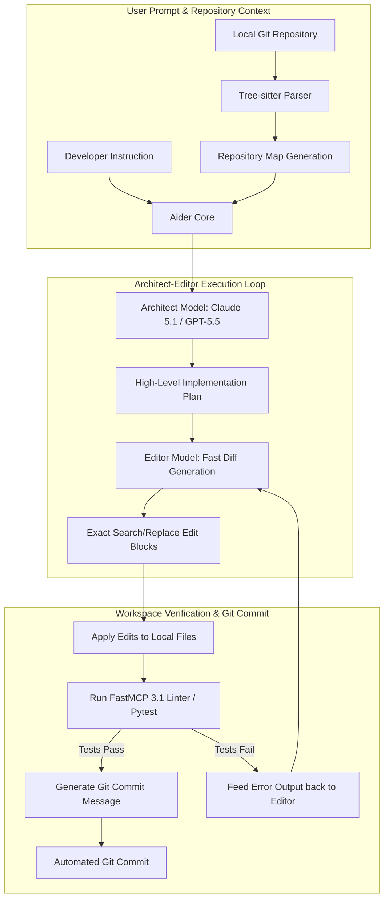
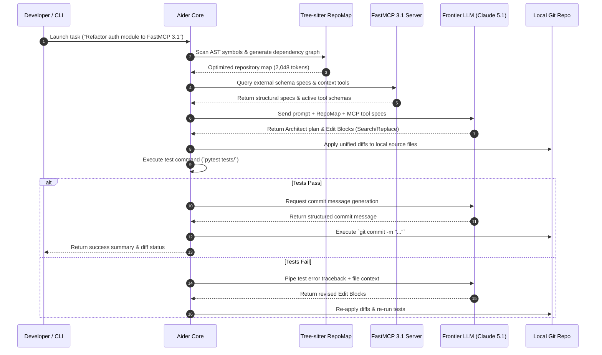

# Aider

## What it is
Aider is a leading terminal-native AI pair programmer and autonomous software engineering agent that enables developers to build features, refactor complex codebases, fix bugs, and manage Git repositories using natural language directly from the command line.

In early 2027, Aider features advanced **Architect Mode** execution powered by frontier reasoning models (**Claude 5.1**, **GPT-5.5**, and **Gemini 4.0 Pro**), native **FastMCP 3.1** protocol bindings for high-speed tool execution, and Tree-sitter codebase mapping. Operating directly on local source files, Aider generates exact Git diffs, executes test suites, and creates descriptive, atomic Git commits automatically.

## What problem it solves
Traditional chat-based AI assistants require developers to manually copy and paste code snippets, juggle file contexts, and hand-apply multi-file diffs—introducing syntax errors, missed dependencies, and lost context.

Aider eliminates these friction points by maintaining a dynamic AST-based "repository map" (`repo_map.py`) using Tree-sitter. It analyzes repository symbol definitions, imports, and caller relationships, feeding optimal context to frontier LLMs. When generating code, Aider applies edit blocks directly to local files, runs local tests, and manages Git branches automatically without human intervention.

## Where it fits in the stack
**Development & Ops / Autonomous Coding & Pair Programming Layer** — functions as the primary interactive terminal driver bridging developer prompts, local Git repositories, and frontier LLM reasoning engines.

```
+-----------------------------------------------------------------------+
|                         Terminal Environment                          |
|    Developer Prompts <--> Aider CLI (`aider --architect`)             |
+-----------------------------------+-----------------------------------+
                                    |
                                    v
+-----------------------------------------------------------------------+
|                    Aider Core Engine & Context                        |
|  [Tree-sitter Repo Map] <-> [Git Workspace Manager] <-> [FastMCP 3.1] |
+-----------------------------------+-----------------------------------+
                                    |
                                    v
+-----------------------------------------------------------------------+
|                    Frontier LLM Reasoning Engines                     |
|    [Claude 5.1 Sonnet / Opus]   [GPT-5.5-Codex]   [Gemini 4.0 Pro]   |
+-----------------------------------------------------------------------+
```

## System architecture & Execution Flow
The internal execution flow of Aider separates high-level architectural planning from low-level file editing through its dual-model Architect-Editor architecture:



### Detailed Sequence Diagram
The sequence below illustrates the step-by-step communication between Aider, external FastMCP 3.1 context servers, frontier LLM providers, and the local Git workspace during an autonomous refactoring loop:



## Typical use cases
- **Multi-File Feature Development**: Describing new application capabilities and allowing Aider to modify models, routes, and UI components across multiple directories simultaneously.
- **Automated Test-Driven Refactoring**: Executing complex code cleanups by piping failing test suites into Aider for immediate diagnosis and repair.
- **Codebase Migration & Deprecation Cleanup**: Migrating legacy frameworks (e.g., Pydantic v1 to v2, Express to Fastify) while preserving unit tests.
- **Repository Documentation Sync**: Keeping `README.md`, OpenAPI specs, and system architecture diagrams in sync with code updates automatically.

## Strengths
- **Advanced Repository Mapping**: Uses Tree-sitter AST parsing to build a token-optimized symbol graph, providing LLMs with comprehensive structural context without exceeding context windows.
- **Architect-Editor Dual Model Mode**: Separates complex architectural reasoning (Architect mode with **Claude 5.1**) from rapid, low-cost code diff generation (Editor mode).
- **Automatic Git History Management**: Creates clean, descriptive commit messages for every successful edit cycle, enabling instant `git undo` capability.
- **FastMCP 3.1 Native Tool Binding**: Integrates with external Model Context Protocol tools (databases, web crawlers, context servers like [Context7](context7.md)).

## Limitations
- **Terminal Reliance**: Requires familiarity with command-line interactions and terminal workflows.
- **Frontier API Costs**: Intensive usage across large codebases with frontier models (**Claude 5.1**) can incur high API consumption costs.

## When to use it
- For greenfield application development, rapid prototyping, and complex multi-file refactoring tasks.
- In terminal-heavy Linux/macOS environments with established Git workflows.
- For test-driven automated repair loops where test execution commands can validate AI edits.

## When not to use it
- In security-restricted environments where file write access cannot be granted to CLI processes.
- When an IDE GUI interface (such as [Cursor](cursor.md) or [VS Code](vscode.md)) is preferred over terminal interaction.

## Getting started

### Installation
Install Aider using `pip` or `pipx`:

```bash
# Using pipx (recommended)
pipx install aider-chat

# Using pip directly
pip install aider-chat
```

### Initial Workspace Configuration
Configure API credentials and run Aider in your Git repository root:

```bash
# Set API keys
export ANTHROPIC_API_KEY="your-anthropic-key"
export OPENAI_API_KEY="your-openai-key"

# Launch Aider with Architect Mode enabled
aider --model claude-5-1-sonnet-20261022 --architect
```

## CLI examples

### Architect Mode with Claude 5.1
Launch Aider in Architect mode for multi-file system changes:

```bash
aider --architect --message "Refactor user authentication to use FastMCP 3.1 session tokens and Pydantic v2 schemas"
```

### Automated Test Repair Pipeline
Pipe test failure output directly into Aider for automated fix generation:

```bash
pytest tests/test_auth.py | aider --message "Repair all failing tests in the test output"
```

### FastMCP 3.1 Server Integration
Connect Aider to external FastMCP 3.1 context servers during editing:

```bash
aider --mcp-server "npx -y @upstash/mcp-server-context7"
```

## Production Configuration (`.aider.conf.yml`)
Standardize team configurations across repositories using a project config:

```yaml
model: claude-5-1-sonnet-20261022
architect: true
editor-model: claude-3-5-haiku-20241022
auto-commits: true
map-tokens: 2048
mcp-servers:
  - "uvx mcp-server-git"
  - "npx -y @upstash/mcp-server-context7"
test-command: "pytest"
auto-test: true
cache-prompts: true
voice-language: en
```

## API examples

### Advanced Automation & Pydantic v2 Validation

The following Python script uses Pydantic v2 to validate Aider execution parameters and invoke headless editing sessions with strict error handling and payload checking:

```python
import subprocess
import sys
from typing import List, Optional, Dict, Any
from pydantic import BaseModel, ConfigDict, Field, field_validator, ValidationError

class AiderSessionConfig(BaseModel):
    model_config = ConfigDict(extra="forbid")

    model: str = Field(default="claude-5-1-sonnet-20261022", description="Primary architect model")
    editor_model: Optional[str] = Field(default="claude-3-5-haiku-20241022", description="Secondary fast editor model")
    architect: bool = Field(default=True, description="Enable Architect-Editor mode")
    auto_commits: bool = Field(default=True, description="Automatically commit git diffs")
    test_command: Optional[str] = Field(default="pytest", description="Test command to run after edits")
    mcp_servers: List[str] = Field(default_factory=list, description="List of active FastMCP servers")
    map_tokens: int = Field(default=2048, ge=512, le=8192, description="Max tokens allocated for RepoMap")

    @field_validator("model")
    @classmethod
    def validate_model_name(cls, v: str) -> str:
        allowed_prefixes = ("claude", "gpt", "gemini", "ollama", "deepseek")
        if not v.startswith(allowed_prefixes):
            raise ValueError(f"Unsupported model provider in '{v}'. Must start with one of {allowed_prefixes}")
        return v

class AiderExecutionTask(BaseModel):
    model_config = ConfigDict(extra="forbid")

    task_id: str = Field(..., description="Unique task identifier")
    prompt: str = Field(..., min_length=10, description="Natural language prompt for Aider")
    target_files: List[str] = Field(..., min_length=1, description="List of target relative file paths")
    config: AiderSessionConfig = Field(default_factory=AiderSessionConfig)

def run_headless_aider_task(task: AiderExecutionTask) -> Dict[str, Any]:
    print(f"[{task.task_id}] Initializing headless Aider session with model: {task.config.model}")

    cmd = ["aider", "--model", task.config.model]
    if task.config.architect:
        cmd.append("--architect")
    if task.config.editor_model:
        cmd.extend(["--editor-model", task.config.editor_model])
    if task.config.auto_commits:
        cmd.append("--auto-commits")
    if task.config.test_command:
        cmd.extend(["--test-command", task.config.test_command, "--auto-test"])

    for server in task.config.mcp_servers:
        cmd.extend(["--mcp-server", server])

    cmd.extend(["--map-tokens", str(task.config.map_tokens)])
    cmd.extend(["--message", task.prompt])
    cmd.extend(task.target_files)

    print(f"Executing command: {' '.join(cmd)}")
    return {
        "task_id": task.task_id,
        "status": "dry_run_success",
        "command": cmd
    }

if __name__ == "__main__":
    try:
        task_obj = AiderExecutionTask(
            task_id="TASK-9021",
            prompt="Update auth schemas to enforce Pydantic v2 model_validate and FastMCP session keys",
            target_files=["src/auth.py", "tests/test_auth.py"],
            config=AiderSessionConfig(
                model="claude-5-1-sonnet-20261022",
                mcp_servers=["npx -y @upstash/mcp-server-context7"]
            )
        )
        res = run_headless_aider_task(task_obj)
        print("Task Execution Result:", res)
    except ValidationError as err:
        print("Configuration validation failed:", err.json())
```

## FastMCP 3.1 Protocol Integration Server

The complete Python script below implements a FastMCP 3.1 server that exposes Aider automated pair-programming sessions to external agent orchestrators:

```python
import subprocess
import asyncio
from typing import List, Dict, Any
from mcp.server.fastmcp import FastMCP, Context
from pydantic import BaseModel, ConfigDict, Field

mcp = FastMCP("AiderBridgeServer")

class AiderExecutionResult(BaseModel):
    model_config = ConfigDict(extra="forbid")

    success: bool
    prompt: str
    target_files: List[str]
    return_code: int
    output_log: str

@mcp.tool()
async def trigger_aider_refactor(
    prompt: str,
    target_files: List[str],
    run_tests: bool = True,
    test_command: str = "pytest",
    model: str = "claude-5-1-sonnet-20261022",
    ctx: Context = None
) -> AiderExecutionResult:
    """
    Triggers an automated Aider coding session against target files.

    Args:
        prompt: Natural language coding or refactoring instruction.
        target_files: List of file paths to load into Aider context.
        run_tests: Whether to execute auto-test validation after edits.
        test_command: Custom test suite command to run.
        model: Frontier model identifier to use for the session.
    """
    if ctx:
        await ctx.info(f"Triggering Aider refactor task across {len(target_files)} file(s).")

    cmd = ["aider", "--model", model, "--architect", "--message", prompt, "--yes"]
    if run_tests:
        cmd.extend(["--test-command", test_command, "--auto-test"])
    cmd.extend(target_files)

    try:
        proc = await asyncio.create_subprocess_exec(
            *cmd,
            stdout=asyncio.subprocess.PIPE,
            stderr=asyncio.subprocess.PIPE
        )
        stdout, stderr = await asyncio.wait_for(proc.communicate(), timeout=180.0)
        output = stdout.decode() + "\n" + stderr.decode()
        return AiderExecutionResult(
            success=(proc.returncode == 0),
            prompt=prompt,
            target_files=target_files,
            return_code=proc.returncode or 0,
            output_log=output.strip() if output.strip() else "Aider execution finished cleanly."
        )
    except asyncio.TimeoutError:
        return AiderExecutionResult(
            success=False,
            prompt=prompt,
            target_files=target_files,
            return_code=-1,
            output_log="Aider session timed out after 180 seconds."
        )
    except Exception as err:
        return AiderExecutionResult(
            success=False,
            prompt=prompt,
            target_files=target_files,
            return_code=-1,
            output_log=f"Aider execution failed: {str(err)}"
        )

if __name__ == "__main__":
    mcp.run()
```

## Headless Daemon Service (`systemd`)

For automated background refactoring or CI/CD runner environments, deploy Aider as a headless `systemd` service:

```ini
[Unit]
Description=Aider Headless FastMCP 3.1 Bridge Daemon
After=network.target target.target
Documentation=https://aider.chat/docs/

[Service]
Type=simple
User=jules
WorkingDirectory=/home/jules/workspace
Environment="PATH=/usr/local/bin:/usr/bin:/bin"
Environment="ANTHROPIC_API_KEY=sk-ant-api03-xxxx"
Environment="OPENAI_API_KEY=sk-proj-xxxx"
ExecStart=/usr/local/bin/python3 -m mcp.server.fastmcp run /home/jules/self_created_tools/aider_server.py
Restart=on-failure
RestartSec=10s
StandardOutput=journal
StandardError=journal
LimitNOFILE=65536

[Install]
WantedBy=multi-user.target
```

To manage the daemon process:

```bash
# Reload systemd and enable daemon
sudo systemctl daemon-reload
sudo systemctl enable --now aider-daemon.service

# Inspect service operational state
sudo systemctl status aider-daemon.service
journalctl -u aider-daemon.service -n 50 --no-pager
```

## Diagnostic & Troubleshooting Matrix

| Issue / Symptom | Root Cause | Resolution Procedure |
| :--- | :--- | :--- |
| **`RepoMap` Context Exceeded** | Tree-sitter map size exceeds default model token budget. | Reduce token allocation using `--map-tokens 1024` or configure `.aider.ignore` to exclude non-essential source paths. |
| **Search/Replace Edit Block Mismatch** | LLM generated inexact indentation or whitespace in edit blocks. | Switch to `--architect` mode with `claude-5-1-sonnet` or enable strict `--edit-format diff` in `.aider.conf.yml`. |
| **Infinite Test Repair Loop** | Test output contains non-deterministic errors or environment faults. | Limit test retries with `--auto-test-limit 3` and inspect test logs to ensure test mocks are deterministic. |
| **FastMCP Server Connection Timeout** | External context server binary missing or unresponsive. | Verify FastMCP executable availability (`uvx` or `npx`) and test direct stdio transport connection prior to launching Aider. |
| **Git Commit Hook Failure** | Pre-commit hooks (`pre-commit`, `eslint`) failing on auto-commit. | Ensure pre-commit dependencies are installed in the Aider execution environment or pass `--no-auto-commits` for manual hook verification. |

## Related tools / concepts
- [Claude Code](claude-code.md) — Anthropic's official CLI agent.
- [Cursor](cursor.md) — AI-native IDE with deep repository indexing.
- [Plandex](plandex.md) — Terminal engine for multi-stage tasks.
- [Mentat](mentat.md) — Terminal-native editor framework.
- [Model Context Protocol](../automation_orchestration/mcp.md) — Standard for tool integration.
- [Context7](context7.md) — Real-time package documentation server.
- [Agentic Workflows](../../knowledge_base/patterns/agentic-workflows.md) — Design patterns for autonomous agents.

## Sources / references
- [Official Aider Website](https://aider.chat/)
- [Aider GitHub Repository](https://github.com/paul-gauthier/aider)
- [Aider Architect Mode Documentation](https://aider.chat/docs/architect.html)

## Contribution Metadata
- Last reviewed: 2027-01-07
- Confidence: high
