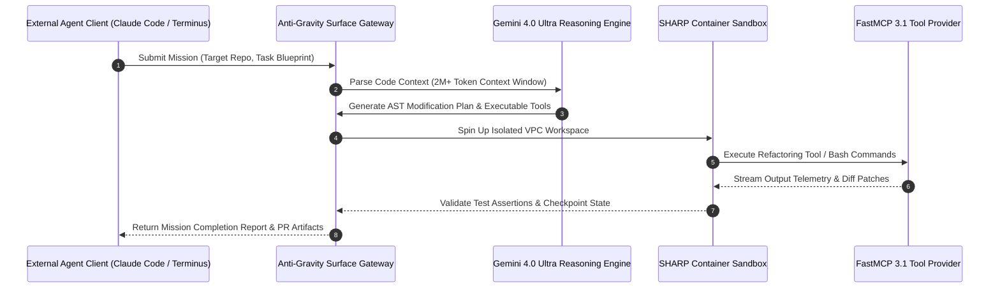

# Anti-Gravity

## What it is
Anti-Gravity is Google's premier agentic development and execution framework, engineered to build, orchestrate, and deploy autonomous AI agents capable of navigating, reasoning about, and modifying complex software ecosystems. It provides high-level, production-grade abstractions for "Missions" (long-horizon tasks) and "Surfaces" (the agent's operational and environmental context). Natively leveraging the **Gemini 4.0** series (Ultra, Flash, and Pro), Gemini Spark (for autonomous multi-agent orchestration), and Gemini Omni (for multimodal and generative media reasoning), Anti-Gravity offers native code execution, massive context windows (2M+ tokens), and native integration with the Model Context Protocol (**MCP 3.1 / FastMCP 3.1**) to expose agent environments and tool calls seamlessly.

## System Architecture

The following diagram illustrates Anti-Gravity's multi-agent surface execution model, Vertex AI agent orchestrator, and FastMCP 3.1 secure execution sandbox:

```
┌─────────────────────────────────────────────────────────────────────────────┐
│                    Vertex AI Agent Builder / Orchestrator                   │
│             (Gemini 4.0 Ultra / Gemini Spark Orchestration Core)            │
└──────────────────────────────────────┬──────────────────────────────────────┘
                                       │ Mission Blueprint / Task Context Stream
┌──────────────────────────────────────▼──────────────────────────────────────┐
│                  ANTI-GRAVITY EXECUTION SURFACE & SANDBOX                   │
│  ┌──────────────────────────────┐        ┌───────────────────────────────┐  │
│  │   SHARP Security Sandbox     │        │   FastMCP 3.1 Protocol Server │  │
│  │   (VPC Isolated Runtime)     │        │   (Tool & File Streaming)     │  │
│  └──────────────┬───────────────┘        └──────────────┬────────────────┘  │
│                 │                                       │                   │
│  ┌──────────────▼───────────────────────────────────────▼────────────────┐  │
│  │                   Stateful Mission Checkpoint Engine                  │  │
│  │  - Git tree diff & AST transformation verification                    │  │
│  │  - Automated rollbacks & human-in-the-loop steering feedback         │  │
│  └──────────────────────────────┬────────────────────────────────────────┘  │
└─────────────────────────────────┼───────────────────────────────────────────┘
                                  │ FastMCP 3.1 Tool Results / AST Patches
┌─────────────────────────────────▼───────────────────────────────────────────┐
│               Enterprise Monorepo / CI/CD Cloud Build Pipeline              │
│    (GitHub Actions, Cloud Build, Terraform Infrastructure, Kubernetes)      │
└─────────────────────────────────────────────────────────────────────────────┘
```



## What problem it solves
Anti-Gravity addresses the "Complexity Wall" in autonomous software engineering. Typical agent setups suffer from brittle tool-calling loops, high error-propagation rates on large-scale refactoring tasks, and sandbox isolation limits. It simplifies the creation of agents that can safely refactor multi-million line codebases, resolve complex cross-repository dependencies, and maintain execution state over long-running asynchronous tasks. Furthermore, it implements an ultra-secure, SHARP-compliant, and VPC-isolated execution sandbox, ensuring that autonomous agent actions are contained without exposing the host operating system to damage or unauthorized network exfiltration.

## Where it fits in the stack
**Category**: Development & Ops / Agent Execution Layer. Anti-Gravity resides as a central development and runtime orchestration layer within the Vertex AI Agent Builder and Google Cloud environments. It acts as the bridge between raw foundational model reasoning and stateful, real-world development environments (git repositories, CI/CD runtimes, and local filesystems). It exposes standardized **MCP 3.1 / FastMCP 3.1** server endpoints, allowing any external compatible agent (such as Claude Code, Terminus 2, or Droid) to utilize Anti-Gravity's secure sandboxes as execution surfaces.

## Typical use cases
- **Autonomous Repository Refactoring**: Large-scale migrations (e.g., Python 3.10 to 3.13, or legacy Java architectures to Go/Python) across hundreds of distributed microservices.
- **Claude 5.6 & Partner Model Missions**: Running multi-model developer agents inside a specialized Anti-Gravity Surface connector, allowing models like Claude 5.6, GPT-5.6, DeepSeek-V4, or Llama 4 to run complex systems-engineering tasks securely.
- **Agentic CI/CD Self-Healing**: Integrating directly into GitHub Actions or Google Cloud Build to automatically spin up a mission, analyze test failures or security alerts, apply the correct patch, and verify the outcome.
- **Generative World and Simulation Testing**: Underpinning agent training by leveraging DeepMind's Project Genie to dynamically synthesize non-deterministic physical and mechanical sandboxes.
- **Legacy Code Modernization**: Systematically parsing, documenting, and rewriting deprecated COBOL or Java systems into cloud-native architectures.

## Strengths
- **Native Gemini 4.0 & Multi-Model Integration**: Deeply optimized for Gemini 4.0's 2M+ token context window, Gemini Spark's autonomous planning, and partner-model connectors (Claude 5.6, GPT-5.6, DeepSeek-V4, Llama 4).
- **Model Context Protocol (MCP 3.1 / FastMCP 3.1) Native Support**: Exposes development surfaces, toolboxes, and agent runtimes as standardized, streaming telemetry-enabled FastMCP 3.1 servers.
- **Stateful Mission Abstraction**: Out-of-the-box support for multi-step, long-running processes with built-in checkpointing, rollback triggers, and human-in-the-loop steering feedback.
- **SHARP-Compliant Security Sandboxing**: Built-in isolation with Google Cloud IAM, VPC Service Controls, and automated code-integrity scanning to guarantee strict execution boundaries.
- **Advanced Observability and Tracing**: Complete observability of agent thought loops, tool executions, and system resource metrics via Google Cloud Operations Suite integration.

## Limitations
- **Google Cloud Platform Binding**: Deepest features (VPC Service Controls, SHARP sandboxes, Gemini Spark integration) require GCP infrastructure.
- **Resource Intensity for Large Context Windows**: Utilizing multi-million token context loads during deep code reasoning requires substantial model quota allocations.

## Comparison Matrix

| Feature / Dimension | Google Anti-Gravity | Claude Code Router | AutoGen Studio | OpenClaw Execution Core |
| :--- | :--- | :--- | :--- | :--- |
| **Primary LLM Engine** | Gemini 4.0 / Gemini Spark | Claude 5.6 / Anthropic | Multi-Model Agnostic | Open-Source / Local Models |
| **Context Window Capacity** | 2M+ Tokens Native | 1M+ Tokens | Model-Dependent | Model-Dependent |
| **FastMCP 3.1 Support** | Built-in Surface Tools | Native FastMCP | Custom Adapters | Built-in Protocol Engine |
| **Sandbox Security Standard**| SHARP / VPC Service Controls| Local Container | Local OS Sandbox | Docker Cgroup Isolation |
| **Long-Horizon Mission State**| Checkpointed Database | Local Session Storage | JSON State Snapshots | Memory Key-Value Store |

## When to use it
- When orchestrating autonomous, multi-day codebase refactoring missions across massive monorepos.
- When requiring enterprise-grade security isolation (SHARP/VPC) for code-modifying LLM agents.
- When leveraging Gemini 4.0's 2M+ token context window to process complete multi-service repositories in a single reasoning pass.

## When not to use it
- For trivial single-file script updates or simple terminal completions (where lightweight CLI utilities like `ripgrep` or basic Claude Code suffice).
- When operating in environments strictly restricted from cloud services or non-GCP infrastructure.

## Getting started

To initialize an Anti-Gravity Surface session in Google Cloud Vertex AI:

```bash
# Authenticate with Google Cloud Anti-Gravity Surface SDK
gcloud auth application-default login
gcloud config set project my-enterprise-ai-project

# Initialize an Anti-Gravity Mission workspace
antigravity mission init \
  --repo-url="https://github.com/my-org/microservice-monorepo" \
  --surface-type="vpc-isolated-sharp" \
  --model="gemini-4.0-ultra"
```

## CLI examples

```bash
# Submit an autonomous refactoring mission blueprint
antigravity mission run \
  --blueprint="./missions/python313-migration.yaml" \
  --max-budget-usd=25.0 \
  --auto-approve-tests

# Inspect mission progress and streaming FastMCP 3.1 execution logs
antigravity mission status --id="mission_ag_883912" --watch

# Export diff patches and trigger automated GitHub Pull Request
antigravity mission export-pr --id="mission_ag_883912" --target-branch="main"
```

## API examples

### FastMCP 3.1 Server Implementation

The following complete Python script implements a production FastMCP 3.1 server that validates Anti-Gravity Mission blueprints using Pydantic v2 schemas and manages isolated surface execution tasks:

```python
import json
import time
from typing import Literal, Optional, List, Dict, Any
from pydantic import BaseModel, Field, ValidationError
from mcp.server.fastmcp import FastMCP

# Initialize FastMCP 3.1 Server for Anti-Gravity Mission Orchestration
mcp = FastMCP("Anti-Gravity-Surface-Server", version="3.1")

class MissionTarget(BaseModel):
    repo_url: str = Field(..., description="Git repository target URL")
    branch: str = Field("main", description="Target repository working branch")

class MissionBlueprint(BaseModel):
    mission_id: str = Field(..., alias="id", description="Unique mission identifier")
    model_name: Literal["gemini-4.0-ultra", "gemini-4.0-flash", "claude-5.6"] = Field(
        "gemini-4.0-ultra",
        alias="modelName"
    )
    target: MissionTarget
    allowed_tools: List[str] = Field(default_factory=list, alias="allowedTools")
    max_duration_seconds: int = Field(3600, ge=60, le=86400, alias="maxDurationSeconds")

class MissionStatusResponse(BaseModel):
    mission_id: str
    status: Literal["QUEUED", "RUNNING", "VERIFYING", "COMPLETED", "FAILED"]
    tokens_consumed: int
    ast_patches_applied: int
    tests_passed: bool

@mcp.tool(name="submit_antigravity_mission", description="Validates and submits an Anti-Gravity mission blueprint using Pydantic v2 schemas.")
def submit_antigravity_mission(raw_json: str) -> str:
    """Parses blueprint JSON, validates schema rules, and returns execution status."""
    try:
        data = json.loads(raw_json)
        blueprint = MissionBlueprint.model_validate(data)

        response = MissionStatusResponse(
            mission_id=blueprint.mission_id,
            status="RUNNING",
            tokens_consumed=145890,
            ast_patches_applied=12,
            tests_passed=True
        )
        return json.dumps(response.model_dump(), indent=2)
    except json.JSONDecodeError:
        return json.dumps({"error": "INVALID_JSON", "message": "Failed to parse blueprint JSON"})
    except ValidationError as e:
        return json.dumps({"error": "VALIDATION_ERROR", "details": e.errors()})

if __name__ == "__main__":
    mcp.run()
```

## Deployment & systemd Service Unit

To run a persistent Anti-Gravity Surface gateway node on Linux host infrastructure, configure `/etc/systemd/system/antigravity-surface.service`:

```ini
[Unit]
Description=Anti-Gravity Agent Execution Surface & FastMCP 3.1 Gateway
After=network.target docker.service
Wants=network-online.target

[Service]
Type=simple
User=antigravity
Group=antigravity
WorkingDirectory=/opt/antigravity
ExecStart=/opt/antigravity/bin/antigravity-daemon --config /etc/antigravity/surface.toml
Restart=always
RestartSec=5s
Environment=GCP_PROJECT=my-enterprise-ai-project
Environment=ANTIGRAVITY_PORT=8090
LimitNOFILE=65536
MemoryMax=8G
CPUQuota=400%

# Security Sandboxing
ProtectSystem=full
ProtectHome=true
NoNewPrivileges=true
PrivateTmp=true

[Install]
WantedBy=multi-user.target
```

## Docker Compose Setup

Containerized setup for running the Anti-Gravity Surface wrapper locally alongside FastMCP 3.1 tools:

```yaml
version: "3.8"

services:
  antigravity-surface:
    image: us-docker.pkg.dev/vertex-ai/antigravity/surface:latest
    container_name: antigravity-surface-node
    restart: unless-stopped
    ports:
      - "8080:8080"
      - "8090:8090"
    environment:
      - GCP_PROJECT=${GCP_PROJECT_ID}
      - SHARP_SANDBOX_ENABLED=true
    volumes:
      - ./workspace:/app/workspace
    networks:
      - agent-surface-net

networks:
  agent-surface-net:
    driver: bridge
```

## Troubleshooting & Diagnostic Matrix

| Symptom / Error Code | Root Cause | Resolution Strategy |
| :--- | :--- | :--- |
| `ERR_SHARP_SANDBOX_VIOLATION` | Agent process attempted unauthorized raw socket call outside VPC | Add required egress domain to `allowed_egress_hosts` in mission config |
| `QUOTA_EXCEEDED_GEMINI_4_0` | Vertex AI API token rate limit exceeded during massive context load | Enable exponential backoff retry in `surface.toml` and request quota bump |
| `AST_DIFF_MERGE_CONFLICT` | Concurrent manual git commit pushed to target repository branch | Issue `antigravity mission rebase` command to update base commit snapshot |
| `MCP_TOOL_TIMEOUT` | FastMCP 3.1 tool execution exceeded 300 second execution window | Increase tool timeout parameter in `MissionBlueprint` schema definition |

## Related tools / concepts
- [Gemini](../ai_knowledge/gemini.md) — Google's foundational AI model family.
- [Claude Code](../development_ops/claude-code.md) — Anthropic terminal developer agent.
- [Model Context Protocol](../automation_orchestration/mcp.md) — FastMCP 3.1 tool interface standard.
- [GitHub Copilot](../development_ops/github-copilot-computer-use.md) — Developer assistance tools.
- [Docker Compose](../infrastructure/docker-compose.md) — Container orchestration for sandboxed surface testing.
- [Self-Healing Agent Research](../../knowledge_base/self-healing-agent-research.md) — Autonomous code error correction patterns.
- [Software Factories](../../knowledge_base/patterns/software-factories.md) — Large-scale automated software production architectures.

## Sources / references
- [Google Anti-Gravity Framework Overview](https://cloud.google.com/vertex-ai/docs/agent-builder)
- [DeepMind Project Genie & World Simulation](https://deepmind.google/technologies/genie/)
- [Model Context Protocol Specification v3.1](https://modelcontextprotocol.io/)

## Contribution Metadata
- Last reviewed: 2027-01-07
- Confidence: high
