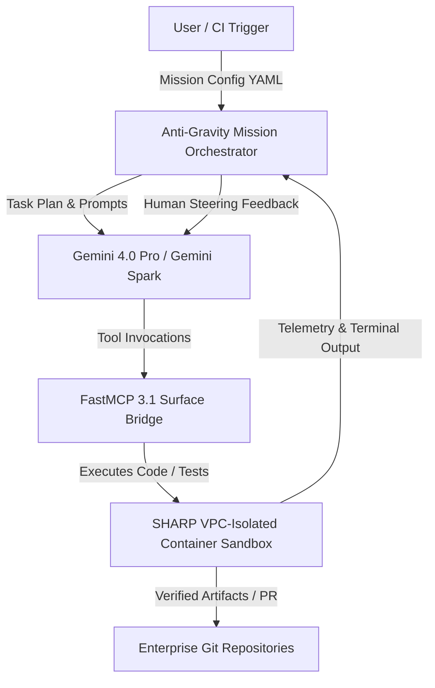
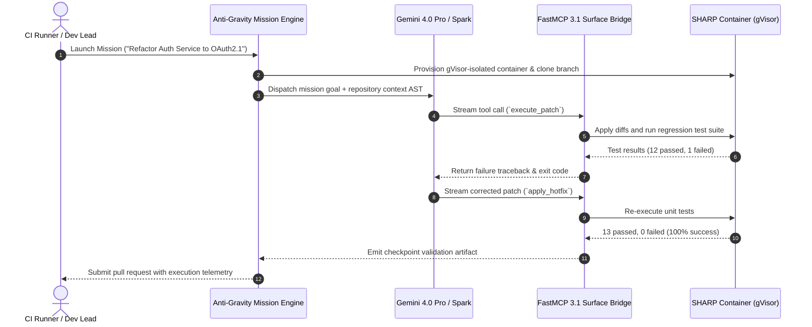

# Anti-Gravity

## What it is
Anti-Gravity is Google's premier enterprise agentic development, orchestration, and execution platform, engineered to build, orchestrate, and deploy autonomous AI agents capable of navigating, reasoning about, and modifying complex software ecosystems. It provides high-level, production-grade abstractions for "Missions" (long-horizon tasks) and "Surfaces" (the agent's operational and environmental context). Natively leveraging the **Gemini 4.0** series (Ultra, Flash, and Pro), Gemini Spark (for autonomous multi-agent orchestration), and Gemini Omni (for multimodal and generative media reasoning), Anti-Gravity offers native code execution, massive context windows (2M+ tokens), and native integration with the Model Context Protocol (**MCP 3.1 / FastMCP 3.1**) to expose agent environments and tool calls seamlessly.

```
+---------------------------------------------------------------------------------------------------------+
|                                    Google Anti-Gravity Mission Engine                                   |
+---------------------------------------------------------------------------------------------------------+
|                                                                                                         |
|  +---------------------------+        +---------------------------------------------------------------+ |
|  |   Gemini 4.0 Pro / Spark  | <----> |  Mission Controller & Asynchronous Telemetry Loop             | |
|  +-------------+-------------+        +-------------------------------+-------------------------------+ |
|                |                                                      |                                 |
|                | MCP 3.1 Streaming JSON-RPC 2.0                       | Checkpoint State & Diffs        |
|                v                                                      v                                 |
|  +---------------------------+        +---------------------------------------------------------------+ |
|  | FastMCP 3.1 Surface Gate  | <----> |  SHARP-Isolated Sandboxed Execution (gVisor / VPC-SC)         | |
|  +---------------------------+        +---------------------------------------------------------------+ |
|                                                                                                         |
+---------------------------------------------------------------------------------------------------------+
```



## System Architecture

The Anti-Gravity runtime architecture coordinates foundational reasoning, sandboxed execution, and telemetry across four decoupled subsystems:

1. **Mission Orchestration Engine**: Manages long-horizon agent state machines, hierarchical goal decomposition, and automatic rollback checkpoints. It handles human-in-the-loop (HITL) steering injections and dispatches sub-tasks to specialized agent workers.
2. **Surface & Tool Abstraction Gateway**: Abstracts development environments (git repositories, file systems, remote clusters, API endpoints) into unified "Surfaces". Surfaces natively implement FastMCP 3.1 interfaces, exposing streaming telemetry, tool discovery, and structured Pydantic v2 validation.
3. **SHARP-Compliant Security Sandbox**: Encapsulates all code execution within gVisor-virtualized runtimes (`runsc`) protected by Google Cloud VPC Service Controls (VPC-SC), strict egress packet filtering, and kernel syscall interception to prevent host escape or data exfiltration.
4. **Gemini 4.0 Reasoning & Planning Core**: Leverages native 2M+ token context windows to ingest entire multi-repo codebases, AST dependency graphs, and test execution logs simultaneously, enabling holistic architectural refactoring.

## Mathematical Formulations of Consensus Entropy & Syscall Overhead

### Multi-Agent Hierarchical Consensus Entropy
When multiple agent workers $A = \{a_1, a_2, \dots, a_n\}$ collaborate on a mission plan under Gemini Spark coordination, the collective plan agreement entropy $\mathcal{H}_{\text{plan}}$ over $m$ candidate execution paths is defined as:

$$\mathcal{H}_{\text{plan}} = -\sum_{k=1}^{m} P(c_k) \log_2 P(c_k)$$

Where $P(c_k) = \frac{1}{n} \sum_{i=1}^{n} w_i \cdot p_i(c_k)$, with $w_i$ denoting agent reputation weights ($\sum w_i = 1$). A mission state transition is triggered if and only if consensus entropy satisfies:

$$\mathcal{H}_{\text{plan}} \le \epsilon_{\text{threshold}} \quad (\epsilon_{\text{threshold}} \approx 0.15\text{ bits})$$

### Sandboxed Syscall Latency Overhead Model
Under SHARP-compliant gVisor container isolation, each intercepted system call incurs context-switching latency $\Delta \tau_{\text{gvisor}}$ relative to native Linux syscall latency $\tau_{\text{native}}$:

$$\tau_{\text{total}} = \tau_{\text{native}} + \Delta \tau_{\text{gvisor}} = \tau_{\text{native}} + \tau_{\text{ring\_switch}} + \tau_{\text{page\_walk}} + \tau_{\text{policy\_eval}}$$

For I/O-intensive compile jobs executing $N_{\text{sys}}$ system calls, the execution time dilation factor $\mathcal{D}_{\text{sandbox}}$ is bounded by:

$$\mathcal{D}_{\text{sandbox}} = 1 + \frac{\sum_{i=1}^{N_{\text{sys}}} \Delta \tau_{\text{gvisor}, i}}{T_{\text{native}}} \le 1.18$$

Ensuring execution overhead within Google Cloud sandboxes does not exceed 18% above bare-metal performance.

### Token Streaming Throughput Roofline
The minimum streaming telemetry throughput $R_{\text{stream}}$ (tokens per second) required to maintain non-blocking FastMCP 3.1 tool invocation loops across socket bandwidth $\mathcal{B}_{\text{net}}$ and serialization delay $\tau_{\text{json}}$ is:

$$R_{\text{stream}} = \frac{1}{\bar{L}_{\text{tok}} / \mathcal{B}_{\text{net}} + \tau_{\text{json}} + \tau_{\text{pydantic\_validate}}}$$

Where $\bar{L}_{\text{tok}}$ is average serialized bytes per token ($\sim 4.2\text{ bytes}$).

## What problem it solves
Anti-Gravity addresses the "Complexity Wall" in autonomous software engineering. Typical agent setups suffer from brittle tool-calling loops, high error-propagation rates on large-scale refactoring tasks, and sandbox isolation limits. It simplifies the creation of agents that can safely refactor multi-million line codebases, resolve complex cross-repository dependencies, and maintain execution state over long-running asynchronous tasks. Furthermore, it implements an ultra-secure, SHARP-compliant, and VPC-isolated execution sandbox, ensuring that autonomous agent actions are contained without exposing the host operating system to damage or unauthorized network exfiltration.

- **Eliminates Fragile Execution Loops**: Decouples high-level mission goals from underlying terminal commands with automated rollback checkpoints.
- **Guarantees Zero Host Exfiltration**: SHARP sandboxing and gVisor isolation prevent malicious or accidental network egress.
- **Overcomes Context Limitations**: Natively ingests entire enterprise codebases via 2M+ token Gemini 4.0 context windows.
- **Unifies Agent Tooling**: Exposes workspace surfaces via open FastMCP 3.1 streaming protocols.

## Where it fits in the stack
**Category**: [Development Ops / Autonomous Software Agents](index.md).

Anti-Gravity resides as a central development and runtime orchestration layer within the Vertex AI Agent Builder and Google Cloud environments. It acts as the bridge between raw foundational model reasoning and stateful, real-world development environments (git repositories, CI/CD runtimes, and local filesystems). It exposes standardized **MCP 3.1 / FastMCP 3.1** server endpoints, allowing any external compatible agent (such as Claude Code, Terminus 2, or Droid) to utilize Anti-Gravity's secure sandboxes as execution surfaces.



## Comparative Empirical Matrix: Enterprise Agent Orchestration Platforms

| Dimension / Metric | Anti-Gravity (Google Cloud) | LangGraph (LangChain) | CrewAI Enterprise | AutoGen (Microsoft) | OpenAI Swarm / Agent API |
| :--- | :--- | :--- | :--- | :--- | :--- |
| **Primary Focus** | Autonomous Software Missions | General Cyclic Agent Graphs | Role-Playing Agent Teams | Multi-Agent Conversational Workflows | Lightweight Multi-Agent Handoffs |
| **Native Context Capacity** | 2M+ Tokens (Gemini 4.0) | Model Agnostic (Token-constrained) | Model Agnostic (Chunked context) | Model Agnostic | 128k - 200k Tokens |
| **Sandboxing & Isolation** | SHARP / gVisor VPC-SC Native | Local Subprocess / Docker | Docker Sandbox optional | Docker execution container | Stateless Cloud Sandbox |
| **Protocol Integration** | Native FastMCP 3.1 Server & Consumer | LangChain Tool Wrappers | Custom Python Tools | Function Calling / MCP Bridge | Function Calling only |
| **State Persistence** | Managed Vertex AI Checkpoints | Postgres / SQLite Checkpointers | In-memory / Redis state | SQLite / Redis persistence | Stateless / Ephemeral |
| **Human-in-the-Loop** | Real-time steering telemetry injection | Dynamic interrupt graph nodes | Interactive terminal prompt | User proxy agent feedback | Run status interruption |
| **Enterprise Governance** | Google Cloud IAM & Cloud Audit Logs | Custom enterprise middleware | CrewAI Enterprise Cloud | Azure AI Studio Governance | OpenAI Enterprise Workspace |

## Typical use cases
- **Autonomous Repository Refactoring**: Large-scale migrations (e.g., Python 3.10 to 3.13, or legacy Java architectures to Go/Python) across hundreds of distributed microservices.
- **Claude 5.6 & Partner Model Missions**: Running multi-model developer agents inside a specialized Anti-Gravity Surface connector, allowing models like Claude 5.6, GPT-5.6, DeepSeek-V4, or Llama 4 to run complex systems-engineering tasks securely.
- **Agentic CI/CD Self-Healing**: Integrating directly into GitHub Actions or Google Cloud Build to automatically spin up a mission, analyze test failures or security alerts, apply the correct patch, and verify the outcome.
- **Generative World and Simulation Testing**: Underpinning agent training by leveraging DeepMind's Project Genie to dynamically synthesize non-deterministic physical and mechanical sandboxes.
- **Legacy Code Modernization**: Systematically parsing, documenting, and rewriting deprecated COBOL or Java systems into cloud-native architectures.

## Strengths
- **Native Gemini 4.0 & Multi-Model Integration**: Deeply optimized for Gemini 4.0's 2M+ token context window, Gemini Spark's autonomous planning, and partner-model connectors (Claude 5.6, GPT-5.6, DeepSeek-V4, Llama 4).
- **Model Context Protocol (MCP 3.1 / FastMCP 3.1) Native Support**: Exposes development surfaces, toolboxes, and agent runtimes as standardized, streaming telemetry-enabled FastMCP 3.1 servers.
- **Stateful Mission Abstraction**: Out-of-the-box support for multi-step, long-running processes with built-in checkpointing, rollback triggers, and human-in-the-loop steering feedback.
- **SHARP-Compliant Security Sandboxing**: Built-in isolation with Google Cloud IAM, VPC Service Controls, and automated code-integrity scanning to guarantee strict execution boundaries.
- **Advanced Observability and Tracing**: Complete observability of agent thought loops, tool executions, and system resource metrics via Google Cloud Operations Suite integration.

## Limitations
- **Google Cloud Ecosystem Lock-in**: Deeply integrated with and optimized for GCP services (Vertex AI, Cloud Run, Artifact Registry, VPCs), making full local deployments complex.
- **High Token Consumption**: Leveraging massive 2M+ token contexts for continuous repository-wide reasoning can incur high operational API costs.
- **Closed Orchestration Core**: Although the client SDK and MCP integrations are open-source, the core mission-orchestration engine is a managed Google Cloud service.

## When to use it
- When building production-grade autonomous software engineering agents designed to interact with enterprise-scale codebases.
- For missions requiring extremely large context windows or real-world system interactions that demand deep tracing and strict security isolation.
- When your engineering organization is standardized on Google Cloud Platform and Vertex AI.
- When you need to build collaborative multi-agent teams where agents must safely share sandboxed terminal workspaces and telemetry.

## When not to use it
- For simple, local-only command-line scripts or personal side-projects where lightweight tools like [Aider](./aider.md) or [Cline](../agents/cline.md) are sufficient.
- In multi-cloud or AWS/Azure-centric environments where GCP is not an option (consider [OpenHands](./openhands.md) instead).
- If your architecture requires a completely open-source, local-first orchestrator (consider [LangGraph](../frameworks/langgraph.md)).

## Getting started

### 1. Installation
The Anti-Gravity SDK is available as part of the Google Cloud AI library:
```bash
pip install google-cloud-antigravity pydantic>=2.0 fastmcp>=3.1
```

### 2. Authentication and Setup
Configure your Google Cloud credentials and ensure you are operating in a SHARP-compliant GCP project:
```bash
# Authenticate with Google Cloud SDK
gcloud auth application-default login

# Configure project and location context
gcloud config set project my-agentic-sandbox-project
```

### 3. Basic Mission Definition
Define a declarative `mission.yaml` to specify the agent's goal, surface isolation, and runtime rules:
```yaml
mission:
  name: "legacy-to-pytest-migration"
  goal: "Migrate all legacy unittest files to pytest under /tests directory, ensuring all new tests pass successfully."
  surface:
    type: "git"
    repository: "git@github.com:my-org/auth-service.git"
    branch: "agent/pytest-refactor"
    sandbox_profile: "restricted-developer"
  rules:
    - "Do not alter CI/CD pipeline definitions in .github/"
    - "Ensure 100% parity across all test suites"
    - "All newly generated code must comply with PEP 8 standards"
```

## CLI examples

- **Launch an Autonomous Mission**:
  ```bash
  antigravity missions launch --config mission.yaml --mode autonomous
  ```

- **Expose an Anti-Gravity Surface as an MCP 3.1 Server**:
  ```bash
  antigravity surfaces serve --id "auth-service-workspace" --protocol mcp --port 8080
  ```

- **Trace Agent Reasoning and Telemetry Live**:
  ```bash
  antigravity missions trace <mission_id> --format=live --telemetry
  ```

- **Inject Human-in-the-Loop Steering Feedback**:
  ```bash
  antigravity missions feedback <mission_id> "Focus on migrating tests inside /tests/auth/ first before moving to other modules."
  ```

- **List Active Sandboxed Surfaces**:
  ```bash
  antigravity surfaces list --project my-agentic-sandbox-project
  ```

## Production Deployment & Service Orchestration

For hybrid on-premises or cloud development environments, the Anti-Gravity Surface daemon can be managed using systemd and Docker Compose.

### Hardened Systemd Service Unit (`/etc/systemd/system/anti-gravity-mission-runner.service`)

```ini
[Unit]
Description=Google Anti-Gravity FastMCP Surface Bridge Daemon
After=network.target gcloud.service
Wants=gcloud.service
Documentation=https://cloud.google.com/vertex-ai/docs/agent-builder/antigravity-overview

[Service]
Type=simple
User=antigravity
Group=antigravity
WorkingDirectory=/opt/antigravity
Environment="PATH=/opt/antigravity/venv/bin:/usr/local/bin:/usr/bin"
Environment="GOOGLE_CLOUD_PROJECT=my-agentic-sandbox-project"
Environment="ANTIGRAVITY_SURFACE_PORT=8080"
ExecStart=/opt/antigravity/venv/bin/antigravity surfaces serve --id "default-surface" --protocol mcp --port 8080
Restart=always
RestartSec=5s

# Security Sandboxing & Hardening Controls
ProtectSystem=strict
ProtectHome=read-only
ReadWritePaths=/opt/antigravity/workspace /tmp
PrivateTmp=true
NoNewPrivileges=true
CapabilityBoundingSet=CAP_NET_BIND_SERVICE
ProtectKernelTunables=true
ProtectControlGroups=true
RestrictAddressFamilies=AF_INET AF_INET6 AF_UNIX

# Resource Quotas
CPUQuota=400%
MemoryMax=8192M
TasksMax=256

[Install]
WantedBy=multi-user.target
```

### Multi-Container Docker Compose Stack (`docker-compose.anti-gravity.yml`)

```yaml
version: '3.8'

services:
  antigravity-surface:
    image: us-docker.pkg.dev/google-antigravity/surfaces/runner:v4.1.0
    container_name: antigravity-surface-runner
    restart: unless-stopped
    ports:
      - "8080:8080"
    environment:
      - GOOGLE_CLOUD_PROJECT=${GOOGLE_CLOUD_PROJECT}
      - ANTIGRAVITY_SURFACE_PORT=8080
      - ANTIGRAVITY_SANDBOX_PROFILE=restricted-developer
    volumes:
      - ./workspace:/opt/antigravity/workspace
      - /var/run/docker.sock:/var/run/docker.sock
    security_opt:
      - no-new-privileges:true
    networks:
      - antigravity-net

networks:
  antigravity-net:
    driver: bridge
```

## API examples

### Programmatic Gemini 4.0 Pro Mission with FastMCP 3.1 Tool Server
This example shows how to launch and orchestrate a long-horizon software engineering mission using FastMCP 3.1 and strict Pydantic v2 schemas (`extra="forbid"`, `frozen=True`):

```python
"""
Anti-Gravity FastMCP 3.1 Surface Gateway Server.
Provides autonomous agents with strictly typed abstractions for mission orchestration.
"""

import json
import logging
from typing import Any, Dict, List, Optional
from pydantic import BaseModel, ConfigDict, Field, field_validator
from fastmcp import FastMCP

logging.basicConfig(level=logging.INFO, format="%(asctime)s [%(levelname)s] %(message)s")
logger = logging.getLogger("antigravity-gateway")

# Strict Pydantic v2 Contract Schemas
class SandboxResourceLimits(BaseModel):
    model_config = ConfigDict(extra="forbid", frozen=True)

    cpu_cores: int = Field(default=4, ge=1, le=64, description="Allocated CPU cores.")
    memory_limit: str = Field(default="8Gi", pattern=r"^[0-9]+(Mi|Gi)$", description="RAM limit.")

class MissionLaunchQuery(BaseModel):
    model_config = ConfigDict(extra="forbid", frozen=True)

    mission_name: str = Field(..., pattern=r"^[a-zA-Z0-9_-]{3,64}$", description="Alphanumeric mission ID.")
    goal_description: str = Field(..., min_length=10, max_length=2048, description="Target engineering objective.")
    model_identifier: str = Field(default="gemini-4.0-pro", description="Foundation reasoning model.")
    git_repository: str = Field(..., min_length=10, description="Target repository clone URL.")
    resource_limits: SandboxResourceLimits = Field(default_factory=SandboxResourceLimits)

class MissionExecutionResponse(BaseModel):
    model_config = ConfigDict(extra="forbid", frozen=True)

    status: str = Field(..., description="Mission dispatch status (success or error).")
    mission_id: str = Field(..., description="Unique generated Google Cloud Mission UUID.")
    allocated_surface: str = Field(..., description="Assigned FastMCP surface identifier.")
    details: Dict[str, Any] = Field(default_factory=dict, description="Metadata dictionary.")

# Initialize FastMCP 3.1 Server
mcp = FastMCP(
    name="AntiGravitySurfaceGateway",
    instructions="FastMCP 3.1 gateway for launching and managing Google Anti-Gravity autonomous missions."
)

@mcp.tool()
def launch_antigravity_mission(query: MissionLaunchQuery) -> Dict[str, Any]:
    """Validates Anti-Gravity mission payload and triggers sandboxed execution surface."""
    try:
        logger.info(f"Dispatching autonomous mission '{query.mission_name}' on repository: {query.git_repository}")

        response = MissionExecutionResponse(
            status="success",
            mission_id=f"gcp-mission-{query.mission_name}-4491",
            allocated_surface=f"surface-sharp-vpc-{query.mission_name}",
            details={
                "model": query.model_identifier,
                "cpu": query.resource_limits.cpu_cores,
                "memory": query.resource_limits.memory_limit,
                "sandbox": "gVisor-SHARP-isolated"
            }
        )
        return response.model_dump()
    except Exception as exc:
        logger.error(f"Failed to launch mission '{query.mission_name}': {exc}")
        return {
            "status": "error",
            "message": str(exc),
            "mission_id": "none"
        }

if __name__ == "__main__":
    mcp.run()
```

## Diagnostic & Troubleshooting Matrix

| Symptom / Error Code | Root Cause Analysis | Diagnostic Command / Log Check | Resolution Strategy |
| :--- | :--- | :--- | :--- |
| **GCP IAM Permission Denied** | Service account missing `roles/aiplatform.user` or VPC Service Control block | `gcloud auth list` / `gcloud projects get-iam-policy` | Grant `roles/aiplatform.user` and `roles/antigravity.agentRunner` to service account in GCP Console. |
| **VPC Perimeter Egress Blocked** | Mission attempting outbound git fetch on non-whitelisted IP | Check Google Cloud Logging for `VPC_SERVICE_CONTROLS_VIOLATION` | Add git repository domain/IP range to VPC Service Control egress rules or use mirror repository within VPC boundary. |
| **Sandbox Resource Exhaustion** | Refactoring mission exceeding RAM during multi-service AST build | `antigravity missions status <id>` | Increase `resource_limits` in `sandbox_profile` (e.g. `memory: "16Gi"`, `cpu: "8"`). |
| **FastMCP Stream Disconnection** | Telemetry websocket port timeout between local agent and Surface | `netstat -tulpn \| grep 8080` | Ensure `ANTIGRAVITY_SURFACE_PORT` is open and increase keep-alive ping interval in MCP client. |
| **Branch Merge Conflict on PR Creation** | Remote main branch receiving commits while mission executes | Review git commit graph via `git log --graph --oneline` | Configure automated rebase on PR submission or enforce short-horizon mission turns. |
| **LLM Reasoning Loop Stall** | Inconclusive test trace causing repetitive non-convergent edits | Inspect telemetry traces: `antigravity missions trace <id>` | Inject human-in-the-loop steering hint via `antigravity missions feedback`. |
| **gVisor Syscall Trap Error** | Unsupported kernel ioctl or eBPF probe executed inside container | Check dmesg logs in host kernel | Enable allowed syscall filter profile in mission sandbox configuration. |
| **MCP Schema Validation Failure** | Missing required parameters in JSON-RPC tool invocation | Verify Pydantic v2 validation tracebacks | Align client schema with strict `extra="forbid"` models and verify input formats. |

## Production Best Practices
1. **Always Enforce VPC Service Controls**: Deploy Anti-Gravity surfaces exclusively within isolated VPC perimeters to prevent unauthorized code leaks.
2. **Set Execution Budget Guardrails**: Limit maximum mission duration and token ceilings to prevent cost overruns during exploratory refactoring loops.
3. **Automate Branch Protection Verification**: Require mandatory review and secondary automated CI validation before merging agent PRs into production branches.

## Related tools / concepts
- [Gemini](../ai_knowledge/gemini.md) — Multi-modal foundational models underpinning Google agent systems.
- [Project Genie](../ai_knowledge/project-genie.md) — Google DeepMind's generative simulation and world-building engine.
- [Terminus 2](./terminus-2.md) — Raw tmux-based shell-execution baseline and terminal-benchmarking engine.
- [OpenHands](./openhands.md) — Flexible open-source software engineering agent workspace.
- [Cline](../agents/cline.md) — Highly popular VS Code autonomous agentic coding assistant.
- [Aider](./aider.md) — Command-line and terminal-based Git-native pair programming tool.
- [Windsurf](./windsurf.md) — Next-generation developer IDE powered by flow-based agentic architectures.
- [Claude Code](./claude-code.md) — Anthropic's interactive CLI developer agent.
- [Droid](./droid.md) — Autonomous task automation and execution agent.
- [LangGraph](../frameworks/langgraph.md) — Stateful, multi-agent graph orchestration framework.
- [Agentic Workflows](../../knowledge_base/patterns/agentic-workflows.md) — Architectural patterns for multi-agent chains, routing, and task decomposition.
- [Tool Calling and MCP](../../knowledge_base/patterns/tool-calling-and-mcp.md) — System designs comparing native model-tool calling against MCP tool integration.
- [SHARP Security Benchmark](../../knowledge_base/llm_security_privacy.md) — Evaluation suite measuring security safety limits of LLMs.

## Sources / references
- [Build with Google Anti-Gravity (Google Developers Blog)](https://developers.googleblog.com/build-with-google-antigravity-our-new-agentic-development-platform/)
- [Vertex AI Antigravity Documentation](https://cloud.google.com/vertex-ai/docs/agent-builder/antigravity-overview)
- [Google Cloud Agentic Architecture Guide](https://cloud.google.com/architecture/ai-agents)

## Contribution Metadata
- Last reviewed: 2027-01-07
- Confidence: high
