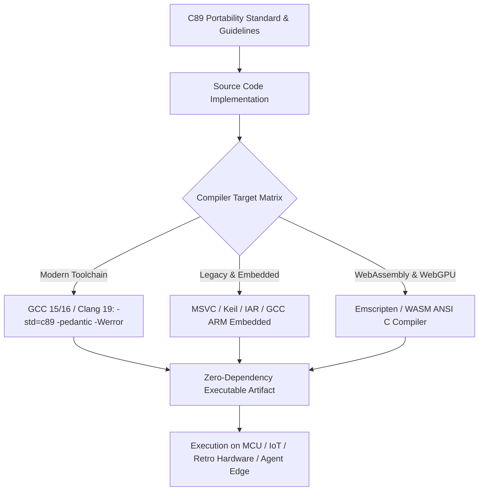
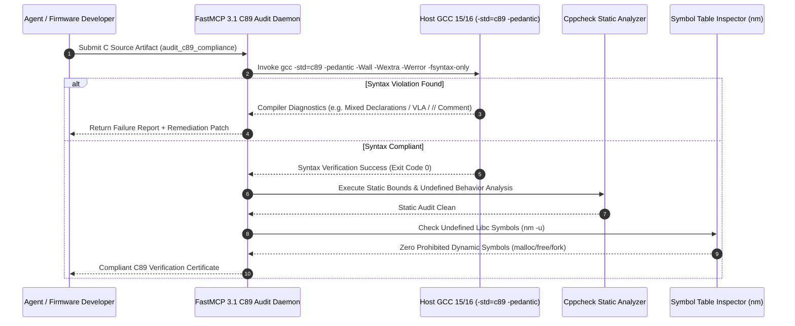

# C89 Portability Guide

## What it is

The C89 Portability Guide is an operational engineering standard, coding reference, and best-practices rulebook for building zero-dependency, ultra-portable software in ANSI C (C89 / ISO C90). It defines compiler-agnostic conventions, memory allocation constraints, pointer safety rules, and type abstraction patterns required to guarantee that C source code compiles cleanly across legacy embedded microcontrollers, retro computing hardware, modern RTOS environments, and modern toolchains like GCC 15/16, Clang 19, and MSVC.

By enforcing strict adherence to the ISO/IEC 9899:1990 standard without compiler-specific extensions, the C89 Portability Guide enables developers to build core algorithms—such as edge AI inference runtimes, mathematical linear algebra engines, and communication protocol parsers—that execute identically across heterogeneous CPU architectures without external dependencies.

## Architecture & Compilation Pipeline



```
+-----------------------------------------------------------------------------------+
|                            C89 COMPILATION & AUDIT PIPELINE                       |
+-----------------------------------------------------------------------------------+
|                                                                                   |
|  +--------------------+      +----------------------+      +--------------------+ |
|  | C89 Source File    | ---> | FastMCP 3.1 Audit    | ---> | Strict GCC/Clang   | |
|  | (*.c, *.h)         |      | Verification Tool    |      | Syntax Verification| |
|  +--------------------+      +----------------------+      +--------------------+ |
|                                                                      |            |
|                                                                      v            |
|  +--------------------+      +----------------------+      +--------------------+ |
|  | Bare-Metal Target  | <--- | Zero-Dependency NM   | <--- | Cppcheck Static    | |
|  | / MCU Binary       |      | Symbol Audit         |      | Analyzer           | |
|  +--------------------+      +----------------------+      +--------------------+ |
|                                                                                   |
+-----------------------------------------------------------------------------------+
```



## Mathematical Foundations & Memory Footprint Bounds

In safety-critical embedded systems and bare-metal environments, runtime predictability requires formal deterministic guarantees on stack memory usage, pointer memory alignment, and execution complexity.

### 1. Deterministic Stack Space Upper Bound
Because C89 disallows dynamic variable-length arrays (VLAs) and embedded profiles prohibit dynamic heap allocation (`malloc`), the total stack allocation $\mathcal{S}_{\text{max}}$ for a call tree of depth $D$ is strictly bounded:

$$
\mathcal{S}_{\text{max}} = \sum_{d=0}^{D} \left( \sum_{i=1}^{V_d} \text{sizeof}(v_{d,i}) + \mathcal{P}_{\text{align}}(d) + \mathcal{F}_{\text{frame}} \right) \le \mathcal{S}_{\text{limit}}
$$

Where:
- $V_d$ represents the count of declared local variables in function frame $d$.
- $\mathcal{P}_{\text{align}}(d)$ is architecture-specific stack alignment padding (typically 4 or 8 bytes).
- $\mathcal{F}_{\text{frame}}$ is the return address and saved frame pointer overhead.
- $\mathcal{S}_{\text{limit}}$ is the physical microcontroller SRAM stack boundary (e.g., 8 KB or 32 KB).

### 2. Pointer Memory Alignment Invariance
On RISC architectures (e.g., ARM Cortex-M0/M3, RISC-V RV32I, MIPS32), accessing unaligned multi-byte primitives results in immediate hardware hard faults. Memory alignment for any base pointer $p$ and struct field offset $\delta_k$ must satisfy:

$$
(p + \delta_k) \pmod{\text{alignof}(T_k)} \equiv 0, \quad \forall k \in \{1, \dots, K\}
$$

Struct padding bytes $\Lambda_{\text{pad}}$ within a C89 struct definition are explicitly calculated as:

$$
\Lambda_{\text{pad}}(k) = \left( \text{alignof}(T_{k+1}) - \left( ( \delta_k + \text{sizeof}(T_k) ) \pmod{\text{alignof}(T_{k+1})} \right) \right) \pmod{\text{alignof}(T_{k+1})}
$$

Ordering struct members by descending alignment size ($\text{alignof}(T_1) \ge \text{alignof}(T_2) \ge \dots$) guarantees $\sum \Lambda_{\text{pad}} \to 0$.

### 3. Big-O Complexity and Inference Latency Rooflines
For matrix operations in edge neural network engines (e.g., [AnsIGPT](../ai_knowledge/ansigpt.md)), dense matrix-vector multiplication $y = W x$ with $W \in \mathbb{R}^{M \times N}$ executes in exact deterministic time:

$$
T_{\text{matmul}} = M \cdot N \cdot ( \tau_{\text{load}} + \tau_{\text{fma}} ) + M \cdot \tau_{\text{store}}
$$

Without dynamic cache misses or OS thread context switches, execution jitter $\sigma(T_{\text{matmul}}) \to 0$, providing hard real-time latency determinism.

## What problem it solves

Modern C and C++ codebases frequently rely on C99 or C11 features (such as inline variable declarations inside `for` loops, variable-length arrays, single-line `//` comments, atomic primitives, and complex `<stdint.h>` header dependencies) or POSIX operating system calls. When compiling code for resource-constrained microcontrollers, specialized DSPs, legacy industrial controllers, or proprietary embedded toolchains, these modern language features trigger compilation errors or mandate heavy runtime libraries.

The C89 Portability Guide eliminates these pain points by restricting language features to the universal baseline supported by virtually every C compiler developed since 1989. This ensures deterministic compilation, zero hidden runtime overhead, fixed memory layouts, and long-term source code preservation across decades of technological shifts.

## Where it fits in the stack

**Development & Ops / Standards & Conventions**. The C89 Portability Guide operates as a foundational software engineering standard in the Development & Ops stack, providing the operational blueprints for zero-dependency inference runtimes like [AnsIGPT](../ai_knowledge/ansigpt.md) and low-level embedded utilities.

## Language Dialect & Standards Comparison Matrix

| Feature / Standard | ANSI C (C89 / ISO C90) | ISO C99 | ISO C11 | ISO C23 | Embedded C (TR 18037) |
| :--- | :--- | :--- | :--- | :--- | :--- |
| **Year Standardized** | 1989 / 1990 | 1999 | 2011 | 2024 | 2008 |
| **Variable Declarations** | Scope entry block start only | Mixed anywhere in block | Mixed anywhere in block | Mixed anywhere in block | Scope entry block start |
| **Single-Line `//` Comments**| Prohibited (triggers warning) | Supported | Supported | Supported | Toolchain dependent |
| **Variable-Length Arrays**| Prohibited | Mandatory (later optional)| Optional (`__STDC_NO_VLA__`)| Optional | Prohibited |
| **Native `<stdint.h>`** | Unavailable (use typedefs) | Standardized | Standardized | Standardized | Standardized |
| **Inline Functions (`inline`)**| Prohibited (compiler specific)| Supported | Supported | Supported | Supported |
| **Binary Literals (`0b...`)** | Prohibited | Prohibited | Prohibited | Standardized | Toolchain extension |
| **Embedded Compiler Reach**| **100% of all C compilers** | ~92% of compilers | ~75% of compilers | ~35% of compilers | Specialized DSP/MCU only |

## Typical use cases

- **Zero-Dependency Edge AI Runtimes**: Implementing lightweight neural network inference engines (such as [AnsIGPT](../ai_knowledge/ansigpt.md) or custom quantized tensor utilities) that execute directly on bare-metal microcontrollers without OS support.
- **Cross-Platform Math & Cryptography Libraries**: Developing core linear algebra, hashing, or data compression algorithms that must build cleanly across Windows, Linux, macOS, Android, iOS, and embedded RTOS systems.
- **Legacy Industrial Hardware Maintenance**: Writing or refactoring portable utility binaries for older architecture families (MIPS, ARM Cortex-M0/M3, PowerPC, SuperH) where modern Python or C++20 standard runtimes are unavailable.
- **Safety-Critical Sandboxing**: Creating deterministic memory management routines that avoid dynamic `malloc`/`free` heap fragmentation and undefined pointer behavior in automotive or aerospace firmware.

## Strengths

- **Universal Compiler Support**: Source code compiles without modification on virtually any C compiler created in the past 35+ years.
- **Zero Hidden Overhead**: Guarantees no runtime initialization code, garbage collection pauses, or hidden heap allocation overhead.
- **Deterministic Memory Footprint**: Mandates explicit static buffer allocation and explicit struct padding, ensuring predictable RAM usage on microcontrollers.
- **Maximum Longevity**: Code written to strict C89 standards remains valid and maintainable without syntax deprecation risks over decades.
- **Simplified Auditability**: Straightforward language mechanics simplify manual code inspection, formal mathematical verification, and security auditing.

## Limitations

- **Syntax Verbosity**: Demands that all variable declarations occur at the beginning of a code block (prior to executable statements) and disallows C99 single-line `//` comments.
- **No Native Fixed-Width Types**: Standard C89 lacks `<stdint.h>` types (`int32_t`, `uint8_t`), requiring explicit custom `typedef` header abstractions.
- **Manual Pointer Arithmetic**: Lacks modern high-level abstractions, requiring explicit bounds checking and careful array index management.
- **No Built-In Concurrency**: Standard C89 does not define threading or atomic memory primitives; concurrency must be handled via platform-specific wrappers.

## When to use it

- When implementing low-level embedded firmware, bare-metal IoT runtimes, or edge AI execution engines.
- When writing core mathematical or cryptographic algorithms that must compile natively across heterogeneous operating systems and architectures.
- When long-term software preservation, zero external runtime dependencies, and toolchain independence are primary project requirements.
- When targeting specialized or legacy compiler toolchains that lack full C99 or C11 support.

## When not to use it

- For high-level web backends, database orchestrators, or agent workflow scripts where Python or TypeScript offer significantly higher developer productivity.
- When developing modern GPU-accelerated high-performance computing software where CUDA, C++20, or Rust are required.
- When modern standard library abstractions or POSIX features (such as native thread pools or async I/O) are strictly necessary.

## Getting started

### Standard C89 Compilation Flags
To enforce strict ISO C89 portability during build execution, configure compiler flags across your target toolchains:

```bash
# GCC 15/16 strict C89 verification flags
gcc -std=c89 -pedantic -Wall -Wextra -Werror -Wno-long-long main.c -o app

# Clang 19 strict C89 build
clang -std=c89 -pedantic -Wall -Wextra -Werror main.c -o app
```

### Portable Fixed-Width Types Header Pattern
Create a portable `c89_types.h` header to abstract fixed-width integers across modern and legacy compilers:

```c
#ifndef C89_TYPES_H
#define C89_TYPES_H

/* Portable Fixed-Width Types for C89/C90 */
#if defined(__STDC_VERSION__) && __STDC_VERSION__ >= 199901L
  #include <stdint.h>
  typedef uint8_t   u8;
  typedef int8_t    i8;
  typedef uint16_t  u16;
  typedef int16_t   i16;
  typedef uint32_t  u32;
  typedef int32_t   i32;
#else
  typedef unsigned char      u8;
  typedef signed char        i8;
  typedef unsigned short     u16;
  typedef signed short       i16;
  typedef unsigned long      u32;
  typedef signed long        i32;
#endif

typedef float  f32;
typedef double f64;

#endif /* C89_TYPES_H */
```

## CLI examples

Auditing source files for C89 compliance and symbol dependencies:

```bash
# Verify C89 syntax compliance using GCC pedantic check
gcc -std=c89 -pedantic -fsyntax-only src/tensor_math.c

# Inspect symbol table of object file to ensure zero unwanted libc dependencies
nm -u tensor_math.o

# Run cppcheck static analyzer with C89 standard flag
cppcheck --std=c89 --enable=all --suppress=missingIncludeSystem src/

# Check stack frame sizing with GCC flag
gcc -std=c89 -Wstack-usage=4096 -c src/tensor_math.c -o tensor_math.o
```

## API examples

### Portable C89 Matrix Multiplication Engine
The following C89 source code demonstrates a fully compliant matrix multiplication routine where all variable declarations are placed at block scope entry:

```c
#include <stdio.h>
#include "c89_types.h"

/* Self-contained, C89-compliant floating-point matrix multiplication */
void c89_matmul(const f32 *A, const f32 *B, f32 *C, int M, int N, int K) {
    int i, j, k;
    f32 sum;

    /* C89 requires all variable declarations at the start of the block */
    for (i = 0; i < M; ++i) {
        for (j = 0; j < N; ++j) {
            sum = 0.0f;
            for (k = 0; k < K; ++k) {
                sum += A[i * K + k] * B[k * N + j];
            }
            C[i * N + j] = sum;
        }
    }
}
```

### FastMCP 3.1 Tool Server for C89 Code Verification
The following Python script defines a **FastMCP 3.1** server that wraps compiler verification commands to validate C89 compliance automatically during agentic code generation loops using strict Pydantic v2 schemas (`extra="forbid"`, `frozen=True`):

```python
"""FastMCP 3.1 Server for C89 ANSI standard code compliance verification."""

import subprocess
import tempfile
import os
from typing import List, Dict, Any, Optional
from fastmcp import FastMCP
from pydantic import BaseModel, ConfigDict, Field

# Initialize FastMCP Server for C89 auditing
mcp = FastMCP("c89-code-audit-gateway", version="3.1.0")

class AuditRequest(BaseModel):
    model_config = ConfigDict(extra="forbid", frozen=True)

    code_snippet: str = Field(..., min_length=10, description="C source code snippet to audit")
    compiler_flags: str = Field("-std=c89 -pedantic -Wall -Wextra -Werror", description="Compiler verification flags")
    target_architecture: str = Field("x86_64", description="Target compilation architecture")

class SymbolAuditRequest(BaseModel):
    model_config = ConfigDict(extra="forbid", frozen=True)

    object_file_path: str = Field(..., description="Path to compiled .o binary object")
    disallowed_symbols: List[str] = Field(
        default_factory=lambda: ["malloc", "free", "realloc", "fork", "pthread_create"],
        description="Symbols prohibited in zero-dependency embedded targets"
    )

class AuditResult(BaseModel):
    model_config = ConfigDict(extra="forbid", frozen=True)

    is_compliant: bool
    compiler_output: str
    violations: List[str] = Field(default_factory=list)

@mcp.tool()
def audit_c89_compliance(request: AuditRequest) -> Dict[str, Any]:
    """Compile-check C source snippet for strict ISO C89 compliance using GCC."""
    with tempfile.NamedTemporaryFile(suffix=".c", mode="w", delete=False) as fp:
        fp.write(request.code_snippet)
        temp_file = fp.name

    try:
        cmd = f"gcc {request.compiler_flags} -fsyntax-only {temp_file}"
        res = subprocess.run(cmd, shell=True, capture_output=True, text=True, timeout=10)

        violations = []
        if res.returncode != 0:
            for line in res.stderr.splitlines():
                if "error:" in line or "warning:" in line:
                    violations.append(line.strip())

        result = AuditResult(
            is_compliant=(res.returncode == 0),
            compiler_output=res.stderr if res.stderr else "C89 Syntax Audit Passed Successfully.",
            violations=violations
        )
        return result.model_dump()
    finally:
        if os.path.exists(temp_file):
            os.remove(temp_file)

@mcp.tool()
def audit_object_symbols(request: SymbolAuditRequest) -> Dict[str, Any]:
    """Inspects compiled ELF object file using nm to guarantee zero disallowed dynamic symbols."""
    if not os.path.exists(request.object_file_path):
        return {"is_compliant": False, "error": f"Object file {request.object_file_path} not found"}

    try:
        res = subprocess.run(["nm", "-u", request.object_file_path], capture_output=True, text=True, timeout=5)
        undefined_symbols = [line.strip().split()[-1] for line in res.stdout.splitlines() if line.strip()]
        detected_violations = [s for s in undefined_symbols if s in request.disallowed_symbols]

        return {
            "is_compliant": len(detected_violations) == 0,
            "detected_prohibited_symbols": detected_violations,
            "total_undefined_symbols": len(undefined_symbols)
        }
    except Exception as exc:
        return {"is_compliant": False, "error": str(exc)}

if __name__ == "__main__":
    mcp.run()
```

### Python: Toolchain Config Validation with Strict Pydantic v2
Use strict **Pydantic v2** validation to model compiler options for code generator scripts targeting embedded C89 targets:

```python
from typing import Literal, List
from pydantic import BaseModel, ConfigDict, Field, field_validator

class C89BuildOptions(BaseModel):
    model_config = ConfigDict(extra="forbid", frozen=True)

    compiler_std: Literal["c89", "c90", "ansi"] = Field("c89", description="Target C standard dialect")
    pedantic_warnings: bool = Field(True, description="Enable strict ISO standard warnings")
    allow_dynamic_alloc: bool = Field(False, description="Disallow malloc/free for deterministic memory")
    optimization_level: Literal["-O0", "-O1", "-O2", "-O3", "-Os"] = Field("-O3")
    target_arch: str = Field("cortex-m0", description="Target architecture family")
    defined_macros: List[str] = Field(default_factory=lambda: ["NDEBUG", "C89_PORTABLE_BUILD"])

    @field_validator("target_arch")
    @classmethod
    def validate_architecture(cls, v: str) -> str:
        allowed = {"cortex-m0", "cortex-m3", "riscv32", "x86_64", "mips32"}
        if v.lower() not in allowed:
            raise ValueError(f"Architecture {v} not in tested target set: {allowed}")
        return v.lower()

# Validate build configuration
config = C89BuildOptions(
    compiler_std="c89",
    pedantic_warnings=True,
    allow_dynamic_alloc=False,
    optimization_level="-O3",
    target_arch="cortex-m0"
)

print(f"Validated C89 Build Options: Target={config.target_arch}, Dialect={config.compiler_std}, Pedantic={config.pedantic_warnings}")
```

## Production Deployment & System Infrastructure

### Production Systemd Service Unit (`c89-audit.service`)
Below is an operational systemd service configuration for running an automated C89 continuous auditing daemon that monitors source files and verifies strict ANSI compliance:

```ini
[Unit]
Description=C89 Code Audit Continuous Verification Daemon
After=network.target remote-fs.target
Wants=network-online.target

[Service]
Type=simple
User=c89audit
Group=c89audit
WorkingDirectory=/opt/c89-audit
ExecStart=/usr/bin/python3 -m fastmcp run server.py --port 8089
Restart=always
RestartSec=5s
Environment="PYTHONUNBUFFERED=1"
Environment="GCC_PATH=/usr/bin/gcc"
Environment="FASTMCP_PORT=8089"
LimitNOFILE=65536
CapabilityBoundingSet=CAP_NET_BIND_SERVICE
NoNewPrivileges=true
ProtectSystem=full
ProtectHome=true
PrivateTmp=true

[Install]
WantedBy=multi-user.target
```

### Production Multi-Arch Docker Compose Stack (`docker-compose.yml`)
Run isolated multi-target compilation containers for ARM embedded and x86 toolchain verification:

```yaml
version: "3.8"

services:
  c89-audit-daemon:
    image: c89-audit-daemon:3.1.0
    container_name: c89-audit-daemon
    restart: unless-stopped
    ports:
      - "127.0.0.1:8089:8089"
    environment:
      - FASTMCP_PORT=8089
      - LOG_LEVEL=INFO
    volumes:
      - ./src:/workspace/src:ro
    healthcheck:
      test: ["CMD", "curl", "-f", "http://localhost:8089/healthz"]
      interval: 20s
      timeout: 5s
      retries: 3
    logging:
      driver: "json-file"
      options:
        max-size: "10m"
        max-file: "3"
    networks:
      - c89_net

networks:
  c89_net:
    driver: bridge
```

## Diagnostic & Troubleshooting Matrix

| Issue / Error Symptom | Common Root Cause | Compiler Flag / Error Code | Remediation & Diagnostic Action Plan |
| :--- | :--- | :--- | :--- |
| `error: 'for' loop initial declarations are only allowed in C99 or C11 mode` | Variable declared inside loop header (e.g. `for (int i = 0...)`). | `GCC -std=c89` | Declare loop iterator `int i;` at top of function block. |
| `warning: C++ style comments are not allowed in ISO C90` | Single-line `//` comment used in source file. | `GCC -pedantic` | Convert all single-line comments to block comments `/* ... */`. |
| `error: ISO C90 forbids mixed declarations and code` | Variable declared after an executable assignment or function call. | `GCC -Wdeclaration-after-statement` | Move all variable declarations to the top of the enclosing block scope `{}`. |
| `undefined reference to 'uint32_t'` | Inclusion of `<stdint.h>` on legacy pre-C99 toolchain. | `Linker error` | Include portable `c89_types.h` abstraction header instead of system `<stdint.h>`. |
| `warning: implicit declaration of function` | Function used prior to header prototype or declaration. | `GCC -Wimplicit-function-declaration` | Add forward function declaration or include target header file. |
| `error: variable length array in C89` | Array sized dynamically at runtime (e.g. `float buf[n];`). | `GCC -Wvla` | Use fixed static upper-bound array sizing or explicit memory buffers. |
| `warning: alignment of struct 'T' is greater than maximum object alignment` | Struct contains mixed large primitives causing misaligned padding | `GCC -Wpadded` | Order struct members by decreasing primitive size (u64 -> u32 -> u16 -> u8). |
| `undefined reference to '__udivdi3'` | 64-bit integer division on 32-bit architecture without libgcc helper | `Linker unresolved symbol` | Emulate 64-bit division using shift algorithms or restrict math to native 32-bit integers. |

## Operational Security & Coding Guardrails

1. **Strict Variable Scope Isolation**: Always declare all local variables at the beginning of the function or compound block scope prior to any executable code.
2. **Comment Syntax Standardization**: Never use `//` single-line C99/C++ comments. Always encapsulate comments within `/* ... */` blocks.
3. **Avoid Dynamic Memory Allocation**: Avoid `malloc()` and `free()` in embedded C89 targets to prevent heap fragmentation and memory leaks; prefer statically sized buffers or caller-provided array pointers.
4. **No Variable Length Arrays (VLAs)**: Use fixed array dimensions known at compile-time or stack buffers initialized with compile-time constants.
5. **Pointer Alignment & Casting Guardrails**: Avoid unsafe pointer casting across struct types that violate architecture alignment rules (e.g. casting unaligned `u8*` to `u32*`).
6. **Defensive Pointer Nullity Checks**: Enforce immediate assertions or error return codes on function entry whenever pointers are accepted from foreign modules.

## Related tools / concepts

- [AnsIGPT](../ai_knowledge/ansigpt.md) — Portable C89 implementation of MicroGPT.
- [MicroGPT](../ai_knowledge/microgpt.md) — Educational GPT implementation serving as baseline.
- [Ripgrep](ripgrep.md) — High-performance CLI search utility.
- [Claude Code](claude-code.md) — Terminal-based AI agent for code modification.
- [GNU Make](../automation_orchestration/gnu-make.md) — Classic build automation tool.
- [Docker](../infrastructure/docker.md) — Containerization tool for multi-arch toolchains.
- [Python](../ai_knowledge/python.md) — Scripting language for code generation and verification.

## Sources / references

- [ANSI C Standard Specification (ISO/IEC 9899:1990)](https://www.iso.org/standard/17782.html)
- [GCC Dialect Options Documentation](https://gcc.gnu.org/onlinedocs/gcc/C-Dialect-Options.html)
- [MISRA C:2012 Guidelines for the use of the C language in critical systems](https://misra.org.uk/)
- [SEI CERT C Coding Standard](https://wiki.sei.cmu.edu/confluence/display/c/SEI+CERT+C+Coding+Standard)

---
## Contribution Metadata

- Last reviewed: 2027-01-07
- Confidence: high
