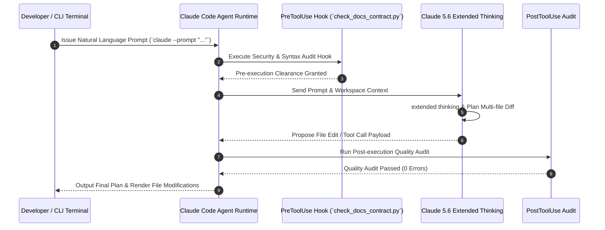

# Claude Code — Project Setup Guide

## What it is
A reproducible setup, environment blueprint, and workspace execution specification for the Anthropic Claude Code CLI environment in production engineering repos. It defines the workspace orchestration layer where **Claude 5.6** (`claude-5-6-20270105`) and hybrid multi-model agent systems operate. This includes global skill definitions, official and custom plugins, **FastMCP 3.1** Model Context Protocol server configurations, and repository lifecycle hooks (`.claude/settings.json`).

Rather than relying on uncommitted, workstation-specific setups, this guide specifies how to configure reproducible, containerized, or local developer workspaces where agentic execution is strictly governed by automated verification hooks, permission policies, and FastMCP tool boundaries.

---

## System Architecture

```mermaid
graph TD
    SubGraph_User[Developer Environment / Container Sandbox]
        CLI[Claude Code CLI Tool - `@anthropic/claude-code`]
        Config[Project Settings - `.claude/settings.json`]
        Auth[OAuth Token & API Key Store]
    end

    SubGraph_Hooks[Lifecycle Verification Hooks]
        PreHook[preToolUse Guardrail - Security & Syntax Audit]
        PostHook[postToolUse Guardrail - Contract & Quality Audit]
        Subshell[Subshell Bash Execution Sandbox]
    end

    SubGraph_Tools[Tool & Protocol Layer]
        FastMCP[FastMCP 3.1 Client Engine]
        Plugins[Claude Plugins - GitHub, Playwright, Security]
        FileSystem[Workspace Filesystem & Git Buffer]
    end

    SubGraph_Models[Cloud Reasoning Services]
        Claude5[Claude 5.6 Extended Reasoning Engine]
        Router[Claude Code Router - Hybrid Multi-Model Dispatch]
    end

    CLI --> Config
    CLI --> Auth
    CLI --> FastMCP
    CLI --> PreHook
    PreHook --> Subshell
    CLI --> FileSystem
    FileSystem --> PostHook
    PostHook --> Subshell
    FastMCP --> Plugins
    CLI --> Router
    Router --> Claude5
```

### Claude Code Workspace Execution Sequence



---

## Mathematical Formulation: Dynamic Context Budgeting & Cost-Utility Optimization

During multi-turn autonomous CLI development, context window consumption expands monotonically with tool execution outputs, AST fragments, and shell traces.

Let $C_{\text{max}}$ be the maximum context window of Claude 5.6 (e.g., $200\text{k}$ or $1\text{M}$ tokens). At turn $t$, total accumulated context tokens $K_t$ is:

$$
K_t = K_{\text{system}} + K_{\text{tools}} + \sum_{i=1}^t \left( K_{\text{prompt}}^{(i)} + K_{\text{thinking}}^{(i)} + K_{\text{completion}}^{(i)} + K_{\text{tool\_res}}^{(i)} \right)
$$

Where $K_{\text{thinking}}$ denotes internal extended thinking tokens. To prevent out-of-context overflows while preserving architectural fidelity, Claude Code optimizes the token retention utility function $\mathcal{U}$:

$$
\max_{\{x_j\}} \sum_{j=1}^M u_j x_j \quad \text{subject to} \quad \sum_{j=1}^M \ell_j x_j \le C_{\text{budget}}
$$

Where $x_j \in \{0, 1\}$ indicates whether historical context block $j$ is retained in active memory, $\ell_j$ is its token length, and utility weight $u_j$ is formulated as an exponential recency and relevance decay:

$$
u_j = \exp\left(-\lambda \cdot (t - t_j)\right) \times \left( \alpha \cdot \text{Sim}(q_t, d_j) + \beta \cdot \mathbb{I}(\text{is\_modified\_file}(d_j)) \right)
$$

With decay rate $\lambda > 0$, cosine relevance $\text{Sim}$, and priority indicator $\mathbb{I}$. The total session cost $\mathcal{S}_{\text{cost}}$ across $N$ execution turns is bounded by:

$$
\mathcal{S}_{\text{cost}} = \sum_{t=1}^N \left( K_t^{\text{input}} \cdot P_{\text{input}} + K_t^{\text{thinking}} \cdot P_{\text{thinking}} + K_t^{\text{output}} \cdot P_{\text{output}} \right)
$$

By configuring automated file compaction hooks in `.claude/settings.json`, token pruning maintains $K_t \le 0.70 \times C_{\text{max}}$, preventing cache thrashing.

---

## What problem it solves
Claude Code's autonomous file editing, shell command execution, and multi-step reasoning capabilities rely heavily on project-level configurations, custom tools, and strict execution guardrails:
1. **"Works on My Machine" Divergence**: Solves environment drift by storing project settings, hook scripts, and plugin lists directly inside Git version control (`.claude/settings.json`).
2. **Ungoverned Tool Execution**: Prevents accidental destructive commands or invalid code edits by intercepting tool calls using `preToolUse` and `postToolUse` lifecycle hooks.
3. **Context Isolation**: Bridges external documentation systems, local database schemas, and pull request management platforms into Claude Code sessions via **FastMCP 3.1** servers.
4. **Token & Permission Management**: Establishes transparent token budgeting (`/usage`) and explicit permission prompts for destructive system actions.

---

## Feature Matrix & CLI Workspace Comparison

| Feature / Metric | Claude Code CLI | Cursor Composer | Aider Terminal | OpenHands CLI | Goose CLI |
| :--- | :--- | :--- | :--- | :--- | :--- |
| **Primary Focus** | Autonomous CLI Development | Graphical IDE Agent | Terminal Pair Programmer | Full-repo Docker Agent | Desktop Tool Runner |
| **Model Engine** | Claude 5.6 / Extended Thinking | Claude 5.6 / GPT-5.6 | Claude 5.6 / GPT-5.5 | Multi-model / Sandboxed | Any LLM / Local |
| **FastMCP 3.1 Integration** | Native First-Class Client | Internal Extensions | Custom Hooks | Custom Tools | Native MCP Client |
| **Lifecycle Hooks** | Native `preToolUse` & `postToolUse` | IDE Event Hooks | Git Commit Hooks | Agent loop hooks | None |
| **Versioned Workspace Config** | `.claude/settings.json` | `.cursor/rules` | `.aider.conf.yml` | Repo config | Global config |
| **Background Headless Mode** | Yes (`--headless`) | No | Yes | Yes (Docker web) | Yes (CLI daemon) |

---

## Where it fits in the stack
**Development & Ops / Tooling Configuration & Execution Environment**. It acts as the local or containerized workbench for [Agentic Workflows](../../knowledge_base/patterns/agentic-workflows.md), linking high-reasoning models (**Claude 5.6**) to shell commands, git operations, and local filesystems under strict security boundaries.

---

## Typical use cases
- **Developer Onboarding**: Bootstrapping new team workstations or ephemeral devcontainers with identical Claude Code skills, tools, and hooks in under 2 minutes.
- **Automated Quality Enforcement**: Executing real-time syntax checking (`check_docs_contract.py` or `pytest`) automatically whenever Claude Code writes or edits a file.
- **FastMCP 3.1 Context Extension**: Connecting local database replicas or documentation engines (Context7) to Claude Code's memory loop.
- **Agentic CI/CD Simulation**: Running headless non-interactive Claude Code tasks inside GitHub Actions or local bash scripts (`claude --prompt "..."`).

---

## Strengths
- **Fully Version-Controlled Workspaces**: Keeps workspace settings (`.claude/settings.json`) committed alongside application source code.
- **Real-Time Hook Execution**: Executes `preToolUse` and `postToolUse` hooks before and after tool calls, enforcing instant verification.
- **FastMCP 3.1 First-Class Integration**: Seamlessly discovers, mounts, and executes Model Context Protocol context servers.
- **Frontier extended thinking**: Leverages Claude 5.6's extended thinking and multi-step plan generation natively in the CLI shell.
- **Zero-Trust Permission Model**: Requires explicit user consent before executing destructive system calls or modifying sensitive files.

---

## Limitations
- **Interactive Initial Auth**: Initial authentication (`claude auth login`) requires interactive OAuth authentication via browser or web callback.
- **Host Binary Dependencies**: Relies on host system binaries (e.g., Node.js v20+, Python uv/pip, Git) being present in the user's `$PATH`.
- **Shell Cross-Compatibility**: Complex bash hook scripts must be carefully formatted to support both Linux (Bash) and macOS (Zsh/Bash) environments.

---

## Production Devcontainer & Headless Orchestration (`docker-compose.yml`)

The following Compose specification defines an isolated devcontainer environment for headless Claude Code execution with mounted git sockets and FastMCP tool servers:

```yaml
version: "3.8"

services:
  claude-devcontainer:
    image: node:20-bookworm
    container_name: claude-code-devcontainer
    restart: unless-stopped
    working_dir: /workspace
    environment:
      - NODE_ENV=development
      - CLAUDE_CONFIG_DIR=/workspace/.claude
      - FASTMCP_BRIDGE_HOST=claude-mcp-bridge
      - FASTMCP_BRIDGE_PORT=9099
      - ANTHROPIC_API_KEY=${ANTHROPIC_API_KEY}
    volumes:
      - .:/workspace:rw
      - claude_auth_volume:/root/.claude
      - /var/run/docker.sock:/var/run/docker.sock:ro
    ports:
      - "9099:9099"
    command: >
      bash -c "npm install -g @anthropic/claude-code && tail -f /dev/null"
    depends_on:
      - claude-mcp-bridge

  claude-mcp-bridge:
    image: python:3.11-slim
    container_name: claude-mcp-bridge
    restart: unless-stopped
    working_dir: /workspace
    environment:
      - FASTMCP_PORT=9099
    volumes:
      - .:/workspace:ro
    command: >
      bash -c "pip install fastmcp>=3.1.0 pydantic>=2.0 && python3 scripts/claude_mcp_bridge.py"

volumes:
  claude_auth_volume:
```

---

## Systemd Service Unit for Claude Code Headless Runner

When executing headless Claude Code background tasks on local server nodes:

```ini
[Unit]
Description=Claude Code Headless Execution Daemon & MCP Bridge
After=network.target local-fs.target
Wants=network-online.target

[Service]
Type=simple
User=claude-runner
Group=claude-runner
WorkingDirectory=/opt/claude-workspace
ExecStart=/usr/local/bin/claude --headless --settings /opt/claude-workspace/.claude/settings.json
Restart=always
RestartSec=5s
Environment=NODE_ENV=production
Environment=FASTMCP_LOG_LEVEL=INFO
Environment=PYTHONUNBUFFERED=1

# Hardening and Sandboxing
ProtectSystem=strict
ProtectHome=true
PrivateTmp=true
NoNewPrivileges=true
ProtectKernelTunables=true
ProtectControlGroups=true
ReadWritePaths=/opt/claude-workspace /tmp

# Resource Limits
LimitNOFILE=65536
MemoryAccounting=true
MemoryHigh=12G
MemoryMax=16G

[Install]
WantedBy=multi-user.target
```

Reload and initialize the headless service:

```bash
sudo systemctl daemon-reload
sudo systemctl enable --now claude-runner.service
sudo systemctl status claude-runner.service
```

---

## When to use it
- When setting up new developer workstations, sandboxes, or containerized dev-environments for agentic coding.
- When committing project-level settings (`.claude/settings.json`) to standardize AI capabilities across engineering teams.
- When configuring **FastMCP 3.1** servers and safety guardrails for local development.

---

## When not to use it
- For general programmatic API calls inside backend services (use direct Anthropic SDKs or Pydantic AI instead).
- In strictly air-gapped embedded environments without local CLI or shell execution capabilities.

---

## Getting started

### Installation & Dependency Setup
Install the global `@anthropic/claude-code` CLI and verify system dependencies:

```bash
# Global npm installation
npm install -g @anthropic/claude-code

# Install Python environment manager (uv)
pip install uv

# Authenticate Claude Code CLI session
claude auth login
```

### Initial Workspace Verification
Verify the active installation, configuration, and model connectivity:

```bash
# Verify version
claude --version

# Run diagnostic check
claude /doctor

# Non-interactive sanity test prompt
claude --prompt "Verify local environment: list active project files and confirm Git repository state."
```

---

## CLI examples

### 1. Managing Official & Custom Plugins
Install plugins to grant Claude Code domain-specific tools:

```bash
# Install official plugins
claude plugin install github@claude-plugins-official
claude plugin install playwright@claude-plugins-official
claude plugin install security-guidance@claude-plugins-official

# List installed plugins and active versions
claude plugin list
```

### 2. Registering FastMCP 3.1 Context Servers
Mount Model Context Protocol tools into your workspace session:

```bash
# Add GitHub MCP server
claude mcp add github -- npx -y @anthropic-ai/mcp-server-github

# Add Context7 documentation search engine
claude mcp add context7 -- npx -y @upstash/context7-mcp

# Inspect active MCP server connections
claude mcp list
```

### 3. Usage & Token Budget Inspection
Inspect token usage, context limits, and cost estimates:

```bash
# View active session token cost and usage breakdown
claude /usage

# Export workspace status to JSON
claude status --json
```

---

## API examples

### FastMCP 3.1 Python Integration for Claude Code with Strict Pydantic v2
Claude Code can interact directly with custom local FastMCP 3.1 servers. Below is a complete Python FastMCP server script (`scripts/claude_mcp_bridge.py`) that exposes project health checks and syntax auditing tools to Claude Code sessions:

```python
from fastmcp import FastMCP
from pydantic import BaseModel, ConfigDict, Field
import os
import subprocess

mcp = FastMCP("ClaudeCodeWorkspaceBridge", version="3.1.0")

class AuditRequest(BaseModel):
    model_config = ConfigDict(extra="forbid", frozen=True)

    filepath: str = Field(..., description="Repository-relative path of file to audit")
    enforce_strict: bool = Field(default=True)

class AuditResponse(BaseModel):
    model_config = ConfigDict(extra="forbid", frozen=True)

    filepath: str = Field(description="Target file audited")
    passed: bool = Field(description="Whether the verification check passed")
    exit_code: int = Field(description="Subprocess return code")
    message: str = Field(description="Audit summary output")

@mcp.tool()
def run_project_docs_audit(request: AuditRequest) -> str:
    """Executes the internal documentation contract auditor on a specific file."""
    if not os.path.exists(request.filepath):
        return f"Error: Target file '{request.filepath}' does not exist."

    try:
        result = subprocess.run(
            ["python3", "scripts/check_docs_contract.py", request.filepath],
            capture_output=True,
            text=True,
            timeout=15
        )
        passed = (result.returncode == 0)
        output = result.stdout or result.stderr
        res = AuditResponse(
            filepath=request.filepath,
            passed=passed,
            exit_code=result.returncode,
            message=output.strip()
        )
        return res.model_dump_json()
    except Exception as e:
        return f"Execution error during audit: {str(e)}"

@mcp.tool()
def get_git_status_summary(repo_path: str = ".") -> str:
    """Returns a concise summary of modified and untracked files in the active Git repository."""
    if not os.path.exists(os.path.join(repo_path, ".git")):
        return f"Error: '{repo_path}' is not a valid Git repository root."

    try:
        result = subprocess.run(
            ["git", "status", "--short"],
            cwd=repo_path,
            capture_output=True,
            text=True,
            timeout=10
        )
        changes = result.stdout.strip()
        if not changes:
            return "Git Status: Clean workspace (no uncommitted changes)."
        return f"Git Modified Files Summary:\n{changes}"
    except Exception as e:
        return f"Git query failed: {str(e)}"

if __name__ == "__main__":
    mcp.run()
```

### Validating Project Settings Schema with Strict Pydantic v2
Ensure `.claude/settings.json` project configurations comply with strict Pydantic v2 validation models before committing changes:

```python
from pydantic import BaseModel, ConfigDict, Field, field_validator
from typing import Dict, List, Optional
import json

class HookConfig(BaseModel):
    model_config = ConfigDict(extra="forbid", frozen=True)

    edit: Optional[str] = Field(None, description="Shell command run before or after file edits")
    create: Optional[str] = Field(None, description="Shell command run before or after file creation")

class ClaudeProjectSettings(BaseModel):
    model_config = ConfigDict(extra="forbid", frozen=True, populate_by_name=True)

    preferred_model: str = Field(default="claude-5-6-20270105", alias="preferredModel")
    hooks: Dict[str, HookConfig] = Field(default_factory=dict, description="Pre/Post tool hooks")
    mcp_servers: List[str] = Field(default_factory=list, alias="mcpServers")
    allowed_tools: List[str] = Field(default_factory=list, alias="allowedTools")

    @field_validator("preferred_model")
    @classmethod
    def validate_model_version(cls, v: str) -> str:
        if not v.startswith("claude-5"):
            raise ValueError(f"Project settings require Claude 5 series reasoning model, got '{v}'")
        return v

# Validate sample project configuration payload
raw_settings = {
    "preferredModel": "claude-5-6-20270105",
    "hooks": {
        "preToolUse": {
            "edit": "python3 scripts/security_audit.py {{file}}"
        },
        "postToolUse": {
            "edit": "python3 scripts/check_docs_contract.py {{file}}"
        }
    },
    "mcpServers": ["github", "context7"],
    "allowedTools": ["Bash", "Edit", "Write", "GlobTool"]
}

config = ClaudeProjectSettings.model_validate(raw_settings)
print(f"Validated Model: {config.preferred_model}")
print(f"Active Pre-Edit Hook: {config.hooks['preToolUse'].edit}")
```

### Complete Project Hook Configuration (`.claude/settings.json`)
Below is a production `.claude/settings.json` file configuring model selection, FastMCP server list, and automated verification hooks:

```json
{
  "preferredModel": "claude-5-6-20270105",
  "allowedTools": [
    "Bash",
    "Edit",
    "Write",
    "GlobTool",
    "LSTool"
  ],
  "hooks": {
    "preToolUse": {
      "edit": "python3 scripts/check_docs_contract.py {{file}}"
    },
    "postToolUse": {
      "edit": "python3 scripts/audit_docs_quality.py {{file}}"
    }
  },
  "mcpServers": [
    "github",
    "context7",
    "claude-mcp-bridge"
  ]
}
```

---

## Systematic Diagnostic & Troubleshooting Matrix

| Issue / Symptom | Probable Cause | Diagnostic Command | Remediation Action |
| :--- | :--- | :--- | :--- |
| **`preToolUse Hook Hangs`** | Non-terminating bash command in hook definition | `claude /doctor` | Ensure hook scripts specify explicit subshell timeout flags (`timeout 15s`). |
| **`FastMCP Connection Refused`** | Local MCP bridge server not running or port blocked | `claude mcp list` | Verify local FastMCP Python server status and `$PATH` configuration. |
| **`OAuth Authentication Failure`** | Stale session token in `~/.claude/auth.json` | `claude auth login --force` | Force re-authentication and re-issue OAuth token. |
| **`Pydantic Model Error`** | Non-Claude 5 model defined in `settings.json` | `python3 scripts/validate_settings.py` | Update `preferredModel` to `claude-5-6-20270105` in `.claude/settings.json`. |
| **`Git Lock Collision`** | Parallel background agents accessing index file concurrently | `rm -f .git/index.lock` | Enforce sequential commit staging or use separate git worktrees. |
| **`Context Window Thrashing`** | Tool returning raw multi-megabyte binary or log dump | `claude /usage` | Pipe tool output through truncation filters (`head -n 50`). |
| **`PydanticFrozenInstanceError`** | Hook script attempting to mutate validated `AuditResponse` | Review Python traceback logs | Use `response.model_copy(update={...})` instead of direct assignment. |
| **`Permission Denied on Host Hooks`** | Execution bit missing on referenced script | `ls -la scripts/check_docs_contract.py` | Run `chmod +x scripts/check_docs_contract.py` to restore execution rights. |

---

## Related tools / concepts
- [Claude Code Router](./claude-code-router.md) — Multi-model routing engine for Claude Code.
- [FastMCP 3.1](../automation_orchestration/mcp.md) — Standardized tool protocol framework.
- [Agent Protocols](../../knowledge_base/agent_protocols.md) — Specifications for agentic tool execution.
- [Standards & Conventions](../../standards.md) — Workspace coding guidelines.
- [Cursor](./cursor.md) — Alternative AI-native graphical IDE environment.

---

## Sources / references
- [Claude Code Official Documentation](https://docs.anthropic.com/claude-code)
- [Model Context Protocol Specification](https://modelcontextprotocol.io)
- [FastMCP 3.1 Python Framework](https://github.com/jlowin/fastmcp)

---

## Contribution Metadata
- Last reviewed: 2027-01-07
- Confidence: high
