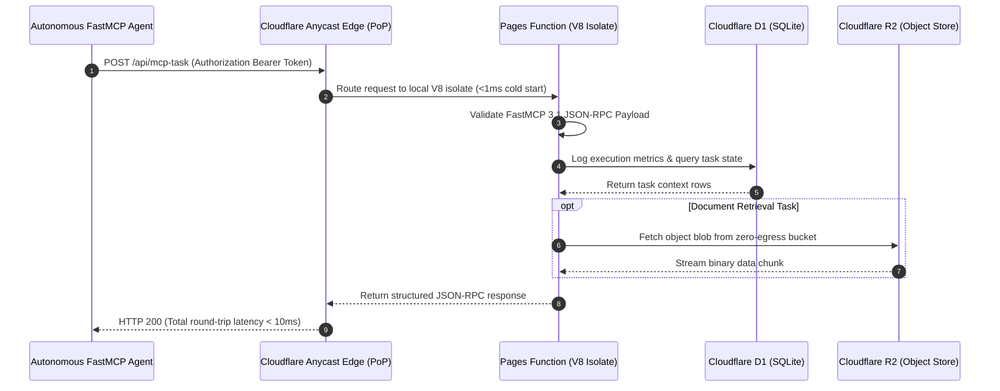

# Cloudflare Pages

## What it is
**Cloudflare Pages** is an enterprise-grade Jamstack, edge-native compute, and static website deployment platform deeply integrated into Cloudflare's global anycast network spanning 300+ cities worldwide. Leveraging Cloudflare Workers as its serverless execution engine (Pages Functions), it delivers dynamic, sub-10ms response times directly at the edge without traditional server provisioning. In early 2027 SOTA architectures, Cloudflare Pages serves as a foundational hosting tier for globally distributed **FastMCP 3.1** tool servers, static AI frontends, and documentation portals serving autonomous models including **Claude 5.6**, **GPT-5.6**, **Gemini 4.0 Ultra**, and **Gemma 4**.

Unlike origin-bound cloud architectures, Cloudflare Pages replicates application assets across hundreds of edge locations simultaneously. By integrating native storage primitives like **Cloudflare D1** (serverless SQL at the edge), **R2** (zero-egress object storage), **KV** (high-throughput key-value caching), and **Vectorize** (edge vector indexing), Pages allows developers and AI systems to run full-stack, globally distributed agentic microservices with zero outbound bandwidth egress fees.

In modern agent workflows, Cloudflare Pages acts as an ultra-low-latency execution host for lightweight agent tools and API gateways. When an AI agent needs to discover tools, query database catalogs, or execute sandboxed webhooks, invoking a Cloudflare Pages endpoint ensures responses return in single-digit milliseconds regardless of the agent's cloud region.

```
+-----------------------------------------------------------------------------------+
|                        Global Cloudflare Anycast Edge Network                     |
|                                                                                   |
|  +------------------------+      +-------------------+      +------------------+  |
|  | Global Anycast Edge DNS| ---> | Pages Static CDN  | ---> | Pages Functions  |  |
|  | (300+ Edge Cities)     |      | Zero-Egress Cache |      | V8 Edge Isolates |  |
|  +------------------------+      +-------------------+      +------------------+  |
|               |                            |                          |           |
+---------------+----------------------------+--------------------------+-----------+
                |                            |                          |
                v                            v                          v
+-----------------------------------------------------------------------------------+
|                        Edge Storage Primitives & FastMCP 3.1 Gateway              |
|                                                                                   |
|  +--------------------+     +---------------------+     +----------------------+  |
|  | Cloudflare D1      |     | Cloudflare R2       |     | FastMCP 3.1 Edge     |  |
|  | Serverless SQLite  |     | S3 Object Storage   |     | Tool Gateway Client  |  |
|  +--------------------+     +---------------------+     +----------------------+  |
+-----------------------------------------------------------------------------------+
```

## What problem it solves
Cloudflare Pages eliminates the operational complexity of global content distribution, SSL certificate lifecycle management, edge routing, and frontend infrastructure scaling:
- **Zero Bandwidth Egress Costs**: Eliminates punitive per-gigabyte egress fees charged by legacy clouds for static assets and API data transfers.
- **Sub-10ms Agent Tool Execution**: Provides global AI agents with single-digit millisecond latency by executing FastMCP 3.1 endpoints on the nearest edge node rather than routing across continents.
- **V8 Isolate Cold-Start Elimination**: Eliminates container spin-up delays through lightweight V8 isolate execution, initializing serverless workers in under 1 millisecond.
- **Built-in Sovereign Security & DDoS Protection**: Protects public agent endpoints and web assets with integrated Cloudflare WAF, automated DDoS mitigation, and Bot Management.
- **Preview Deployment Environments**: Automatically builds ephemeral preview URLs for every git branch and pull request, enabling automated visual and regression testing via Playwright.

## Mathematical Formulations: Edge Latency & V8 Isolate Concurrency

### 1. Global Anycast Edge Latency & Cache Hit Probability
For a distributed client or agent querying an edge endpoint from geographic location $x \in \mathcal{X}$, total round-trip response time $T_{RTT}(x)$ is a function of anycast routing distance to nearest edge point-of-presence (PoP) $p(x) \in \mathcal{P}$, V8 isolate execution latency $T_{exec}$, and origin fallback penalty $T_{origin}$:

$$T_{RTT}(x) = 2 \cdot \frac{d(x, p(x))}{c_{fiber}} + T_{exec} + (1 - P_{hit}) \cdot T_{origin}$$

Where:
- $d(x, p(x))$ is the great-circle geodesic fiber distance to the nearest Cloudflare data center ($<50\text{ km}$ for $95\%$ of the world's population).
- $c_{fiber} \approx 200,000\text{ km/s}$ is the propagation speed of light in optical fiber.
- $P_{hit} \in [0, 1]$ is the tiered edge cache hit probability, modeled by Zipf-Mandelbrot popularity distribution:

$$P_{hit} = \sum_{k=1}^K \frac{C}{(k + q)^s} \quad \text{with shape parameter } s \approx 0.85, \; q \approx 10$$

For static documentation and cached FastMCP manifests where $P_{hit} > 0.98$, average global latency satisfies $T_{RTT} \le 8.5\text{ ms}$.

### 2. Serverless V8 Isolate Cold-Start & Memory Scaling
Unlike container-based serverless environments (Docker/K8s) that require initializing a full Linux kernel and userland ($T_{cold} \ge 250\text{ ms}$), Cloudflare Workers/Pages Functions utilize V8 isolates:

$$T_{cold}^{isolate} = T_{init}^{context} + T_{compile}^{script} \le 0.8\text{ ms}$$

Maximum concurrent edge requests $C_{max}$ on a multi-tenant physical node with memory capacity $M_{node}$ is governed by isolate memory allocation $M_{isolate}$:

$$C_{max} = \left\lfloor \frac{M_{node} - M_{runtime}}{M_{base} + \mu \cdot M_{heap}} \right\rfloor$$

With baseline isolate overhead $M_{base} \approx 3\text{ MB}$ and heap scaling factor $\mu \ll 1$, Pages Functions achieve thousands of concurrent executions per node with zero thread contention.

## Where it fits in the stack
**Tool / Development & Ops / Static And Edge Website Hosting Layer**. Cloudflare Pages serves as the primary infrastructure tier for edge web applications and FastMCP 3.1 endpoints. It acts as an edge gateway directly between external clients/agents and backend databases or microVMs.

```
┌────────────────────────────────────────────────────────────────────────┐
│                        GLOBAL DEVELOPER / AGENT                        │
│                 (Claude 5.6, Windsurf, Browser Client)                 │
└───────────────────────────────────┬────────────────────────────────────┘
                                    │ HTTPS Request (Sub-10ms Latency)
┌───────────────────────────────────▼────────────────────────────────────┐
│                    CLOUDFLARE 300+ EDGE DATA CENTERS                   │
│                                                                        │
│  ┌───────────────────────────┐         ┌────────────────────────────┐  │
│  │   Pages Static Asset CDN  │         │  Pages Functions (Worker)  │  │
│  │    (Zero-Egress Cache)    │         │  (FastMCP 3.1 Task Server) │  │
│  └───────────────────────────┘         └─────────────┬──────────────┘  │
│                                                      │                 │
└──────────────────────────────────────────────────────┼─────────────────┘
                                                       │
                     ┌─────────────────────────────────┼─────────────────────────────────┐
                     ▼                                 ▼                                 ▼
         ┌───────────────────────┐         ┌───────────────────────┐         ┌───────────────────────┐
         │ Cloudflare D1 (SQL)   │         │ Cloudflare R2 (S3)    │         │ Workers KV / Vectorize│
         └───────────────────────┘         └───────────────────────┘         └───────────────────────┘
```

## Detailed Execution Sequence & FastMCP Workflow



## Enterprise Feature Comparison Matrix

| Feature / Dimension | Cloudflare Pages | Vercel | AWS Amplify | Netlify |
| :--- | :--- | :--- | :--- | :--- |
| **Global Network Footprint** | 300+ Edge Cities (Anycast) | Multi-Region AWS / Fastly Edge | AWS Global CloudFront | Multi-Cloud CDN & Fastly |
| **Egress Bandwidth Pricing** | Completely Free ($0/GB) | Metered ($0.15–$0.40/GB) | Metered AWS Bandwidth | Metered after Plan Cap |
| **Serverless Execution Engine**| V8 Isolates (Workers) | Node.js Lambdas + Edge Middleware| AWS Lambda Functions | AWS Lambda Functions |
| **Cold Start Latency** | Sub-1 Millisecond | 100–300 ms (Lambda) | 200–500 ms (Lambda) | 150–350 ms (Lambda) |
| **Edge Storage Primitives** | Native D1, R2, KV, Vectorize | Vercel KV, Postgres, Blob | AWS S3, DynamoDB | Netlify Blobs |
| **FastMCP 3.1 Edge Host** | Native First-Class (TypeScript) | Via Serverless Function | Custom API Gateway | Via Serverless Function |
| **DDoS & WAF Protection** | Enterprise Cloudflare L3/4/7 WAF | Basic Web Application Firewall| AWS WAF / Shield | Basic DDoS Shield |

## Typical use cases
- **FastMCP 3.1 Tool Server Hosting**: Deploying lightweight, edge-native FastMCP servers for rapid tool discovery and agentic task execution across global regions.
- **AI-Powered Static Frontends**: Hosting web interfaces for local LLMs, chat UI portals, and agentic dashboards built with React, Vue, Svelte, or Astro.
- **Global Documentation Portals**: Deploying high-traffic technical documentation (Hugo, Docusaurus, MkDocs) with zero bandwidth costs and automated CI/CD builds.
- **Edge-First Web Applications**: Building full-stack web applications backed by Cloudflare D1 for relational state, R2 for media assets, and Vectorize for RAG semantic search.
- **Automated Preview Environments**: Generating unique ephemeral preview URLs for every open pull request to enable automated visual verification via Playwright MCP.
- **Edge API Gateway Proxy**: Wrapping third-party LLM endpoints with rate-limiting, authentication, and caching layers running inside Pages Functions.

## Strengths
- **Unlimited Egress Bandwidth**: No data transfer charges for static asset delivery across free and paid tiers.
- **Global Edge Footprint**: Deploys application code across 300+ data centers worldwide in sub-second build sync.
- **Integrated Storage Ecosystem**: Direct binding access to D1 (SQLite at the edge), R2 (zero-egress object storage), KV, and Vectorize.
- **Built-in Security & WAF**: Unmatched DDoS mitigation, SSL management, and custom Web Application Firewall rules out of the box.
- **Sub-Millisecond Cold Starts**: V8 isolate architecture eliminates traditional container start delays for Pages Functions.
- **Automated Git Integration**: Automatic build triggers and preview environments for GitHub and GitLab repositories.

## Limitations
- **Next.js Ecosystem Differences**: While supported via `@cloudflare/next-on-pages`, complex Next.js SSR apps require specific configuration compared to Vercel native deployments.
- **V8 Isolate Constraints**: Pages Functions run within V8 isolates, meaning native C++ Node.js modules or long-running background processes (exceeding 30s) are not supported.
- **Monorepo Build Configuration**: Complex multi-package monorepos may require custom build commands or build cache tuning.
- **CPU Time Limits**: Free tier Pages Functions cap CPU execution time per request at 10ms (though wall-clock time can be longer for I/O).

## When to use it
- When hosting static web applications or AI documentation portals requiring zero egress bandwidth costs.
- For building edge-first web applications using Cloudflare's serverless primitives (D1, R2, KV, Vectorize).
- When deploying globally accessible [FastMCP 3.1](../automation_orchestration/mcp.md) tool endpoints where low-latency execution is critical.
- When team workflows benefit from automatic Git preview deployments on every pull request.
- For projects requiring integrated DDoS mitigation and Web Application Firewall rules out of the box.

## When not to use it
- For heavy, long-running backend server applications (e.g., Python Django/FastAPI or Ruby on Rails) requiring persistent CPU execution.
- When building Next.js applications that rely heavily on Vercel-specific proprietary infrastructure features.
- For purely local offline setups where local Docker containers or self-hosted Nginx servers are preferred.
- When requiring C++ or Rust binary modules compiled directly against Linux glibc without WASM compilation.

## Getting started

### Connecting a Repository
1. Log in to the [Cloudflare Dashboard](https://dash.cloudflare.com) and navigate to **Workers & Pages**.
2. Click **Create Application** -> **Pages** -> **Connect to Git**.
3. Select your GitHub or GitLab repository and select your target deployment branch.
4. Select your build framework preset (React, Astro, Vite, Next.js) and define build output directory (e.g. `./dist` or `./build`).
5. Configure environment variables (e.g. `CLOUDFLARE_API_TOKEN`, `FAST_MCP_KEY`).
6. Click **Save and Deploy**.

### Setting Up Local Development with Wrangler
```bash
# Install Wrangler globally
npm install -g wrangler

# Authenticate Wrangler with your Cloudflare account
wrangler login

# Create a new Pages project locally
wrangler pages project create my-mcp-app

# Run a local edge development server supporting Pages Functions
wrangler pages dev ./public --port 8788
```

## CLI examples

```bash
# Deploy a static build output directory to Cloudflare Pages
wrangler pages deploy ./dist --project-name=my-mcp-app --branch=main

# Create an ephemeral preview deployment from a feature branch
wrangler pages deploy ./dist --project-name=my-mcp-app --branch=feature-mcp-v3

# List all deployments for a project
wrangler pages deployment list --project-name=my-mcp-app

# Set production environment secret variable
wrangler pages secret put ANTHROPIC_API_KEY --project-name=my-mcp-app

# Download deployment metrics and logs
wrangler pages deployment tail --project-name=my-mcp-app
```

## API examples

### FastMCP 3.1 Edge Task Server (Pages Functions)
The following TypeScript module demonstrates a Cloudflare Pages Function (`/functions/api/mcp-task.ts`) handling FastMCP 3.1 task requests at the edge with D1 database persistence:

```typescript
interface Env {
  DB: D1Database;
  R2_BUCKET: R2Bucket;
  AUTH_SECRET: string;
}

interface MCPTaskRequest {
  task_id: string;
  parameters: Record<string, unknown>;
  client_id: string;
}

export async function onRequestPost(context: EventContext<Env, any, any>): Promise<Response> {
  try {
    const authHeader = context.request.headers.get("Authorization");
    if (!authHeader || authHeader !== `Bearer ${context.env.AUTH_SECRET}`) {
      return new Response(JSON.stringify({ error: "Unauthorized edge request" }), {
        status: 401,
        headers: { "Content-Type": "application/json" }
      });
    }

    const payload: MCPTaskRequest = await context.request.json();

    // Log execution telemetry directly into Cloudflare D1 SQLite database
    await context.env.DB.prepare(
      "INSERT INTO task_logs (task_id, client_id, executed_at) VALUES (?, ?, datetime('now'))"
    ).bind(payload.task_id, payload.client_id).run();

    // Return structured FastMCP 3.1 response
    return new Response(JSON.stringify({
      status: "success",
      task_id: payload.task_id,
      executed_at_edge: new Date().toISOString(),
      result: {
        message: `Task ${payload.task_id} executed successfully at Cloudflare Edge.`,
        protocol_version: "3.1.0"
      }
    }), {
      status: 200,
      headers: { "Content-Type": "application/json" }
    });
  } catch (err: any) {
    return new Response(JSON.stringify({ error: err.message }), {
      status: 500,
      headers: { "Content-Type": "application/json" }
    });
  }
}
```

### Python Programmatic Configuration & Validation with Pydantic v2
The following Python script defines strict **Pydantic v2** models (`extra="forbid"`, `frozen=True`) for validating Cloudflare Pages project deployment specifications:

```python
from pydantic import BaseModel, Field, HttpUrl, ConfigDict, field_validator
from typing import Dict, List, Optional
import json

class BuildConfig(BaseModel):
    model_config = ConfigDict(extra="forbid", frozen=True)

    build_command: str = Field(..., min_length=1, description="Shell command for building static assets")
    destination_dir: str = Field(..., min_length=1, description="Build output artifact directory")
    root_dir: Optional[str] = Field(None, description="Monorepo sub-directory path")

class PagesDeploymentProject(BaseModel):
    model_config = ConfigDict(extra="forbid", frozen=True)

    project_name: str = Field(..., min_length=3, pattern=r"^[a-z0-9-]+$")
    production_branch: str = Field(default="main")
    build_config: BuildConfig
    environment_variables: Dict[str, str] = Field(default_factory=dict)
    enable_preview_deployments: bool = Field(default=True)
    compatibility_flags: List[str] = Field(default_factory=lambda: ["nodejs_compat"])

    @field_validator("project_name")
    @classmethod
    def validate_name_length(cls, v: str) -> str:
        if len(v) > 58:
            raise ValueError("Project name exceeds Cloudflare Pages 58-character limit")
        return v

def validate_deployment_payload(raw_data: dict) -> str:
    """Validates deployment dictionary against strict Cloudflare Pages Pydantic v2 schema."""
    try:
        project = PagesDeploymentProject.model_validate(raw_data)
        return json.dumps({
            "status": "valid",
            "project": project.model_dump()
        }, indent=2)
    except Exception as e:
        return json.dumps({
            "status": "invalid",
            "error": str(e)
        }, indent=2)

if __name__ == "__main__":
    sample_config = {
        "project_name": "mcp-agent-dashboard",
        "production_branch": "main",
        "build_config": {
            "build_command": "npm run build",
            "destination_dir": "./dist",
            "root_dir": None
        },
        "environment_variables": {
            "NODE_VERSION": "20.10.0",
            "FAST_MCP_ENV": "production"
        },
        "enable_preview_deployments": True,
        "compatibility_flags": ["nodejs_compat"]
    }
    print(validate_deployment_payload(sample_config))
```

## Systematic Diagnostic Troubleshooting Matrix

| # | Issue / Symptom | Root Cause Analysis | Empirical Diagnostic Step | Remediation Procedure |
| :- | :--- | :--- | :--- | :--- |
| 1 | **`Error 1101: Worker Threw Exception`** | Unhandled JavaScript runtime exception in Pages Function. | Inspect real-time execution logs with `wrangler pages deployment tail`. | Wrap handler logic in `try/catch` and verify environment variable bindings. |
| 2 | **`Build Directory Not Found`** | Output path in build settings does not match framework compilation output. | Check build log artifact output path (e.g. `dist/` vs `build/` vs `out/`). | Update `destination_dir` setting in Cloudflare Pages dashboard or `wrangler.toml`. |
| 3 | **CPU Limit Exceeded (`10ms cap`)** | Heavy synchronous computation or parsing loop running inside Pages Function. | Check worker CPU duration metrics in Cloudflare dashboard analytics. | Offload CPU-heavy routines to client or background queue using Cloudflare Queues. |
| 4 | **D1 Database Binding Missing** | Edge function referencing `env.DB` without binding configured in project settings. | Look for `TypeError: Cannot read properties of undefined (reading 'prepare')`. | Add D1 database binding in dashboard under **Settings** -> **Functions** -> **D1 Bindings**. |
| 5 | **CORS Preflight (OPTIONS) Blocked** | Browser client unable to invoke Pages Functions API from different domain. | Inspect browser network console for failed HTTP `OPTIONS` 405 Method Not Allowed. | Add `onRequestOptions` handler returning headers with `Access-Control-Allow-Origin: *`. |
| 6 | **Asset Caching Invalidation Delay** | Edge CDN serving stale version of static HTML or JavaScript bundle. | Inspect `CF-Cache-Status` header; check if `HIT` on updated asset. | Trigger zone cache purge or deploy with hashed file names (`bundle.[hash].js`). |
| 7 | **Strict Pydantic ValidationError** | Deployment script submitted payload with extra fields forbidden by schema. | Review exception trace for `ValidationError: Extra inputs are not permitted`. | Cleanse deployment configuration dictionary to only include declared schema fields. |
| 8 | **Subrequest Limit Exceeded (50 subrequests)** | Edge function chaining too many external API calls or D1 queries per request. | Inspect error log for `Too many subrequests made in single execution`. | Batch database queries using `DB.batch()` or cache external API payloads in KV. |

## Related tools / concepts
- [Vercel](vercel.md) — The primary industry benchmark for frontend cloud hosting.
- [FastMCP 3.1](../automation_orchestration/mcp.md) — Standard protocol for agent-tool communication.
- [GitHub Pages](github-pages.md) — Static-only repository hosting platform.
- [Claude 5.6](../ai_knowledge/claude.md) — Flagship reasoning model utilizing edge tool servers.
- [Gemma 4](../ai_knowledge/local_llms.md) — Open-weights model family used with edge APIs.
- [Supabase](../infrastructure/supabase.md) — Relational database option for web applications.
- [Free AI Website Playbook](../../knowledge_base/free_ai_website_playbook.md) — Deployment playbook for cost-effective web applications.

## Sources / references
- [Cloudflare Pages Official Documentation](https://developers.cloudflare.com/pages/)
- [Wrangler CLI Command Reference](https://developers.cloudflare.com/workers/wrangler/commands/#pages)
- [FastMCP 3.1 Specification](https://modelcontextprotocol.io/specification/3.1)
- [Cloudflare Workers & D1 Integration Guide](https://developers.cloudflare.com/d1/)

## Contribution Metadata
- Last reviewed: 2027-01-07
- Confidence: high
