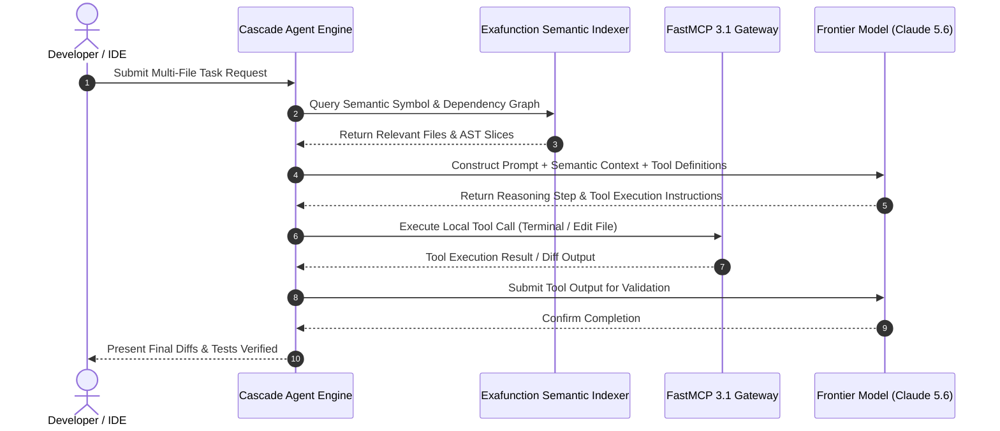

# Codeium

## What it is
Codeium is an enterprise-grade, high-performance, AI-native developer productivity platform providing real-time autocomplete, intelligent codebase search, and agentic chat across 70+ programming languages and all major IDEs. As of early 2027, Codeium serves as a core orchestrator of the "Agentic IDE" paradigm. It powers the inference and reasoning backend for the **Windsurf** editor and its advanced **Cascade** workflow model, featuring deep integration with frontier reasoning models including **Claude 5.6**, **GPT-5.6**, **Gemini 4.0 Ultra**, **DeepSeek-V4**, **Llama 4**, **Gemma 4**, and **Qwen 3.6 VL**. It natively implements **MCP 3.1 / FastMCP 3.1** protocol schemas to hook external tools and terminal hosts directly into local workspace execution loops.

## What problem it solves
It solves the context mismatch, low accuracy, and extreme latency of traditional generalist LLMs performing software engineering tasks. Standard LLM integrations lack repository-level index awareness, operating mostly file-by-file with high cognitive load on the developer to manage context. Codeium bridges this gap by continuously indexing the workspace in the background using a highly optimized, low-latency semantic search engine. This translates passive text suggestions into active, multi-file agentic execution, allowing local agents to locate, edit, build, and verify complex applications with sub-100ms response rates.

## Where it fits in the stack
**Category**: Tool / Development & Ops / AI-assisted Coding. Codeium functions as the local or VPC-hosted "Inference, Context, and Semantic Reasoning Plane" for IDE environments such as VS Code, JetBrains, Vim/Neovim, and standalone editors like Windsurf.

## Architecture Diagram & Cascade Workflow
```
+-----------------------------------------------------------------------------------+
|                        Codeium & Windsurf Cascade Architecture                    |
|                                                                                   |
|  +-----------------------------------------------------------------------------+  |
|  | Developer Interaction Surface (Windsurf IDE / VS Code / Neovim plugin)      |  |
|  +-----------------------------------------------------------------------------+  |
|                                        ||                                         |
|                                        \/                                         |
|  +-----------------------------------------------------------------------------+  |
|  | Cascade Agent Engine (Context Weaver, Plan Generator, Tool Invoker)         |  |
|  +-----------------------------------------------------------------------------+  |
|                     ||                                    ||                      |
|                     \/                                    \/                      |
|  +--------------------------------------+  +-----------------------------------+  |
|  | Exafunction Semantic Indexing Engine |  | FastMCP 3.1 External Tool Gateway |  |
|  | (AST Parser, Vector Embeddings)      |  | (PostgreSQL, Terminal, GitHub)    |  |
|  +--------------------------------------+  +-----------------------------------+  |
|                                        ||                                         |
|                                        \/                                         |
|  +-----------------------------------------------------------------------------+  |
|  | Reasoning Plane (Claude 5.6, GPT-5.6, DeepSeek-V4, Enterprise Air-Gapped)    |  |
|  +-----------------------------------------------------------------------------+  |
+-----------------------------------------------------------------------------------+
```



## Typical use cases
- **Multi-File Agentic Engineering**: Empowering the Cascade engine in Windsurf to autonomously navigate, edit, execute terminal commands, and run tests locally to solve complex issues.
- **Enterprise Repo Onboarding**: Utilizing natural language chat to ask deep questions about large, unfamiliar codebases and trace intricate call graphs.
- **Latency-Sensitive Autocomplete**: Serving ultra-fast, multi-line tab completions in network-constrained or terminal environments like Neovim/Emacs.
- **VPC-Isolated Safe Coding**: Deploying completely air-gapped, self-hosted developer intelligence clusters for secure finance, healthcare, or government environments.

## Comprehensive Comparison Matrix: AI Coding Assistants

| Capability / Feature | Codeium (Windsurf/Cascade) | GitHub Copilot | Cursor | Aider |
| :--- | :--- | :--- | :--- | :--- |
| **Primary Interface** | Windsurf Editor / Extensions | Extension for VS Code/JetBrains | Forked VS Code Editor | Terminal CLI |
| **Agentic Mode** | Cascade (Multi-file & Terminal) | Copilot Workspace / Edits | Agent Mode / Composer | Git-integrated CLI Agent |
| **Model Selection** | Claude 5.6, GPT-5.6, DeepSeek-V4 | Claude 3.5, GPT-4o | Claude 3.5, GPT-4o | Any via LiteLLM / API keys |
| **Protocol Standards** | FastMCP 3.1 / MCP 3.1 | Proprietary Extensions | MCP Protocol Support | Direct Function Calling |
| **Indexing Latency** | Sub-100ms Exafunction Engine | Cloud-side Vector Indexing | Local RAG / Vector DB | Tree-sitter AST Graph |
| **Air-Gapped VPC Setup** | Supported (Enterprise Tier) | Enterprise Cloud Only | Limited Local Modes | Fully Supported (Self-Hosted) |
| **Terminal Integration** | Deep native CLI execution | Limited inline commands | Native terminal execution | Terminal is primary UI |

## Strengths
- **Windsurf & Cascade Agent Model**: Seamless transition from chat to fully autonomous agentic mode, carrying perfect state and context without manual file attachment.
- **Sub-100ms Latency**: Custom Exafunction hardware-software co-optimization ensures suggestions compile and stream with extreme speed.
- **Robust Terminal IDE Support**: First-class Neovim, Vim, and Emacs plugins, delivering VS Code-quality AI intelligence to lightweight keyboard-driven setups.
- **Native FastMCP 3.1 Integration**: Seamlessly maps local or remote Model Context Protocol servers to expose external services (e.g. databases, live APIs) to Cascade.
- **Highly Scalable Indexing**: Background indexing that scales to multi-gigabyte monorepos without causing laptop thermal throttling.

## Limitations
- **Opaque Proprietary Models**: Autocomplete models are proprietary and closed-weights, making behavior difficult to formally verify for strict compliance audits.
- **Cloud Dependency for Individual Tiers**: The free and standard pro tiers depend on Exafunction cloud clusters, which may conflict with strict local-only security directives unless upgraded to Enterprise.
- **High Resource Footprint in Agent Mode**: Running Cascade's multi-file search and auto-execution loops concurrently with heavy local build pipelines demands modern developer hardware (e.g. Apple Silicon M-series or high-end x86 workstations).

## When to use it
- When you want the most seamless, powerful agentic coding experience available via the Windsurf-Cascade interface.
- If you work in terminal-based editors like Neovim and require an ultra-low-latency, free-tier autocomplete engine.
- When working on large codebases where simple directory-context search fails to find relevant utility classes or cross-module patterns.

## When not to use it
- In environments where absolute data isolation is required and budgeting does not allow for a dedicated Enterprise VPC license.
- If you rely purely on open-source, open-weight models and want to self-host the entire inference chain locally on personal GPUs.
- For simple, isolated single-file scripts where deep codebase indexing represents unnecessary overhead.

## Getting started

### Windsurf Setup (Recommended)
1. Download Windsurf from the [official Codeium page](https://codeium.com/windsurf).
2. Install the application and log in to activate the standard individual or pro license.
3. Open a folder; Codeium will begin background indexing immediately. You can open Cascade (Ctrl + L or Cmd + L) to start chatting or trigger Agent Mode.

### Installing Neovim Autocomplete (lazy.nvim)
For terminal-centric developers, add the following configuration to your Neovim setup:
```lua
{
  "Exafunction/codeium.vim",
  event = "BufRead",
  config = function()
    -- Bind Ctrl+g to accept autocomplete suggestion
    vim.keymap.set('i', '<C-g>', function() return vim.fn['codeium#Accept']() end, { expr = true, silent = true })
    -- Clear current suggestion using Ctrl+x
    vim.keymap.set('i', '<C-x>', function() return vim.fn['codeium#Clear']() end, { expr = true, silent = true })
  end
}
```

## CLI examples

### Headless LSP Authentication and Health Check
For remote development servers or headless virtual machines, authenticate the Codeium background language server manually:
```bash
# Download the official standalone Codeium LSP helper
curl -Lo codeium_bin https://github.com/Exafunction/codeium/releases/latest/download/codeium-linux-x64
chmod +x codeium_bin

# Authenticate with your user account
./codeium_bin auth

# Confirm active connection, model status, and background indexer health
./codeium_bin status
```

### Pre-indexing Monorepos Headlessly
Accelerate the onboarding time for remote developer instances by pre-indexing massive repositories before launching IDE workspaces:
```bash
./codeium_bin index --path /home/workspace/monorepo --exclude-git-ignored --output-dir /var/cache/codeium
```

## API examples

### Pydantic v2 Configuration and Policy Validator
Use the following Python script to programmatically construct, validate, and write Codeium Enterprise policy configurations. This enforces data leakage prevention rules and verified FastMCP 3.1 tool integrations prior to workspace deployment.

```python
from typing import Dict, List, Optional
from pydantic import BaseModel, Field, HttpUrl, ValidationError, ConfigDict
from fastmcp import FastMCP

# Initialize FastMCP 3.1 server for Codeium plugin extension
mcp = FastMCP(name="codeium-enterprise-validator", version="3.1")

# Define modern Pydantic v2 schemas for Codeium tool integrations
class McpServerSchema(BaseModel):
    model_config = ConfigDict(extra="forbid", str_strip_whitespace=True)

    command: str = Field(..., description="The main executable command for the MCP server")
    args: List[str] = Field(default_factory=list, description="Command line arguments for the server")
    env: Dict[str, str] = Field(default_factory=dict, description="Custom environment variables injected into the server process")

class CodeiumPolicyConfig(BaseModel):
    model_config = ConfigDict(extra="forbid", str_strip_whitespace=True)

    enterprise_portal: HttpUrl = Field(..., description="Secure URL to the self-hosted Codeium enterprise portal")
    enable_local_indexing: bool = Field(True, description="Enables deep repository semantic index extraction")
    telemetry_opt_out: bool = Field(True, description="Strict opt-out for remote analytics transmission")
    ignored_paths: List[str] = Field(
        default_factory=lambda: ["**/secrets/**", "**/*.pem", "**/*.key", "**/node_modules/**"],
        description="Glob patterns of directories to block from being indexed"
    )
    mcp_servers: Dict[str, McpServerSchema] = Field(default_factory=dict, description="Authorized FastMCP 3.1 tool servers")

# Validate an incoming deployment payload programmatically
raw_payload = {
    "enterprise_portal": "https://codeium.internal.corp",
    "enable_local_indexing": True,
    "telemetry_opt_out": True,
    "mcp_servers": {
        "local-db-executor": {
            "command": "npx",
            "args": ["-y", "@modelcontextprotocol/server-postgres", "postgresql://localhost:5432/devdb"],
            "env": {"PGPASSWORD": "secret_password"}
        }
    }
}

try:
    config = CodeiumPolicyConfig(**raw_payload)
    print("Configuration validated successfully!")
    print(f"Enterprise Portal: {config.enterprise_portal}")
    print(f"Configured MCP Servers: {list(config.mcp_servers.keys())}")
except ValidationError as e:
    print(f"Validation failed: {e.json(indent=2)}")
```

### Context Isolation Configuration (`.codeiumignore`)
To restrict specific credentials or directories from ever being parsed by the indexing engine, write a standard `.codeiumignore` file:
```text
# .codeiumignore
# Prevent indexing of sensitive cryptographic material
**/secrets/
**/*.pem
**/*.key
**/*.pfx

# Exclude high-volume build outputs and dependency folders
**/node_modules/
**/dist/
**/build/
.git/
```

## Troubleshooting Guide

| Issue / Symptom | Probable Cause | Corrective Action |
| :--- | :--- | :--- |
| `Indexing Process Stalled` | High CPU usage or recursive symlinks in workspace | Create a `.codeiumignore` file excluding heavy build directories like `node_modules` and `dist`. |
| `Cascade Agent Execution Error` | FastMCP 3.1 server command failed or environment variable missing | Check MCP server logs and ensure all required credentials (e.g. `PGPASSWORD`) are exported in runtime. |
| `Neovim Autocomplete Disconnected` | `codeium_bin` binary missing or blocked by firewall | Re-run `./codeium_bin auth` and check port connectivity to `codeium.com`. |
| `VPC Portal Sync Fail` | SSL Certificate validation failure on private enterprise URL | Export private CA bundle or specify `CA_BUNDLE_PATH` in environment configuration. |

## Related tools / concepts
- [Windsurf](./windsurf.md) — The primary agentic IDE powered by Codeium.
- [Sourcegraph Cody](./sourcegraph_cody.md) — Multi-model codebase intelligence platform.
- [GitHub Copilot](./github_copilot.md) — Standard autocomplete and IDE companion.
- [Cursor](./cursor.md) — First-class competitor in the AI-native editor space.
- [Aider](./aider.md) — CLI-native autonomous coding agent.
- [Claude Code](./claude-code.md) — Terminal-native pair programmer from Anthropic.
- [Zed](./zed.md) — Multi-developer, ultra-fast collaborative IDE.
- [Continue](./continue_dev.md) — Modular, open-source IDE AI extension framework.
- [Tabnine](./tabnine.md) — Secure, local-first code assistant.
- [Model Context Protocol (MCP)](../automation_orchestration/mcp.md) — Core open-standard for agent tool connections.

## Sources / references
- [Codeium Homepage](https://codeium.com/)
- [Windsurf & Cascade Architecture Blog](https://codeium.com/blog/windsurf-agentic-ide)
- [Codeium Enterprise Integration Guide](https://docs.codeium.com/)
- [Model Context Protocol Specification](https://modelcontextprotocol.io/)

## Contribution Metadata

- Last reviewed: 2027-01-07
- Confidence: high
