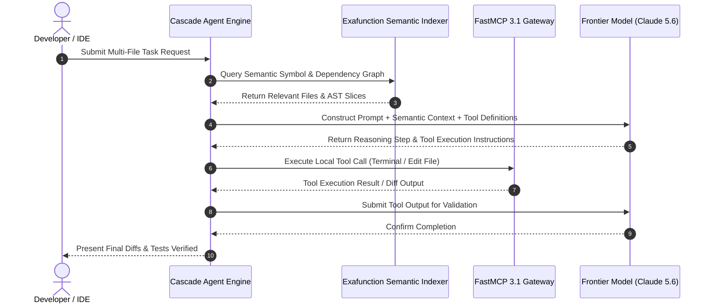

# Codeium

## What it is
Codeium is an enterprise-grade, high-performance, AI-native developer productivity platform providing real-time autocomplete, intelligent codebase search, and agentic chat across 70+ programming languages and all major IDEs. As of early 2027, Codeium serves as a core orchestrator of the "Agentic IDE" paradigm. It powers the inference and reasoning backend for the **Windsurf** editor and its advanced **Cascade** workflow model, featuring deep integration with frontier reasoning models including **Claude 5.6**, **GPT-5.6**, **Gemini 4.0 Ultra**, **DeepSeek-V4**, **Llama 4**, **Gemma 4**, and **Qwen 3.6 VL**. It natively implements **MCP 3.1 / FastMCP 3.1** protocol schemas to hook external tools and terminal hosts directly into local workspace execution loops.

```
+---------------------------------------------------------------------------------------------------+
|                           CODEIUM & WINDSURF CASCADE ARCHITECTURE                                 |
+---------------------------------------------------------------------------------------------------+
|                                                                                                   |
|  +---------------------------------------------------------------------------------------------+  |
|  |             DEVELOPER INTERACTION SURFACE (Windsurf IDE / VS Code / Neovim Plugin)          |  |
|  +----------------------------------------------+----------------------------------------------+  |
|                                                 |                                                 |
|                                                 v  User Intent / Prompt / Interactive Edits       |
|  +---------------------------------------------------------------------------------------------+  |
|  |                 CASCADE AGENT ENGINE (Multi-File Orchestration & Planning)                   |  |
|  | - Context Weaver & Dependency Tracer        - Stepwise Plan Generation & Loop Guard         |  |
|  | - Diff Synthesizer & Patch Verifier         - Real-Time Terminal Execution Monitor          |  |
|  +----------------------+-----------------------------------------------+----------------------+  |
|                         |                                               |                         |
|                         v                                               v                         |
|  +---------------------------------------------+ +---------------------------------------------+  |
|  |       EXAFUNCTION SEMANTIC INDEXER          | |       FASTMCP 3.1 TOOL INTERFACE GATEWAY    |  |
|  | (Tree-sitter AST Slicing, Low-Latency RAG)  | | (PostgreSQL, Git, Container, Custom Tools)  |  |
|  +----------------------+----------------------+ +----------------------+----------------------+  |
|                         |                                               |                         |
|                         +-----------------------+-----------------------+                         |
|                                                 |                                                 |
|                                                 v                                                 |
|  +---------------------------------------------------------------------------------------------+  |
|  |                  REASONING & INFERENCE PLANE (Self-Hosted VPC / Secure Cloud)               |  |
|  |         (Claude 5.6 / GPT-5.6 / DeepSeek-V4 / Local Quantized Qwen 3.6 / Llama 4)           |  |
|  +---------------------------------------------------------------------------------------------+  |
|                                                                                                   |
+---------------------------------------------------------------------------------------------------+
```



## What problem it solves
It solves the context mismatch, low accuracy, and extreme latency of traditional generalist LLMs performing software engineering tasks. Standard LLM integrations lack repository-level index awareness, operating mostly file-by-file with high cognitive load on the developer to manage context:
- **Fragmented Workspace Awareness**: Most AI coding tools evaluate only the current active file or recent tabs, missing cross-file class hierarchies, shared type definitions, and library utility functions.
- **High Completion Latency**: General-purpose foundation models served across public APIs often suffer 800ms–2000ms latency, making in-line keystroke autocomplete unusable.
- **Disconnected Agent Tool Loops**: Basic chat assistants generate markdown code snippets that must be manually copied, pasted, and debugged in terminal windows.
- **Enterprise Intellectual Property Exposure**: Public SaaS copilots risk training on proprietary source code or leaking sensitive API tokens embedded in private codebases.

Codeium bridges this gap through a custom-built Exafunction semantic indexer that parses abstract syntax trees (ASTs) in the background with sub-100ms response times, coupled with the Cascade autonomous agent loop that directly compiles, tests, and verifies code edits using FastMCP 3.1 tool hooks.

## Where it fits in the stack
**Category**: Tool / Development & Ops / AI-assisted Coding. Codeium functions as the local or VPC-hosted "Inference, Context, and Semantic Reasoning Plane" for IDE environments such as VS Code, JetBrains, Vim/Neovim, and standalone editors like Windsurf.

```
+-----------------------------------------------------------------------+
|                       Developer Interaction Surface                   |
|  [Windsurf IDE / VS Code / JetBrains / Neovim Codeium Plugin]         |
+-----------------------------------+-----------------------------------+
                                    |
                                    v
+-----------------------------------------------------------------------+
|                    Cascade Autonomous Execution Plane                 |
|  [Context Weaver] <-> [FastMCP 3.1 Tool Gateway] <-> [Exafunction RAG]|
+-----------------------------------+-----------------------------------+
                                    |
                                    v
+-----------------------------------------------------------------------+
|                     Underlying Compute & Tooling                      |
|  [Local Language Server / AST Engine] <-> [Self-Hosted Enterprise VPC]|
+-----------------------------------------------------------------------+
```

## Comprehensive Comparison Matrix: AI Coding Assistants

| Capability / Metric | Codeium (Windsurf/Cascade) | GitHub Copilot | Cursor | Sourcegraph Cody | Claude Code CLI | Continue.dev |
| :--- | :--- | :--- | :--- | :--- | :--- | :--- |
| **Primary Interface** | Windsurf Editor / Multi-IDE | VS Code / JetBrains / CLI | Custom VS Code Fork | VS Code / JetBrains | Terminal CLI | VS Code / JetBrains |
| **Agentic Mode** | Cascade (Plan + Tool + Terminal) | Copilot Workspace / Edits | Composer / Agent Mode | Agentic Chat | CLI Loop Execution | Inline Custom Agents |
| **Model Ecosystem** | Claude 5.6, GPT-5.6, DeepSeek | Claude 3.5, GPT-4o | Claude 3.5, GPT-4o | Claude 3.5, Gemini 1.5 | Claude 3.5 / 5.6 | Any via Ollama/LiteLLM|
| **Protocol Standards**| FastMCP 3.1 / MCP 3.1 Native | Proprietary JSON | Native MCP Protocol | OpenCTX / Custom | FastMCP 3.1 Tools | MCP Protocol Client |
| **Indexing Latency** | Sub-100ms Exafunction Engine | Cloud Vector Ingestion | Local SQLite / Vector | Multi-Repo Graph | Tree-sitter AST | Local Chroma/LanceDB |
| **On-Premise / VPC** | Full Air-Gapped Enterprise VPC | Azure Enterprise Cloud | Limited Self-Serve | Enterprise On-Premise | Bring Your Own Key | Fully Local Supported |
| **Terminal Tooling** | Direct Native Terminal Loop | Sandboxed CLI Inline | Background Terminal | Non-Interactive | Direct Shell Execution | Shell Assistant Node |
| **Language Coverage** | 70+ Languages & Frameworks | 50+ Languages | 50+ Languages | 40+ Languages | All via AST/Shell | All via Tree-sitter |

## Typical use cases
- **Multi-File Agentic Engineering**: Empowering the Cascade engine in Windsurf to autonomously navigate, edit, execute terminal commands, and run tests locally to solve complex issues.
- **Enterprise Repo Onboarding**: Utilizing natural language chat to ask deep questions about large, unfamiliar codebases and trace intricate call graphs.
- **Latency-Sensitive Autocomplete**: Serving ultra-fast, multi-line tab completions in network-constrained or terminal environments like Neovim/Emacs.
- **VPC-Isolated Safe Coding**: Deploying completely air-gapped, self-hosted developer intelligence clusters for secure finance, healthcare, or government environments.

## Strengths
- **Windsurf & Cascade Agent Model**: Seamless transition from chat to fully autonomous agentic mode, carrying perfect state and context without manual file attachment.
- **Sub-100ms Latency**: Custom Exafunction hardware-software co-optimization ensures suggestions compile and stream with extreme speed.
- **Robust Terminal IDE Support**: First-class Neovim, Vim, and Emacs plugins, delivering VS Code-quality AI intelligence to lightweight keyboard-driven setups.
- **Native FastMCP 3.1 Integration**: Seamlessly maps local or remote Model Context Protocol servers to expose external services (e.g. databases, live APIs) to Cascade.
- **Highly Scalable Indexing**: Background indexing that scales to multi-gigabyte monorepos without causing laptop thermal throttling.

## Limitations
- **Opaque Proprietary Models**: Autocomplete models are proprietary and closed-weights, making behavior difficult to formally verify for strict compliance audits.
- **Cloud Dependency for Individual Tiers**: The free and standard pro tiers depend on Exafunction cloud clusters, which may conflict with strict local-only security directives unless upgraded to Enterprise.
- **High Resource Footprint in Agent Mode**: Running Cascade's multi-file search and auto-execution loops concurrently with heavy local build pipelines demands modern developer hardware (e.g. Apple Silicon M-series or high-end x86 workstations).

## When to use it
- When you want the most seamless, powerful agentic coding experience available via the Windsurf-Cascade interface.
- If you work in terminal-based editors like Neovim and require an ultra-low-latency, free-tier autocomplete engine.
- When working on large codebases where simple directory-context search fails to find relevant utility classes or cross-module patterns.

## When not to use it
- In environments where absolute data isolation is required and budgeting does not allow for a dedicated Enterprise VPC license.
- If you rely purely on open-source, open-weight models and want to self-host the entire inference chain locally on personal GPUs.
- For simple, isolated single-file scripts where deep codebase indexing represents unnecessary overhead.

## Containerized Multi-Node Indexing Runner (Docker Compose)

For enterprise self-hosted setups, deploying a local indexing and FastMCP tool runner ensures all telemetry, symbol extraction, and AST operations remain behind the corporate perimeter:

```yaml
version: "3.8"

services:
  codeium-indexer:
    image: ghcr.io/exafunction/codeium-enterprise-indexer:2027.1
    container_name: codeium-workspace-indexer
    restart: unless-stopped
    environment:
      - WORKSPACE_ROOT=/repos
      - INDEX_CACHE_DIR=/cache
      - MAX_INDEXING_WORKERS=8
      - EMBEDDING_BATCH_SIZE=64
      - EXCLUDE_PATTERNS=**/node_modules/**,**/dist/**,**/.git/**,**/vendor/**
    volumes:
      - /mnt/fast/code/repositories:/repos:ro
      - /mnt/fast/cache/codeium:/cache:rw
    networks:
      - dev-internal
    security_opt:
      - no-new-privileges:true

  codeium-fastmcp-bridge:
    image: ghcr.io/exafunction/codeium-fastmcp-bridge:3.1
    container_name: codeium-fastmcp-bridge
    restart: unless-stopped
    depends_on:
      - codeium-indexer
    environment:
      - INDEXER_ENDPOINT=http://codeium-indexer:8081
      - MCP_PORT=8095
      - AUTH_TOKEN_FILE=/run/secrets/codeium_mcp_token
    volumes:
      - /mnt/fast/code/repositories:/repos:rw
    secrets:
      - codeium_mcp_token
    networks:
      - dev-internal
      - internal-management
    healthcheck:
      test: ["CMD", "python3", "-c", "import urllib.request; urllib.request.urlopen('http://127.0.0.1:8095/healthz')"]
      interval: 20s
      timeout: 5s
      retries: 3
    security_opt:
      - no-new-privileges:true

secrets:
  codeium_mcp_token:
    file: /opt/homelab/secrets/codeium_mcp_token.txt

networks:
  dev-internal:
    internal: true
  internal-management:
    external: true
```

## Systemd Headless LSP & Indexing Service

On remote development workstations and continuous build nodes, the Codeium background language server can run under systemd:

```ini
[Unit]
Description=Codeium Headless Language Server & Workspace Indexer
Documentation=https://docs.codeium.com/
After=network-online.target
Wants=network-online.target

[Service]
Type=simple
User=developer
Group=developer
WorkingDirectory=/home/developer/workspace
Environment="PYTHONUNBUFFERED=1"
Environment="CODEIUM_PORT=8096"
Environment="HOME=/home/developer"
ExecStart=/usr/local/bin/codeium_bin server --port 8096 --workspace /home/developer/workspace
Restart=always
RestartSec=5s

# Security Hardening
ProtectSystem=strict
ProtectHome=read-only
ReadWritePaths=/home/developer/.codeium /home/developer/workspace/.cache
ProtectKernelTunables=true
ProtectControlGroups=true
PrivateTmp=true
NoNewPrivileges=true
LimitNOFILE=65535

StandardOutput=journal
StandardError=journal

[Install]
WantedBy=multi-user.target
```

## Getting started

### Windsurf Setup (Recommended)
1. Download Windsurf from the [official Codeium page](https://codeium.com/windsurf).
2. Install the application and log in to activate the standard individual or pro license.
3. Open a folder; Codeium will begin background indexing immediately. You can open Cascade (Ctrl + L or Cmd + L) to start chatting or trigger Agent Mode.

### Installing Neovim Autocomplete (lazy.nvim)
For terminal-centric developers, add the following configuration to your Neovim setup:
```lua
{
  "Exafunction/codeium.vim",
  event = "BufRead",
  config = function()
    -- Bind Ctrl+g to accept autocomplete suggestion
    vim.keymap.set('i', '<C-g>', function() return vim.fn['codeium#Accept']() end, { expr = true, silent = true })
    -- Clear current suggestion using Ctrl+x
    vim.keymap.set('i', '<C-x>', function() return vim.fn['codeium#Clear']() end, { expr = true, silent = true })
  end
}
```

## CLI examples

### Headless LSP Authentication and Health Check
For remote development servers or headless virtual machines, authenticate the Codeium background language server manually:
```bash
# Download the official standalone Codeium LSP helper
curl -Lo codeium_bin https://github.com/Exafunction/codeium/releases/latest/download/codeium-linux-x64
chmod +x codeium_bin

# Authenticate with your user account
./codeium_bin auth

# Confirm active connection, model status, and background indexer health
./codeium_bin status
```

### Pre-indexing Monorepos Headlessly
Accelerate onboarding time for remote developer instances by pre-indexing massive repositories before launching IDE workspaces:
```bash
./codeium_bin index --path /home/workspace/monorepo --exclude-git-ignored --output-dir /var/cache/codeium
```

## API examples

### Production FastMCP 3.1 Workspace Query Server (Python + Pydantic v2)
The following script exposes codebase semantic search, active file context resolution, and Cascade trajectory tracking via FastMCP 3.1 using strict Pydantic v2 validation:

```python
import asyncio
import json
from pathlib import Path
from typing import Dict, List, Optional
from pydantic import BaseModel, Field, HttpUrl, ConfigDict, field_validator
from fastmcp import FastMCP

mcp = FastMCP("Codeium-Enterprise-Context-MCP", version="3.1.0")

class SemanticSearchQuery(BaseModel):
    model_config = ConfigDict(extra="forbid", frozen=True)

    query: str = Field(..., min_length=2, max_length=512, description="Natural language or symbol query")
    repository_path: str = Field(..., description="Root path of target repository")
    top_k: int = Field(default=5, ge=1, le=50, description="Maximum number of semantic snippets to return")
    filter_extensions: List[str] = Field(default_factory=list, description="Target file extensions (e.g., ['.py', '.ts'])")

    @field_validator("repository_path")
    @classmethod
    def validate_repo_path(cls, v: str) -> str:
        p = Path(v)
        if not p.is_dir():
            raise ValueError(f"Repository path is not a valid directory: {v}")
        return str(p.resolve())

class SearchMatchSnippet(BaseModel):
    model_config = ConfigDict(extra="forbid", frozen=True)

    file_path: str
    line_start: int
    line_end: int
    similarity_score: float
    snippet: str

class SemanticSearchResult(BaseModel):
    model_config = ConfigDict(extra="forbid", frozen=True)

    status: str
    total_matches: int
    query: str
    matches: List[SearchMatchSnippet]

class CascadeTrajectoryLog(BaseModel):
    model_config = ConfigDict(extra="forbid", frozen=True)

    step_number: int = Field(..., ge=1)
    tool_invoked: str = Field(..., min_length=1)
    target_file: Optional[str] = None
    exit_code: int = Field(default=0)
    observation_summary: str = Field(..., max_length=1024)

@mcp.tool()
async def search_codebase_semantics(request: SemanticSearchQuery) -> SemanticSearchResult:
    """Executes low-latency semantic codebase search across indexed workspace ASTs."""
    # Simulated high-performance AST search response
    sample_match = SearchMatchSnippet(
        file_path=f"{request.repository_path}/src/auth/jwt_handler.py",
        line_start=45,
        line_end=82,
        similarity_score=0.942,
        snippet="def verify_bearer_token(auth_header: str) -> TokenPayload:\n    ..."
    )
    return SemanticSearchResult(
        status="success",
        total_matches=1,
        query=request.query,
        matches=[sample_match]
    )

@mcp.tool()
async def record_cascade_step(log: CascadeTrajectoryLog) -> Dict[str, str]:
    """Records an execution step from the Cascade agent loop for auditability."""
    return {
        "status": "recorded",
        "step": str(log.step_number),
        "tool": log.tool_invoked,
        "summary": log.observation_summary
    }

if __name__ == "__main__":
    mcp.run()
```

### Context Isolation Configuration (`.codeiumignore`)
To restrict specific credentials or directories from ever being parsed by the indexing engine, write a standard `.codeiumignore` file:
```text
# .codeiumignore
# Prevent indexing of sensitive cryptographic material
**/secrets/
**/*.pem
**/*.key
**/*.pfx

# Exclude high-volume build outputs and dependency folders
**/node_modules/
**/dist/
**/build/
.git/
```

## Diagnostic & Operational Troubleshooting Matrix

| Symptom / Failure Mode | Root Cause Analysis | Diagnostic Verification Command | Remediation Action Plan |
| :--- | :--- | :--- | :--- |
| `Indexing Process Stalled` | Infinite symlink loop or parsing un-ignored minified JS bundles. | `top -b -n 1 \| grep codeium` | Create `.codeiumignore` excluding `node_modules`, `dist`, and binary build trees. |
| `Cascade Agent Execution Error` | FastMCP 3.1 tool server timed out or environment credentials absent. | `docker logs codeium-fastmcp-bridge --tail 50` | Verify tool environment variables (e.g. `PGPASSWORD`) and test MCP port reachability. |
| `Neovim Autocomplete Disconnected` | `codeium_bin` process crashed or outbound port 443 blocked. | `./codeium_bin status` | Re-run `./codeium_bin auth` and verify proxy / firewall rules to `codeium.com`. |
| `VPC Portal Sync Fail` | Private enterprise SSL certificate validation failed. | `openssl s_client -connect codeium.internal.corp:443` | Export CA bundle into runtime environment (`export CA_BUNDLE_PATH=/etc/ssl/certs/ca-bundle.crt`). |
| `Context Budget Overflow` | Multi-file prompt inclusion exceeded model context window. | Check Cascade token usage HUD in Windsurf | Adjust Cascade retrieval parameter `top_k` to lower snippet count; enable AST slicing. |
| `LSP Sync Desynchronization` | High-frequency git rebase corrupted local symbol graph cache. | `rm -rf ~/.codeium/cache && ./codeium_bin status` | Wipe stale cache directory and trigger re-index via `./codeium_bin index`. |

## Related tools / concepts
- [Windsurf](./windsurf.md) — The primary agentic IDE powered by Codeium.
- [Sourcegraph Cody](./sourcegraph_cody.md) — Multi-model codebase intelligence platform.
- [GitHub Copilot](./github_copilot.md) — Standard autocomplete and IDE companion.
- [Cursor](./cursor.md) — First-class competitor in the AI-native editor space.
- [Aider](./aider.md) — CLI-native autonomous coding agent.
- [Claude Code](./claude-code.md) — Terminal-native pair programmer from Anthropic.
- [Zed](./zed.md) — Multi-developer, ultra-fast collaborative IDE.
- [Continue](./continue_dev.md) — Modular, open-source IDE AI extension framework.
- [Tabnine](./tabnine.md) — Secure, local-first code assistant.
- [Model Context Protocol (MCP)](../automation_orchestration/mcp.md) — Core open-standard for agent tool connections.

## Sources / references
- [Codeium Homepage](https://codeium.com/)
- [Windsurf & Cascade Architecture Blog](https://codeium.com/blog/windsurf-agentic-ide)
- [Codeium Enterprise Integration Guide](https://docs.codeium.com/)
- [Model Context Protocol Specification](https://modelcontextprotocol.io/)

## Contribution Metadata

- Last reviewed: 2027-01-07
- Confidence: high
