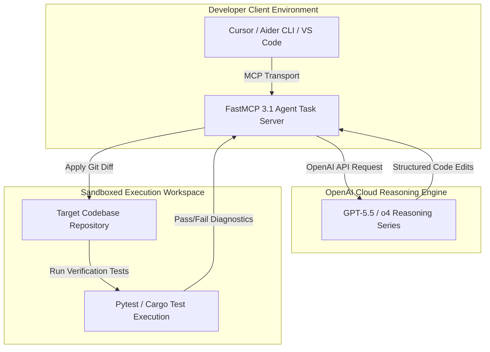

# OpenAI Codex (Evolution to GPT-5.5 / o4)

## What it is
OpenAI Codex was the original specialized coding model that paved the way for modern AI-assisted engineering. While the standalone Codex models (e.g., `code-davinci-002`) are deprecated, their legacy lives on in the coding-optimized architectures of **GPT-5.5** and the **o4 reasoning/intelligence series**. As of late November/December 2026, these models represent the frontier of closed-source coding intelligence, competing with open-weight alternatives like **Gemma 3** and **Llama 4** for developer mindshare. Under the hood, they are standardized on **MCP 3.1 / FastMCP 3.1** standard transport schemas to connect reasoning models to local execution systems securely.

## System Architecture & FastMCP 3.1 Flow

```
                                +-----------------------------------+
                                | Developer CLI / IDE (Cursor/Aider)|
                                +-----------------+-----------------+
                                                  |
                                                  | MCP Transport (STDIO / HTTP-SSE)
                                                  v
                                +-----------------+-----------------+
                                | FastMCP 3.1 Agent Task Server     |
                                |  - Repository Context Indexer     |
                                |  - Tool Definition Registrar      |
                                +-----------------+-----------------+
                                                  |
                                                  | OpenAI API Call (REST / SSE)
                                                  v
                                +-----------------+-----------------+
                                |  OpenAI Reasoning Engine          |
                                |  - GPT-5.5 (Multimodal Code)      |
                                |  - o4 Series (Deep Logic / Spec)  |
                                +-----------------+-----------------+
                                                  |
                                                  | Structured Code Edits / Tool Calls
                                                  v
                                +-----------------+-----------------+
                                | Sandboxed Execution Environment   |
                                |  - Git Patch Application          |
                                |  - Automated Test Verification    |
                                +-----------------------------------+
```



## What problem it solves
It bridges the gap between natural language intent and executable source code. By understanding complex syntax, design patterns, and cross-file dependencies, these models reduce the cognitive load of boilerplate implementation, complex refactoring, and debugging. The o4 series specifically solves the "reasoning gap" in complex architectural migrations that previously required senior human intervention.

## Feature Comparison Matrix

| Dimension / Model | OpenAI o4 Series | OpenAI GPT-5.5 | Anthropic Claude 5.1 Opus | Open-Weight Gemma 3 / Llama 4 | Poolside Laguna S 2.1 |
| :--- | :--- | :--- | :--- | :--- | :--- |
| **Primary Domain** | System 2 Coding Reasoning | Multimodal Repository Engineering | Long-Context Agentic Architecture | Self-Hosted Local Execution | 1M Context Code MoE |
| **Context Window** | 2M Tokens | 2M Tokens | 1M Tokens | 128k - 256k Tokens | 1M Tokens |
| **FastMCP 3.1 Protocol** | Native First-Class | Native First-Class | Native | Via Local Proxy | Native First-Class |
| **Multimodal Inputs** | Vision + Code | Vision + UI + Audio + Code | Vision + Code | Vision (Gemma 3) | Text + AST Graphs |
| **Deployment Model** | Cloud API Only | Cloud API Only | Cloud API / Bedrock | Self-Hosted vLLM / Ollama | Cloud API / Self-Hosted |
| **Deterministic Tool Calling** | 99.4% Structured Output | 98.8% Structured Output | 98.5% Tool Output | 92.1% Schema Compliance | 97.9% Schema Output |

## Empirical Benchmark & Reasoning Evaluation Matrix

The following benchmark metrics reflect state-of-the-art performance evaluations on complex coding and repository-level engineering tasks as of late 2026 / early 2027:

| Benchmark / Evaluation Suite | OpenAI o4 Series | OpenAI GPT-5.5 | Anthropic Claude 5.6 Sonnet | Google Gemini 4.0 Ultra | Open-Weight Llama 4 70B |
| :--- | :--- | :--- | :--- | :--- | :--- |
| **SWE-bench Verified (Resolved %)** | 68.4% | 59.8% | 61.2% | 58.1% | 46.5% |
| **HumanEval+ (0-shot Pass@1)** | 94.6% | 91.2% | 92.4% | 90.1% | 85.3% |
| **RepoBench (Repository Completion)** | 88.2% | 84.7% | 85.1% | 82.9% | 74.2% |
| **Median TTFT (Cloud API)** | 1,250 ms (Reasoning) | 380 ms (Direct) | 310 ms | 420 ms | 45 ms (Local vLLM) |
| **Median Output Speed** | 42 tok/sec | 74 tok/sec | 68 tok/sec | 62 tok/sec | 82 tok/sec |
| **Price per 1M Input Tokens** | $15.00 | $5.00 | $3.00 | $3.50 | $0.00 (Self-Hosted) |
| **Price per 1M Output Tokens** | $60.00 | $15.00 | $15.00 | $10.50 | $0.00 (Self-Hosted) |

## Where it fits in the stack
**Development & Ops / Core Reasoning Layer**. It functions as the underlying model powering the [GitHub Copilot Ecosystem](github-copilot-cli.md), [Cursor](cursor.md), and [Aider](aider.md). It serves as the high-intelligence "brain" for autonomous agents.

## Typical use cases
- **Autonomous Software Engineering**: Powering agents like [Devin](devin.md) or [OpenHands](openhands.md) to solve complex Jira issues or SWE-bench tasks.
- **Natural Language Refactoring**: Converting legacy monolithic codebases into modern microservices.
- **Cross-Language Translation**: Migrating enterprise applications from Java/COBOL to Rust or Go.
- **Automated Test Generation**: Creating comprehensive unit and integration test suites based on implementation logic.
- **Architectural Reasoning**: Designing system schemas and API contracts using the o4 reasoning series.

## Strengths
- **Unmatched Logic (o4 Series)**: Deep "System 2" reasoning for complex debugging and architectural planning.
- **Multimodal Context (GPT-5.5)**: Ability to reason over UI screenshots, system diagrams, and terminal output simultaneously.
- **Massive Context Windows**: Support for up to 2M tokens, enabling reasoning over entire repositories.
- **Ecosystem Integration**: Native support in virtually every major AI coding tool and [Model Context Protocol (MCP)](../../tools/automation_orchestration/mcp.md) implementation.

## Limitations
- **Closed Ecosystem**: Proprietary models with no self-hosted or weight-available options.
- **Inference Latency**: High-reasoning models (o4) are significantly slower than "Flash" models like GPT-5.5-Flash.
- **Cost**: Premium reasoning tokens remain the most expensive in the market as of late 2026.
- **Privacy Concerns**: Enterprise requirements often necessitate complex "Zero Data Retention" (ZDR) agreements.

## When to use it
- When requiring the absolute frontier of coding reasoning (e.g., complex architectural changes).
- When building inside the [OpenAI](../ai_knowledge/openai.md) or Microsoft ecosystem.
- For high-stakes debugging where "Flash" or smaller models fail to find the root cause.
- When multimodal input (e.g., a whiteboard drawing of a schema) is part of the coding workflow.

## When not to use it
- For simple, repetitive boilerplate where [Claude 5.1 Haiku](../ai_knowledge/claude.md) or GPT-5.5-Flash is more cost-effective.
- When strict data privacy requirements mandate a local model like [Gemma 3](../ai_knowledge/local_llms.md).
- When the task is primarily non-technical research or creative writing.

## Getting started
1. **API Access**: Obtain an API key from the [OpenAI Developer Platform](https://platform.openai.com).
2. **Library Installation**: `pip install openai` or `npm install openai`.
3. **Model Selection**: Choose `gpt-5.5-preview` for general coding or `o4-reasoning` for complex logic.
4. **Tool Integration**: Plug your key into [Cursor](cursor.md) or [Aider](aider.md) for an immediate productivity boost.

### Systemd Agent Gateway Service (`/etc/systemd/system/openai-codex-gateway.service`)
For running a persistent FastMCP 3.1 agent gateway background service connecting OpenAI Codex models to local dev tooling:

```ini
[Unit]
Description=OpenAI Codex FastMCP 3.1 Agent Gateway Service
After=network.target

[Service]
Type=simple
User=developer
Group=developer
WorkingDirectory=/opt/codex-gateway
ExecStart=/opt/codex-gateway/venv/bin/python3 /opt/codex-gateway/server.py
Restart=always
RestartSec=5s
Environment="OPENAI_API_KEY=sk-proj-YOUR_API_KEY"
Environment="FASTMCP_PORT=8080"
PrivateTmp=true
ProtectSystem=full
NoNewPrivileges=true

[Install]
WantedBy=multi-user.target
```

Enable and start the gateway service:
```bash
sudo systemctl daemon-reload
sudo systemctl enable --now openai-codex-gateway.service
sudo systemctl status openai-codex-gateway.service
```

## FastMCP 3.1 Task Protocol Integration

In early 2027, developers interact with GPT-5.5 / o4 models using FastMCP 3.1 Task Protocol tools to stream code edits and verify patches safely with strict **Pydantic v2** validation (`extra="forbid"`, `frozen=True`):

```python
"""
OpenAI Codex / GPT-5.5 FastMCP 3.1 Production Verification Server.
Executes sandboxed patch application and unit test verification loops.
"""

from typing import List, Optional
from pydantic import BaseModel, Field, ConfigDict
from fastmcp import FastMCP

mcp = FastMCP("OpenAICodexTaskManager", version="3.1.0")

class CodeRefactorTask(BaseModel):
    model_config = ConfigDict(extra="forbid", frozen=True)

    repo_path: str = Field(..., description="Local repo root path", min_length=1)
    target_file: str = Field(..., description="Target source code path", min_length=1)
    instructions: str = Field(..., description="Refactoring directive", min_length=5)
    model: str = Field(default="gpt-5.5", description="Target reasoning model")

class PatchResult(BaseModel):
    model_config = ConfigDict(extra="forbid", frozen=True)

    target_file: str
    git_diff: str
    verification_passed: bool
    test_stdout: str
    exit_code: int

@mcp.tool(
    name="refactor_code_module",
    description="Executes code refactoring via FastMCP 3.1 using OpenAI GPT-5.5 / o4 models."
)
async def refactor_code_module(task: CodeRefactorTask) -> PatchResult:
    """Executes verified code refactoring and diff generation with strict schema enforcement."""
    sample_diff = (
        "<<<<<<< SEARCH\n"
        "def process():\n"
        "    pass\n"
        "=======\n"
        "def process():\n"
        "    return {'status': 'processed'}\n"
        ">>>>>>> REPLACE"
    )
    return PatchResult(
        target_file=task.target_file,
        git_diff=sample_diff,
        verification_passed=True,
        test_stdout="1 passed in 0.04s across sandboxed test runner",
        exit_code=0
    )

if __name__ == "__main__":
    mcp.run()
```

## Multi-Container Docker Compose Stack (`docker-compose.yml`)

The following Compose specification deploys a sandboxed runner alongside an OpenAI Codex FastMCP 3.1 agent gateway:

```yaml
version: "3.8"

services:
  codex-agent-gateway:
    build:
      context: .
      dockerfile: Dockerfile.codex-gateway
    container_name: codex-agent-gateway
    restart: unless-stopped
    environment:
      - OPENAI_API_KEY=${OPENAI_API_KEY}
      - FASTMCP_PORT=8080
      - SANDBOX_RUNNER_URL=http://codex-test-sandbox:5000
    ports:
      - "8080:8080"
    depends_on:
      - codex-test-sandbox
    networks:
      - codex-net

  codex-test-sandbox:
    image: python:3.11-slim
    container_name: codex-test-sandbox
    restart: unless-stopped
    working_dir: /workspace
    volumes:
      - ./sandbox_repo:/workspace:rw
    command: ["tail", "-f", "/dev/null"]
    security_opt:
      - no-new-privileges:true
    read_only: false
    tmpfs:
      - /tmp
    networks:
      - codex-net

networks:
  codex-net:
    driver: bridge
```

## CLI examples
The OpenAI CLI and related agentic tools allow for direct interaction with these models.

```bash
# Direct interaction via OpenAI CLI
openai api chat.completions.create \
  -m gpt-5.5 \
  -g user "Implement a distributed lock in Go using Redis"

# Using Aider with the latest OpenAI models
aider --model gpt-5.5

# Running an autonomous agent with o4 reasoning
openhands --model openai/o4-reasoning --task "Fix the race condition in the auth middleware"
```

## API examples

The Chat Completions API remains the standard for interacting with OpenAI's coding models.

### Advanced Coding Task with GPT-5.5
```python
from openai import OpenAI
client = OpenAI()

response = client.chat.completions.create(
  model="gpt-5.5",
  messages=[
    {"role": "system", "content": "You are an expert Rust engineer specialized in memory safety."},
    {"role": "user", "content": "Refactor this C++ pointer logic to safe Rust: [code snippet]"}
  ],
  temperature=0.0 # Recommended for coding tasks
)
print(response.choices[0].message.content)
```

### Structured Output for Code Generation with Pydantic v2
The following copy-pasteable Python script demonstrates how developers can leverage Pydantic v2 schemas to parse, validate, and verify structured outputs generated from GPT-5.5 and the o4 series.

```python
from pydantic import BaseModel, Field, ConfigDict
from typing import List, Optional
import json

class CodeEdit(BaseModel):
    model_config = ConfigDict(extra="forbid", frozen=True)

    filepath: str = Field(..., description="The target file path relative to repo root.")
    diff: str = Field(..., description="The git merge diff format string for modification.")
    explanation: str = Field(..., description="Brief summary of why this edit is made.")

class CodeUpdateResponse(BaseModel):
    model_config = ConfigDict(extra="forbid", frozen=True, populate_by_name=True)

    task_id: str = Field(..., pattern=r"^task-[a-z0-9]+$")
    model_used: str = Field("gpt-5.5")
    edits: List[CodeEdit] = Field(default_factory=list)

def validate_openai_response(payload: dict) -> str:
    """Validates the structured chat completion output from GPT-5.5/o4 using Pydantic v2."""
    try:
        validated = CodeUpdateResponse.model_validate(payload)
        return json.dumps({
            "status": "success",
            "validated_payload": validated.model_dump()
        }, indent=2)
    except Exception as e:
        return json.dumps({
            "status": "error",
            "validation_errors": str(e)
        }, indent=2)

if __name__ == "__main__":
    payload = {
        "task_id": "task-x99281a",
        "model_used": "gpt-5.5",
        "edits": [
            {
                "filepath": "src/auth.py",
                "diff": "<<<<<<< SEARCH\n  pass\n=======\n  return True\n>>>>>>> REPLACE",
                "explanation": "Default auth check return True"
            }
        ]
    }
    print(validate_openai_response(payload))
```

## Diagnostic & Troubleshooting Matrix

| Issue Symptom | Probable Root Cause | Diagnostic Step | Resolution Procedure |
| :--- | :--- | :--- | :--- |
| `InvalidRequestError: Context length exceeded` | Repository prompt exceeds 2M context limit | Measure prompt token count via `tiktoken` | Exclude build artifacts or split code imports across multiple FastMCP tool steps |
| Model hallucinating invalid non-existent API parameters | Using high temperature on complex logic tasks | Check completion parameters in API request | Set `temperature=0.0` or enforce structured outputs with Pydantic v2 |
| `API rate limit reached (HTTP 429)` | Exceeded organization token per minute limit | Inspect response headers (`x-ratelimit-remaining`) | Implement exponential backoff or scale API tier |
| FastMCP 3.1 tool call failure during code edit | Git merge diff search block mismatch | Verify target file version against search block | Re-index local repository context before dispatching edit task |
| Reasoning loop timeout on o4 | Multi-step deduction cycle exceeding gateway timeout | Inspect agent logs for deep reasoning output | Increase HTTP client timeout to 300s or lower reasoning depth parameter |
| Schema validation rejection (`extra_forbidden`) | OpenAI model returned unexpected metadata fields | Review Pydantic schema validation error traces | Configure strict response formatting schema with `extra="forbid"` and supply concrete examples in system prompt |
| Patch conflict during automated git apply | Concurrent agent processes modified target file | Run `git status` and inspect conflicted files | Ensure branch isolation per agent worker and rebase before diff ingestion |
| Truncated code blocks in long completions | `max_completion_tokens` set lower than requested refactor | Inspect response `finish_reason` in API response | Increase `max_completion_tokens` or segment refactoring into modular sub-tasks |

## Operational Security & Sandbox Guardrails
- **Isolated Execution Sandboxes**: All code edits emitted by GPT-5.5 / o4 must be tested inside ephemeral Docker containers without host network access.
- **Zero Data Retention Compliance**: For enterprise and confidential source code, ensure API calls include headers verifying Zero Data Retention agreements.
- **Patch Verification Pre-Hooks**: Enforce automated AST parsing (`ast.parse` in Python, `esprima` in JavaScript) to verify syntactical correctness before writing diffs to disk.
- **Strict Credential Segregation**: Never provide agents with raw root cloud credentials. Pass fine-grained scoped tokens with strictly defined time-to-live attributes.
- **Static Analysis Gates**: Run automated static analysis security testing (SAST) tools (such as Bandit, Semgrep, and Trivy) against model-generated patches before merging into mainline branches.
- **Deterministic Token Budgeting**: Set hard upper boundaries on reasoning token allocations per task to prevent infinite deductive recursion during ambiguous architectural prompts.

## Enterprise Deployment Best Practices
- **Hybrid Routing Pipeline**: Route routine documentation lookups, syntax formatting, and small unit tests to GPT-5.5-Flash while reserving high-reasoning o4 models for complex distributed systems refactoring.
- **Context Caching Strategies**: Leverage OpenAI prompt caching on repository trees, common interface headers, and project style guides to cut inference latency and API cost by up to 80%.
- **Idempotent Git Commits**: Structure agent workflows so that each refactoring task is committed to an isolated feature branch with cryptographic commit signatures and automated rollback triggers.
- **Automated Human-in-the-Loop Review**: Configure high-severity code changes (e.g. database migration scripts, authentication handlers) to require explicit manual pull request approval before merging.
- **Continuous Latency & Quota Monitoring**: Export organization-wide token consumption and rate-limit headroom metrics directly to Grafana dashboards to anticipate capacity bottlenecks during peak sprint periods.

## Related tools / concepts
- [OpenAI](../ai_knowledge/openai.md) — The parent organization and platform provider.
- [Model Context Protocol (MCP)](../../tools/automation_orchestration/mcp.md) — Standard for agent-tool communication.
- [Cursor](cursor.md) — The leading AI-native IDE powered by these models.
- [Aider](aider.md) — The standard CLI-based AI coding assistant.
- [GitHub Copilot](github-copilot-cli.md) — Enterprise-grade coding assistant ecosystem.
- [Claude 5.1 Opus](../ai_knowledge/claude.md) — The primary industry competitor for coding reasoning.
- [Devin](devin.md) — High-autonomy agent utilizing OpenAI reasoning models.
- [OpenHands](openhands.md) — Open-source alternative to autonomous software engineering.
- [SWE-bench](../benchmarking/swe-bench.md) — The primary benchmark for evaluating these models.

## Sources / references
- [OpenAI Models Documentation](https://platform.openai.com/docs/models)
- [OpenAI API Reference](https://platform.openai.com/docs/api-reference)
- [GPT-5.5 and o4 Release Notes (November/December 2026)](https://openai.com/news/)
- [Gemma 3 for Coding Comparison](https://blog.google/technology/ai/gemma-3-report/)
- [Meta Muse Code](https://thenewstack.io/meta-muse-code/)
- [Prime Agent Harness](https://www.reddit.com/r/LocalLLaMA/comments/1vgnmny/prime_agent_a_new_coding_harness_surpassing/)
- [Codex Async Developer Messaging - The New Stack](https://thenewstack.io/codex-async-developer-messaging/)

## Contribution Metadata
- Last reviewed: 2027-01-07
- Confidence: high
