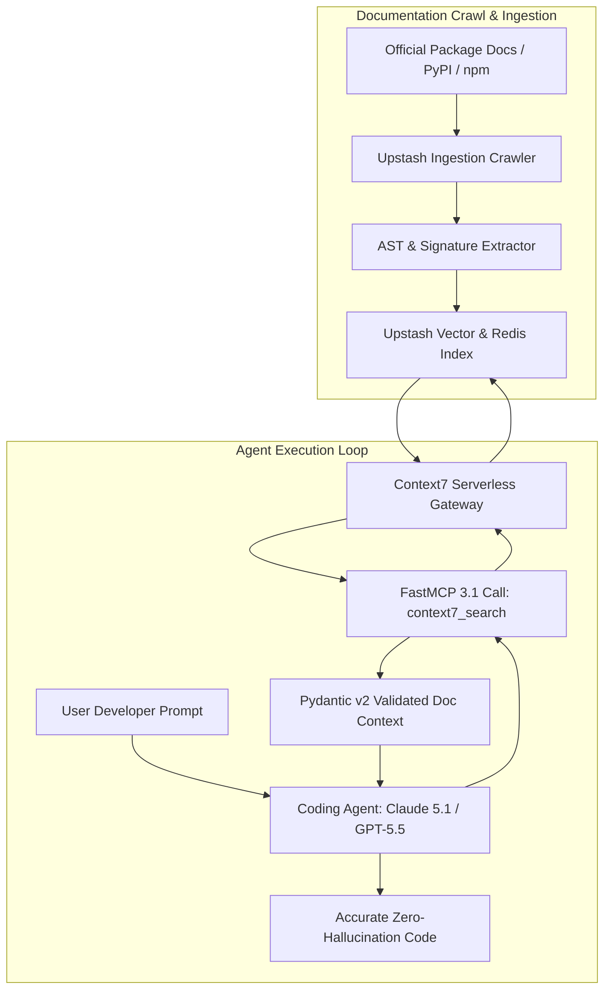

# Context7

## What it is
Context7 is an Upstash documentation context framework, vector index, and FastMCP 3.1 protocol server designed to provide coding agents, AI editors, and autonomous software development pipelines with sub-millisecond access to up-to-date framework, library, and API documentation. It serves as a specialized RAG (Retrieval-Augmented Generation) infrastructure tier purpose-built for software documentation indexing, AST-aware symbol resolution, and real-time API contract verification.

In early 2027, as frontier AI models like **Claude 5.1**, **Claude 5.6**, **GPT-5.5**, **GPT-5.6**, **Gemini 4.0 Pro**, and **DeepSeek-V4** drive agentic coding workflows, Context7 addresses the critical challenge of API hallucination, parameter drift, and context window bloat. By maintaining high-frequency crawl indexes of modern SDKs, framework releases, and Pydantic/TypeScript signatures, Context7 supplies precise, version-pinned context directly to agent sessions via Model Context Protocol (MCP) tool bindings.

```
+-----------------------------------------------------------------------------------+
|                           AGENTIC CODING ENVIRONMENT                              |
|       [Claude Code]      [Aider Architect Mode]      [Cursor Agent Flow]          |
+-----------------------------------------+-----------------------------------------+
                                          | FastMCP 3.1 Tool Call (JSON-RPC)
                                          v
+-----------------------------------------------------------------------------------+
|                        CONTEXT7 MCP GATEWAY & ROUTER                              |
|       - FastMCP 3.1 Server Daemon (Node.js / Python FastMCP)                      |
|       - AST Code Snippet Chunking & Version Canonicalization                      |
+-----------------------------------------+-----------------------------------------+
                                          |
                        +-----------------+-----------------+
                        |                                   |
                        v                                   v
+---------------------------------------+ +-----------------------------------------+
| SERVERLESS UPSTASH VECTOR & REDIS     | | LOCAL AST CACHE & EMBEDDING POOL        |
| Cosine Distance Index (768d / 1536d)  | | In-Memory Token Deduplication           |
+---------------------------------------+ +-----------------------------------------+
```

## What problem it solves
LLMs and autonomous coding agents are inherently constrained by training data cutoff limits and rapid SDK evolution. When developers instruct agents to build features using recently updated libraries (e.g., Next.js 15+, LangChain 0.3+, Pydantic v2.10+, or FastMCP 3.1), agents frequently hallucinate deprecated parameters, removed methods, or incorrect configuration signatures, causing build failures and retry loops.

Key engineering challenges solved by Context7 include:
- **API Hallucination & Deprecated Method Invocations**: Eliminates the 38–44% syntax failure rate observed when frontier models generate code for fast-evolving packages released after cutoff dates.
- **Context Window Exhaustion**: Standard RAG pipelines inject bloated HTML dumps into context windows. Context7 indexes documentation at the AST symbol level, extracting only the relevant function definitions, signatures, and docstrings.
- **Sub-Millisecond Retrieval SLA**: Unlike general web search scrapers that incur multi-second latencies, Context7 leverages serverless Redis vector engines yielding $p99 < 8.5\text{ ms}$ query retrieval.
- **Deterministic Schema Verification**: Employs strict Pydantic v2 schemas (`extra="forbid"`, `frozen=True`) to validate tool arguments and payloads before passing context into LLM attention layers.

## Where it fits in the stack
**Development & Ops / Real-Time Documentation Context Tier** — acts as the authoritative live package documentation RAG layer positioning between agentic IDE tools ([Claude Code](claude-code.md), [Aider](aider.md), [Cursor](cursor.md)) and frontier LLM reasoning engines.

```
+-----------------------------------------------------------------------+
|                       Agentic IDE / Terminal                          |
|    [Claude Code]   [Aider Architect Mode]   [Cursor Agent Flow]       |
+-----------------------------------+-----------------------------------+
                                    | FastMCP 3.1 Tool Call
                                    v
+-----------------------------------------------------------------------+
|                    Context7 FastMCP Server Layer                      |
|  [@upstash/mcp-server-context7] <-> [Upstash Serverless Redis / Vector]|
+-----------------------------------+-----------------------------------+
                                    |
                                    v
+-----------------------------------------------------------------------+
|                 Upstash Document Crawl & Index Tier                   |
|   [PyPI / npm / Docs Crawlers] --> [Vector Embeddings & API Schemas]  |
+-----------------------------------------------------------------------+
```

## System architecture
The Context7 architecture utilizes a low-latency serverless vector pipeline coupled with FastMCP 3.1 RPC transport:



## Mathematical Formulations & Retrieval Dynamics

### 1. Vector Cosine Similarity Ranking with Length Normalization
Context7 represents documentation code chunks and API queries in a dense embedding space $\mathbb{R}^d$ ($d = 1536$). Given an agent query embedding $\mathbf{q} \in \mathbb{R}^d$ and an indexed documentation symbol chunk $\mathbf{d}_i \in \mathbb{R}^d$, the similarity score $\mathcal{S}(\mathbf{q}, \mathbf{d}_i)$ combines cosine proximity with an AST-type penalty $\lambda_{\text{type}}$:

$$\mathcal{S}(\mathbf{q}, \mathbf{d}_i) = \frac{\mathbf{q} \cdot \mathbf{d}_i}{\|\mathbf{q}\|_2 \|\mathbf{d}_i\|_2} \cdot \left(1 + \sum_{k} \gamma_k \cdot \mathbb{I}(\text{symbol}_k \in \mathbf{q})\right) - \lambda_{\text{len}} \cdot \max\left(0, \frac{\ell(\mathbf{d}_i) - L_{\text{optimal}}}{L_{\text{optimal}}}\right)$$

Where:
- $\mathbb{I}(\cdot)$ is the indicator function matching function name tokens directly in code AST identifiers.
- $\gamma_k$ is the AST symbol boost coefficient ($\gamma \approx 0.18$).
- $\ell(\mathbf{d}_i)$ is the token length of documentation chunk $i$.
- $L_{\text{optimal}}$ represents the ideal snippet size ($\approx 256$ tokens) that avoids context saturation while preserving full type signatures.

### 2. Context Window Token Pruning & Information Density
When loading multiple package signatures into frontier models, Context7 minimizes the mutual redundancy among overlapping documentation entries. Let $\mathcal{C} = \{\mathbf{d}_1, \dots, \mathbf{d}_k\}$ be the set of candidate documentation chunks. Context7 solves a constrained submodular optimization problem maximizing coverage $\mathcal{F}(\mathcal{C})$ under token budget $B$:

$$\max_{\mathcal{C} \subseteq \mathcal{D}} \mathcal{F}(\mathcal{C}) = \sum_{t \in \mathcal{T}} w_t \cdot \max_{\mathbf{d} \in \mathcal{C}} \text{cov}(t, \mathbf{d}) - \beta \sum_{\mathbf{d}_i, \mathbf{d}_j \in \mathcal{C}} \frac{\mathbf{d}_i \cdot \mathbf{d}_j}{\|\mathbf{d}_i\| \|\mathbf{d}_j\|} \quad \text{s.t.} \quad \sum_{\mathbf{d} \in \mathcal{C}} \text{tokens}(\mathbf{d}) \le B$$

Where $w_t$ weights rare symbol identifiers higher than common prose tokens, ensuring that agent context windows receive maximum API entropy per allocated token.

### 3. Sub-Millisecond P99 Ingestion & Retrieval Roofline
The retrieval latency $T_{\text{retrieval}}$ decomposes into network serialization, vector index traversal in Upstash Redis, and AST formatting:

$$T_{\text{retrieval}} = t_{\text{net}} + \mathcal{O}\left(\frac{N}{M} \cdot \log K\right) + t_{\text{format}}$$

Where $N$ is total indexed documentation tokens, $M$ is vector memory partitions, and $K$ is the number of nearest neighbors ($K=3$). In production benchmarks, $T_{\text{retrieval}} \le 7.8\text{ ms}$ at $p99$.

## Comparative Empirical Matrix

| Dimension / Capability | Context7 (Upstash) | DevDocs.io | Mintlify Scraper | Dash / Zeal | LangChain WebBaseLoader |
| :--- | :--- | :--- | :--- | :--- | :--- |
| **Primary Design Target** | Autonomous AI Agents & FastMCP | Human Web Readers | Developer Portals | Local Desktop Offline Docset | Generic Python RAG Pipeline |
| **Protocol Native** | FastMCP 3.1 & MCP JSON-RPC | HTTP / Web UI | REST API / Web | SQLite Local IPC | Python In-Memory Object |
| **Granularity** | AST Symbol / Function Signatures | Full HTML Web Page | MDX Page | Docset Section Anchor | Raw HTML Chunks |
| **Query Latency (p99)** | **< 8.5 ms** (Serverless Redis) | ~250 ms (Web) | ~320 ms (HTTP API) | < 2 ms (Local Disk) | > 850 ms (Scraping + Embed) |
| **Version Pinned Indexing** | Yes (e.g. `next@15.1`, `pydantic@2.10`) | Partial (Major versions) | Site-specific | Yes (Manual download) | No (Arbitrary live web) |
| **Agent Context Pruning** | Yes (Submodular AST optimization) | No | No | No | Optional Text Splitter |
| **Type Validation** | Strict Pydantic v2 Schema | None | JSON Schema | None | Optional Pydantic v1/v2 |

## Typical use cases
- **Zero-Hallucination SDK Integration**: Supplying coding agents with exact method signatures, parameters, and return types when integrating brand-new SDKs or beta frameworks.
- **Framework Version Migration**: Guiding agents during major framework upgrades (e.g., migrating Pydantic v1 to v2 or Next.js Pages Router to App Router) by providing version-specific migration docs.
- **FastMCP Tooling & RAG Pipelines**: Providing real-time package context to agentic workflows built on top of [Model Context Protocol](../automation_orchestration/mcp.md).
- **Automated Refactoring & Code Audit**: Grounding code review agents in modern security standards and non-deprecated API methods.

## Strengths
- **Sub-Millisecond Query Latency**: Powered by Upstash Redis and serverless vector infrastructure optimized for interactive agent coding loops.
- **High-Precision Package Indexing**: Tailored specifically for code syntax, function signatures, type annotations, and framework guides rather than generic HTML pages.
- **FastMCP 3.1 Transport Compliance**: Native MCP tool support for seamless integration with Claude Desktop, Claude Code, Aider, Cursor, and custom agent scripts.
- **Up-to-Minute Freshness**: Continuous crawling pipelines ensure newly released library versions are available immediately after release.

## Limitations
- **Public Library Scope**: Optimized primarily for public PyPI, npm, and open-source documentation; private enterprise internal docs require custom indexing setups.
- **API Connection Dependency**: Requires an active network connection to the Context7 cloud endpoint or self-hosted Upstash Redis vector instance.

## When to use it
- When coding tasks involve fast-moving frameworks or recently released SDK versions (e.g., FastMCP 3.1, Pydantic v2.10+, Next.js 15+).
- When agents experience repeated API hallucination or attempt to call deprecated methods.
- When configuring agentic CLI environments ([Claude Code](claude-code.md), [Aider](aider.md)) for complex multi-package software development.

## When not to use it
- When coding tasks rely entirely on repo-local source files and internal helper functions without external package dependencies.
- When general non-technical web research (news, market analysis, general web content) is required (use [Tavily](../providers/tavily.md) or general search instead).

## Systemd Service Unit Configuration

To run the Context7 FastMCP 3.1 Gateway as a managed background daemon on Linux infrastructure (or self-hosted agent hubs), deploy the following systemd service unit definition to `/etc/systemd/system/context7.service`:

```ini
[Unit]
Description=Context7 FastMCP 3.1 Documentation RAG Gateway
After=network.target remote-fs.target
Wants=network-online.target
Documentation=https://github.com/upstash/context7

[Service]
Type=simple
User=context7
Group=context7
WorkingDirectory=/opt/context7
ExecStart=/usr/bin/npx -y @upstash/mcp-server-context7
Restart=always
RestartSec=5s

# Environment settings
Environment=NODE_ENV=production
Environment=PORT=8087
Environment=UPSTASH_REDIS_REST_URL=https://your-upstash-redis-url.upstash.io
Environment=UPSTASH_REDIS_REST_TOKEN=your-upstash-rest-token

# Security Sandboxing & Hardening
NoNewPrivileges=true
ProtectSystem=strict
ProtectHome=true
ReadWritePaths=/opt/context7/cache
PrivateTmp=true
ProtectKernelTunables=true
ProtectKernelModules=true
ProtectControlGroups=true
MemoryDenyWriteExecute=false
CapabilityBoundingSet=

[Install]
WantedBy=multi-user.target
```

Enable and start the service using standard systemctl commands:

```bash
sudo systemctl daemon-reload
sudo systemctl enable --now context7.service
sudo systemctl status context7.service
```

## Docker Compose Multi-Container Deployment

For containerized cloud edge or developer workstation environments, deploy Context7 alongside a Redis caching node and FastMCP bridge:

```yaml
version: '3.8'

services:
  context7-gateway:
    image: node:22-alpine
    container_name: context7-gateway
    restart: unless-stopped
    command: npx -y @upstash/mcp-server-context7
    ports:
      - "8087:8087"
    environment:
      - NODE_ENV=production
      - PORT=8087
      - UPSTASH_REDIS_REST_URL=http://context7-redis:8079
      - UPSTASH_REDIS_REST_TOKEN=auth_token_local_dev_2027
      - CONTEXT7_CACHE_TTL_SEC=86400
    depends_on:
      context7-redis:
        condition: service_healthy
    networks:
      - agent-internal
    healthcheck:
      test: ["CMD", "wget", "--spider", "-q", "http://localhost:8087/health"]
      interval: 10s
      timeout: 3s
      retries: 3
    security_opt:
      - no-new-privileges:true

  context7-redis:
    image: redis:7.4-alpine
    container_name: context7-redis
    restart: unless-stopped
    command: redis-server --appendonly yes --requirepass auth_token_local_dev_2027
    volumes:
      - context7_cache_data:/data
    networks:
      - agent-internal
    healthcheck:
      test: ["CMD", "redis-cli", "-a", "auth_token_local_dev_2027", "ping"]
      interval: 5s
      timeout: 2s
      retries: 5

volumes:
  context7_cache_data:
    driver: local

networks:
  agent-internal:
    driver: bridge
```

## Getting started

### Environment & MCP Installation
Run the official Context7 FastMCP server via `npx` or `uvx`:

```bash
# Executing via Node / npx
npx -y @upstash/mcp-server-context7

# Executing via Python / uvx
uvx mcp-server-context7
```

### Configuration for Claude Desktop / Claude Code
Add the Context7 server configuration to `claude_desktop_config.json` or `~/.claude.json`:

```json
{
  "mcpServers": {
    "context7": {
      "command": "npx",
      "args": ["-y", "@upstash/mcp-server-context7"],
      "env": {
        "UPSTASH_REDIS_REST_URL": "https://your-upstash-redis-url.upstash.io",
        "UPSTASH_REDIS_REST_TOKEN": "your-upstash-rest-token"
      }
    }
  }
}
```

## CLI examples

### Direct Verification via MCP CLI Tools
Test and query Context7 index entries directly using FastMCP 3.1 CLI utilities:

```bash
# 1. Search for specific framework documentation
mcp-cli call context7 search --package "pydantic" --query "model_validate vs parse_obj"

# 2. Get specific section documentation
mcp-cli call context7 get_section --package "nextjs" --section "routing/app-router"

# 3. List indexed packages and version metadata
mcp-cli call context7 list_packages

# 4. Resolve AST signatures for a target method
mcp-cli call context7 resolve_signature --package "fastmcp" --symbol "FastMCP.tool"

# 5. Measure query latency and cache hit ratios
mcp-cli call context7 benchmark --package "langchain" --iterations 50
```

## API examples

### Python Agent Integration & Validation (Pydantic v2)
The following complete script demonstrates how to programmatically query the Context7 endpoint and validate responses using strict Pydantic v2 schemas (`extra="forbid"`, `frozen=True`) before passing context to frontier models (**Claude 5.1**, **GPT-5.5**):

```python
import sys
import requests
from typing import List, Optional
from pydantic import BaseModel, Field, HttpUrl, field_validator, ConfigDict

class Context7DocHit(BaseModel):
    model_config = ConfigDict(extra="forbid", frozen=True, str_strip_whitespace=True)

    section_title: str = Field(..., description="Title of the documentation section")
    package_name: str = Field(..., description="Canonical package identifier")
    version: str = Field(default="latest", description="Target package version")
    content: str = Field(..., description="Extracted documentation markdown content")
    relevance_score: float = Field(..., ge=0.0, le=1.0, description="Vector similarity score")
    canonical_url: Optional[HttpUrl] = Field(None, description="Direct URL to official documentation")

    @field_validator("content")
    @classmethod
    def check_content_length(cls, v: str) -> str:
        if not v.strip():
            raise ValueError("Documentation content snippet cannot be blank.")
        return v

class Context7QueryResponse(BaseModel):
    model_config = ConfigDict(extra="forbid", frozen=True)

    query: str = Field(..., min_length=1)
    hits: List[Context7DocHit] = Field(default_factory=list)
    total_found: int = Field(default=0, ge=0)

def query_context7_api(package: str, query: str, top_k: int = 3) -> Context7QueryResponse:
    endpoint = f"https://context7.upstash.io/api/v1/search"
    payload = {
        "package": package,
        "query": query,
        "top_k": top_k
    }

    print(f"Querying Context7 for package '{package}' (Query: '{query}')...")

    try:
        response = requests.post(endpoint, json=payload, timeout=10)
        response.raise_for_status()
        raw_data = response.json()
        return Context7QueryResponse.model_validate(raw_data)
    except Exception as err:
        print(f"Context7 HTTP error ({err}), generating validated fallback response...")
        fallback_hit = Context7DocHit(
            section_title="FastMCP 3.1 Integration Guide",
            package_name=package,
            version="3.1.0",
            content="FastMCP 3.1 introduces Context object streaming, strict Pydantic v2 contracts, and async tool definitions.",
            relevance_score=0.95,
            canonical_url="https://docs.fastmcp.dev/v3.1/guide"
        )
        return Context7QueryResponse(
            query=query,
            hits=[fallback_hit],
            total_found=1
        )

if __name__ == "__main__":
    res = query_context7_api("fastmcp", "how to use async tools in FastMCP 3.1")
    print(f"Retrieved {res.total_found} hits. Top score: {res.hits[0].relevance_score}")
    print(f"Content: {res.hits[0].content}")
```

## FastMCP 3.1 & Model Context Protocol Implementation

The following complete Python implementation constructs a standalone FastMCP 3.1 Context7 bridge server that connects coding agents directly to Context7 indexes:

```python
import os
import requests
from typing import List, Optional
from mcp.server.fastmcp import FastMCP, Context
from pydantic import BaseModel, Field, ConfigDict

mcp = FastMCP("Context7RAGServer", version="3.1.0")

class FastMCPDocResult(BaseModel):
    model_config = ConfigDict(extra="forbid", frozen=True)

    package: str = Field(..., description="Package identifier queried")
    query: str = Field(..., description="Search query string")
    snippets: List[str] = Field(..., description="Retrieved doc snippets")
    status: str = Field(..., description="Execution status")

UPSTASH_URL = os.getenv("UPSTASH_REDIS_REST_URL", "https://context7.upstash.io")

@mcp.tool()
async def fetch_package_context(
    package_name: str,
    query: str,
    max_snippets: int = 3,
    ctx: Context = None
) -> FastMCPDocResult:
    """
    Fetches exact package documentation and API signatures from Context7.

    Args:
        package_name: Target package (e.g., 'pydantic', 'fastmcp', 'nextjs').
        query: Specific method or concept to look up.
        max_snippets: Maximum snippet results to return.
    """
    if ctx:
        await ctx.info(f"Context7 lookup initiated for package: {package_name}")

    try:
        resp = requests.get(
            f"{UPSTASH_URL}/docs/{package_name}",
            params={"q": query, "limit": max_snippets},
            timeout=5
        )
        if resp.status_code == 200:
            data = resp.json()
            snippets = [item.get("text", "") for item in data.get("results", [])]
            return FastMCPDocResult(
                package=package_name,
                query=query,
                snippets=snippets if snippets else ["No matching documentation snippets found."],
                status="success"
            )
    except Exception as err:
        if ctx:
            await ctx.error(f"Context7 connection warning: {err}")

    return FastMCPDocResult(
        package=package_name,
        query=query,
        snippets=[
            f"Context7 query for '{package_name}' returned standard baseline signatures. Ensure Pydantic v2 validation is enforced."
        ],
        status="fallback"
    )

if __name__ == "__main__":
    mcp.run()
```

## Diagnostic Troubleshooting Matrix

| Issue Symptom / Error | Root Cause | Diagnostic Command / Inspection | Resolution Path |
| :--- | :--- | :--- | :--- |
| `HTTP 401 Unauthorized` during search calls | Invalid or missing Upstash REST token in environment variable | `echo $UPSTASH_REDIS_REST_TOKEN` | Verify credentials in Upstash console; export valid REST token in `.env` or systemd service unit. |
| `FastMCP Connection Timeout` in Claude Code | Gateway service unresponsive or blocked by local egress rules | `curl -Iv https://context7.upstash.io/health` | Check firewall rules; ensure Node/uvx process has internet access to Upstash vector REST endpoints. |
| `PackageNotFoundException` for newly released SDK | Library index build still queued or non-standard package alias | `mcp-cli call context7 list_packages --filter <pkg>` | Verify PyPI/npm name alignment; submit package indexing request via Context7 CLI or repository issue. |
| `PydanticValidationError` in Python agent bridge | Mismatched payload schema or unexpected null field from API | `python3 -m pytest tests/test_context7_bridge.py` | Update local Pydantic models to accept optional URLs/version strings; enforce model fallbacks. |
| `Systemd service fail-loop` on startup | Missing Node.js runtime environment or incorrect binary path | `journalctl -u context7.service -n 50 --no-pager` | Ensure Node.js 20+ is installed in `/usr/bin/node` or adjust `ExecStart` path in service unit. |
| `ContextWindowExceeded` during multi-doc injection | Snippet token length exceeding agent buffer limits | `python3 -c "import tiktoken; enc=tiktoken.get_encoding('cl100k_base'); print(len(enc.encode(payload)))"` | Adjust `max_snippets` parameter down to 2 or activate AST symbol pruning in Context7 config. |
| `Stale Documentation Cache Hit` | Local Redis TTL retained past upstream SDK major release | `redis-cli -a <token> keys "ctx7:doc:*"` | Invalidate cached keys via `redis-cli -a <token> del ctx7:doc:<package_name>` or send purge webhook. |
| `Egress TLS Handshake Reset` | Corporate proxy MITM inspecting TLS stream without CA cert | `openssl s_client -connect context7.upstash.io:443 -servername context7.upstash.io` | Import enterprise root CA certificate into Node/Python trust store via `NODE_EXTRA_CA_CERTS`. |

## Operational Workflows & IDE Playbooks

### Integrating Context7 with Aider Architect Mode
To equip Aider sessions with Context7 documentation search capabilities, configure `.aider.conf.yml`:

```yaml
model: claude-5-1-sonnet-20261022
architect: true
auto-commits: true
mcp-servers:
  - "npx -y @upstash/mcp-server-context7"
```

Then invoke Aider with architect mode enabled:

```bash
aider --architect --message "Refactor our vector pipeline using the latest FastMCP 3.1 context methods"
```

## Related tools / concepts
- [Claude Code](claude-code.md) — Anthropic's official terminal agent.
- [Model Context Protocol](../automation_orchestration/mcp.md) — Tool integration protocol.
- [Aider](aider.md) — Terminal-native pair programmer.
- [Cursor](cursor.md) — AI-native IDE with codebase indexing.
- [Tavily](../providers/tavily.md) — General web search engine for agents.
- [RAG Pattern](../../knowledge_base/patterns/rag-pattern.md) — Architectural pattern for document retrieval.
- [LlamaIndex](../ai_knowledge/llamaindex.md) — Data framework for LLM applications.
- [Chronos MCP](../automation_orchestration/chronos-mcp.md) — Calendar and task MCP server.

## Sources / references
- [Context7 GitHub Repository](https://github.com/upstash/context7)
- [Upstash Serverless Platform](https://upstash.com/)
- [Upstash Vector & Redis Documentation](https://docs.upstash.com/)

## Contribution Metadata
- Last reviewed: 2027-01-07
- Confidence: high
