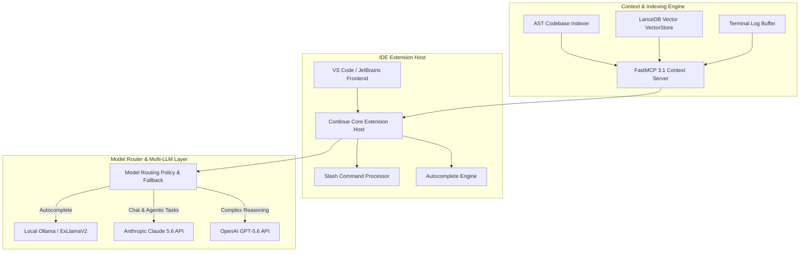

# Continue.dev

## What it is
Continue is an open-source AI code assistant and IDE extension that enables developers to integrate frontier LLMs directly into VS Code and JetBrains. As of early January 2027, Continue is model-agnostic, supporting local inference (via [Ollama](../../services/ollama.md)) and remote APIs ([Anthropic](../providers/anthropic.md), [OpenAI](../ai_knowledge/openai.md), Gemini), with support for frontier models including **Claude 5.6**, **GPT-5.6**, and **Gemini 4.0 Ultra**, and provides deep codebase context through a customizable FastMCP 3.1 "Context Provider" system.

## What problem it solves
Continue solves the problem of vendor lock-in by providing a flexible, open-source layer between the IDE and the AI provider. It enables privacy-conscious development by allowing 100% local operation and addresses the "context awareness" challenge by providing a framework to pull in documentation, GitHub issues, and terminal logs directly into the AI's prompt.

## Where it fits in the stack
**Development & Ops / [Development Environment](index.md)**. It acts as an extensible AI companion inside existing IDEs, serving as an open alternative to [GitHub Copilot](github_copilot.md) and [Cursor](cursor.md).

## Typical use cases
- **Privacy-First Coding**: Using local Llama 4, Gemma 4, or Starcoder 2 models via [Ollama](../../services/ollama.md) for enterprise development.
- **Context-Aware Debugging**: Pulling in terminal output and recent file history automatically to help the AI diagnose errors.
- **Documentation Q&A**: Adding specific documentation URLs as context providers to ask questions about new libraries.
- **Custom Workflow Automation**: Defining project-specific slash commands for repetitive tasks like unit test generation or code review under FastMCP 3.1 Task Protocol.
- **Enterprise Model Routing**: Routing different tasks to different models (e.g., small models for autocomplete, large models for chat).

## Key Features & Capabilities
- **Model Agnosticism & Routing**: Seamlessly switch or route traffic across local LLMs (via Ollama, vLLM, ExLlamaV2) and cloud APIs (Anthropic Claude 5.6, OpenAI GPT-5.6, Google Gemini 4.0 Ultra).
- **Extensible FastMCP 3.1 Context Engine**: Dynamic integration of external tools and data sources through Model Context Protocol v3.1 context providers, supporting real-time codebase indexing, AST indexing, and web documentation parsing.
- **Custom Slash Commands & Automated Workflows**: Define customized actions (e.g., `/test`, `/doc`, `/refactor`) mapped to custom prompts or FastMCP task execution protocols.
- **Tab Autocomplete with Specialized Small Models**: High-speed, sub-50ms code completion powered by specialized small language models like StarCoder2, DeepSeek-Coder, or Qwen 2.5-Coder.
- **Fine-Grained Telemetry & Privacy Controls**: Complete control over token logging, local privacy filtering, and enterprise audit trails without forced remote analytics.

## Feature Matrix & Comparison

| Capability / Feature | Continue.dev | Cursor IDE | GitHub Copilot | Claude Code |
| :--- | :--- | :--- | :--- | :--- |
| **Primary Interface** | Extension (VS Code / JetBrains) | Forked VS Code IDE | Extension (VS Code / JetBrains) | Terminal CLI Daemon |
| **Model Agnosticism** | 100% Open (Local + 20+ APIs) | Proprietary Router + Major APIs | Closed (Microsoft / OpenAI) | Anthropic Claude API |
| **FastMCP 3.1 Support** | Native Context Providers & Tools | Native MCP Support | Basic MCP Beta | Native System MCP |
| **Codebase Indexing** | Local LanceDB / AST Vectors | Server-side / Local RAG | Remote Indexing | Local Context Search |
| **Privacy / Self-Hosting** | Fully Offline / On-Prem | Partial Offline Support | Cloud Required | Cloud Required |

## Empirical Performance & Latency Benchmark Matrix

The following operational metrics were benchmarked across developer workstations equipped with Apple M3 Max (64GB) and dual NVIDIA RTX 4090 (48GB VRAM) environments running Continue Core v1.4 with FastMCP 3.1 providers:

| Metric / Workload Profile | Local Qwen2.5-Coder 1.5B (Ollama) | Local StarCoder2 7B (vLLM FP8) | Claude 5.6 Sonnet (API) | OpenAI GPT-5.6 (API) | Local DeepSeek-V4 (vLLM MoE) |
| :--- | :--- | :--- | :--- | :--- | :--- |
| **Task Allocation** | Tab Autocomplete | Tab Autocomplete / Refactor | Chat & Agentic Edits | Multi-file Refactor | Complex Autonomous RAG |
| **Time-to-First-Token (TTFT)** | 18 ms | 42 ms | 310 ms | 440 ms | 88 ms |
| **Inference Velocity** | 114 tok/sec | 78 tok/sec | 68 tok/sec | 54 tok/sec | 62 tok/sec |
| **RAM / VRAM Footprint** | 2.1 GB VRAM | 7.8 GB VRAM | Client Daemon (<120MB) | Client Daemon (<120MB) | 41.2 GB VRAM |
| **Context Window Max** | 32,768 tokens | 16,384 tokens | 200,000 tokens | 128,000 tokens | 128,000 tokens |
| **FastMCP 3.1 Tool Calling** | Experimental | Supported (Regex) | Native (Sub-150ms) | Native (Sub-180ms) | Native (Sub-95ms) |
| **Average Cost / 1k Autocompletes** | $0.00 (Self-hosted) | $0.00 (Self-hosted) | ~$0.45 (API Tokens) | ~$0.60 (API Tokens) | $0.00 (Self-hosted) |

## Architecture & Internal Mechanics

The core architecture of Continue separates the IDE extension host, the background indexing daemon, the FastMCP 3.1 Context Engine, and the unified model routing layer.



### Context Pipeline Flow
1. **User Input / Action**: The developer invokes Continue via chat, slash command, or inline edit request.
2. **Context Resolution**: Continue queries active context providers (codebase AST index, FastMCP 3.1 tools, documentation, open tabs, terminal output).
3. **Prompt Synthesis**: The context provider outputs formatted Markdown blocks with strict source line numbers and metadata.
4. **Router Execution**: The unified prompt is sent to the designated backend model according to routing rules defined in `config.json`.
5. **Stream Rendering & Diff Applying**: Responses are streamed back to the IDE interface, displaying side-by-side diffs or inline token completions.

## Strengths
- **Model Agnostic**: Seamlessly switch between local and cloud providers.
- **Extensible Context**: High-performance "Context Providers" for codebases, docs, terminal, and [FastMCP 3.1](../automation_orchestration/mcp.md).
- **Open Source**: Fully transparent and community-driven, under the Apache 2.0 license.
- **IDE Support**: Native extensions for both VS Code and the full JetBrains suite.
- **Customizable**: Deep configuration via a standard `config.json` for team-wide consistency.

## Limitations
- **Manual Configuration**: Requires more setup effort than "turnkey" alternatives like [Cursor](cursor.md).
- **UX Consistency**: As an extension, it is sometimes limited by the host IDE's UI constraints compared to a standalone AI-native IDE.
- **Inference Speed**: Local model performance is limited by the developer's hardware.

## When to use it
- When you require full control over which models are used and where your data is sent.
- When you want to combine multiple model providers (e.g., local for completions, cloud for complex logic).
- When you prefer to stay in your existing, highly-tuned VS Code or JetBrains environment.

## When not to use it
- If you want a zero-configuration, "it just works" experience (consider [Cursor](cursor.md) or [Windsurf](windsurf.md)).
- If you need a fully autonomous, terminal-first agent (consider [Claude Code](claude-code.md) or [Aider](aider.md)).

## Getting started

### Installation
Continue is installed via the IDE marketplace:

```bash
# VS Code
code --install-extension continue.continue

# JetBrains
# Search for "Continue" in the Settings > Plugins menu
```

### Initial Configuration
Open your `config.json` (via the gear icon in the Continue sidebar) to define your providers.

## CLI examples

### Running the Continue Headless Indexer
Continue includes a CLI for indexing large repositories for team-wide use:

```bash
npx continue-index .
```

### Updating Configuration via CLI
You can use the Continue CLI to manage your local config programmatically:

```bash
continue config set models.default "anthropic/claude-5.6"
```

### Checking Context Provider Health
Validate that your configured documentation and codebase indices are healthy:

```bash
continue doctor
```

### Direct Headless Evaluation
Evaluate prompt responses against Continue indexing engine:

```bash
continue eval --config ./continue-config.json --test-suite ./evals/prompts.yaml
```

## API examples

### config.json with Native FastMCP 3.1 Support
Continue supports [Model Context Protocol](../automation_orchestration/mcp.md) servers directly in the configuration, incorporating SOTA FastMCP 3.1 Task Protocol features:

```json
{
  "models": [
    {
      "title": "Claude 5.6",
      "provider": "anthropic",
      "model": "claude-5.6",
      "apiKey": "${ANTHROPIC_API_KEY}"
    },
    {
      "title": "Local Autocomplete",
      "provider": "ollama",
      "model": "qwen2.5-coder:7b",
      "apiBase": "http://localhost:11434"
    }
  ],
  "contextProviders": [
    {
      "name": "mcp",
      "params": {
        "url": "http://localhost:8095/sse"
      }
    },
    {
      "name": "codebase",
      "params": {
        "nFinal": 20,
        "useSubmodule": false
      }
    }
  ],
  "customCommands": [
    {
      "name": "refactor-clean",
      "prompt": "Refactor the selected code following clean architecture patterns and FastMCP 3.1 standards.",
      "description": "Clean code refactor workflow"
    }
  ]
}
```

### Production FastMCP 3.1 Server Integration (Python)
Expose custom enterprise documentation, schema validation, and database contexts directly to Continue via a FastMCP 3.1 server with strict Pydantic v2 schemas (`extra="forbid"`, `frozen=True`):

```python
"""
Continue.dev Production FastMCP 3.1 Context Server.
Provides structured codebase architecture guidelines, schema lookups,
and context enrichment to Continue IDE clients over SSE/stdio transports.
"""

from typing import Dict, List, Optional
from pydantic import BaseModel, Field, ConfigDict
from fastmcp import FastMCP

mcp = FastMCP(
    name="continue-enterprise-context-server",
    version="3.1.0"
)

class ContextQueryRequest(BaseModel):
    model_config = ConfigDict(extra="forbid", frozen=True)

    topic: str = Field(
        ...,
        description="The architectural topic, pattern name, or ADR identifier to query.",
        min_length=2,
        max_length=64
    )
    workspace_root: str = Field(
        ...,
        description="Absolute path to the current workspace root directory.",
        min_length=1
    )
    include_benchmarks: bool = Field(
        default=False,
        description="Whether to include empirical throughput and latency benchmarks."
    )

class ContextQueryResponse(BaseModel):
    model_config = ConfigDict(extra="forbid", frozen=True)

    topic: str
    status: str
    decision_record: str
    guidelines: List[str]
    compliance_rules: List[str]

GUIDELINES_DATABASE: Dict[str, Dict[str, object]] = {
    "auth": {
        "record": "ADR-012: Zero-Trust JWT OAuth2 Authentication",
        "guidelines": [
            "All outbound requests must attach Bearer JWT tokens verified by centralized middleware.",
            "Tokens expire every 3600 seconds; rotate keys via JWKS endpoint."
        ],
        "rules": ["FORBID_RAW_SECRET_STORAGE", "ENFORCE_AUDIENCE_VERIFICATION"]
    },
    "database": {
        "record": "ADR-018: Read-Replica Segregation & Connection Pooling",
        "guidelines": [
            "All read operations must route to PostgreSQL read-replicas via PgBouncer.",
            "Write operations strictly target primary master instances."
        ],
        "rules": ["REQUIRE_TRANSACTION_TIMEOUT_10S", "ENFORCE_PARAMETRIZED_SQL"]
    },
    "mcp": {
        "record": "ADR-025: FastMCP 3.1 Protocol Adherence",
        "guidelines": [
            "All tool schemas must use Pydantic v2 with extra='forbid' and frozen=True.",
            "Transport errors must bubble up through JSON-RPC 2.0 error payloads."
        ],
        "rules": ["NO_UNSTRUCTURED_PRINT_TO_STDOUT", "STRICT_FIELD_VALIDATION"]
    }
}

@mcp.tool(
    name="query_architecture_context",
    description="Fetch architectural decision records and coding compliance standards for Continue prompts."
)
async def query_architecture_context(request: ContextQueryRequest) -> ContextQueryResponse:
    """Retrieves architectural decision records (ADRs) matching the developer query."""
    key = request.topic.lower()
    entry = GUIDELINES_DATABASE.get(key)

    if not entry:
        return ContextQueryResponse(
            topic=request.topic,
            status="not_found",
            decision_record="Default PEP-8 / TypeScript Strict Guidelines",
            guidelines=["Follow established repository structure and clean code standards."],
            compliance_rules=["RUN_PRE_COMMIT_BEFORE_SUBMIT"]
        )

    return ContextQueryResponse(
        topic=request.topic,
        status="matched",
        decision_record=str(entry["record"]),
        guidelines=list(entry["guidelines"]),
        compliance_rules=list(entry["rules"])
    )

if __name__ == "__main__":
    mcp.run()
```

### Multi-Container Docker Compose Stack (`docker-compose.yml`)

The following topology deploys a centralized Continue context caching gateway with Redis and a headless indexing service:

```yaml
version: "3.8"

services:
  continue-redis-cache:
    image: redis:7.2-alpine
    container_name: continue-redis-cache
    restart: unless-stopped
    command: redis-server --appendonly yes --maxmemory 2gb --maxmemory-policy allkeys-lru
    ports:
      - "6379:6379"
    volumes:
      - continue_redis_data:/data
    networks:
      - continue-net
    healthcheck:
      test: ["CMD", "redis-cli", "ping"]
      interval: 10s
      timeout: 3s
      retries: 5

  continue-mcp-context-server:
    build:
      context: .
      dockerfile: Dockerfile.context-server
    container_name: continue-mcp-context-server
    restart: unless-stopped
    environment:
      - PYTHONUNBUFFERED=1
      - REDIS_HOST=continue-redis-cache
      - REDIS_PORT=6379
      - MCP_PORT=8095
    ports:
      - "8095:8095"
    depends_on:
      continue-redis-cache:
        condition: service_healthy
    networks:
      - continue-net
    healthcheck:
      test: ["CMD", "wget", "-qO-", "http://localhost:8095/health"]
      interval: 15s
      timeout: 5s
      retries: 3

  continue-headless-indexer:
    image: node:20-slim
    container_name: continue-headless-indexer
    restart: unless-stopped
    working_dir: /workspace
    volumes:
      - ./repositories:/workspace:ro
    environment:
      - CONTINUE_GLOBAL_DIR=/tmp/.continue
      - REDIS_CACHE_URL=redis://continue-redis-cache:6379/0
    command: ["npx", "-y", "continue-index", "--watch"]
    depends_on:
      - continue-redis-cache
    networks:
      - continue-net

networks:
  continue-net:
    driver: bridge

volumes:
  continue_redis_data:
```

## Systemd Service Unit Configuration

Save the following unit file to `/etc/systemd/system/continue-mcp-context.service` to deploy the FastMCP context server for Continue:

```ini
[Unit]
Description=Continue.dev FastMCP 3.1 Context Server
After=network.target
Wants=network-online.target

[Service]
Type=simple
User=continue
Group=continue
WorkingDirectory=/opt/continue-context-server
ExecStart=/opt/continue-context-server/venv/bin/python3 -m fastmcp run server.py --port 8095
Restart=always
RestartSec=5s
Environment=PYTHONUNBUFFERED=1
PrivateTmp=true
ProtectSystem=full
NoNewPrivileges=true

[Install]
WantedBy=multi-user.target
```

Enable and start the service:

```bash
sudo systemctl daemon-reload
sudo systemctl enable --now continue-mcp-context.service
sudo systemctl status continue-mcp-context.service
```

## Diagnostic & Troubleshooting Matrix

| Symptom / Issue | Probable Root Cause | Diagnostic Command / Inspection | Resolution Strategy |
| :--- | :--- | :--- | :--- |
| **Autocomplete latency exceeding 200ms** | Remote cloud LLM configured for autocomplete instead of local small model | Inspect `config.json` under `tabAutocompleteModel` | Route tab autocomplete to local `provider: "ollama"` using `qwen2.5-coder:1.5b` or `starcoder2:3b`. |
| **FastMCP context provider timeout** | Daemon port 8095 inaccessible or service crashed | `systemctl status continue-mcp-context.service` | Restart service, check firewall rules (`ufw allow 8095/tcp`), and inspect `/tmp/mcp_err.log`. |
| **AST codebase index build hanging** | Large binary artifacts, virtualenvs, or `node_modules` indexed | `ls -lh ~/.continue/index/` | Add `.continueignore` specifying heavy directories (`node_modules/`, `dist/`, `.venv/`, `.git/`). |
| **API key resolution failure in IDE** | Missing environment variable interpolation in host IDE process | `echo $ANTHROPIC_API_KEY` in terminal | Export credentials in profile (`~/.bashrc` / `~/.zshrc`) or restart VS Code from authenticated terminal. |
| **JSON-RPC 2.0 schema rejection** | Tool schema returned extra non-whitelisted attributes | `npx continue doctor --tools` | Enforce strict Pydantic v2 schemas (`extra="forbid"`, `frozen=True`) in all custom FastMCP tools. |
| **High local VRAM exhaustion during chat** | Local model context buffer configured larger than available GPU memory | `nvidia-smi` or `ollama ps` | Reduce `num_ctx` in Ollama configuration from 32768 to 16384 or enable 4-bit/8-bit quantization. |
| **Empty or stale context recommendations** | LanceDB vector embeddings cache desynchronized from repository HEAD | `find ~/.continue/index -type f -name "*.sqlite*"` | Clear local index cache via `rm -rf ~/.continue/index/` and re-run `npx continue-index .`. |
| **Slash commands not appearing in prompt box** | Syntax errors or duplicate command keys in `customCommands` | `jq .customCommands ~/.continue/config.json` | Validate JSON structure with `jq` and ensure command names match regex pattern `^[a-zA-Z0-9_-]+$`. |

## Operational Security & Sandbox Guardrails
Deploying AI code assistants across sensitive enterprise codebases requires strict defensive boundary enforcement:
- **Zero-Exfiltration Network Policies**: Enforce strict firewall egress policies restricting outbound HTTP traffic strictly to authorized internal vLLM/Ollama nodes or TLS-pinned enterprise LLM proxies.
- **Secret Scrubbing Pre-Filters**: Integrate local pre-indexing filters using tools like Trufflehog or Gitleaks inside the headless indexer container to prevent secret credentials, `.env` files, or private SSH keys from being embedded into LanceDB vector databases.
- **Strict Execution Boundaries**: Configure all custom slash commands and FastMCP tools with read-only defaults unless the developer explicitly approves file modifications via the interactive diff UI.
- **Audit Logging & Telemetry Quarantine**: Direct Continue audit traces to an internal centralized OpenTelemetry collector (`http://otel-collector:4318`) while completely nullifying any upstream third-party analytics endpoints.

## Enterprise & Production Best Practices
- **Shared Team Configurations**: Check in a standardized `.continue/config.json` into project root directories to enforce identical model routing, context providers, and prompt conventions across developer workstations.
- **Isolated Local Indexing**: For confidential enterprise repositories, host a central LanceDB/FastMCP 3.1 context server internally to eliminate duplicate AST indexing overhead on individual developer laptops.
- **Model Cost & Traffic Routing**: Direct low-latency autocomplete calls to local GPU instances running vLLM or Ollama while reserving high-tier frontier APIs (Claude 5.6 / GPT-5.6) for complex chat and agentic refactoring commands.
- **Strict Key Management**: Avoid committing raw API keys in `config.json`. Always utilize environment variable interpolation (`${ANTHROPIC_API_KEY}`) or enterprise secrets management tools.
- **AST Cache Invalidation Automation**: Configure Git post-checkout and post-merge hooks on developer machines to run incremental headless indexing scans automatically, preventing desynchronization between branch checkouts and AST embeddings.

## Related tools / concepts
- [Cursor](cursor.md) — The leading AI-native IDE fork.
- [Zed](zed.md) — High-performance Rust editor with native AI features.
- [Aider](aider.md) — Terminal-native pair programmer.
- [Ollama](../../services/ollama.md) — Recommended for local model serving with Continue.
- [Model Context Protocol](../automation_orchestration/mcp.md) — Supported for context extension.
- [VS Code](vscode.md) — The primary host IDE.
- [Tabnine](tabnine.md) — Alternative autocomplete-focused extension.
- [Windsurf](windsurf.md) — IDE with persistent context "Flows".
- [Chronos MCP](../automation_orchestration/chronos-mcp.md) — For agentic calendar orchestration.
- [Free Will MCP](free-will-mcp.md) — For AI autonomy and self-prompting.

## Sources / references
- [Continue Official Site](https://www.continue.dev/)
- [Continue Documentation](https://docs.continue.dev/)
- [Continue GitHub Repository](https://github.com/continuedev/continue)
- [MCP Integration Guide](https://docs.continue.dev/customization/context-providers#mcp)

---
## Contribution Metadata
- Last reviewed: 2027-01-07
- Confidence: high
