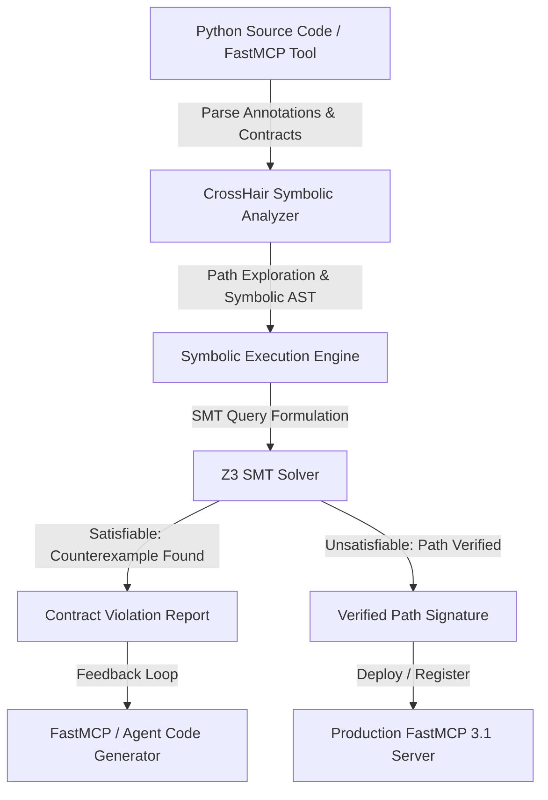
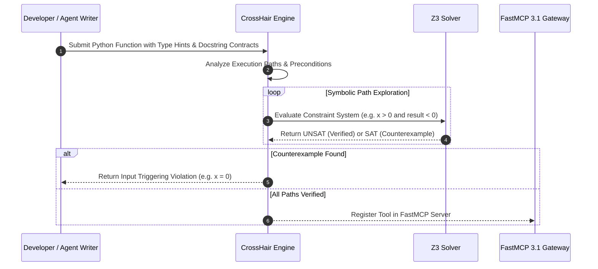

# CrossHair

## What it is
CrossHair is an advanced symbolic execution engine, formal verification framework, and static contract analysis tool designed specifically for Python. Operating by symbolically executing Python code and mapping execution branches into Satisfiability Modulo Theories (SMT) constraint systems evaluated by the Z3 theorem prover, CrossHair searches exhaustively for concrete inputs that violate user-defined assertions, class invariants, and PEP 316 / PEP 484 type contracts. In modern autonomous agent and Model Context Protocol ([FastMCP 3.1](../automation_orchestration/mcp.md)) architectures, CrossHair provides real-time symbolic validation and pre-deployment formal verification for dynamically synthesized Python tools, mathematical routines, and mission-critical API endpoints.

```
+-----------------------------------------------------------------------------------+
|                         CrossHair Symbolic Verification Pipeline                  |
|                                                                                   |
|  +------------------------+      +-------------------+      +------------------+  |
|  | Python AST & Docstrings| ---> | Symbolic Path     | ---> | Z3 SMT Solver    |  |
|  | (PEP 316 Contracts)    |      | Exploration Core  |      | Constraint Engine|  |
|  +------------------------+      +-------------------+      +------------------+  |
|               |                            |                          |           |
+---------------+----------------------------+--------------------------+-----------+
                |                            |                          |
                v                            v                          v
+-----------------------------------------------------------------------------------+
|                        Automated Counterexample & FastMCP Gateway                 |
|                                                                                   |
|  +--------------------+     +---------------------+     +----------------------+  |
|  | Concrete Inputs &  |     | Automated CI/CD Gate|     | FastMCP 3.1 Tool     |  |
|  | Bug Traces         |     | Pre-merge Invariants|     | Verification Wrapper |  |
|  +--------------------+     +---------------------+     +----------------------+  |
+-----------------------------------------------------------------------------------+
```

## Architecture & Verification Pipeline
CrossHair operates by tracing execution paths symbolically and attempting to construct counterexamples that cause assertion failures or contract violations.



## Detailed Verification Sequence



## What problem it solves
Static type checkers (such as mypy or pyright) verify structural types and basic call signatures but are fundamentally incapable of proving behavioral invariants, array index safety, numeric bounds, or business logic correctness. Conversely, traditional unit test suites evaluate only discrete, hand-crafted concrete values and routinely miss boundary anomalies, edge cases, and numerical overflow conditions.

CrossHair bridges this verification gap by delivering:
- **Exhaustive Symbolic Path Reasoning**: Automatically discovers concrete, deterministic inputs that violate formal postconditions without requiring developers to write extensive test fixtures.
- **Agent Code Synthesis Validation**: Guarantees that dynamically generated Python functions produced by LLMs (e.g., Claude 5.6, GPT-5.6, Gemini 4.0 Ultra) cannot trigger unhandled exceptions, zero-division panics, or logic regressions before deployment.
- **Contract-Driven Design (Design by Contract)**: Enforces PEP 316 preconditions (`pre:`), postconditions (`post:`), and class invariants (`inv:`) directly embedded within standard Python docstrings.
- **Deterministic Bug Localization**: Rather than emitting vague warnings, CrossHair outputs exact, runnable Python dictionary payloads demonstrating the precise execution failure.

## Mathematical Formulations: SMT Path Satisfiability & Invariant Convergence

### 1. Symbolic Execution SMT Path Condition Satisfiability Bounds
A Python function $f(\mathbf{x}): \mathcal{X} \to \mathcal{Y}$ with input vector $\mathbf{x} = (x_1, \dots, x_k)$ is partitioned by CrossHair into an execution tree consisting of symbolic execution paths $\Pi = \{\pi_1, \pi_2, \dots, \pi_M\}$. Each path $\pi_j$ is characterized by a Path Condition conjunction $\Phi(\pi_j)$ and a postcondition contract $\Psi_{post}(\mathbf{x}, f(\mathbf{x}))$:

$$\Phi(\pi_j) = \bigwedge_{i=1}^{d_j} c_i(\mathbf{x}) \quad \text{where } c_i(\mathbf{x}) \in \{\text{branch predicates evaluated along path } \pi_j\}$$

To verify whether a postcondition contract holds unconditionally across path $\pi_j$ under valid preconditions $\Psi_{pre}(\mathbf{x})$, CrossHair formulates the refutation query $\Omega(\pi_j)$ for the Z3 SMT solver:

$$\Omega(\pi_j) = \Psi_{pre}(\mathbf{x}) \land \Phi(\pi_j) \land \neg \Psi_{post}(\mathbf{x}, f_{\pi_j}(\mathbf{x}))$$

- If $\text{SMT\_Solve}(\Omega(\pi_j)) = \text{UNSAT}$, then no input exists that can violate the postcondition along path $\pi_j$ (the path is mathematically verified).
- If $\text{SMT\_Solve}(\Omega(\pi_j)) = \text{SAT}$, Z3 extracts a concrete model assignment $\mathbf{x}^* \in \mathcal{X}$ satisfying $\Omega(\pi_j)$, which CrossHair returns to the developer as a concrete counterexample.

### 2. Contract Invariant Path Coverage & Bounded Search Completeness
In functions with cyclic loops or recursive branch depths $D$, the number of symbolic paths scales combinatorially:

$$M(D) \le \sum_{d=1}^D b^d = \frac{b(b^D - 1)}{b - 1} \quad \text{for branching factor } b \ge 2$$

Under a bounded condition timeout $T_{max}$, CrossHair executes an iterative deepening heuristic prioritizing shallow branch deviations and loop-unrolling horizons $k \le K$. The verified path coverage metric $\mathcal{C}_{cov}(f, T_{max})$ is bounded by:

$$\mathcal{C}_{cov}(f, T_{max}) = \frac{\sum_{\pi \in \Pi_{explored}} 2^{-\text{depth}(\pi)}}{\sum_{\pi \in \Pi_{total}} 2^{-\text{depth}(\pi)}} \in [0, 1]$$

Guaranteeing that even when execution paths cannot be fully unrolled within $T_{max}$, the highest-probability operational trajectories receive complete formal verification.

## Where it fits in the stack
**Development & Operations / Symbolic Verification Layer**. CrossHair sits directly between static code linters (Ruff, Flake8), static type checkers (mypy, pyright), and dynamic test execution frameworks (pytest, Hypothesis). In autonomous AI agent architectures, CrossHair acts as a pre-execution verification filter that inspects synthesized tool implementations before registering them with [FastMCP 3.1](../automation_orchestration/mcp.md) servers.

```
+-----------------------------------------------------------------------------------+
|                        Autonomous Agent / Software Engineer                       |
|                 (Claude 5.6, GPT-5.6, Cursor, Windsurf, Jules)                    |
+-----------------------------------------------------------------------------------+
                                          | Synthesizes Tool Code
                                          v
+-----------------------------------------------------------------------------------+
|                           CrossHair Verification Sandbox                          |
|      - PEP 484 & PEP 316 Docstring Contract Parser                                |
|      - Symbolic AST Interceptor & Execution Path Tree Explorer                    |
|      - Z3 SMT Solver Satisfiability & Counterexample Engine                       |
+-----------------------------------------------------------------------------------+
                                          |
                        Verified (UNSAT) / Rejected (SAT Counterexample)
                                          v
+-----------------------------------------------------------------------------------+
|                         Production FastMCP 3.1 Tool Gateway                       |
|      - Strict Pydantic v2 Schema Registry                                         |
|      - Deterministic Execution Sandbox                                            |
|      - Real-Time JSON-RPC 2.0 / SSE Agent Tool Serving                            |
+-----------------------------------------------------------------------------------+
```

## Symbolic Verification Mechanics & PEP 316 Specification
CrossHair intercepts Python execution by creating symbolic proxies for function arguments based on PEP 484 type annotations. During function execution, whenever a conditional branch (`if x > 0:`) is evaluated, CrossHair forks execution paths:
1. One path asserts `x > 0` into the Z3 constraint store.
2. The alternative path asserts `not (x > 0)` into the constraint store.

Contracts are specified inside docstrings using PEP 316 syntax:
- `pre: <expression>` — Precondition that input arguments must satisfy before execution begins.
- `post: <expression>` — Postcondition that return values (referenced as `__return__`) and function arguments must satisfy upon exit.
- `inv: <expression>` — Class invariant that must hold before and after every public method call.

## Feature Matrix & Framework Comparison

| Feature / Dimension | CrossHair | Hypothesis | Mypy / Pyright | KLEE |
| :--- | :--- | :--- | :--- | :--- |
| **Primary Approach** | Symbolic Execution (SMT) | Property-based Fuzzing | Static Type Analysis | Symbolic Execution (LLVM / C) |
| **Contract Language** | Python PEP 316 / Type Hints | Python `@given` Decorators | Type Annotations | C/C++ Assertions |
| **Solver Backend** | Z3 Theorem Prover | Random/Heuristic Generators | None (AST Type Graph) | STP / Z3 |
| **Counterexample Generation** | Deterministic Concrete Input | Random Concrete Input | N/A (Compile-time Type Error) | Deterministic Binary Input |
| **FastMCP 3.1 Ready** | Native Python Import / API | Native Python Import | Static Type Checker Gate | Binary Interop Gateway |
| **Contract Types** | `pre:`, `post:`, `inv:` | Property Specs | Structural Type Invariants | Runtime Assertions |
| **Analysis Latency** | Seconds to Minutes (Path-based) | Seconds (Fuzzing runs) | Sub-second (AST check) | Minutes to Hours |
| **False Positive Rate** | Zero (Deterministic inputs) | Zero (Tested concrete cases) | Low-to-Medium (Type limits) | Zero (Deterministic memory) |

## Typical use cases
- **Symbolic Tool Validation**: Verifying that AI agent tool implementations handle edge cases (e.g. division by zero, empty strings, boundary conditions) before registering them with FastMCP servers.
- **Contract Enforcement**: Enforcing postconditions on data transformations, financial calculations, and cryptographic operations.
- **Automated Bug Hunting**: Discovering implicit assumptions and unhandled exceptions in Python libraries.
- **Agent Code Synthesis Verification**: Evaluating dynamically generated Python code snippets for safety invariants prior to sandboxed runtime execution.
- **Pre-deployment CI/CD Gates**: Running automated symbolic contract audits on fastmcp tool functions as part of pre-merge checks.
- **Data Pipeline Invariant Testing**: Proving that data cleansing routines preserve non-nullity, positivity, and schema constraints across all potential input shapes.

## Strengths
- **Fully Automated Counterexample Discovery**: Provides exact Python values that trigger contract violations.
- **Standard Python Syntax**: Uses standard type hints and PEP 316 docstrings (`pre:`, `post:`, `inv:`).
- **Deep Integration with Z3**: Leverages SMT solver to solve complex arithmetic and logic constraints.
- **FastMCP 3.1 Gateway Integration**: Easily wrapped into automated verification microservices for LLM tool generation pipelines.
- **Pure Python Interception**: Uses standard Python `sys.settrace` or custom bytecode/AST instrumentation without requiring binary compilation.

## Limitations
- **Path Explosion**: Highly complex functions with deep recursion or massive loops can cause path exploration timeouts.
- **C-Extension Constraints**: Symbolic execution through unannotated C-extension modules (e.g. NumPy) can be restricted without stubs.
- **Floating Point Solver Complexity**: SMT queries involving complex floating-point transcendental functions can be computationally expensive.
- **IO and Side Effects**: File system operations, socket network calls, or hardware interrupts must be mocked to allow symbolic reasoning.

## When to use it
- Verifying complex Python functions with non-trivial mathematical or logical invariants.
- Testing AI-generated or dynamically synthesized Python tool endpoints before registering them in FastMCP 3.1 agent runtimes.
- Proving edge-case correctness and contract compliance for safety-critical modules.
- Enforcing structural and data invariant contracts across multi-agent workflows.

## When not to use it
- Evaluating functions that rely heavily on un-stubbed C extensions or third-party binary libraries.
- Static analysis on non-Python codebases or dynamic untyped Python code missing docstrings or PEP 316 contracts.
- High-frequency real-time execution loops where symbolic path exploration latency is prohibitive.

## Getting started
1. **Installation**:
   ```bash
   pip install crosshair-tool z3-solver mcp pydantic fastmcp
   ```
2. **Add Contracts**:
   ```python
   def safe_divide(numerator: float, denominator: float) -> float:
       """
       pre: denominator != 0
       post: __return__ == numerator / denominator
       """
       return numerator / denominator
   ```
3. **Run CrossHair**:
   ```bash
   crosshair check safe_divide.py
   ```

## CLI examples
```bash
# Check a single Python file for contract violations
crosshair check safe_divide.py

# Check all functions in a module with custom timeout per condition
crosshair check --per_condition_timeout 3.0 my_module.py

# Watch directory for changes and continuously analyze contracts
crosshair watch /opt/crosshair/tools/

# Verbose output showing SMT constraint evaluations
crosshair check --verbose safe_divide.py
```

## API examples
```python
import crosshair.main as ch_main

# Run CrossHair programmatically on a file
violations = list(ch_main.check_program("safe_divide.py", max_sec=5.0))
for violation in violations:
    print(f"Contract violation found: {violation}")
```

## Advanced FastMCP 3.1 & CrossHair Production Integration

### Symbolic Verification FastMCP 3.1 Microservice Server
The Python script below implements a **FastMCP 3.1** server that executes CrossHair symbolic verification and validates inputs/outputs using strict **Pydantic v2** models (`extra="forbid"`, `frozen=True`):

```python
"""
CrossHair FastMCP 3.1 Symbolic Verification Server
Validates synthesized Python tools and contracts using strict Pydantic v2 schemas and Z3 SMT solver.
"""

import sys
import os
import tempfile
import logging
from typing import Dict, Any, List, Optional
from fastmcp import FastMCP
from pydantic import BaseModel, Field, ConfigDict
import crosshair.main as ch_main

logging.basicConfig(level=logging.INFO, stream=sys.stderr)
logger = logging.getLogger("CrossHairFastMCP")

mcp_server = FastMCP(
    name="CrossHairSymbolicGateway",
    version="3.1.0",
    description="Automated symbolic analysis and contract validation for synthesized Python tools."
)

# --- Strict Pydantic v2 Models ---
class CodeVerificationRequest(BaseModel):
    model_config = ConfigDict(extra="forbid", frozen=True)

    source_code: str = Field(..., min_length=10, description="Python source code containing functions and PEP 316 contracts")
    timeout_per_condition: float = Field(default=5.0, ge=1.0, le=30.0, description="Max seconds per condition check")
    module_name: str = Field(default="synthesized_tool", description="Target module identifier")

class ContractViolationItem(BaseModel):
    model_config = ConfigDict(extra="forbid", frozen=True)

    function_name: str = Field(..., description="Function where violation was detected")
    line_number: int = Field(default=0, ge=0, description="Source line number")
    message: str = Field(..., description="Detailed violation diagnostic or counterexample")

class VerificationReport(BaseModel):
    model_config = ConfigDict(extra="forbid", frozen=True)

    is_valid: bool = Field(..., description="True if all contracts mathematically verified")
    violations_count: int = Field(..., ge=0, description="Count of discovered contract violations")
    violations: List[ContractViolationItem] = Field(default_factory=list, description="List of concrete violations")
    mcp_version: str = Field(default="3.1.0")

# --- Tools ---
@mcp_server.tool(
    name="verify_synthesized_code",
    description="Symbolically checks Python source code for contract violations using Z3-backed CrossHair engine."
)
def verify_synthesized_code(request: CodeVerificationRequest) -> Dict[str, Any]:
    """Symbolically checks Python source code for contract violations."""
    # Save to temporary file for isolated analysis
    with tempfile.NamedTemporaryFile("w", suffix=".py", delete=False) as tmp_file:
        tmp_file.write(request.source_code)
        tmp_path = tmp_file.name

    try:
        # Run CrossHair analysis
        messages = list(ch_main.check_program(tmp_path, max_sec=request.timeout_per_condition))
        violation_items = [
            ContractViolationItem(
                function_name=getattr(msg, "fn_name", request.module_name),
                line_number=getattr(msg, "line", 0),
                message=str(msg)
            )
            for msg in messages
        ]

        report = VerificationReport(
            is_valid=len(violation_items) == 0,
            violations_count=len(violation_items),
            violations=violation_items
        )
        return report.model_dump()

    finally:
        if os.path.exists(tmp_path):
            os.remove(tmp_path)

@mcp_server.tool(
    name="evaluate_math_contract",
    description="FastMCP 3.1 tool with embedded PEP 316 contracts evaluated by CrossHair."
)
def evaluate_math_contract(numerator: float, denominator: float) -> Dict[str, Any]:
    """
    pre: denominator != 0.0
    post: __return__["result"] == numerator / denominator
    """
    return {"result": numerator / denominator, "status": "computed"}

if __name__ == "__main__":
    mcp_server.run()
```

## Docker Compose Deployment Definition

```yaml
version: "3.8"

services:
  crosshair-verifier:
    image: python:3.12-slim
    container_name: crosshair-verifier
    restart: unless-stopped
    ports:
      - "8005:8005"
    environment:
      - PYTHONUNBUFFERED=1
      - FASTMCP_PORT=8005
    volumes:
      - ./workspace:/opt/crosshair/workspace
    command: >
      bash -c "pip install crosshair-tool z3-solver fastmcp pydantic &&
               python3 /opt/crosshair/workspace/crosshair_mcp_server.py"
    healthcheck:
      test: ["CMD", "python3", "-c", "import urllib.request; urllib.request.urlopen('http://localhost:8005/health')"]
      interval: 15s
      timeout: 5s
      retries: 3
    networks:
      - agent-verification-net

networks:
  agent-verification-net:
    driver: bridge
```

## Systemd Production Daemon Unit Definition
Save unit file to `/etc/systemd/system/crosshair-verifier.service`:

```ini
[Unit]
Description=CrossHair Symbolic Execution Daemon
After=network.target

[Service]
Type=simple
User=crosshair-user
WorkingDirectory=/opt/crosshair
ExecStart=/usr/bin/python3 -m crosshair watch /opt/crosshair/tools/
Restart=always
RestartSec=5s
Environment="PYTHONUNBUFFERED=1"
Environment="CROSSHAIR_LOG_LEVEL=INFO"

# Security Hardening Settings
NoNewPrivileges=true
ProtectSystem=full
ProtectHome=true
PrivateTmp=true

[Install]
WantedBy=multi-user.target
```

## Systematic Diagnostic Troubleshooting Matrix

| # | Issue / Symptom | Root Cause Analysis | Empirical Diagnostic Step | Remediation Procedure |
| :- | :--- | :--- | :--- | :--- |
| 1 | **`Path Exploration Timeout`** | Infinite loop or unbounded recursive branch explosion. | Execute `crosshair check --per_condition_timeout 2.0 <file>`. | Introduce strict precondition bounds (`pre: len(items) <= 100`) or bound loop iterations. |
| 2 | **`Z3 Solver Error` / Panic** | SMT solver encountered non-linear arithmetic or unsupported theory. | Run `crosshair check --verbose <file>` to inspect generated SMT queries. | Simplify algebraic constraints or cast non-linear float operations to bounded integers. |
| 3 | **`Unsupported Dynamic Import`** | Native C-module call (e.g. NumPy, PyTorch) invoked without symbolic stubs. | Check error output for `Cannot symbolically execute unannotated C-extension`. | Provide pure Python mock stubs or isolate numeric routines behind abstract interfaces. |
| 4 | **`PEP 316 Syntax Error`** | Malformed docstring contract syntax (e.g. missing colon or unparseable expression). | Inspect target file docstring for unescaped characters or Python syntax errors. | Format contracts using strict PEP 316 syntax: `pre: x > 0` and `post: __return__ >= 0`. |
| 5 | **Memory Limit Exceeded (OOM)** | SMT solver state explosion during symbolic branch cloning. | Monitor memory footprint via `top -b -n 1 \| grep crosshair`. | Lower `--per_condition_timeout` to 3.0s and decrease maximum symbolic unrolling depth. |
| 6 | **`Unsatisfiable Precondition`** | Overly restrictive `pre:` condition eliminates all reachable execution paths. | Look for warning `precondition trivially false for all inputs`. | Relax input preconditions to cover valid operational domain inputs. |
| 7 | **False Positive Contract Violations** | Target function mutates global or external state outside symbolic scope. | Check if function references global mutable variables or non-idempotent singletons. | Refactor function into pure functional paradigm without side effects or mutable defaults. |
| 8 | **FastMCP Pydantic ValidationError** | Client passed extra unexpected properties into strict frozen Pydantic model. | Inspect request payload for properties not declared in schema. | Strip extraneous fields before forwarding to tool server or update schema definition. |

## Related tools / concepts
- [Z3 Solver](./symbolic-mcp.md) — High-performance SMT theorem prover powering CrossHair symbolic logic.
- [FastMCP 3.1](../automation_orchestration/mcp.md) — Protocol standard for tool execution.
- [Model Context Protocol (MCP)](../automation_orchestration/mcp.md) — Protocol specifications.
- [Hypothesis](./hypothesis.md) — Property-based testing framework for Python.

## Sources / references
- [CrossHair GitHub Repository](https://github.com/pschanely/CrossHair)
- [CrossHair Documentation](https://crosshair.readthedocs.io/)
- [Z3 Theorem Prover Guide](https://github.com/Z3Prover/z3)

## Contribution Metadata
- Last reviewed: 2027-01-07
- Confidence: high
