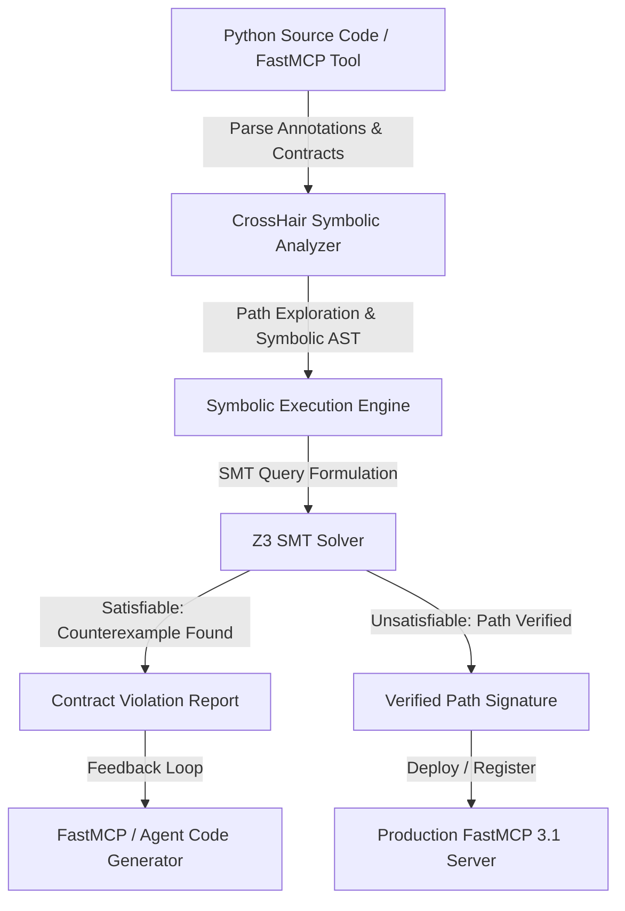
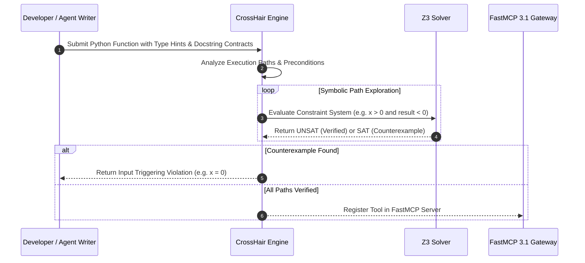

# CrossHair

## What it is
CrossHair is a symbolic execution engine and static analysis tool for Python that verifies code contracts, type annotations, and formal preconditions/postconditions. By executing Python code symbolically using SMT (Satisfiability Modulo Theories) solvers such as Z3, CrossHair searches for inputs that violate user-defined assertions or Python standard typing contracts. In modern autonomous agent and Model Context Protocol ([FastMCP 3.1](../automation_orchestration/mcp.md)) environments, CrossHair provides real-time symbolic validation of dynamically synthesized Python functions and API tool endpoints.

## Architecture & Verification Pipeline
CrossHair operates by tracing execution paths symbolically and attempting to construct counterexamples that cause assertion failures or contract violations.



## Detailed Verification Sequence



## What problem it solves
Static type checkers (like mypy or pyright) verify structural types but cannot check behavioral logic, array index bounds, or complex business logic invariants. Traditional unit tests test specific concrete values but often miss edge cases. CrossHair bridges this gap by automatically discovering concrete inputs that violate formal specifications without requiring developers to hand-craft exhaustive test cases.

## Where it fits in the stack
**Development & Operations / Verification Layer**. CrossHair sits alongside static checkers and dynamic test runners in automated CI/CD pipelines or FastMCP agent tool verification layers. It intercepts agent-generated Python tool code before execution to guarantee safety contracts.

## Typical use cases
- **Symbolic Tool Validation**: Verifying that AI agent tool implementations handle edge cases (e.g. division by zero, empty strings, boundary conditions) before registering them with FastMCP servers.
- **Contract Enforcement**: Enforcing postconditions on data transformations, financial calculations, and cryptographic operations.
- **Automated Bug Hunting**: Discovering implicit assumptions and unhandled exceptions in python libraries.

## Strengths
- **Fully Automated Counterexample Discovery**: Provides exact Python values that trigger contract violations.
- **Standard Python Syntax**: Uses standard type hints and PEP 316 docstrings (`post: _ == expected`).
- **Deep Integration with Z3**: Leverages SMT solver to solve complex arithmetic and logic constraints.

## Limitations
- **Path Explosion**: Highly complex functions with deep recursion or massive loops can cause path exploration timeouts.
- **C-Extension Constraints**: Symbolic execution through unannotated C-extension modules (e.g. NumPy) can be restricted without stubs.

## When to use it
- Verifying complex Python functions with non-trivial mathematical or logical invariants.
- Testing AI-generated or dynamically synthesized Python tool endpoints before registering them in FastMCP 3.1 agent runtimes.
- Proving edge-case correctness and contract compliance for safety-critical modules.

## When not to use it
- Evaluating functions that rely heavily on un-stubbed C extensions or third-party binary libraries.
- Static analysis on non-Python codebases or dynamic untyped Python code missing docstrings or PEP 316 contracts.
- High-frequency real-time execution loops where symbolic path exploration latency is prohibitive.

## Feature Matrix & Framework Comparison

| Feature | CrossHair | Hypothesis | Mypy / Pyright | KLEE |
| :--- | :--- | :--- | :--- | :--- |
| **Primary Approach** | Symbolic Execution (SMT) | Property-based Fuzzing | Static Type Analysis | Symbolic Execution (C/C++) |
| **Contract Language** | Python PEP 316 / Type Hints | Python `@given` Decorators | Type Annotations | C Assertions |
| **Solver Backend** | Z3 Solver | Random/Heuristic Generators | None (AST Type Graph) | STP / Z3 |
| **Counterexample Generation** | Deterministic Concrete Input | Random Concrete Input | N/A | Deterministic Input |
| **FastMCP 3.1 Ready** | Native Python Import / API | Native Python Import | Type Checker Gate | Binary Interop |

## Getting started
1. **Installation**:
   ```bash
   pip install crosshair-tool z3-solver mcp pydantic
   ```
2. **Add Contracts**:
   ```python
   def safe_divide(numerator: float, denominator: float) -> float:
       """
       pre: denominator != 0
       post: __return__ == numerator / denominator
       """
       return numerator / denominator
   ```
3. **Run CrossHair**:
   ```bash
   crosshair check safe_divide.py
   ```

## CLI examples
```bash
# Check a single Python file for contract violations
crosshair check safe_divide.py

# Check all functions in a module with custom timeout per condition
crosshair check --per_condition_timeout 3.0 my_module.py

# Watch directory for changes and continuously analyze contracts
crosshair watch /opt/crosshair/tools/
```

## API examples
```python
import crosshair.main as ch_main

# Run CrossHair programmatically on a file
violations = list(ch_main.check_program("safe_divide.py", max_sec=5.0))
for violation in violations:
    print(f"Contract violation found: {violation}")
```

## API & FastMCP 3.1 Examples

### FastMCP 3.1 Symbolic Execution Gateway Provider
```python
import mcp.server.fastmcp as fastmcp
from pydantic import BaseModel, Field
from typing import Dict, Any, List
import crosshair.main as ch_main

mcp_server = fastmcp.FastMCP("CrossHair Symbolic Validation Server", version="3.1")

class VerificationRequest(BaseModel):
    file_path: str = Field(..., description="Path to Python file containing target functions")
    timeout_sec: float = Field(default=10.0, ge=1.0, le=60.0)

@mcp_server.tool()
def verify_python_contract(request: VerificationRequest) -> Dict[str, Any]:
    """FastMCP 3.1 Tool that symbolically checks Python functions for contract violations using CrossHair."""
    # Execute CrossHair verification check
    messages = list(ch_main.check_program(request.file_path, max_sec=request.timeout_sec))
    violations = [str(msg) for msg in messages]

    return {
        "verified": len(violations) == 0,
        "violations_count": len(violations),
        "details": violations,
        "mcp_version": "3.1"
    }

if __name__ == "__main__":
    mcp_server.run()
```

### Programmatic CrossHair Execution Wrapper
```python
from pydantic import BaseModel, Field
import crosshair.main as ch_main
from typing import List

class AnalysisConfig(BaseModel):
    target_path: str
    max_seconds: float = Field(5.0, gt=0)

def run_symbolic_analysis(config: AnalysisConfig) -> List[str]:
    print(f"Running CrossHair symbolic analysis on {config.target_path}...")
    issues = list(ch_main.check_program(config.target_path, max_sec=config.max_seconds))
    return [str(issue) for issue in issues]

if __name__ == "__main__":
    cfg = AnalysisConfig(target_path="safe_divide.py", max_seconds=10.0)
    # Perform symbolic analysis
    # results = run_symbolic_analysis(cfg)
```

## Systemd Service Unit Definition
Save unit file to `/etc/systemd/system/crosshair-verifier.service`:

```ini
[Unit]
Description=CrossHair Symbolic Execution Daemon
After=network.target

[Service]
Type=simple
User=crosshair-user
WorkingDirectory=/opt/crosshair
ExecStart=/usr/bin/python3 -m crosshair watch /opt/crosshair/tools/
Restart=always
RestartSec=5s

[Install]
WantedBy=multi-user.target
```

## Troubleshooting & Diagnostic Matrix

| Issue Symptom / Error | Root Cause | Verification Command | Remediation Action |
| :--- | :--- | :--- | :--- |
| **`Path Timeout`** | Infinite loop or excessive recursion paths | `crosshair check --per_condition_timeout 2.0 <file>` | Add strict precondition bounds or simplify loop invariants |
| **`Z3 Solver Error`** | Incompatible SMT constraints | `crosshair check --verbose <file>` | Ensure Z3 solver version matches python environment requirements |
| **`Unsupported Dynamic Import`** | Native C-module call without symbolic stub | `python -m crosshair check <file>` | Mock or wrap C-extension calls in pure Python stubs |

## Related tools / concepts
- [Z3 Solver](./symbolic-mcp.md) — High-performance SMT solver powering CrossHair symbolic logic.
- [FastMCP 3.1](../automation_orchestration/mcp.md) — Protocol standard for tool execution.
- [Model Context Protocol (MCP)](../automation_orchestration/mcp.md) — Protocol specifications.

## Sources / references
- [CrossHair GitHub Repository](https://github.com/pschanely/CrossHair)
- [CrossHair Documentation](https://crosshair.readthedocs.io/)

## Contribution Metadata
- Last reviewed: 2027-01-07
- Confidence: high
