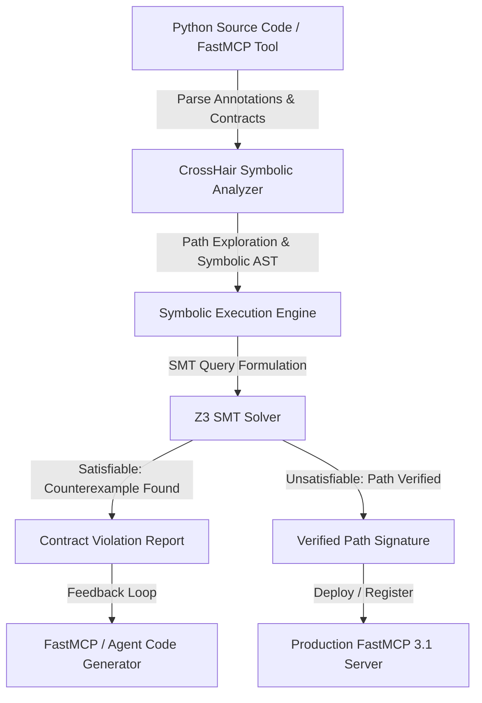
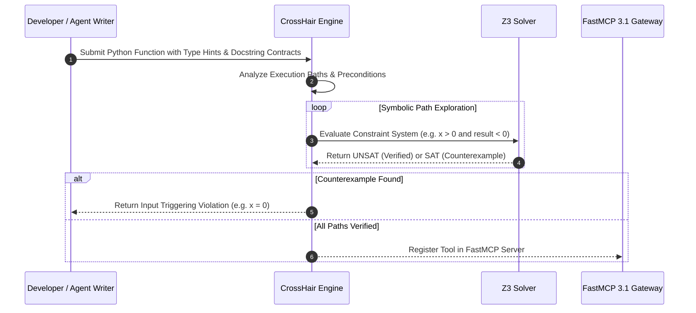

# CrossHair

## What it is
CrossHair is a symbolic execution engine and static analysis tool for Python that verifies code contracts, type annotations, and formal preconditions/postconditions. By executing Python code symbolically using SMT (Satisfiability Modulo Theories) solvers such as Z3, CrossHair searches for inputs that violate user-defined assertions or Python standard typing contracts. In modern autonomous agent and Model Context Protocol ([FastMCP 3.1](../automation_orchestration/mcp.md)) environments, CrossHair provides real-time symbolic validation of dynamically synthesized Python functions and API tool endpoints.

## Architecture & Verification Pipeline
CrossHair operates by tracing execution paths symbolically and attempting to construct counterexamples that cause assertion failures or contract violations.



## Detailed Verification Sequence



## What problem it solves
Static type checkers (like mypy or pyright) verify structural types but cannot check behavioral logic, array index bounds, or complex business logic invariants. Traditional unit tests test specific concrete values but often miss edge cases. CrossHair bridges this gap by automatically discovering concrete inputs that violate formal specifications without requiring developers to hand-craft exhaustive test cases.

## Where it fits in the stack
**Development & Operations / Verification Layer**. CrossHair sits alongside static checkers and dynamic test runners in automated CI/CD pipelines or FastMCP agent tool verification layers. It intercepts agent-generated Python tool code before execution to guarantee safety contracts.

## Symbolic Verification Mechanics & PEP 316 Specification
CrossHair intercepts Python execution by creating symbolic proxies for function arguments based on PEP 484 type annotations. During function execution, whenever a conditional branch (`if x > 0:`) is evaluated, CrossHair forks execution paths:
1. One path asserts `x > 0` into the Z3 constraint store.
2. The alternative path asserts `not (x > 0)` into the constraint store.

Contracts are specified inside docstrings using PEP 316 syntax:
- `pre: <expression>` — Precondition that input arguments must satisfy before execution begins.
- `post: <expression>` — Postcondition that return values (referenced as `__return__`) and function arguments must satisfy upon exit.
- `inv: <expression>` — Class invariant that must hold before and after every public method call.

## Typical use cases
- **Symbolic Tool Validation**: Verifying that AI agent tool implementations handle edge cases (e.g. division by zero, empty strings, boundary conditions) before registering them with FastMCP servers.
- **Contract Enforcement**: Enforcing postconditions on data transformations, financial calculations, and cryptographic operations.
- **Automated Bug Hunting**: Discovering implicit assumptions and unhandled exceptions in Python libraries.
- **Agent Code Synthesis Verification**: Evaluating dynamically generated Python code snippets for safety invariants prior to sandboxed runtime execution.
- **Pre-deployment CI/CD Gates**: Running automated symbolic contract audits on fastmcp tool functions as part of pre-merge checks.
- **Data Pipeline Invariant Testing**: Proving that data cleansing routines preserve non-nullity, positivity, and schema constraints across all potential input shapes.

## Strengths
- **Fully Automated Counterexample Discovery**: Provides exact Python values that trigger contract violations.
- **Standard Python Syntax**: Uses standard type hints and PEP 316 docstrings (`pre:`, `post:`, `inv:`).
- **Deep Integration with Z3**: Leverages SMT solver to solve complex arithmetic and logic constraints.
- **FastMCP 3.1 Gateway Integration**: Easily wrapped into automated verification microservices for LLM tool generation pipelines.
- **Pure Python Interception**: Uses standard Python `sys.settrace` or custom bytecode/AST instrumentation without requiring binary compilation.

## Limitations
- **Path Explosion**: Highly complex functions with deep recursion or massive loops can cause path exploration timeouts.
- **C-Extension Constraints**: Symbolic execution through unannotated C-extension modules (e.g. NumPy) can be restricted without stubs.
- **Floating Point Solver Complexity**: SMT queries involving complex floating-point transcendental functions can be computationally expensive.
- **IO and Side Effects**: File system operations, socket network calls, or hardware interrupts must be mocked to allow symbolic reasoning.

## When to use it
- Verifying complex Python functions with non-trivial mathematical or logical invariants.
- Testing AI-generated or dynamically synthesized Python tool endpoints before registering them in FastMCP 3.1 agent runtimes.
- Proving edge-case correctness and contract compliance for safety-critical modules.
- Enforcing structural and data invariant contracts across multi-agent workflows.

## When not to use it
- Evaluating functions that rely heavily on un-stubbed C extensions or third-party binary libraries.
- Static analysis on non-Python codebases or dynamic untyped Python code missing docstrings or PEP 316 contracts.
- High-frequency real-time execution loops where symbolic path exploration latency is prohibitive.

## Feature Matrix & Framework Comparison

| Feature | CrossHair | Hypothesis | Mypy / Pyright | KLEE |
| :--- | :--- | :--- | :--- | :--- |
| **Primary Approach** | Symbolic Execution (SMT) | Property-based Fuzzing | Static Type Analysis | Symbolic Execution (C/C++) |
| **Contract Language** | Python PEP 316 / Type Hints | Python `@given` Decorators | Type Annotations | C Assertions |
| **Solver Backend** | Z3 Solver | Random/Heuristic Generators | None (AST Type Graph) | STP / Z3 |
| **Counterexample Generation** | Deterministic Concrete Input | Random Concrete Input | N/A | Deterministic Input |
| **FastMCP 3.1 Ready** | Native Python Import / API | Native Python Import | Type Checker Gate | Binary Interop |
| **Contract Types** | `pre:`, `post:`, `inv:` | Property Specs | Type Invariants | Runtime Assertions |
| **Analysis Latency** | Seconds to Minutes (Path-based) | Seconds (Fuzzing runs) | Sub-second (AST check) | Minutes to Hours |

## Getting started
1. **Installation**:
   ```bash
   pip install crosshair-tool z3-solver mcp pydantic
   ```
2. **Add Contracts**:
   ```python
   def safe_divide(numerator: float, denominator: float) -> float:
       """
       pre: denominator != 0
       post: __return__ == numerator / denominator
       """
       return numerator / denominator
   ```
3. **Run CrossHair**:
   ```bash
   crosshair check safe_divide.py
   ```

## CLI examples
```bash
# Check a single Python file for contract violations
crosshair check safe_divide.py

# Check all functions in a module with custom timeout per condition
crosshair check --per_condition_timeout 3.0 my_module.py

# Watch directory for changes and continuously analyze contracts
crosshair watch /opt/crosshair/tools/

# Verbose output showing SMT constraint evaluations
crosshair check --verbose safe_divide.py
```

## API examples
```python
import crosshair.main as ch_main

# Run CrossHair programmatically on a file
violations = list(ch_main.check_program("safe_divide.py", max_sec=5.0))
for violation in violations:
    print(f"Contract violation found: {violation}")
```

## Advanced FastMCP 3.1 & CrossHair Production Integration

### Symbolic Verification FastMCP 3.1 Microservice Server
```python
import sys
import os
import tempfile
import logging
from typing import Dict, Any, List, Optional
import mcp.server.fastmcp as fastmcp
from mcp.server.fastmcp import FastMCP, Context
from pydantic import BaseModel, Field
import crosshair.main as ch_main

logging.basicConfig(level=logging.INFO, stream=sys.stderr)
logger = logging.getLogger("CrossHairFastMCP")

mcp_server = FastMCP(
    "CrossHair Symbolic Verification Gateway",
    version="3.1",
    instructions="Automated symbolic analysis and contract validation for synthesized Python tools."
)

# --- Pydantic v2 Models ---
class CodeVerificationRequest(BaseModel):
    source_code: str = Field(..., description="Python source code containing functions and PEP 316 contracts")
    timeout_per_condition: float = Field(default=5.0, ge=1.0, le=30.0, description="Max seconds per condition check")
    module_name: Optional[str] = Field(default="synthesized_tool", description="Target module identifier")

class ContractViolationItem(BaseModel):
    function_name: str
    line_number: int
    message: str
    counterexample_inputs: Dict[str, Any]

class VerificationReport(BaseModel):
    is_valid: bool
    violations_count: int
    violations: List[str]
    mcp_version: str = "3.1"

# --- Tools ---
@mcp_server.tool()
async def verify_synthesized_code(request: CodeVerificationRequest, ctx: Context) -> Dict[str, Any]:
    """Symbolically checks Python source code for contract violations using Z3-backed CrossHair engine."""
    await ctx.report_progress(10, 100)
    ctx.info(f"Writing source code for module '{request.module_name}' to sandboxed workspace")

    # Save to temporary file for isolated analysis
    with tempfile.NamedTemporaryFile("w", suffix=".py", delete=False) as tmp_file:
        tmp_file.write(request.source_code)
        tmp_path = tmp_file.name

    try:
        await ctx.report_progress(40, 100)
        ctx.info(f"Executing CrossHair check with timeout={request.timeout_per_condition}s")

        # Run CrossHair analysis
        messages = list(ch_main.check_program(tmp_path, max_sec=request.timeout_per_condition))
        violations = [str(msg) for msg in messages]

        await ctx.report_progress(90, 100)

        is_valid = len(violations) == 0
        if is_valid:
            ctx.info("Symbolic verification succeeded: All contract paths UNSAT (no violations)")
        else:
            ctx.warning(f"Symbolic verification found {len(violations)} contract violation(s)")

        report = VerificationReport(
            is_valid=is_valid,
            violations_count=len(violations),
            violations=violations
        )
        await ctx.report_progress(100, 100)
        return report.model_dump()

    finally:
        if os.path.exists(tmp_path):
            os.remove(tmp_path)

@mcp_server.tool()
def evaluate_math_contract(numerator: float, denominator: float) -> Dict[str, Any]:
    """
    FastMCP 3.1 tool with embedded PEP 316 contracts evaluated by CrossHair.
    pre: denominator != 0.0
    post: __return__["result"] == numerator / denominator
    """
    return {"result": numerator / denominator, "status": "computed"}

if __name__ == "__main__":
    mcp_server.run(transport="stdio")
```

### Programmatic Python Verification Runner with PEP 316 Contracts
```python
from pydantic import BaseModel, Field
import crosshair.main as ch_main
from typing import List, Dict, Any

class CodeContractAuditJob(BaseModel):
    file_path: str = Field(..., description="Path to target python source file")
    per_condition_timeout: float = Field(default=3.0, gt=0)

def audit_python_file(job: CodeContractAuditJob) -> Dict[str, Any]:
    print(f"Starting CrossHair audit on '{job.file_path}' (timeout={job.per_condition_timeout}s)...")
    raw_violations = list(ch_main.check_program(job.file_path, max_sec=job.per_condition_timeout))

    formatted_issues = []
    for issue in raw_violations:
        formatted_issues.append({
            "message": str(issue),
            "filename": getattr(issue, "filename", job.file_path),
            "line": getattr(issue, "line", 0)
        })

    return {
        "file": job.file_path,
        "clean": len(formatted_issues) == 0,
        "issues": formatted_issues
    }

if __name__ == "__main__":
    job = CodeContractAuditJob(file_path="safe_divide.py", per_condition_timeout=5.0)
    # result = audit_python_file(job)
```

## Docker Compose Deployment Definition

```yaml
version: "3.8"

services:
  crosshair-verifier:
    build:
      context: .
      dockerfile: Dockerfile
    container_name: crosshair-verifier
    restart: unless-stopped
    ports:
      - "8005:8005"
    environment:
      - PYTHONUNBUFFERED=1
      - FASTMCP_TRANSPORT=sse
      - FASTMCP_PORT=8005
    volumes:
      - ./workspace:/opt/crosshair/workspace
    healthcheck:
      test: ["CMD", "curl", "-f", "http://localhost:8005/health"]
      interval: 15s
      timeout: 5s
      retries: 3
    networks:
      - agent-verification-net

networks:
  agent-verification-net:
    driver: bridge
```

## Systemd Production Daemon Unit Definition
Save unit file to `/etc/systemd/system/crosshair-verifier.service`:

```ini
[Unit]
Description=CrossHair Symbolic Execution Daemon
After=network.target

[Service]
Type=simple
User=crosshair-user
WorkingDirectory=/opt/crosshair
ExecStart=/usr/bin/python3 -m crosshair watch /opt/crosshair/tools/
Restart=always
RestartSec=5s
Environment="PYTHONUNBUFFERED=1"
Environment="CROSSHAIR_LOG_LEVEL=INFO"

# Security Hardening Settings
NoNewPrivileges=true
ProtectSystem=full
ProtectHome=true
PrivateTmp=true

[Install]
WantedBy=multi-user.target
```

## Troubleshooting & Diagnostic Matrix

| Issue Symptom / Error | Root Cause | Verification Command | Remediation Action |
| :--- | :--- | :--- | :--- |
| **`Path Timeout`** | Infinite loop or excessive recursion paths | `crosshair check --per_condition_timeout 2.0 <file>` | Add strict precondition bounds or simplify loop invariants |
| **`Z3 Solver Error`** | Incompatible SMT constraints | `crosshair check --verbose <file>` | Ensure Z3 solver version matches python environment requirements |
| **`Unsupported Dynamic Import`** | Native C-module call without symbolic stub | `python -m crosshair check <file>` | Mock or wrap C-extension calls in pure Python stubs |
| **`PEP 316 Syntax Error`** | Invalid `pre:` or `post:` docstring format | `crosshair check <file>` | Format docstrings using PEP 316 syntax (`pre: x > 0`, `post: __return__ != None`) |
| **`Memory Limit Exceeded`** | Solver state explosion on huge floating point arrays | `top -b -n 1 \| grep crosshair` | Decrease `per_condition_timeout` or bound input collection size |
| **`Unsatisfiable Precondition`** | Overly restrictive `pre:` condition prevents path exploration | Inspect error message for `precondition false` | Relax precondition constraints or check logic assumptions |
| **`False Positive Violations`** | Unhandled side-effect or state mutation outside target function | `crosshair check --verbose <file>` | Isolate pure logic functions from I/O calls or mock state objects |

## Related tools / concepts
- [Z3 Solver](./symbolic-mcp.md) — High-performance SMT solver powering CrossHair symbolic logic.
- [FastMCP 3.1](../automation_orchestration/mcp.md) — Protocol standard for tool execution.
- [Model Context Protocol (MCP)](../automation_orchestration/mcp.md) — Protocol specifications.
- [Hypothesis](./hypothesis.md) — Property-based testing framework for Python.

## Sources / references
- [CrossHair GitHub Repository](https://github.com/pschanely/CrossHair)
- [CrossHair Documentation](https://crosshair.readthedocs.io/)

## Contribution Metadata
- Last reviewed: 2027-01-07
- Confidence: high
