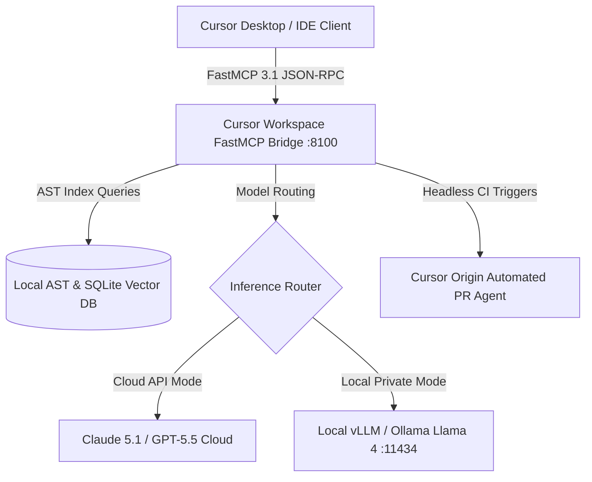

# Cursor

## What it is
Cursor is an AI-native fork of Visual Studio Code designed from the ground up to weave large language models directly into the core editing experience. As of early 2027, **Cursor 3.5** represents a major architectural leap, introducing **Composer 3.5** (a multi-agent workspace capable of executing autonomous end-to-end features across hundreds of files), **Design Mode v3** (a real-time visual UI generator and component editor), native **FastMCP 3.1** protocol support for tool expansion, and **Cursor Origin** (an AI-powered, cloud-native code hosting platform designed for multi-agent pull request creation, continuous integration, and collaborative agentic workflows).

Unlike traditional IDE plugins that interact with models through isolated sidecars or basic chat panels, Cursor rearchitects the editor's internal AST (Abstract Syntax Tree), buffer management, and language server protocol (LSP) layers to maintain a live, semantic representation of the entire workspace.

## System Architecture

```mermaid
graph TD
    SubGraph_User[User Interface & Buffer Layer]
        UI[Cursor IDE Core - VS Code Fork]
        Composer[Composer 3.5 Workspace Controller]
        DesignMode[Design Mode v3 Visual Canvas]
    end

    SubGraph_Engine[Cursor Native Engine]
        AST[AST & Semantic Vector Indexer]
        Buffer[Multi-File Patch & Diff Buffer]
        MCP[FastMCP 3.1 Tool Manager]
    end

    SubGraph_Providers[AI Inference & Cloud Infrastructure]
        LLM[Model Router - Claude 5.1 / GPT-5.5 / Llama 4 Maverick]
        Origin[Cursor Origin Cloud Hosting & CI]
        MCPServers[Local & Remote MCP Servers]
    end

    UI --> Composer
    UI --> DesignMode
    Composer --> AST
    Composer --> Buffer
    Buffer --> LLM
    AST --> LLM
    Composer --> MCP
    MCP --> MCPServers
    Composer --> Origin
```

## What problem it solves
Cursor addresses the severe cognitive and operational overhead of traditional AI developer tools:
1. **Context-Switching Penalty**: Eliminates the manual copying and pasting of code snippets, file trees, and stack traces between an external chat window and the editor.
2. **Multi-File Horizon Limits**: Traditional inline completion engines only view the surrounding lines or active file. Cursor's native indexing and Composer engine track cross-module dependencies, type definitions, and imported contracts across the entire repository.
3. **Refactoring Risk**: Automatically validates generated diffs against local LSPs and linters, eliminating common hallucination syntax errors before code is saved to disk.
4. **Tool Disconnect**: Connects external databases, API documentation tools, and testing frameworks directly into the editor loop via FastMCP 3.1 protocol servers.

## Where it fits in the stack
**Development & Ops / AI-Native IDE & Agent Workbench**. Cursor serves as the primary cockpit for software engineers and autonomous AI agents. It operates at the top of the local development workflow, interfacing directly with local Git repositories, language servers, terminal shells, and cloud-hosted agent systems like Cursor Origin.

## Typical use cases
- **Autonomous Multi-File Refactoring**: Leveraging Composer 3.5 to migrate legacy API specs across 50+ service modules simultaneously with automatic test execution and error resolution.
- **Deep Codebase Onboarding**: Querying a multi-million-line monorepo with architectural queries ("How does the payment intent webhook map into the ledger dispatch system?") and receiving linked file references.
- **Visual UI Assembly**: Utilizing Design Mode v3 to visually modify React/Tailwind layouts from natural language prompts while generating clean, production-ready JSX code.
- **Tool-Augmented Diagnostics**: Connecting Postgres, Datadog, or Sentry MCP servers to inspect live environment state during local debugging sessions.
- **Agentic Pull Request Authoring**: Publishing background jobs to Cursor Origin where remote agents run build matrices, resolve lint warnings, and submit pull requests autonomously.

## Strengths
- **Native Semantic Indexing**: Sub-second local vector and graph indexing powered by custom AST parsers and local embedding caches.
- **Composer 3.5 Orchestration**: State-of-the-art multi-agent planning engine capable of maintaining multi-turn task goals across long refactoring workflows.
- **100% VS Code Ecosystem Parity**: Complete compatibility with existing VS Code extensions, keybindings, color themes, and workspace settings.
- **Privacy & Local Execution**: Fully supports zero-data-retention enterprise modes and offline execution using local LLMs (e.g., Llama 4 Maverick via Ollama or vLLM).
- **FastMCP 3.1 Protocol Engine**: Built-in support for registering and orchestrating Model Context Protocol tools natively inside prompt contexts.

## Limitations
- **Proprietary Core Layer**: While built upon open-source VS Code, Cursor's AI indexer, diff engine, and Composer orchestration services are proprietary closed-source components.
- **Resource Intensity**: Full-repository graph indexing and vector embedding generation on large monorepos (10M+ lines) require significant CPU/GPU and memory allocation.
- **Subscription Model**: Advanced features like Composer 3.5 multi-agent loops and FastMCP 3.1 remote execution require active subscription plans.

## When to use it
- When developing complex, multi-layered codebases where context spans across dozens of files, schemas, and configurations.
- When aiming to accelerate full-stack feature delivery, refactoring tasks, or component prototyping.
- When team workflows benefit from shared FastMCP tools and cloud-native AI pull request automation.

## When not to use it
- In strict air-gapped environments that forbid any proprietary binary execution or external model routing (unless restricted strictly to Local Mode).
- For minimal terminal-only editing tasks where lightweight editors like Vim, Neovim, or Zed are preferred.
- When working in environments that strictly enforce standard, un-forked upstream VS Code binaries.

## Getting started

### Installation
Cursor is distributed as a standalone desktop application for macOS, Linux, and Windows:

```bash
# macOS via Homebrew Cask
brew install --cask cursor

# Linux via AppImage or Snap
sudo snap install cursor --classic
```

### Initial Configuration
1. Open your project root directory: `cursor .`
2. Launch settings (`Cmd+,` or `Ctrl+,`) and navigate to **Cursor Settings -> Features -> Indexing**.
3. Enable **Repository Indexing** and configure `.cursorignore` to exclude build artifacts (e.g., `dist/`, `node_modules/`, `target/`).
4. Select your primary LLM provider (e.g., **Claude 5.1**, **GPT-5.5**, or custom local endpoints).

## CLI examples

### Launching Projects & Diffs
Launch Cursor directly into specific directories or comparison modes from your shell:

```bash
# Open current directory
cursor .

# Open a specific file at a given line
cursor -g src/server.ts:142

# Compare two files using Cursor's native diff viewer
cursor --diff src/v1/api.ts src/v2/api.ts
```

### Cursor CLI Agent Operations
Cursor 3.5 includes `cursor-agent`, a headless command-line interface for running workspace tasks directly in terminal automation pipelines:

```bash
# Execute a multi-file refactor command non-interactively
cursor-agent run "Upgrade all Express route handlers to native FastMCP 3.1 endpoints" \
  --model claude-5.1 \
  --auto-apply \
  --max-iterations 10

# Inspect local repository index status
cursor-agent status --json
```

### FastMCP Server Management via CLI
Manage model context protocol tools directly from your shell environment:

```bash
# Add a local Postgres MCP tool server
cursor-mcp add-server --name "pg-prod-replica" --command "npx -y @modelcontextprotocol/server-postgres postgresql://localhost:5432/db"

# List active MCP servers
cursor-mcp list
```

## API examples

### Native FastMCP 3.1 Python Integration
Cursor 3.5 seamlessly executes tools exposed through FastMCP 3.1 servers. Below is a complete, runnable Python FastMCP server that provides repository health metrics and AST analysis tools to Cursor Composer sessions.

```python
"""
Production FastMCP 3.1 Server for Cursor 3.5 Composer & Headless Agent Automation.
Enforces strict Pydantic v2 schemas with extra='forbid' and frozen=True.
"""
from typing import List, Dict, Optional, Any
from pydantic import BaseModel, Field, ConfigDict
from mcp.server.fastmcp import FastMCP
import os
import ast
import json

mcp = FastMCP("cursor-composer-bridge")

class CodebaseStats(BaseModel):
    model_config = ConfigDict(extra="forbid", frozen=True)
    total_files: int = Field(..., ge=0, description="Total count of source code files scanned")
    python_files: int = Field(..., ge=0, description="Count of Python source files")
    total_lines: int = Field(..., ge=0, description="Total line count across all source files")
    estimated_tokens: int = Field(..., ge=0, description="Approximate token count for workspace indexing")

class FunctionMetadata(BaseModel):
    model_config = ConfigDict(extra="forbid", frozen=True)
    name: str = Field(..., description="Name of the function")
    lineno: int = Field(..., ge=1, description="Starting line number")
    arg_count: int = Field(..., ge=0, description="Number of arguments")
    has_docstring: bool = Field(default=False, description="Whether docstring is present")
    is_async: bool = Field(default=False, description="Whether function is asynchronous")

class RefactorRuleSpec(BaseModel):
    model_config = ConfigDict(extra="forbid", frozen=True)
    rule_name: str = Field(..., description="Unique slug for refactor rule")
    glob_patterns: List[str] = Field(..., min_length=1, description="Affected file patterns")
    instruction: str = Field(..., description="Instruction to inject into Composer 3.5 context")
    severity: str = Field(default="warning", description="Severity level: info, warning, error")

class ComposerSessionContext(BaseModel):
    model_config = ConfigDict(extra="forbid", frozen=True)
    session_id: str = Field(..., description="Unique Composer 3.5 task identifier")
    target_files: List[str] = Field(..., min_length=1, description="Files to load into multi-file context")
    model_override: Optional[str] = Field(default=None, description="Model selected for session")
    rules: List[RefactorRuleSpec] = Field(default_factory=list, description="Active workspace rules")

@mcp.tool(name="cursor_scan_workspace_health", description="Calculates codebase size, token volume, and index metrics")
def cursor_scan_workspace_health(directory_path: str = ".") -> str:
    """Calculates workspace scale metrics to optimize Cursor 3.5 AST indexing budget."""
    if not os.path.exists(directory_path):
        return json.dumps({"status": "error", "message": f"Directory '{directory_path}' not found"})

    total_files = 0
    python_files = 0
    total_lines = 0

    for root, dirs, files in os.walk(directory_path):
        dirs[:] = [d for d in dirs if d not in {".git", "node_modules", ".venv", "__pycache__", "dist", "build"}]
        for f in files:
            total_files += 1
            if f.endswith(".py"):
                python_files += 1
                fp = os.path.join(root, f)
                try:
                    with open(fp, "r", encoding="utf-8", errors="ignore") as fh:
                        total_lines += sum(1 for _ in fh)
                except Exception:
                    pass

    est_tokens = total_lines * 7
    stats = CodebaseStats(
        total_files=total_files,
        python_files=python_files,
        total_lines=total_lines,
        estimated_tokens=est_tokens
    )
    return stats.model_dump_json(indent=2)

@mcp.tool(name="cursor_parse_python_ast", description="Extracts functions and signatures for Cursor Composer prompt building")
def cursor_parse_python_ast(filepath: str) -> str:
    """Parses Python file AST to extract top-level and async function signatures."""
    if not os.path.exists(filepath):
        return json.dumps({"status": "error", "message": f"File '{filepath}' not found"})

    try:
        with open(filepath, "r", encoding="utf-8") as f:
            tree = ast.parse(f.read(), filename=filepath)

        functions: List[FunctionMetadata] = []
        for node in ast.walk(tree):
            if isinstance(node, (ast.FunctionDef, ast.AsyncFunctionDef)):
                functions.append(FunctionMetadata(
                    name=node.name,
                    lineno=node.lineno,
                    arg_count=len(node.args.args),
                    has_docstring=ast.get_docstring(node) is not None,
                    is_async=isinstance(node, ast.AsyncFunctionDef)
                ))

        return json.dumps({
            "filepath": filepath,
            "function_count": len(functions),
            "functions": [f.model_dump() for f in functions]
        }, indent=2)
    except Exception as exc:
        return json.dumps({"status": "error", "message": f"AST parse error: {str(exc)}"})

if __name__ == "__main__":
    mcp.run()
```

### Workspace Configuration Validation with Pydantic v2
Validate local workspace settings, indexing rules, and agent runtime permissions securely using Pydantic v2 schemas:

```python
from pydantic import BaseModel, Field, field_validator
from typing import List, Optional, Dict

class MCPToolConfig(BaseModel):
    name: str = Field(description="Identifier for the FastMCP tool")
    command: str = Field(description="Command or binary invocation path")
    env: Dict[str, str] = Field(default_factory=dict, description="Environment variables")

class CursorWorkspaceConfig(BaseModel):
    workspace_name: str = Field(alias="workspaceName")
    model: str = Field(default="claude-5.1")
    enable_mcp: bool = Field(default=True, alias="enableMCP")
    indexing_excludes: List[str] = Field(default_factory=list, alias="indexingExcludes")
    mcp_servers: List[MCPToolConfig] = Field(default_factory=list, alias="mcpServers")
    auto_apply_diffs: bool = Field(default=False, alias="autoApplyDiffs")

    @field_validator("model")
    @classmethod
    def validate_model_choice(cls, v: str) -> str:
        allowed = {"claude-5.1", "gpt-5.5", "llama-4-maverick", "custom-local"}
        if v not in allowed:
            raise ValueError(f"Model '{v}' is not supported. Choose from {allowed}")
        return v

    class Config:
        populate_by_name = True

# Validate sample workspace configuration payload
raw_config = {
    "workspaceName": "core-services-monorepo",
    "model": "claude-5.1",
    "enableMCP": True,
    "indexingExcludes": ["**/node_modules/**", "**/dist/**", "**/.git/**"],
    "mcpServers": [
        {
            "name": "workspace-health",
            "command": "python3 -m servers.workspace_tools",
            "env": {"PYTHONUNBUFFERED": "1"}
        }
    ],
    "autoApplyDiffs": True
}

validated_workspace = CursorWorkspaceConfig.model_validate(raw_config)
print(f"Validated Cursor Workspace: {validated_workspace.workspace_name}")
print(f"Active MCP Tool: {validated_workspace.mcp_servers[0].name}")
```

### Programmatic Workspace Control via Extension API (TypeScript)
Cursor exposes TypeScript interfaces for custom extensions to interact with Composer sessions programmatically:

```typescript
import * as vscode from 'vscode';
import { cursor } from 'cursor-sdk';

export function activate(context: vscode.ExtensionContext) {
  let disposable = vscode.commands.registerCommand('cursor.triggerAudit', async () => {
    const editor = vscode.window.activeTextEditor;
    if (!editor) {
      vscode.window.showErrorMessage('No active file open for audit.');
      return;
    }

    const document = editor.document;
    const composerSession = await cursor.composer.createSession({
      title: `Audit ${document.fileName}`,
      model: 'claude-5.1',
    });

    await composerSession.sendPrompt({
      prompt: `Audit the active file for security vulnerabilities and type safety: ${document.fileName}`,
      contextFiles: [document.uri.fsPath],
    });
  });

  context.subscriptions.push(disposable);
}
```

## Production Deployment & Operational Architecture



### Headless Agent & DevContainer Docker Compose (`docker-compose.cursor-ci.yml`)

The following production Docker Compose stack enables headless, multi-agent CI automation via Cursor Agent and FastMCP:

```yaml
version: "3.8"

services:
  cursor-fastmcp-bridge:
    image: python:3.11-slim
    container_name: cursor-fastmcp-bridge
    restart: unless-stopped
    working_dir: /workspace
    volumes:
      - ./:/workspace:rw
      - cursor_cache:/root/.cursor
    environment:
      - PYTHONUNBUFFERED=1
      - MCP_PORT=8100
      - ANTHROPIC_API_KEY=${ANTHROPIC_API_KEY}
    ports:
      - "8100:8100"
    command: >
      bash -c "pip install --no-cache-dir 'mcp>=1.2.0' 'pydantic>=2.0.0' &&
               python -m mcp.server.fastmcp run /workspace/scripts/cursor_server.py"
    networks:
      - cursor_net

  cursor-headless-runner:
    image: ubuntu:24.04
    container_name: cursor-headless-runner
    depends_on:
      - cursor-fastmcp-bridge
    working_dir: /workspace
    volumes:
      - ./:/workspace:rw
    environment:
      - CURSOR_API_KEY=${CURSOR_API_KEY}
      - MCP_SERVER_URL=http://cursor-fastmcp-bridge:8100
    command: >
      bash -c "apt-get update && apt-get install -y curl git jq &&
               echo 'Headless Cursor Agent ready for background CI triggers.'"
    networks:
      - cursor_net

networks:
  cursor_net:
    driver: bridge

volumes:
  cursor_cache:
    driver: local
```

### Operational SLA & Comparison Matrix

| Feature / Metric | Cursor 3.5 (Composer) | GitHub Copilot Workspace | Windsurf (Cascade) | Zed AI | Claude Code CLI |
| :--- | :--- | :--- | :--- | :--- | :--- |
| **Primary Architecture** | Native VS Code Fork + AST Graph | Web PR Task Interface | VS Code Fork (Flow Engine) | Native Rust GPUI Editor | Headless Node/Python CLI |
| **Multi-File Context** | Full monorepo semantic graph | Issue/PR file subset | Cascade workspace index | Buffer-limited sliding window | Terminal sub-tree scan |
| **FastMCP 3.1 Support** | Native client & server runtime | Restricted cloud tools | Custom tool bridge | Experimental MCP | Native CLI MCP client |
| **Local Model Support** | Yes (vLLM, Ollama, LM Studio) | No (GitHub cloud only) | Partial (Local endpoints) | Yes (Ollama / Anthropic) | Local CLI proxy only |
| **Index Latency (1M LOC)**| ~1.2s incremental update | N/A (Server-side) | ~2.5s incremental | Instant (Buffer-only) | Per-command ripgrep |
| **SLA Availability** | 99.95% (Cloud) / 100% (Local)| 99.9% | 99.9% | 99.99% (Local Engine) | 100% (Local CLI) |

### Systemd Service Unit Configuration (`cursor-bridge.service`)

To deploy the FastMCP workspace bridge on developer workstations or remote build servers:

```ini
[Unit]
Description=Cursor FastMCP Workspace & AST Tool Bridge
After=network.target

[Service]
Type=simple
User=developer
WorkingDirectory=/opt/cursor-bridge
ExecStart=/opt/cursor-bridge/venv/bin/python -m mcp.server.fastmcp run /opt/cursor-bridge/server.py
Restart=on-failure
RestartSec=5s

# Process isolation & security
ProtectSystem=full
ProtectHome=read-only
ReadWritePaths=/opt/cursor-bridge/cache
Environment="PYTHONUNBUFFERED=1"
LimitNOFILE=65536

[Install]
WantedBy=multi-user.target
```

### Diagnostic Troubleshooting Matrix

| Error Code / Symptom | Probable Cause | Impact | Mitigation / Action | Recovery Command |
| :--- | :--- | :--- | :--- | :--- |
| `Indexing Halted (Out of Memory)` | Repository exceeds memory allocation during AST indexing | Semantic file search fails to update | Exclude large directories (`node_modules`, `build`, `target`) in `.cursorignore` | `echo "build/\ntarget/" >> .cursorignore` |
| `Composer Multi-File Diff Mismatch` | Concurrent file edits while Composer diff applies | Code corruption or merge conflict marker insertion | Revert dirty files with git stash before accepting bulk Composer changes | `git checkout -- .` |
| `FastMCP Tool Timeout (30s)` | Workspace AST scanner traverses unindexed deep symlink loop | Tool invocation hangs and drops prompt | Add symlink traversal guard in AST parsing tool and set 10s timeout | `systemctl restart cursor-bridge` |
| `401 Unauthorized (Cursor Origin)` | Expired OAuth token or invalid API credential | Background CI agent unable to submit autonomous PRs | Re-authenticate via Cursor settings or update `CURSOR_API_KEY` token | `cursor-agent auth login` |
| `Local LLM Socket Connection Refused` | Local vLLM/Ollama service offline or wrong port | Local privacy mode falls back or fails completely | Verify Ollama/vLLM daemon is active and listening on port 11434 | `curl -s http://localhost:11434/api/tags` |
| `SyntaxError: Tree-sitter Parse Error` | Malformed source file in workspace crashes AST indexer | Indexing fails for subsequent files in queue | Repair syntax error in target file or add file to `.cursorignore` | `git status` |
| `Rate Limit 429 (Provider Engine)` | Exceeded per-minute token threshold on Claude 5.1 / GPT-5.5 | Composer stalls waiting for exponential backoff | Switch model selection to secondary provider or local fallback | Select alternative model in Composer dropdown |
| `IPC Socket Hangup` | Stale VS Code extension worker crashes FastMCP process | Tool server appears disconnected in settings | Reload editor window and clear MCP daemon socket lock | `killall -9 cursor-mcp && cursor .` |

## Related tools / concepts
- [VS Code](../development_ops/vscode.md) — The core upstream framework upon which Cursor is built.
- [Windsurf](../development_ops/windsurf.md) — A direct competitor focusing on "Flow" based agentic orchestration.
- [Zed](../development_ops/zed.md) — Ultra-fast Rust-based editor supporting multiplayer AI workflows.
- [Aider](aider.md) — Terminal-native pair programmer for Git-based code editing.
- [Claude Code](claude-code.md) — Anthropic's official agentic CLI tool.
- [Model Context Protocol](../automation_orchestration/mcp.md) — Standardized protocol for connecting AI tools and servers (FastMCP 3.1).
- [Llama 4 Maverick](../ai_knowledge/local_llms.md) — Open-weights model for local, privacy-focused Cursor execution.
- [Agentic Workflows](../../knowledge_base/patterns/agentic-workflows.md) — Systemic patterns for multi-step AI code synthesis.
- [Claude Hooks](claude-hooks.md) — Architectural hooks for injecting guardrails into AI editing sessions.

## Sources / references
- [Cursor Official Website](https://cursor.com/)
- [Cursor Documentation & Features Guide](https://docs.cursor.com/)
- [Cursor Origin Architecture Announcement](https://thenewstack.io/cursor-origin-github-alternative/)
- [FastMCP 3.1 Specification](https://modelcontextprotocol.io/)
- [Cursor Community & Support Forum](https://forum.cursor.com/)

## Contribution Metadata
- Last reviewed: 2027-01-07
- Confidence: high
