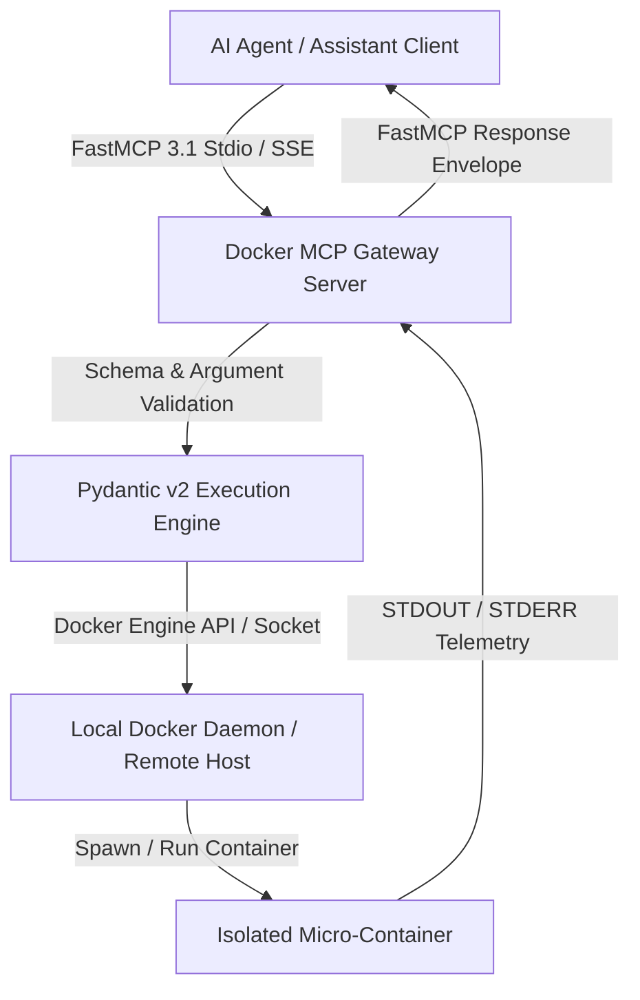
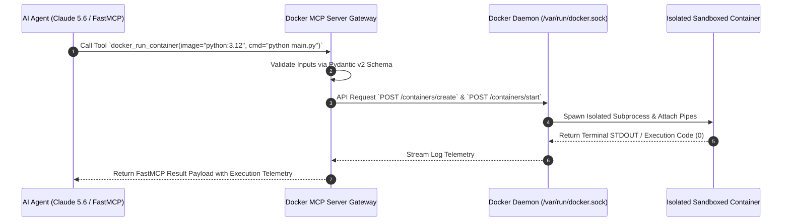

# Docker MCP

## What it is
Docker MCP Server (Docker Model Context Protocol) is an official tool integration standard that exposes Docker container orchestration, image management, volume handling, and isolated container execution environments to AI agents via the [Model Context Protocol (FastMCP 3.1 Standard)](../automation_orchestration/mcp.md). Powered by FastMCP 3.1 and Pydantic v2 schemas, Docker MCP allows autonomous assistants (such as Claude 5.6, GPT-5.6, and Gemini 4.0) to safely spawn, inspect, run, and destroy isolated Linux environments without exposing root host privileges.

## Architecture & Container Execution Lifecycle
Docker MCP translates standardized JSON-RPC Model Context Protocol messages into structured Docker Engine API commands or Docker CLI invocations.



## Detailed Execution Sequence & Tool Invocation



## What problem it solves
Autonomous agents often need to run shell commands, compile binaries, or test untrusted code scripts. Executing these directly on the developer's host system creates significant security risks (e.g. system file modification, arbitrary command execution, dependency corruption). Docker MCP provides a secure, deterministic sandbox layer where agents execute commands inside disposable, resource-constrained Docker containers with restricted network and file system access.

## Where it fits in the stack
**Development & Operations / Infrastructure Security Layer**. Docker MCP sits between higher-level AI agent orchestrators ([Agency Swarm](../agents/agency-swarm.md), [Claude Code Container MCP](claude-code-container-mcp.md)) and the low-level Docker container daemon.

## Container Isolation & Security Boundaries
Docker MCP enforces multi-layer isolation parameters across all dynamically spawned containers:
- **CGroups v2 Resource Limits**: Caps CPU quotas (`nano_cpus`), RAM memory (`mem_limit="512m"`), and swap limits to prevent host resource starvation.
- **Rootless & User Namespaces**: Maps in-container root UID `0` to unprivileged host UID mappings (`100000+`).
- **Network Modes**: Defaults to isolated `none` or internal `bridge` networks to block unauthorized outbound socket connections during script execution.
- **Read-Only Volume Bindings**: Binds workspace directories in read-only (`:ro`) mode unless explicit temporary workspace scratchpads are requested.

## Typical use cases
- **Sandboxed Agent Code Execution**: Spawning temporary containers to run dynamic Python, Node.js, or Rust code without host side-effects.
- **Container Infrastructure Management**: Allowing dev agents to build Dockerfiles, list active containers, inspect system health, and inspect container logs.
- **Automated Integration Testing**: Provisioning ephemeral Postgres/Redis databases for test runs during agentic software development loops.
- **Isolated Multi-Tenant Execution**: Running simultaneous code evaluation tasks for different user requests in strictly isolated containers.
- **Environment Parity Testing**: Verifying that application code compiles and executes consistently across different Linux distributions (Ubuntu, Alpine, Debian).

## Strengths
- **Native FastMCP 3.1 Integration**: Provides pre-packaged Pydantic v2 schemas for container run, list, exec, stop, and prune tools.
- **Secure Isolation**: Runs agent actions strictly within isolated container namespaces and dynamic resource limits (CPU/RAM).
- **Cross-Platform Compatibility**: Works seamlessly across Linux, macOS (Docker Desktop/OrbStack), and Windows (WSL2).
- **Streamed Execution Telemetry**: Captures STDOUT/STDERR logs in real time and streams progress back to agent execution contexts via FastMCP `Context`.

## Limitations
- **Daemon Access Requirement**: Requires access to the Docker socket (`/var/run/docker.sock`), demanding careful socket permissions setup.
- **Image Pull Latency**: Spawning containers with non-cached images can introduce initial network download delays.
- **Storage Overhead**: Continuous container creation without prune policies can accumulate unused image layers and stopped container states.

## When to use it
- Executing untrusted AI agent generated code or dynamic scripts in isolated container environments.
- Managing containers, images, volumes, and micro-services through FastMCP tool protocols.
- Building, inspecting, and debugging Docker containers autonomously during dev loops.
- Providing standardized execution environments for LLM agent benchmark evaluation tools.

## When not to use it
- Environments where Docker daemon access is restricted or unavailable (e.g. strict serverless functions).
- Simple file or text manipulation tasks where container startup latency overhead is unnecessary.
- Workloads requiring direct host system hardware access (e.g. specialized PCIe devices without pass-through).

## Feature Matrix & Framework Comparison

| Feature | Docker MCP | Claude Code Container MCP | Kubernetes MCP | Podman MCP |
| :--- | :--- | :--- | :--- | :--- |
| **Primary Target Engine** | Docker Engine API / Daemon | Docker / Finch Containers | K8s API Server / Pods | Podman Socket |
| **Protocol Standard** | FastMCP 3.1 / MCP Native | Anthropic MCP Standard | Custom K8s MCP Server | FastMCP Standard |
| **Isolation Boundary** | Container Namespaces / CGroups | Micro-VM / Docker Sandbox | Pod / Namespace Guard | Rootless Podman |
| **Volume Mount Guard** | Strict Workspace Bounding | Sandbox File Sync | Persistent Volume Claims | Rootless User Mounts |
| **FastMCP 3.1 Ready** | Native Built-in Server | Native Built-in | Custom Wrapper | Native Built-in |
| **Resource Limits** | Native CGroups v2 | Sandboxed Defaults | K8s Spec Quotas | Rootless User Limits |

## Getting started
1. **Prerequisites**: Ensure Docker Engine or Docker Desktop is installed and active.
2. **Install Docker MCP Server**:
   ```bash
   npm install -g @docker/mcp-server
   # or run directly via npx
   npx @docker/mcp-server
   ```
3. **Configure Claude Desktop / FastMCP Client**: Add to `claude_desktop_config.json`:
   ```json
   {
     "mcpServers": {
       "docker": {
         "command": "npx",
         "args": ["-y", "@docker/mcp-server"]
       }
     }
   }
   ```

## CLI examples
```bash
# Run Docker MCP Server via NPX CLI
npx @docker/mcp-server

# Build Docker image using local Docker CLI
docker build -t my-agent-sandbox:latest .

# Inspect running Docker MCP containers
docker ps --filter "label=mcp-server"

# Prune stopped MCP agent containers
docker container prune --filter "label=mcp-server" -f
```

## API examples
```python
import docker

client = docker.from_env()
# List running containers via Docker Engine API
containers = client.containers.list()
for container in containers:
    print(f"Container: {container.name} - Status: {container.status}")
```

## Advanced FastMCP 3.1 & Docker MCP Production Implementation

### Comprehensive Docker MCP Gateway Server
```python
import sys
import logging
from typing import Dict, Any, List, Optional
import mcp.server.fastmcp as fastmcp
from mcp.server.fastmcp import FastMCP, Context
from pydantic import BaseModel, Field
import docker

logging.basicConfig(level=logging.INFO, stream=sys.stderr)
logger = logging.getLogger("DockerMCPGateway")

mcp_server = FastMCP(
    "Docker MCP Gateway Server",
    version="3.1",
    instructions="Production MCP gateway for isolated Docker container execution and lifecycle management."
)

try:
    docker_client = docker.from_env()
except Exception as err:
    logger.error("Failed to connect to Docker daemon: %s", err)
    docker_client = None

# --- Pydantic v2 Models ---
class ContainerRunPayload(BaseModel):
    image: str = Field(..., description="Target Docker image (e.g., 'python:3.12-alpine')")
    command: str = Field(..., description="Command string to execute in container")
    memory_limit: str = Field(default="512m", description="Memory limit (e.g. 256m, 1g)")
    cpus: float = Field(default=1.0, ge=0.1, le=4.0, description="CPU core quota")
    read_only_workspace: Optional[str] = Field(default=None, description="Host directory path to mount read-only at /workspace")

class ContainerExecPayload(BaseModel):
    container_id: str = Field(..., description="Target active container ID or name")
    command: str = Field(..., description="Command to execute inside running container")

class ContainerInspectionRequest(BaseModel):
    container_id: str = Field(..., description="Container ID or name to inspect")

# --- FastMCP 3.1 Tools ---
@mcp_server.tool()
async def run_sandboxed_container(payload: ContainerRunPayload, ctx: Context) -> Dict[str, Any]:
    """Executes a command inside an isolated disposable Docker container with resource boundaries."""
    if not docker_client:
        return {"success": False, "error": "Docker daemon unavailable"}

    await ctx.report_progress(10, 100)
    ctx.info(f"Preparing container run for image '{payload.image}'")

    volumes = {}
    if payload.read_only_workspace:
        volumes[payload.read_only_workspace] = {"bind": "/workspace", "mode": "ro"}

    try:
        await ctx.report_progress(30, 100)
        ctx.info("Spawning container with cgroups boundaries...")

        container = docker_client.containers.run(
            image=payload.image,
            command=payload.command,
            mem_limit=payload.memory_limit,
            nano_cpus=int(payload.cpus * 1e9),
            volumes=volumes,
            labels={"mcp-server": "true", "mcp-version": "3.1"},
            remove=True,
            detach=False,
            network_mode="none"  # Restrict network for code execution security
        )

        await ctx.report_progress(100, 100)
        output_text = container.decode("utf-8") if isinstance(container, bytes) else str(container)
        return {
            "success": True,
            "output": output_text,
            "mcp_version": "3.1"
        }
    except Exception as exc:
        ctx.error(f"Container execution failed: {exc}")
        return {"success": False, "error": str(exc), "mcp_version": "3.1"}

@mcp_server.tool()
def list_mcp_containers(include_all: bool = False) -> Dict[str, Any]:
    """Lists active Docker containers created or managed by Docker MCP."""
    if not docker_client:
        return {"error": "Docker daemon unavailable"}

    filters = {"label": "mcp-server=true"} if not include_all else {}
    containers = docker_client.containers.list(all=include_all, filters=filters)

    items = []
    for c in containers:
        items.append({
            "id": c.short_id,
            "name": c.name,
            "image": c.image.tags[0] if c.image.tags else c.image.short_id,
            "status": c.status
        })

    return {"containers_count": len(items), "containers": items, "mcp_version": "3.1"}

@mcp_server.tool()
def inspect_container_logs(request: ContainerInspectionRequest) -> Dict[str, Any]:
    """Retrieves standard output and error logs from a target container."""
    if not docker_client:
        return {"error": "Docker daemon unavailable"}

    try:
        container = docker_client.containers.get(request.container_id)
        logs = container.logs(tail=200).decode("utf-8")
        return {"container_id": request.container_id, "logs": logs, "mcp_version": "3.1"}
    except Exception as e:
        return {"error": str(e), "mcp_version": "3.1"}

if __name__ == "__main__":
    mcp_server.run(transport="stdio")
```

### Docker MCP Async Client Invocation Example
```python
import asyncio
from mcp import ClientSession, StdioServerParameters
from mcp.client.stdio import stdio_client

async def run_docker_mcp_client():
    server_params = StdioServerParameters(
        command="python3",
        args=["docker_mcp_server.py"],
        env=None
    )

    async with stdio_client(server_params) as (read, write):
        async with ClientSession(read, write) as session:
            await session.initialize()

            # Execute python script inside ephemeral container tool
            result = await session.call_tool(
                "run_sandboxed_container",
                arguments={
                    "payload": {
                        "image": "python:3.12-alpine",
                        "command": "python3 -c \"import sys; print(f'Python Version: {sys.version}')\"",
                        "memory_limit": "256m"
                    }
                }
            )
            print("Container Output:", result.content[0].text)

if __name__ == "__main__":
    asyncio.run(run_docker_mcp_client())
```

## Docker Compose Deployment Definition

```yaml
version: "3.8"

services:
  docker-mcp-gateway:
    build:
      context: .
      dockerfile: Dockerfile
    container_name: docker-mcp-gateway
    restart: unless-stopped
    ports:
      - "8008:8008"
    volumes:
      - /var/run/docker.sock:/var/run/docker.sock:rw
      - ./workspace:/opt/docker-mcp/workspace
    environment:
      - PYTHONUNBUFFERED=1
      - FASTMCP_TRANSPORT=sse
      - FASTMCP_PORT=8008
      - DOCKER_HOST=unix:///var/run/docker.sock
    healthcheck:
      test: ["CMD", "curl", "-f", "http://localhost:8008/health"]
      interval: 15s
      timeout: 5s
      retries: 3
    networks:
      - mcp-docker-net

networks:
  mcp-docker-net:
    driver: bridge
```

## Systemd Service Unit Definition
Save unit file to `/etc/systemd/system/docker-mcp-gateway.service`:

```ini
[Unit]
Description=Docker MCP Server Gateway Service
After=network.target docker.service
Wants=docker.service

[Service]
Type=simple
User=docker-mcp-user
Group=docker
WorkingDirectory=/opt/docker-mcp
ExecStart=/usr/bin/python3 /opt/docker-mcp/docker_mcp_server.py --transport sse --port 8008
Restart=always
RestartSec=5s
Environment="PYTHONUNBUFFERED=1"
Environment="DOCKER_HOST=unix:///var/run/docker.sock"

# Security Hardening Settings
NoNewPrivileges=true
ProtectSystem=full
ProtectHome=true
PrivateTmp=true

[Install]
WantedBy=multi-user.target
```

## Troubleshooting & Diagnostic Matrix

| Issue Symptom / Error | Root Cause | Verification Command | Remediation Action |
| :--- | :--- | :--- | :--- |
| **`Permission Denied (/var/run/docker.sock)`** | Service user lacks `docker` group permissions | `ls -la /var/run/docker.sock` | Add user to docker group: `sudo usermod -aG docker <user>` |
| **`Image Pull Failure`** | Container image tag missing or network blocked | `docker pull <image_name>` | Verify internet connectivity and exact image registry path |
| **`Container OOM Killed`** | Memory limit exceeded during agent execution | `docker inspect <container_id>` | Increase `mem_limit` in FastMCP execution payload |
| **`Socket Connection Timeout`** | Docker daemon process crashed or stopped | `systemctl status docker` | Restart daemon via `sudo systemctl restart docker` |
| **`Disk Space Exhaustion`** | Dangling container images and stopped containers accumulated | `docker system df` | Run automated prune: `docker system prune -f --volumes` |
| **`Network Sandbox Denied`** | Code attempted outbound network request in `network_mode="none"` | Inspect Python script for network requests | Set `network_mode="bridge"` if outbound access is explicitly required |
| **`Volume Mount Denied`** | Target volume path outside allowed workspace directory | Check container volume binding arguments | Ensure host paths exist and have appropriate POSIX read permissions |

## Related tools / concepts
- [Claude Code Container MCP](claude-code-container-mcp.md) — Containerized Claude Code workspace engine.
- [Docker Compose](../infrastructure/docker-compose.md) — Multi-container application orchestrator.
- [FastMCP 3.1](../automation_orchestration/mcp.md) — Protocol specifications.
- [CrossHair](crosshair.md) — Symbolic contract verifier for Python functions.

## Sources / references
- [Docker MCP Server GitHub Repository](https://github.com/docker/mcp-server)
- [Official Docker Documentation](https://docs.docker.com/)

## Contribution Metadata
- Last reviewed: 2027-01-07
- Confidence: high
