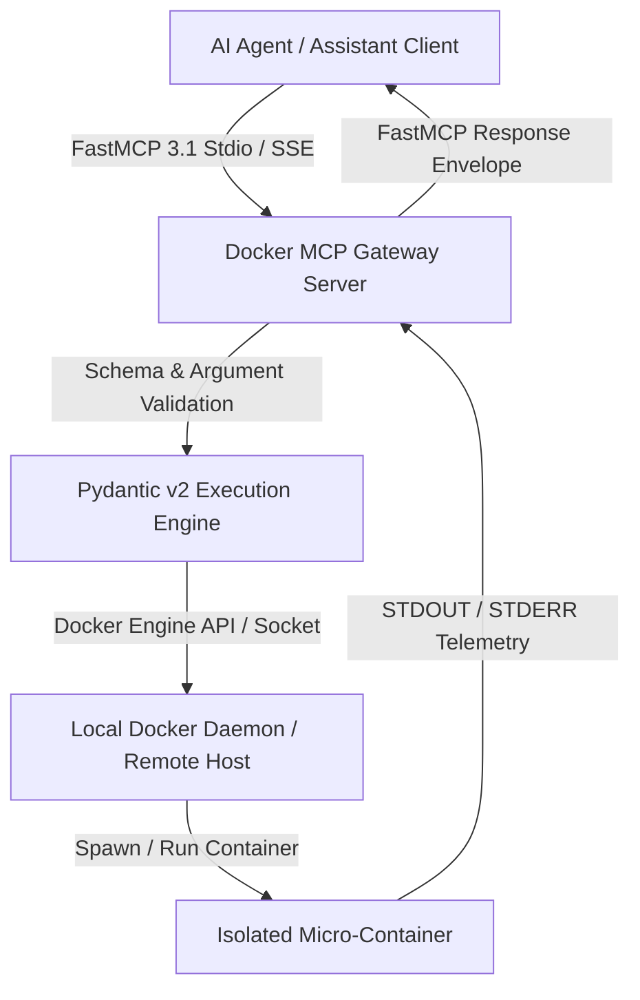
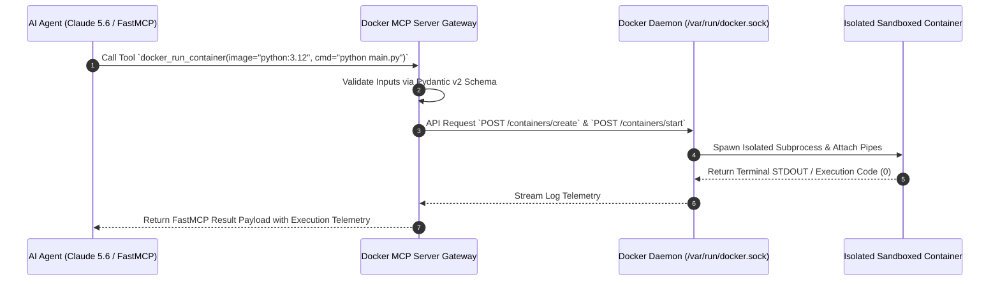

# Docker MCP

## What it is
Docker MCP Server (Docker Model Context Protocol) is an official tool integration standard that exposes Docker container orchestration, image management, volume handling, and isolated container execution environments to AI agents via the [Model Context Protocol (FastMCP 3.1 Standard)](../automation_orchestration/mcp.md). Powered by FastMCP 3.1 and Pydantic v2 schemas, Docker MCP allows autonomous assistants (such as Claude 5.6, GPT-5.6, and Gemini 4.0) to safely spawn, inspect, run, and destroy isolated Linux environments without exposing root host privileges.

## Architecture & Container Execution Lifecycle
Docker MCP translates standardized JSON-RPC Model Context Protocol messages into structured Docker Engine API commands or Docker CLI invocations.



## Detailed Execution Sequence & Tool Invocation



## What problem it solves
Autonomous agents often need to run shell commands, compile binaries, or test untrusted code scripts. Executing these directly on the developer's host system creates significant security risks (e.g. system file modification, arbitrary command execution, dependency corruption). Docker MCP provides a secure, deterministic sandbox layer where agents execute commands inside disposable, resource-constrained Docker containers.

## Where it fits in the stack
**Development & Operations / Infrastructure Security Layer**. Docker MCP sits between higher-level AI agent orchestrators ([Agency Swarm](../agents/agency-swarm.md), [Claude Code Container MCP](claude-code-container-mcp.md)) and the low-level Docker container daemon.

## Typical use cases
- **Sandboxed Agent Code Execution**: Spawning temporary containers to run dynamic Python, Node.js, or Rust code without host side-effects.
- **Container Infrastructure Management**: Allowing dev agents to build Dockerfiles, list active containers, inspect system health, and inspect container logs.
- **Automated Integration Testing**: Provisioning ephemeral Postgres/Redis databases for test runs during agentic software development loops.

## Strengths
- **Native FastMCP 3.1 Integration**: Provides pre-packaged Pydantic v2 schemas for container run, list, exec, stop, and prune tools.
- **Secure Isolation**: Runs agent actions strictly within isolated container namespaces and dynamic resource limits (CPU/RAM).
- **Cross-Platform Compatibility**: Works seamlessly across Linux, macOS (Docker Desktop/OrbStack), and Windows (WSL2).

## Limitations
- **Daemon Access Requirement**: Requires access to the Docker socket (`/var/run/docker.sock`), demanding careful socket permissions setup.
- **Image Pull Latency**: Spawning containers with non-cached images can introduce initial network download delays.

## When to use it
- Executing untrusted AI agent generated code or dynamic scripts in isolated container environments.
- Managing containers, images, volumes, and micro-services through FastMCP tool protocols.
- Building, inspecting, and debugging Docker containers autonomously during dev loops.

## When not to use it
- Environments where Docker daemon access is restricted or unavailable (e.g. strict serverless functions).
- Simple file or text manipulation tasks where container startup latency overhead is unnecessary.
- Workloads requiring direct host system hardware access (e.g. specialized PCIe devices without pass-through).

## Feature Matrix & Framework Comparison

| Feature | Docker MCP | Claude Code Container MCP | Kubernetes MCP | Podman MCP |
| :--- | :--- | :--- | :--- | :--- |
| **Primary Target Engine** | Docker Engine API / Daemon | Docker / Finch Containers | K8s API Server / Pods | Podman Socket |
| **Protocol Standard** | FastMCP 3.1 / MCP Native | Anthropic MCP Standard | Custom K8s MCP Server | FastMCP Standard |
| **Isolation Boundary** | Container Namespaces / CGroups | Micro-VM / Docker Sandbox | Pod / Namespace Guard | Rootless Podman |
| **Volume Mount Guard** | Strict Workspace Bounding | Sandbox File Sync | Persistent Volume Claims | Rootless User Mounts |
| **FastMCP 3.1 Ready** | Native Built-in Server | Native Built-in | Custom Wrapper | Native Built-in |

## Getting started
1. **Prerequisites**: Ensure Docker Engine or Docker Desktop is installed and active.
2. **Install Docker MCP Server**:
   ```bash
   npm install -g @docker/mcp-server
   # or run directly via npx
   npx @docker/mcp-server
   ```
3. **Configure Claude Desktop / FastMCP Client**: Add to `claude_desktop_config.json`:
   ```json
   {
     "mcpServers": {
       "docker": {
         "command": "npx",
         "args": ["-y", "@docker/mcp-server"]
       }
     }
   }
   ```

## CLI examples
```bash
# Run Docker MCP Server via NPX CLI
npx @docker/mcp-server

# Build Docker image using local Docker CLI
docker build -t my-agent-sandbox:latest .

# Inspect running Docker MCP containers
docker ps --filter "label=mcp-server"
```

## API examples
```python
import docker

client = docker.from_env()
# List running containers via Docker Engine API
containers = client.containers.list()
for container in containers:
    print(f"Container: {container.name} - Status: {container.status}")
```

## API & FastMCP 3.1 Examples

### FastMCP 3.1 Python Gateway for Docker Operations
```python
import mcp.server.fastmcp as fastmcp
from pydantic import BaseModel, Field
from typing import Dict, Any, List
import docker

mcp_server = fastmcp.FastMCP("Docker MCP Python Gateway Server", version="3.1")
client = docker.from_env()

class RunContainerRequest(BaseModel):
    image: str = Field(..., description="Docker image tag (e.g. python:3.12-slim)")
    command: str = Field(..., description="Command script to execute inside container")
    mem_limit: str = Field(default="512m", description="Memory allocation boundary")

@mcp_server.tool()
def execute_in_sandbox(request: RunContainerRequest) -> Dict[str, Any]:
    """FastMCP 3.1 Tool that executes commands inside disposable Docker containers."""
    try:
        container = client.containers.run(
            image=request.image,
            command=request.command,
            mem_limit=request.mem_limit,
            remove=True,
            detach=False
        )
        return {
            "success": True,
            "output": container.decode("utf-8"),
            "mcp_version": "3.1"
        }
    except Exception as e:
        return {
            "success": False,
            "error": str(e),
            "mcp_version": "3.1"
        }

if __name__ == "__main__":
    mcp_server.run()
```

### Programmatic Docker Container Spawner
```python
from pydantic import BaseModel, Field
import docker

class ContainerSpec(BaseModel):
    image: str = "python:3.12-alpine"
    command: str = "python -c \"print('Docker MCP Active')\""

def run_ephemeral_container(spec: ContainerSpec) -> str:
    cli = docker.from_env()
    logs = cli.containers.run(spec.image, spec.command, remove=True)
    return logs.decode("utf-8").strip()

if __name__ == "__main__":
    spec = ContainerSpec()
    # print(run_ephemeral_container(spec))
```

## Systemd Service Unit Definition
Save unit file to `/etc/systemd/system/docker-mcp-gateway.service`:

```ini
[Unit]
Description=Docker MCP Server Gateway Service
After=network.target docker.service
Wants=docker.service

[Service]
Type=simple
User=docker-mcp-user
Group=docker
WorkingDirectory=/opt/docker-mcp
ExecStart=/usr/bin/npx @docker/mcp-server
Restart=always
RestartSec=5s

[Install]
WantedBy=multi-user.target
```

## Troubleshooting & Diagnostic Matrix

| Issue Symptom / Error | Root Cause | Verification Command | Remediation Action |
| :--- | :--- | :--- | :--- |
| **`Permission Denied (/var/run/docker.sock)`** | Service user lacks `docker` group permissions | `ls -la /var/run/docker.sock` | Add user to docker group: `sudo usermod -aG docker <user>` |
| **`Image Pull Failure`** | Container image tag missing or network blocked | `docker pull <image_name>` | Verify internet connectivity and exact image registry path |
| **`Container OOM Killed`** | Memory limit exceeded during agent execution | `docker inspect <container_id>` | Increase `mem_limit` in FastMCP execution payload |

## Related tools / concepts
- [Claude Code Container MCP](claude-code-container-mcp.md) — Containerized Claude Code workspace engine.
- [Docker Compose](../infrastructure/docker-compose.md) — Multi-container application orchestrator.
- [FastMCP 3.1](../automation_orchestration/mcp.md) — Protocol specifications.

## Sources / references
- [Docker MCP Server GitHub Repository](https://github.com/docker/mcp-server)
- [Official Docker Documentation](https://docs.docker.com/)

## Contribution Metadata
- Last reviewed: 2027-01-07
- Confidence: high
