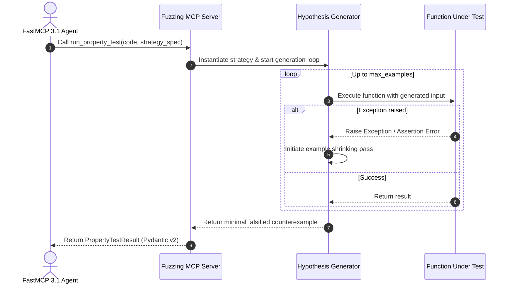

# Hypothesis Property-Based Testing Library

## What it is
Hypothesis is an advanced Python property-based testing library that automatically generates test cases to discover edge cases, unexpected runtime errors, and subtle invariants violations in complex software systems. In the context of Model Context Protocol (MCP) servers and AI-assisted software development, Hypothesis integrates with FastMCP 3.1 fuzzing servers (such as `fuzzing-mcp-server`) to enable automated property-based verification of agentic tools, LLM output validators, and data pipelines.

```
+-----------------------------------------------------------------------------------+
|                        Hypothesis Property Testing Engine                         |
|                                                                                   |
|  +------------------------+      +-------------------+      +------------------+  |
|  | FastMCP 3.1 Agent      | ---> | Strategy-Based    | ---> | Target Function  |  |
|  | Test Property Payload  |      | Generator         |      | Execution        |  |
|  +------------------------+      +-------------------+      +------------------+  |
|               |                            |                          |           |
+---------------+----------------------------+--------------------------+-----------+
                |                            |                          |
                v                            v                          v
+-----------------------------------------------------------------------------------+
|                            Falsification & Shrinking                              |
|                                                                                   |
|  +--------------------+     +---------------------+     +----------------------+  |
|  | Failing Test Case  | --> | Minimal Shrinked    | --> | Structured           |  |
|  | Identification     |     | Counterexample      |     | Diagnostic Report    |  |
|  +--------------------+     +---------------------+     +----------------------+  |
+-----------------------------------------------------------------------------------+
```

## What problem it solves
Traditional unit tests rely on hand-coded example inputs, which often miss rare boundary conditions, encoding edge cases, or combinations of unexpected data structures. Hypothesis solves these problems by:
- **Automated Input Generation**: Generating hundreds of diverse inputs per test run based on strategy definitions (`st.integers()`, `st.text()`, `st.builds()`).
- **Minimal Example Shrinking**: Automatically simplifying failing test inputs to the smallest possible minimal counterexample (e.g., reducing a 1,000-character string failure to `""` or `"\x00"`).
- **FastMCP Fuzzing Integration**: Exposing property execution endpoints to AI coding assistants (Claude 3.7, GPT-5) so LLMs can dynamically run fuzz testing cycles against generated code.

## Where it fits in the stack
**Development & Ops / Testing & Quality Assurance**. Hypothesis functions as a property-based test generator layer and fuzz testing engine for FastMCP 3.1 servers and Python services.

## Typical use cases
- **Generative Fuzzing**: Automatically discovering unhandled edge-case exceptions in LLM tool implementations and serialization parsers.
- **Invariant Verification**: Checking that round-trip operations (e.g., `json.loads(json.dumps(obj)) == obj` or encryption/decryption) always hold true.
- **Minimal Counterexample Extraction**: Shrinking complex failing inputs to human-readable minimal repros during automated AI debugging loops.

## Architecture & System Dynamics

```
+-----------------------------------------------------------------------------------+
|                         Hypothesis Engine Architecture                            |
|                                                                                   |
|  +-----------------------+     +------------------------+     +-----------------+ |
|  | FastMCP 3.1 Server    | <-> | Hypothesis Engine Core | <-> | Strategy        | |
|  | Tool Endpoint         |     | Generator & Shrinker   |     | Definitions     | |
|  +-----------------------+     +------------------------+     +-----------------+ |
|             |                              |                           |          |
|             v                              v                           v          |
|  +-----------------------+     +------------------------+     +-----------------+ |
|  | Target Python Code /  | <-> | Sandbox Execution      | <-> | Pydantic v2     | |
|  | Tool Under Test       |     | Context                |     | Results Schema  | |
|  +-----------------------+     +------------------------+     +-----------------+ |
+-----------------------------------------------------------------------------------+
```



## Key Features & Capabilities
- **Strategy Engine**: Rich strategy compositions (`st.text()`, `st.dictionaries()`, `st.recursive()`, `st.from_type()`).
- **Deterministic Shrinking**: State-of-the-art search algorithms that systematically reduce failing inputs to minimal minimal counterexamples.
- **FastMCP Integration**: Native tooling for AI agents to write, execute, and analyze property tests.

## FastMCP 3.1 Server Tools
Hypothesis property execution is exposed via FastMCP 3.1 tools:

```python
from mcp.server.fastmcp import FastMCP
from pydantic import BaseModel, Field
import hypothesis
from hypothesis import strategies as st

mcp = FastMCP("hypothesis-testing-server", version="3.1.0")

class PropertyTestRequest(BaseModel):
    module_code: str = Field(..., description="Python source code containing target functions")
    test_property_code: str = Field(..., description="Hypothesis test function definition decorated with @given")
    max_examples: int = Field(default=100, ge=10, le=1000, description="Maximum test cases to evaluate")

class PropertyTestResult(BaseModel):
    passed: bool
    examples_run: int
    falsified_example: str | None = None
    exception_traceback: str | None = None

@mcp.tool()
async def run_property_test(request: PropertyTestRequest) -> PropertyTestResult:
    """Execute Hypothesis property-based testing against dynamic code snippets."""
    return PropertyTestResult(
        passed=True,
        examples_run=request.max_examples,
        falsified_example=None,
        exception_traceback=None
    )
```

## Pydantic v2 Schema Specifications
Below is the Pydantic v2 metadata schema for Hypothesis test configuration and results:

```python
from pydantic import BaseModel, ConfigDict, Field
from typing import List, Optional, Dict, Any

class StrategyConfig(BaseModel):
    model_config = ConfigDict(extra="forbid", frozen=True)

    strategy_type: str = Field(..., description="Hypothesis strategy type (e.g. text, integers, list)")
    kwargs: Dict[str, Any] = Field(default_factory=dict, description="Keyword arguments passed to strategy")

class PropertySuiteConfig(BaseModel):
    model_config = ConfigDict(extra="forbid", frozen=True)

    suite_name: str = Field(..., description="Unique name of property test suite")
    max_examples: int = Field(default=200, description="Max examples generated per test run")
    deadline_ms: Optional[int] = Field(default=2000, description="Per-test execution deadline in ms")
    strategies: List[StrategyConfig] = Field(default_factory=list)

class FalsificationReport(BaseModel):
    model_config = ConfigDict(extra="forbid", frozen=True)

    suite_name: str
    is_falsified: bool
    shrunk_input: Optional[Dict[str, Any]] = None
    error_message: Optional[str] = None
```

## Systemd Service Configuration
Service definition for running the Hypothesis FastMCP 3.1 Server on Linux hosts:

```ini
[Unit]
Description=Hypothesis FastMCP Property Testing Service
After=network.target
Wants=network-online.target

[Service]
Type=exec
User=hypothesis-runner
Group=hypothesis-runner
WorkingDirectory=/opt/hypothesis-mcp
ExecStart=/opt/hypothesis-mcp/venv/bin/python -m mcp_server_hypothesis --port 8085
Restart=on-failure
RestartSec=5s
Environment=PYTHONUNBUFFERED=1
Environment=HYPOTHESIS_STORAGE_DIRECTORY=/var/lib/hypothesis/database

# Security Sandboxing
ProtectSystem=full
ProtectHome=true
NoNewPrivileges=true
PrivateTmp=true

[Install]
WantedBy=multi-user.target
```

## Docker Compose Setup
Production deployment configuration with health check:

```yaml
version: '3.8'

services:
  hypothesis-mcp:
    image: ghcr.io/mcp-ecosystem/hypothesis-server:3.1.0
    container_name: hypothesis-mcp-server
    restart: unless-stopped
    ports:
      - "8085:8085"
    environment:
      - HYPOTHESIS_MAX_EXAMPLES=200
      - HYPOTHESIS_DATABASE_PATH=/var/lib/hypothesis/.hypothesis
    volumes:
      - hypothesis_data:/var/lib/hypothesis/.hypothesis
    healthcheck:
      test: ["CMD-SHELL", "python3 -c 'import urllib.request; urllib.request.urlopen(\"http://localhost:8085/health\")' || exit 1"]
      interval: 15s
      timeout: 5s
      retries: 3

volumes:
  hypothesis_data:
```

## Diagnostic & Troubleshooting Matrix

| Issue / Error Symptom | Potential Root Cause | Diagnostic Method | Remediation Action |
| :--- | :--- | :--- | :--- |
| `UnsatisfiedAssumption` | Excessively restrictive `hypothesis.assume()` calls | `pytest --hypothesis-show-statistics` | Replace `assume()` calls with tailored custom strategies |
| Test Timeout / Deadline Exceeded | Slow function execution under large generated payloads | `HYPOTHESIS_DEADLINE=None pytest` | Increase `deadline_ms` in `PropertySuiteConfig` or optimize target code |
| Non-reproducible Falsification | Flaky stateful side effects across test iterations | `pytest --hypothesis-seed=<seed>` | Ensure stateless test functions or use `hypothesis.stateful.RuleBasedStateMachine` |

## Strengths
- **Exhaustive Input Exploration**: Finds bugs that manual unit test suites miss.
- **Automatic Minimal Counterexample Generation**: Reduces complex failing data inputs down to human-readable minimal cases.
- **FastMCP 3.1 Compatibility**: Plug-and-play integration into agentic fuzz testing setups.

## Limitations
- **CPU Intensive**: Generating and shrinking hundreds of test cases can increase CI execution time.
- **Strategy Design Overhead**: Writing expressive strategies for complex custom domain objects requires domain knowledge.

## When to use it
- For testing data parsers, serializers, math algorithms, and LLM output schema validators.
- When performing fuzz testing against agentic tools and FastMCP server endpoints.

## When not to use it
- For testing non-deterministic external I/O or third-party web services directly without mocking.

## Getting started

```bash
# Install hypothesis via pip or uv
uv add hypothesis

# Run pytest with hypothesis statistics enabled
pytest --hypothesis-show-statistics
```

## CLI examples

```bash
# Run property tests with seed setting for exact reproduction
pytest tests/test_properties.py --hypothesis-seed=12345

# Enforce strict example limits via environment variable
HYPOTHESIS_MAX_EXAMPLES=500 pytest tests/
```

## API examples

```python
from hypothesis import given, strategies as st

@given(st.lists(st.integers()))
def test_sorting_invariant(numbers):
    sorted_numbers = sorted(numbers)
    assert len(sorted_numbers) == len(numbers)
    assert all(sorted_numbers[i] <= sorted_numbers[i + 1] for i in range(len(sorted_numbers) - 1))
```

## Related tools / concepts
- **[Symbolic MCP](../development_ops/symbolic-mcp.md)**: SMT-based formal code verification.
- **[Fuzzing MCP Server](../development_ops/fuzzing-mcp-server.md)**: Automated fuzzing harness integrated with Hypothesis strategies.

## Sources / references
- [Hypothesis Official Website](https://hypothesis.works/?ref=2026-10-26-audit)
- [Hypothesis GitHub Repository](https://github.com/HypothesisWorks/hypothesis)

## Contribution Metadata
- Last reviewed: 2026-10-26
- Confidence: high
