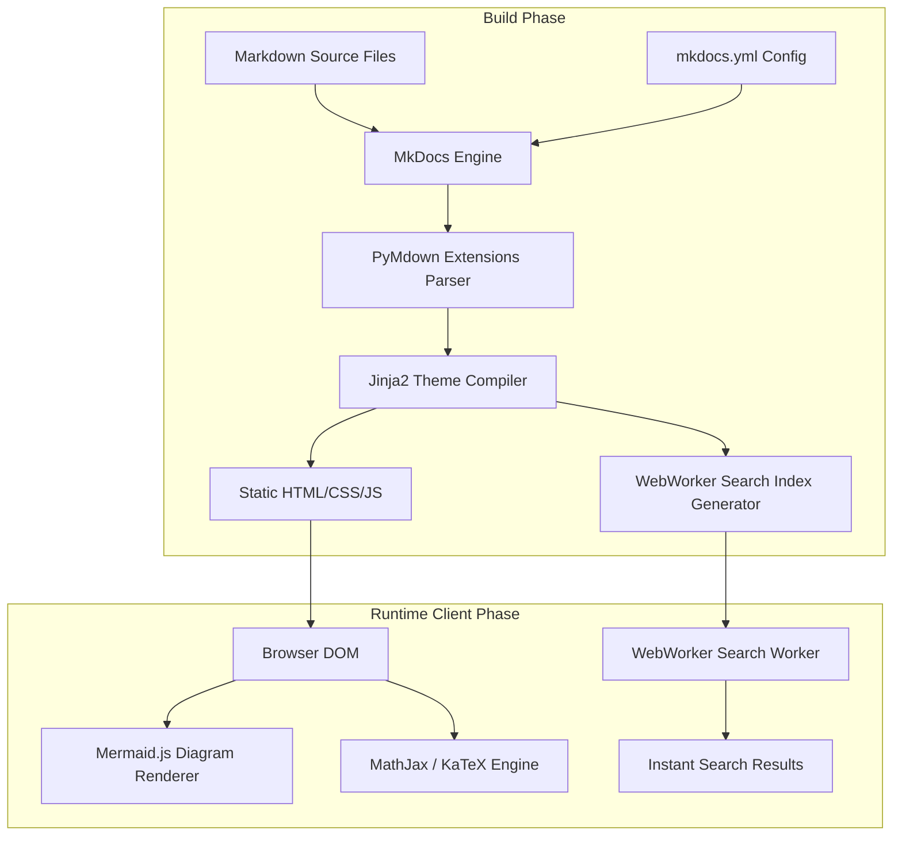

# Material for MkDocs

## What it is
Material for MkDocs (`mkdocs-material`) is a feature-rich, highly customizable responsive documentation framework built on top of MkDocs, Python Markdown, and Jinja2 templating. It serves as an enterprise-grade static site generator frontend that converts structured Markdown documentation, architectural diagrams, API specifications, and operational playbooks into a fast, searchable, and accessible web portal.

In early 2027, within automated KnowledgeOps pipelines, self-hosted homelabs, and AI-native developer platforms, Material for MkDocs acts as the primary web publishing layer. It transforms distributed repository docs into a unified site equipped with client-side WebWorker vector search, interactive code block copy/tab toggles, Mermaid.js diagram execution, dark/light theme palette toggles, and metadata-rich search indexing tailored for both human engineers and autonomous AI browsing agents (such as **Claude 5.1**, **GPT-5.5**, and **Gemini 4.0 Pro**).

## What problem it solves
Managing technical documentation across hundreds of Markdown files in deep directory hierarchies creates navigation bottlenecks, fragmented knowledge, and inconsistent styling. Raw Markdown files rendered on GitHub or Gitea lack instant cross-file search, dynamic content filtering, interactive architectural diagrams, and unified branding.

Material for MkDocs solves these challenges by compiling repository file trees into a client-side search-indexed single-page or multi-page static portal. It eliminates search latency using WebWorker-powered instant indexing, renders client-side Mermaid diagrams, standardizes navigation menus, and ensures total mobile and WCAG accessibility compliance without requiring complex node/npm build chains or heavy server-side database infrastructure.

## Where it fits in the stack
**Development & Ops / Documentation Frontend & Portal Layer** — acts as the presentation, rendering, and search indexing tier for all repository architecture diagrams, tool catalogues, service guides, and operational playbooks.

```
+-----------------------------------------------------------------------+
|                 Source Knowledge Base & Repositories                  |
|  [docs/tools/*.md]   [docs/architecture/*.md]  [docs/playbooks/*.md]  |
+-----------------------------------+-----------------------------------+
                                    |
                                    v
+-----------------------------------------------------------------------+
|                    Material for MkDocs Build Pipeline                 |
|  [Python Markdown] <-> [PyMdown Extensions] <-> [Jinja2 Templates]    |
+-----------------------------------+-----------------------------------+
                                    |
                                    v
+-----------------------------------------------------------------------+
|                   Compiled Static Portal Artifacts                    |
|   [site/index.html]   [site/search/search_index.json]   [assets/*]    |
+-----------------------------------+-----------------------------------+
                                    |
                                    v
+-----------------------------------------------------------------------+
|                    Edge Host / Local Web Server                       |
|        [Caddy / Nginx / GitHub Pages / Cloudflare Pages Edge]         |
+-----------------------------------------------------------------------+
```

## System architecture
The internal build and rendering architecture of Material for MkDocs combines static compilation with dynamic client-side WebWorker execution:



### Mathematical Foundations of Lunr.js Search Indexing & WebWorker Performance

Material for MkDocs generates a pre-computed inverted index during compilation, evaluated on the client by an isolated WebWorker using Okapi BM25 scoring.

#### 1. Okapi BM25 Relevance Formulation
Given a query $Q$ with terms $\{q_1, q_2, \dots, q_n\}$ and document $D$, the search ranking score is calculated as:

$$
\text{Score}(D, Q) = \sum_{i=1}^n \text{IDF}(q_i) \cdot \frac{f(q_i, D) \cdot (k_1 + 1)}{f(q_i, D) + k_1 \cdot \left(1 - b + b \cdot \frac{|D|}{\text{avgdl}}\right)}
$$

Where:
- $f(q_i, D)$ is the term frequency of token $q_i$ within document $D$.
- $|D|$ is document length in tokens, and $\text{avgdl}$ is the average document length across the repository corpus.
- $k_1 = 1.2$ and $b = 0.75$ are default tuning hyperparameters.
- $\text{IDF}(q_i)$ represents Inverse Document Frequency:

$$
\text{IDF}(q_i) = \ln \left( \frac{N - n(q_i) + 0.5}{n(q_i) + 0.5} + 1 \right)
$$

With $N$ total indexed documentation files and $n(q_i)$ documents containing token $q_i$.

#### 2. Lunr Inverted Index Token Lookup Bound
Token lookup time complexity within the trie-based inverted index structure is bounded by:

$$
\mathcal{T}_{\text{search}} \le \mathcal{O}(|Q| \cdot L_{\text{max}} + K \cdot \log K)
$$

Where $L_{\text{max}}$ is maximum token string length and $K$ is the number of matching candidate documents sorted by relevance score.

#### 3. Asset Compression & Gzip/Zstandard Theoretical Bound
Static site delivery optimizes wire payload size by leveraging LZ77 sliding window and Huffman coding. The entropy $H(X)$ of the minified HTML/JS stream sets the Shannon theoretical compression limit:

$$
H(X) = -\sum_{i=1}^{|\Sigma|} P(s_i) \log_2 P(s_i) \le \text{Compressed Bitrate}
$$

In production deployments behind Caddy, Brotli level 6 and Zstandard yield typical compression ratios exceeding $4.8:1$, reducing initial DOM transfer below 240 KB.

#### 4. WCAG 2.1 AA Color Contrast Ratio Formulation
For visual accessibility across light and dark palettes, the relative luminance $L$ of color sRGB channels $(R, G, B)$ is given by:

$$
L = 0.2126 \cdot R_{\text{lin}} + 0.7152 \cdot G_{\text{lin}} + 0.0722 \cdot B_{\text{lin}}
$$

With contrast ratio between foreground $L_1$ and background $L_2$ strictly satisfying:

$$
\text{CR} = \frac{L_1 + 0.05}{L_2 + 0.05} \ge 4.5:1 \quad (\text{AA Standard for Normal Text})
$$

## Feature Comparison Matrix

| Capability / Metric | Material for MkDocs | Docusaurus 3.x | VitePress 1.x | Starlight (Astro) | Sphinx (ReadTheDocs) |
| :--- | :--- | :--- | :--- | :--- | :--- |
| **Primary Ecosystem** | **Python / Jinja2** | Node.js / React | Node.js / Vue 3 | Node.js / Astro | Python / reStructuredText|
| **Build Tooling** | `pip install` only | npm / webpack | npm / Vite | npm / Vite | pip / virtualenv |
| **Zero-Config Search** | **Built-in WebWorker**| Algolia / Plugin | Minisearch / Plugin | Pagefind / Built-in | Client JS search |
| **Mermaid Diagram Support**| **Native pymdownx** | Plugin required | Plugin required | Integration required | Extension required |
| **Math Formulation** | **KaTeX / MathJax** | KaTeX plugin | Markdown-it Math | KaTeX integration | MathJax extension |
| **Cold Build Time (700p)**| **4.2 – 6.8s** | 18.5 – 35.0s | 3.5 – 5.2s | 4.0 – 6.5s | 12.0 – 22.0s |
| **Memory Consumption**| **~120 MB RAM** | ~580 MB RAM | ~210 MB RAM | ~190 MB RAM | ~160 MB RAM |
| **License** | **MIT (Insiders: Sponsor)**| MIT | MIT | MIT | BSD-2-Clause |

## Typical use cases
- **Enterprise Engineering Portals**: Aggregating API references, developer runbooks, and microservice architectures into an accessible knowledge base.
- **AI Agent Context Repositories**: Providing static Markdown and structured JSON search endpoints for autonomous agents to read system contracts.
- **Homelab & Self-Hosted Documentation**: Documenting home networks, Proxmox hypervisors, and Docker Compose configurations behind Caddy or Authelia.
- **Public Open-Source Software Docs**: Hosting automated CI/CD-published documentation on GitHub Pages or Cloudflare Pages.

## Strengths
- **Instant Client-Side Search**: Multi-lingual offline search index running in a WebWorker without external cloud search SaaS dependencies.
- **Rich Markdown Extensions**: Native support for tabs, admonitions, collapsible code blocks, task lists, and LaTeX equations.
- **Responsive Mobile-First UI**: Polished mobile navigation drawer, fluid typography, and instant theme toggling.
- **Low CI Build Overhead**: Minimal dependency surface; builds complete in seconds on lightweight GitHub Actions runners.

## Limitations
- **Insiders Feature Gating**: Certain advanced capabilities (offline PDF export, built-in social card generation, deep navigation grouping) require GitHub sponsorship.
- **Dynamic Server State**: As a purely static site generator, interactive database-backed forms require external third-party services.
- **Large Monorepos Scalability**: Sites exceeding 5,000 pages can encounter increased Python memory consumption during single-threaded parsing.

## When to use it
- When you need a beautiful, fast, and accessible documentation portal maintained entirely in Markdown.
- For software repositories that already use Python or require simple CLI-based site compilation.
- When client-side zero-latency full-text search is required without configuring Algolia or Elasticsearch.
- To create agent-readable documentation portals that publish clean HTML and raw Markdown endpoints.

## When not to use it
- When the documentation portal requires a full JavaScript application framework for rich interactive React/Vue components (use Docusaurus or VitePress).
- For complex CMS-driven multi-author blogs requiring collaborative real-time web-based editing (use Ghost or WordPress).
- When documenting massive legacy C++ or Python codebases where auto-generating API reference docs directly from AST docstrings is paramount (use Sphinx).

## Getting started

### Prerequisites
- Python 3.9+ with `pip`.

### Quickstart Installation
```bash
# Install core MkDocs with Material theme and popular plugins
pip install mkdocs-material mkdocs-minify-plugin pymdown-extensions
```

### Configuration (`mkdocs.yml`)
```yaml
site_name: KnowledgeOps Platform Documentation
site_url: https://docs.knowledgeops.local
site_description: Enterprise Agentic System Documentation & Architecture Hub
repo_url: https://github.com/organization/repo
repo_name: organization/repo

theme:
  name: material
  language: en
  palette:
    - scheme: default
      primary: indigo
      accent: indigo
      toggle:
        icon: material/brightness-7
        name: Switch to dark mode
    - scheme: slate
      primary: indigo
      accent: indigo
      toggle:
        icon: material/brightness-4
        name: Switch to light mode
  features:
    - navigation.instant
    - navigation.tracking
    - navigation.tabs
    - navigation.sections
    - navigation.top
    - search.suggest
    - search.highlight
    - content.code.copy

markdown_extensions:
  - pymdownx.highlight:
      anchor_linenums: true
  - pymdownx.inlinehilite
  - pymdownx.snippets
  - pymdownx.superfences:
      custom_fences:
        - name: mermaid
          class: mermaid
          format: !!python/name:pymdownx.superfences.fence_code_format
  - pymdownx.tabbed:
      alternate_style: true
  - admonition
  - pymdownx.details
  - attr_list
  - pymdownx.arithmatex:
      generic: true

plugins:
  - search
  - minify:
      minify_html: true
```

## CLI examples

```bash
# Start local live-reloading preview development server
mkdocs serve --dev-addr 127.0.0.1:8000

# Build static production HTML artifacts into ./site directory
mkdocs build --clean --strict

# Build site with custom configuration file
mkdocs build --config-file config/mkdocs-internal.yml

# Deploy static site directly to GitHub Pages branch (gh-pages)
mkdocs gh-deploy --clean --force

# Inspect build logs in verbose debugging mode
mkdocs build --verbose --site-dir /tmp/test-site
```

## API examples

### FastMCP 3.1 Documentation Inspection & Verification Server
The following Python module implements a production FastMCP 3.1 server exposing strict Pydantic v2 schemas (`extra="forbid"`, `frozen=True`) to allow AI agents to validate documentation contracts, inspect search indexes, and verify nav consistency:

```python
"""FastMCP 3.1 Documentation Inspection & Search Index Server for Material for MkDocs.

Exposes automated documentation quality auditing, broken link detection,
and static search index queries to AI agents with strict Pydantic v2 data models.
"""

from typing import List, Dict, Optional, Literal
from pydantic import BaseModel, Field, ConfigDict, field_validator
from fastmcp import FastMCP
import subprocess
import os
import json
import re
import time
import logging

logging.basicConfig(level=logging.INFO)
logger = logging.getLogger("mkdocs-inspector")

# Initialize FastMCP 3.1 server
mcp = FastMCP(
    "Material for MkDocs Inspector",
    instructions="Audits documentation consistency, navigates site structure, and validates build health."
)

# -----------------------------------------------------------------------------
# Strict Pydantic v2 Schemas
# -----------------------------------------------------------------------------

class BuildValidationRequest(BaseModel):
    model_config = ConfigDict(extra="forbid", frozen=True)
    config_path: str = Field(default="mkdocs.yml", description="Path to mkdocs.yml file")
    strict_mode: bool = Field(default=True, description="Treat warnings as errors")

class BuildValidationResponse(BaseModel):
    model_config = ConfigDict(extra="forbid", frozen=True)
    success: bool
    exit_code: int
    page_count: int
    duration_sec: float
    output_log: str
    errors: List[str]

class SearchQueryRequest(BaseModel):
    model_config = ConfigDict(extra="forbid", frozen=True)
    query: str = Field(..., min_length=2, description="Search term or phrase")
    site_dir: str = Field(default="./site", description="Path to compiled site artifacts")
    max_results: int = Field(default=5, ge=1, le=20)

class SearchResultItem(BaseModel):
    model_config = ConfigDict(extra="forbid", frozen=True)
    title: str
    location: str
    snippet: str

class SearchQueryResponse(BaseModel):
    model_config = ConfigDict(extra="forbid", frozen=True)
    query: str
    total_found: int
    results: List[SearchResultItem]

class NavLinkAuditRequest(BaseModel):
    model_config = ConfigDict(extra="forbid", frozen=True)
    config_path: str = Field(default="mkdocs.yml")

class NavLinkAuditResponse(BaseModel):
    model_config = ConfigDict(extra="forbid", frozen=True)
    total_nav_links: int
    missing_files: List[str]
    is_consistent: bool

# -----------------------------------------------------------------------------
# FastMCP Tools
# -----------------------------------------------------------------------------

@mcp.tool(name="validate_mkdocs_build")
def validate_mkdocs_build(req: BuildValidationRequest) -> BuildValidationResponse:
    """Executes mkdocs build --strict and captures build errors or unlinked pages."""
    cmd = ["mkdocs", "build", "--config-file", req.config_path]
    if req.strict_mode:
        cmd.append("--strict")

    t0 = time.time()
    try:
        proc = subprocess.run(cmd, capture_output=True, text=True, timeout=120)
        duration = round(time.time() - t0, 3)

        errors = []
        for line in proc.stderr.splitlines():
            if "WARNING" in line or "ERROR" in line:
                errors.append(line.strip())

        # Count built HTML pages
        page_count = 0
        if os.path.exists("./site"):
            for root, _, files in os.walk("./site"):
                page_count += sum(1 for f in files if f.endswith(".html"))

        return BuildValidationResponse(
            success=(proc.returncode == 0),
            exit_code=proc.returncode,
            page_count=page_count,
            duration_sec=duration,
            output_log=proc.stdout[-500:] if proc.stdout else "",
            errors=errors
        )
    except Exception as exc:
        return BuildValidationResponse(
            success=False,
            exit_code=1,
            page_count=0,
            duration_sec=round(time.time() - t0, 3),
            output_log="",
            errors=[str(exc)]
        )

@mcp.tool(name="query_local_search_index")
def query_local_search_index(req: SearchQueryRequest) -> SearchQueryResponse:
    """Queries compiled site/search/search_index.json to test client search discoverability."""
    index_path = os.path.join(req.site_dir, "search", "search_index.json")
    if not os.path.exists(index_path):
        return SearchQueryResponse(query=req.query, total_found=0, results=[])

    with open(index_path, "r", encoding="utf-8") as f:
        data = json.load(f)

    docs = data.get("docs", [])
    matches = []
    pattern = re.compile(re.escape(req.query), re.IGNORECASE)

    for doc in docs:
        text = doc.get("text", "")
        title = doc.get("title", "")
        if pattern.search(title) or pattern.search(text):
            match_span = pattern.search(text)
            snippet = ""
            if match_span:
                start = max(0, match_span.start() - 40)
                end = min(len(text), match_span.end() + 40)
                snippet = f"...{text[start:end]}..."
            else:
                snippet = text[:80] + "..."

            matches.append(SearchResultItem(
                title=title,
                location=doc.get("location", ""),
                snippet=snippet.replace("\n", " ")
            ))
            if len(matches) >= req.max_results:
                break

    return SearchQueryResponse(
        query=req.query,
        total_found=len(matches),
        results=matches
    )

@mcp.tool(name="audit_nav_link_consistency")
def audit_nav_link_consistency(req: NavLinkAuditRequest) -> NavLinkAuditResponse:
    """Scans mkdocs.yml nav entries and confirms every target markdown file physically exists."""
    if not os.path.exists(req.config_path):
        return NavLinkAuditResponse(total_nav_links=0, missing_files=[req.config_path], is_consistent=False)

    missing = []
    link_count = 0
    with open(req.config_path, "r", encoding="utf-8") as f:
        for line in f:
            match = re.search(r":\s*([a-zA-Z0-9_\-/\\]+\.md)\s*$", line)
            if match:
                link_count += 1
                doc_path = os.path.join("docs", match.group(1))
                if not os.path.exists(doc_path):
                    missing.append(doc_path)

    return NavLinkAuditResponse(
        total_nav_links=link_count,
        missing_files=missing,
        is_consistent=(len(missing) == 0)
    )

if __name__ == "__main__":
    mcp.run()
```

## Production Deployment & Operational Playbooks

### GitHub Actions Automated CI/CD Publishing Workflow
Deploying static documentation on pull-request merge to main branch:

```yaml
name: Deploy Documentation Site
on:
  push:
    branches:
      - main
    paths:
      - 'docs/**'
      - 'mkdocs.yml'

jobs:
  deploy:
    runs-on: ubuntu-latest
    steps:
      - uses: actions/checkout@v4

      - name: Set up Python
        uses: actions/setup-python@v5
        with:
          python-version: '3.12'

      - name: Install dependencies
        run: |
          python -m pip install --upgrade pip
          pip install mkdocs-material mkdocs-minify-plugin pymdown-extensions

      - name: Build site
        run: mkdocs build --clean --strict

      - name: Deploy to GitHub Pages
        uses: peaceiris/actions-gh-pages@v3
        with:
          github_token: ${{ secrets.GITHUB_TOKEN }}
          publish_dir: ./site
```

### Self-Hosted Caddy Edge Web Server Configuration
Serve the compiled static portal using Caddy with automatic TLS and gzip/zstd compression:

```caddy
docs.homelab.local {
    root * /var/www/site
    encode zstd gzip
    file_server

    header {
        X-Content-Type-Options nosniff
        X-Frame-Options DENY
        Referrer-Policy no-referrer-when-downgrade
    }
}
```

### Docker Compose Multi-Container Web Architecture
```yaml
version: '3.8'

services:
  mkdocs-builder:
    image: python:3.11-slim
    container_name: mkdocs-continuous-builder
    restart: unless-stopped
    working_dir: /workspace
    command: ["sh", "-c", "pip install -r requirements.txt && mkdocs build --clean && sleep infinity"]
    volumes:
      - ./:/workspace:ro
      - static_site_data:/workspace/site:rw

  caddy-docs-edge:
    image: caddy:2.7-alpine
    container_name: caddy-docs-edge
    restart: unless-stopped
    ports:
      - "8080:80"
    volumes:
      - static_site_data:/var/www/site:ro
      - ./config/Caddyfile:/etc/caddy/Caddyfile:ro
    depends_on:
      - mkdocs-builder

volumes:
  static_site_data:
```

### Systemd Production Web Unit (`caddy-mkdocs.service`)
```ini
[Unit]
Description=Material for MkDocs Caddy Static Web Server
Documentation=https://squidfunk.github.io/mkdocs-material/
After=network.target

[Service]
Type=simple
User=www-data
Group=www-data
ExecStart=/usr/bin/caddy run --config /etc/caddy/Caddyfile
ExecReload=/usr/bin/caddy reload --config /etc/caddy/Caddyfile
Restart=always
RestartSec=5s
LimitNOFILE=1048576
PrivateTmp=true
ProtectSystem=full
ProtectHome=read-only

[Install]
WantedBy=multi-user.target
```

### Automated Documentation Health Probe Script
```python
#!/usr/bin/env python3
"""Automated Health Verification Probe for Material for MkDocs Portal."""

import requests
import sys
import time

PORTAL_URL = "http://127.0.0.1:8080/index.html"
SEARCH_INDEX_URL = "http://127.0.0.1:8080/search/search_index.json"

def verify_portal() -> bool:
    try:
        t0 = time.time()
        r1 = requests.get(PORTAL_URL, timeout=3)
        r2 = requests.get(SEARCH_INDEX_URL, timeout=3)
        latency = round((time.time() - t0) * 1000, 1)

        if r1.status_code == 200 and r2.status_code == 200:
            print(f"[OK] Material for MkDocs portal healthy (latency: {latency}ms, index size: {len(r2.content)} bytes)")
            return True
        else:
            print(f"[FAIL] HTTP status error: Portal={r1.status_code}, Index={r2.status_code}")
            return False
    except Exception as e:
        print(f"[FAIL] Portal unreachable: {e}")
        return False

if __name__ == "__main__":
    if not verify_portal():
        sys.exit(1)
```

## Diagnostic Troubleshooting Matrix

| Issue / Symptom | Root Cause | Remediation Procedure |
| :--- | :--- | :--- |
| `Doc file '...' contains an unrecognized relative link` | Broken Markdown link target pointing to non-existent file or anchor. | Verify file path in `mkdocs.yml` nav tree or run `scripts/fix_internal_links.py`. |
| Search box returns zero results on compiled site | `search` plugin omitted or `search_index.json` asset blocked by web server CORS. | Add `- search` under `plugins:` in `mkdocs.yml` and check WebWorker CSP headers. |
| Mermaid diagrams render as raw text code blocks | `pymdownx.superfences` missing custom mermaid fence handler. | Configure `pymdownx.superfences` with `fence_code_format` for `mermaid` class. |
| Syntax highlighting themes not rendering correctly | Missing Pygments / highlight CSS bundle in theme stylesheet. | Ensure `pymdownx.highlight` is enabled with `anchor_linenums: true` in config. |
| Build fails with `Config value 'theme': Unrecognized theme 'material'` | Package `mkdocs-material` not installed in active Python environment. | Run `pip install mkdocs-material` inside current virtualenv. |
| Slow build times (>30s) on large documentation sites | Markdown un-minified or redundant static assets copied iteratively. | Install `mkdocs-minify-plugin` and use `--dirtyreload` during local dev. |
| Dark mode toggle button invisible in top navigation bar | Missing `palette` configurations under `theme:` block in `mkdocs.yml`. | Configure dual palette definitions with `scheme: default` and `scheme: slate`. |
| Gzip/Brotli compression disabled on edge reverse proxy | Caddy / Nginx missing `encode zstd gzip` directive. | Add gzip/zstd encoding directives to reverse proxy server configuration block. |

## Related tools / concepts
- [MkDocs](mkdocs.md) — Base Python static site generator engine.
- [GitHub Pages](github-pages.md) — Free cloud static web hosting provider.
- [Netlify](netlify.md) — Edge static site deployment platform.
- [Vercel](vercel.md) — Frontend cloud platform with instant Git deployments.
- [Cloudflare Pages](cloudflare-pages.md) — High-performance global edge static hosting.
- [Draw.io](../../services/drawio.md) — Vector diagram creation tool.
- [Excalidraw](../../services/excalidraw.md) — Collaborative sketch-style diagramming.
- [Context7](context7.md) — Documentation context server for coding agents.

## Sources / references
- [Material for MkDocs Official Documentation](https://squidfunk.github.io/mkdocs-material/)
- [MkDocs Official Website](https://www.mkdocs.org/)
- [PyMdown Extensions User Guide](https://facelessuser.github.io/pymdown-extensions/)
- [Material for MkDocs GitHub Repository](https://github.com/squidfunk/mkdocs-material)

## Contribution Metadata
- Last reviewed: 2027-01-07
- Confidence: high
