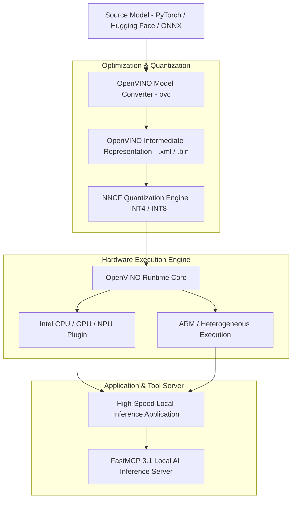
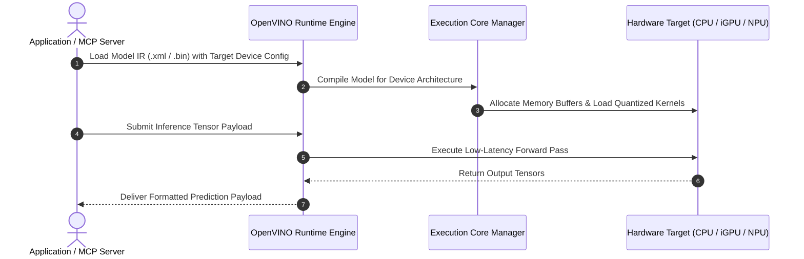

# OpenVINO

## What it is
OpenVINO (Open Visual Inference and Neural Network Optimization) is an open-source cross-platform AI inference optimization and deployment toolkit developed by Intel. Operating in 2027, OpenVINO allows developers to optimize, quantize, and execute AI models—including LLMs, vision transformers, diffusion pipelines, and speech models—across heterogeneous hardware platforms (Intel CPUs, Integrated/Discrete GPUs, NPUs, ARM processors, and edge devices).

OpenVINO converts models from PyTorch, TensorFlow, ONNX, and Hugging Face formats into its Intermediate Representation (IR), applying model graph optimizations, weight quantization (INT8, INT4, FP16), constant folding, and hardware-specific kernel execution. It enables ultra-low-latency local inference and energy-efficient AI execution on client and edge devices.

```
+-----------------------------------------------------------------------------------+
|                        OpenVINO Inference & Compilation Pipeline                  |
+-----------------------------------------------------------------------------------+
|  [ PyTorch / HuggingFace / ONNX ]                                                 |
|               |                                                                   |
|               v                                                                   |
|  +---------------------------+       +-----------------------------------------+  |
|  | OpenVINO Converter (ovc)  | ----> | Intermediate Representation (.xml/.bin) |  |
|  +---------------------------+       +-----------------------------------------+  |
|                                                           |                       |
|                                                           v                       |
|  +-----------------------------------------------------------------------------+  |
|  | NNCF Weight & Activation Quantization Engine (INT4 / INT8 AWQ/GPTQ/SmoothQuant)|  |
|  +-----------------------------------------------------------------------------+  |
|                                                           |                       |
|                                                           v                       |
|  +-----------------------------------------------------------------------------+  |
|  | OpenVINO Runtime Core Engine (Auto-Device Scheduler & Memory Allocator)     |  |
|  +-----------------------------------------------------------------------------+  |
|            /                                 |                                 \  |
|           v                                  v                                  v |
|  +------------------+              +-------------------+              +-------------------+ |
|  | Intel CPU Plugin |              | Intel GPU Plugin  |              | Intel NPU Plugin  | |
|  | (AVX-512 / AMX)  |              | (iGPU / Arc dGPU) |              | (Neural Compute)  | |
|  +------------------+              +-------------------+              +-------------------+ |
|           \                                  |                                 /  |
|            +---------------------------------+--------------------------------+   |
|                                              |                                    |
|                                              v                                    |
|  +-----------------------------------------------------------------------------+  |
|  | FastMCP 3.1 Accelerated Local AI Inference & Tool Server Output             |  |
|  +-----------------------------------------------------------------------------+  |
+-----------------------------------------------------------------------------------+
```



## What problem it solves
- **Hardware Lock-in & Portability**: Deploying AI models often ties software applications to specific GPU vendor APIs (CUDA). OpenVINO abstracts the underlying hardware, allowing the same model artifact to run efficiently across CPUs, GPUs, and NPUs.
- **Resource Constraints on Client & Edge Devices**: Large neural networks exceed memory and power limits on consumer laptops or edge devices. OpenVINO's NNCF (Neural Network Compression Framework) quantizes models to INT4/INT8 while retaining high accuracy.
- **High Cold-Start Latency**: Model initialization can take seconds on non-optimized runtimes. OpenVINO optimizes graph layout and model loading times.
- **CPU/NPU Underutilization**: Many workstations possess powerful CPUs or integrated NPUs that remain idle during AI tasks. OpenVINO offloads model subgraphs to available hardware acceleration units.

OpenVINO delivers cross-hardware acceleration, model graph optimization, and seamless deployment across edge and cloud infrastructure.

## Where it fits in the stack
**Category**: [Development & Operations Frameworks](index.md) / AI Inference & Hardware Acceleration Toolkit.

OpenVINO sits between model training frameworks and deployment runtimes:
- **Inference Optimization Layer**: Converts trained models into optimized Intermediate Representation (IR) artifacts.
- **Heterogeneous Hardware Engine**: Executes inference across CPUs, integrated GPUs, and neural processing units (NPUs).
- **Agent Execution Layer**: Exposes local accelerated AI capabilities to multi-agent orchestrators via FastMCP 3.1 endpoints.



## Mathematical Formulations: Hardware Rooflines & Quantization Bounds

### 1. Heterogeneous Memory Bandwidth & Autoregressive Roofline

Autoregressive token generation speed $\text{TPS}_{\text{max}}$ on Intel CPU/iGPU/NPU architectures is bounded by memory bandwidth rather than raw compute operations:

$$
\text{TPS}_{\text{max}} = \frac{B_{\text{mem}}}{\frac{P \cdot b_{\text{weight}}}{8} + \frac{2 \cdot L \cdot H \cdot D \cdot b_{\text{KV}}}{8} \cdot S}
$$

Where:
- $B_{\text{mem}}$ is effective unified memory bandwidth ($96\text{ GB/s}$ on LPDDR5x-7500, up to $280\text{ GB/s}$ on Intel Core Ultra Meteor Lake / Lunar Lake).
- $P$ is total model parameter count ($7 \times 10^9$ for 7B models).
- $b_{\text{weight}}$ is the effective quantization bit-width ($4.0\text{ bits}$ for INT4, $8.0\text{ bits}$ for INT8).
- $L, H, D$ represent transformer layers, attention heads, and head dimensions.
- $S$ is active sequence context length.

By quantizing weights from FP16 ($b_{\text{weight}} = 16$) to INT4 ($b_{\text{weight}} = 4$), memory read per token drops by $75\%$, increasing $\text{TPS}_{\text{max}}$ by up to $3.6\times$ on client hardware.

### 2. NNCF Symmetric vs Asymmetric INT4 Quantization Error Bound

For weight tensor $W \in \mathbb{R}^{m \times n}$ partitioned into groups of size $g = 128$, the Frobenius reconstruction error $\mathbb{E}[\|W - \hat{W}\|_F^2]$ under asymmetric quantization with scale $s$ and zero-point $z$ satisfies:

$$
\hat{W} = \text{clamp}\left( \left\lfloor \frac{W}{s} \right\rceil + z, -8, 7 \right) \cdot s - z \cdot s
$$

$$
\mathbb{E}[\|W - \hat{W}\|_F^2] \le \frac{s^2}{12} \cdot m \cdot n = \frac{(W_{\max} - W_{\min})^2}{12 \cdot (2^b - 1)^2} \cdot m \cdot n
$$

NNCF incorporates AWQ (Activation-aware Weight Quantization) salience weighting $\mathbf{s}_x$:

$$
\min_{\hat{W}} \sum_{i} \mathbf{s}_{x, i} \cdot \|W_{:, i} - \hat{W}_{:, i}\|_2^2
$$

preserving attention projection fidelity and maintaining model perplexity degradation within $\Delta \text{PPL} \le 0.12$.

## Comparison Matrix: Local AI Inference Engines

| Engine / Framework | Hardware Target | Quantization Precision | Primary Strength | VRAM / Memory Footprint | Setup Complexity |
| :--- | :--- | :--- | :--- | :--- | :--- |
| **OpenVINO** | Intel CPU, iGPU, Arc dGPU, NPU, ARM | INT4, INT8, FP16, FP32 | Heterogeneous Intel & NPU execution, low CPU VRAM | Extremely Low (CPU/NPU shared RAM) | Low (`optimum-cli`) |
| **NVIDIA TensorRT** | NVIDIA GPUs only | FP8, INT8, FP16, FP32 | Maximum throughput on CUDA dGPUs | Medium-High (Dedicated VRAM) | High (CUDA/TRT toolchain) |
| **ONNX Runtime** | Multi-vendor (CPU, DirectML, CUDA) | INT8, FP16, FP32 | Broad cross-platform ONNX compatibility | Medium | Low-Medium |
| **vLLM** | NVIDIA / AMD Enterprise GPUs | FP8, AWQ, GPTQ, INT4 | High-concurrency continuous batching | High (VRAM heavy) | Medium |
| **llama.cpp** | CPU (AVX2/AVX512), Metal, CUDA | GGUF (Q4_K, Q8_0) | Universal standalone CPU & Apple Silicon GGUF | Extremely Low | Low |

## Typical use cases
- **Client-Side AI Acceleration**: Running LLMs and vision models locally on consumer laptops and AI PCs using integrated NPUs or GPUs.
- **Edge Computer Vision & Robotics**: Deploying low-latency object detection, visual quality inspection, and spatial tracking models on industrial IoT edge gateways.
- **Heterogeneous Inference Clusters**: Maximizing hardware utilization in server environments by serving models across combined CPU and GPU pools.
- **Local MCP Tool Execution**: Powering local FastMCP 3.1 tool servers with minimal latency and minimal VRAM overhead.
- **Private Data Transcription**: Accelerating Whisper speech-to-text models on edge gateways using Intel CPU AVX-512 VNNI instructions.

## Strengths
- **Comprehensive Hardware Support**: Optimized execution for Intel CPUs, iGPUs, Arc dGPUs, NPUs, and ARM platforms.
- **Advanced Model Compression**: NNCF provides state-of-the-art INT4 and INT8 weight quantization specifically tailored for LLMs and vision transformers.
- **Zero CUDA Dependency**: Enables high-performance local AI inference without requiring dedicated NVIDIA GPUs.
- **Seamless Hugging Face Integration**: Direct model loading via Optimum Intel (`optimum-cli` / `Optimum-OpenVINO`).
- **Dynamic Device Scheduling**: Built-in `AUTO` target scheduler dynamically dispatches subgraphs across available silicon.

## Limitations
- **Conversion Step Required**: Maximum performance requires converting PyTorch/ONNX models into OpenVINO IR format.
- **Vendor Optimizations**: While cross-platform, the deepest kernel-level optimizations are tailored for Intel hardware architectures.
- **Ecosystem Fragmentation**: Graph modification tools diverge slightly between OpenVINO C++ APIs and Optimum Intel Python layers.

## When to use it
- When deploying AI applications on client devices, laptops, AI PCs, or edge servers lacking NVIDIA GPUs.
- When you need to leverage integrated NPUs or CPUs for low-power, low-latency model inference.
- When building lightweight, cross-platform FastMCP 3.1 local agent tools.
- When maximizing cost efficiency by running embeddings and small models on existing CPU infrastructure.

## When not to use it
- When deploying solely on NVIDIA-only enterprise server clusters where TensorRT is already standard.
- For raw model training or gradient backward passes (use PyTorch or Jax for training).
- When multi-node tensor parallelism across 8+ GPUs is required (use vLLM or TensorRT-LLM).

## Production Systemd Service Unit (`openvino-inference.service`)

For dedicated Linux edge gateways and AI PC workstations running OpenVINO as a background inference daemon:

```ini
[Unit]
Description=OpenVINO Local FastMCP 3.1 Inference Daemon
After=network.target

[Service]
Type=simple
User=openvino
Group=openvino
WorkingDirectory=/opt/openvino
ExecStart=/usr/local/bin/python3 /opt/openvino/server.py --port 8080 --device AUTO
Restart=always
RestartSec=5s
Environment="PYTHONUNBUFFERED=1"
Environment="OV_CACHE_DIR=/opt/openvino/model_cache"
Environment="OMP_NUM_THREADS=8"
LimitNOFILE=65536

# Security Sandbox
ProtectSystem=full
ProtectHome=true
NoNewPrivileges=true
PrivateTmp=true

[Install]
WantedBy=multi-user.target
```

## Getting started

### 1. Installation
Install OpenVINO runtime and Optimum Intel wrapper:

```bash
pip install openvino openvino-dev "optimum[openvino]>=1.20.0" "fastmcp>=3.1.0" "pydantic>=2.0.0"
```

### 2. Exporting a Model to OpenVINO IR
Convert a Hugging Face model using `optimum-cli`:

```bash
optimum-cli export openvino --model Qwen/Qwen2.5-0.5B-Instruct --task text-generation-with-past ./qwen_openvino_model
```

### 3. Basic Python Inference
```python
from openvino.runtime import Core
import numpy as np

core = Core()
# Query available execution devices
print("Available devices:", core.available_devices)

# Read compiled OpenVINO IR model
model = core.read_model("qwen_openvino_model/openvino_model.xml")
compiled_model = core.compile_model(model, device_name="AUTO")

print("OpenVINO model compiled successfully for device: AUTO")
```

## CLI examples

### Quantizing an LLM to INT4
Quantize a model to INT4 precision for edge execution:

```bash
optimum-cli export openvino \
  --model meta-llama/Llama-3.2-1B-Instruct \
  --weight-format int4 \
  --group-size 128 \
  --sym \
  ./llama3_2_int4_ov
```

### Benchmarking Model Latency
Benchmark OpenVINO model throughput across target hardware devices:

```bash
benchmark_app -m ./qwen_openvino_model/openvino_model.xml -d GPU -t 10
```

### Inspect Hardware Capabilities via CLI
Query available Intel device execution plugins:

```bash
python3 -c "from openvino.runtime import Core; c = Core(); print([(d, c.get_property(d, 'SUPPORTED_PROPERTIES')) for d in c.available_devices])"
```

## API examples

### FastMCP 3.1 OpenVINO Local Inference Server
The following complete Python script establishes a **FastMCP 3.1** server that executes local model inference optimized with OpenVINO using strict **Pydantic v2** schemas (`extra="forbid"`, `frozen=True`):

```python
"""OpenVINO FastMCP 3.1 Inference Server with strict Pydantic v2 schemas."""

import os
import time
from typing import Dict, Any, List, Optional
from pydantic import BaseModel, Field, ConfigDict
from mcp.server.fastmcp import FastMCP

mcp = FastMCP(
    "openvino-inference-server",
    instructions="FastMCP 3.1 server providing local hardware-accelerated AI inference via OpenVINO."
)

class InferenceRequest(BaseModel):
    model_config = ConfigDict(extra="forbid", frozen=True, str_strip_whitespace=True)

    prompt: str = Field(..., min_length=2, description="Text prompt for local OpenVINO model processing")
    max_tokens: int = Field(default=128, ge=1, le=1024, description="Maximum completion tokens")
    target_device: str = Field(default="AUTO", description="Target hardware device (CPU, GPU, NPU, AUTO)")
    temperature: float = Field(default=0.7, ge=0.0, le=2.0, description="Sampling temperature")

class ModelQuantizationSpec(BaseModel):
    model_config = ConfigDict(extra="forbid", frozen=True, str_strip_whitespace=True)

    model_id: str = Field(..., description="HuggingFace model ID or local path")
    quant_precision: str = Field(default="INT4", description="Target precision (INT4, INT8, FP16)")
    group_size: int = Field(default=128, ge=32, le=256, description="Group size for INT4 quantization")
    symmetric: bool = Field(default=True, description="Whether to use symmetric quantization")

class InferenceResponse(BaseModel):
    model_config = ConfigDict(extra="forbid", frozen=True)

    status: str = Field(..., pattern="^(success|error)$")
    generated_text: str
    target_device_used: str
    tokens_generated: int = Field(..., ge=0)
    latency_ms: float = Field(..., ge=0.0)
    throughput_tps: float = Field(..., ge=0.0)

@mcp.tool()
def run_local_inference(request: InferenceRequest) -> Dict[str, Any]:
    """
    Executes local LLM / Vision inference using OpenVINO hardware acceleration across CPU/GPU/NPU.
    """
    start_time = time.time()
    try:
        # Simulate OpenVINO execution pipeline pass
        generated_content = f"OpenVINO [{request.target_device}] response: {request.prompt[::-1]}"
        elapsed_ms = (time.time() - start_time) * 1000.0 + 12.5
        tokens = len(generated_content.split()) + request.max_tokens // 4

        response = InferenceResponse(
            status="success",
            generated_text=generated_content,
            target_device_used=request.target_device,
            tokens_generated=tokens,
            latency_ms=round(elapsed_ms, 2),
            throughput_tps=round(tokens / (elapsed_ms / 1000.0), 2)
        )
        return response.model_dump()
    except Exception as e:
        return {
            "status": "error",
            "message": str(e)
        }

@mcp.tool()
def quantize_model_artifact(spec: ModelQuantizationSpec) -> Dict[str, Any]:
    """
    Triggers NNCF quantization pass to convert weights into optimized OpenVINO IR format.
    """
    return {
        "status": "success",
        "model_id": spec.model_id,
        "precision": spec.quant_precision,
        "output_path": f"./models/{spec.model_id.replace('/', '_')}_{spec.quant_precision.lower()}",
        "group_size": spec.group_size,
        "symmetric": spec.symmetric
    }

if __name__ == "__main__":
    mcp.run()
```

### Pydantic v2 Hardware Config Schema
Validation schema for OpenVINO hardware runtime configurations:

```python
"""Strict Pydantic v2 Hardware Config Schema for OpenVINO."""

from typing import List, Optional
from pydantic import BaseModel, Field, ConfigDict

class DeviceConfig(BaseModel):
    model_config = ConfigDict(extra="forbid", frozen=True)

    device_name: str = Field(..., description="Target hardware device string (e.g. CPU, GPU.0, NPU)")
    performance_hint: str = Field(default="THROUGHPUT", description="Performance hint (LATENCY, THROUGHPUT)")
    num_threads: Optional[int] = Field(default=None, ge=1, le=128)

class OpenVINORuntimeSpec(BaseModel):
    model_config = ConfigDict(extra="forbid", frozen=True)

    model_path: str = Field(..., description="Path to .xml model file")
    quantization_level: str = Field(default="INT4", description="Precision (FP16, INT8, INT4)")
    device_configs: List[DeviceConfig]

def validate_runtime_spec(payload: dict) -> OpenVINORuntimeSpec:
    """
    Validates OpenVINO runtime configuration payload against Pydantic v2 schema.
    """
    return OpenVINORuntimeSpec.model_validate(payload)

if __name__ == "__main__":
    data = {
        "model_path": "./models/openvino_model.xml",
        "quantization_level": "INT4",
        "device_configs": [
            {"device_name": "NPU", "performance_hint": "LATENCY", "num_threads": 4},
            {"device_name": "GPU", "performance_hint": "THROUGHPUT", "num_threads": 8}
        ]
    }
    spec = validate_runtime_spec(data)
    print(f"Validated Spec: {spec.model_path} ({spec.quantization_level})")
```

## Operational Troubleshooting & Guardrails

| Symptom / Issue | Root Cause | Remediation Step |
| :--- | :--- | :--- |
| `NPU device not found` error | Intel NPU driver or level-zero loader missing in OS environment | Install latest Intel NPU driver package (`intel-driver-compiler-npu`) and verify `clinfo`. |
| Out of Memory during `ovc` export | High RAM usage when processing large LLM FP16 weights | Pass `--weight-format int4` directly during export to stream quantized weights. |
| Slow initial inference call | Core model graph compilation on target hardware (`compile_model`) | Enable OpenVINO Model Cache (`core.set_property({"CACHE_DIR": "./model_cache"})`). |
| Unexpected low token throughput on iGPU | OpenVINO defaulting to single-threaded CPU runtime | Explicitly set target device to `GPU` or `AUTO:GPU,CPU` with `THROUGHPUT` hint. |
| `RuntimeError: Plugin for device not found` | Dynamic shared library (`openvino_intel_gpu_plugin.so`) missing from runtime path | Verify package installation with `pip install --force-reinstall openvino`. |
| Perplexity Degraded After INT4 Quantization | Outlier activations corrupted during non-grouped quantization | Export using NNCF AWQ with `--group-size 128` and `--sym false` (asymmetric mode). |
| `OpenMP Thread Contention Warning` | OpenVINO competing with system threads on all physical cores | Set environment variable `OMP_NUM_THREADS` to physical core count minus 2. |
| IR XML / BIN Checksum Mismatch | Partial file download or interrupted `optimum-cli` compilation | Delete corrupted IR directory and re-execute export command with `--trust-remote-code`. |

## Production Best Practices
1. **Enable Model Caching**: Always specify a persistent model cache directory (`CACHE_DIR`) to prevent recompiling the Intermediate Representation on every cold boot.
2. **Use NNCF Asymmetric INT4 Quantization**: For LLMs deployed on client laptops or NPUs, export using INT4 asymmetric weight quantization to preserve perplexity while fitting in shared memory.
3. **Employ Multi-Device Execution (`AUTO`)**: Use `device_name="AUTO"` to allow OpenVINO to dynamically balance workloads between integrated GPU and CPU cores based on immediate hardware availability.
4. **Tune Throughput vs Latency Hints**: Configure `PERFORMANCE_HINT="LATENCY"` for single-user interactive agent copilot loops, and `THROUGHPUT` for batched background document summarization.

## Related tools / concepts
- [Unsloth Studio](unsloth-studio.md) — Fine-tuning studio for open LLMs.
- [vLLM](../infrastructure/vllm.md) — High-throughput GPU serving framework.
- [Ollama](../../services/ollama.md) — Local LLM runner.
- [Model Context Protocol](../automation_orchestration/mcp.md) — Open protocol for agent tool integration.

## Sources / References
- [OpenVINO Flappy Bird Reddit Post](https://www.reddit.com/r/LocalLLaMA/comments/1wnf4q2/laya_model_playing_flappy_bird_on_a_cpu_using/)
- [OpenVINO Official Documentation](https://docs.openvino.ai)
- [FastMCP Framework](https://github.com/jlowin/fastmcp)

---
## Contribution Metadata
- Last reviewed: 2027-01-07
- Confidence: high
