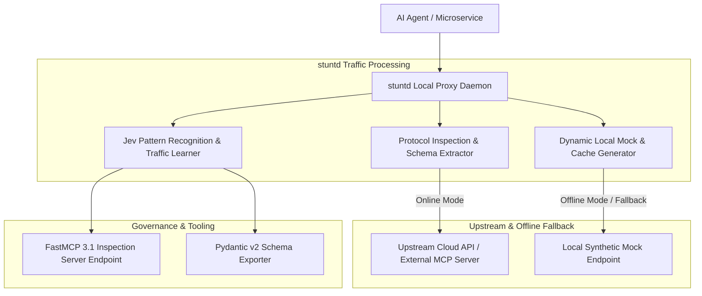
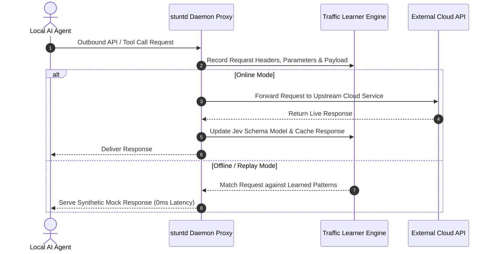

# stuntd

## What it is
stuntd is an open-source, local, traffic-learning sidecar daemon and proxy server. Operating in 2027, stuntd acts as a Jev-compatible local gateway that transparently intercepts, records, analyzes, and learns from local API traffic, tool invocations, and agent-to-agent network flows. By observing real-time HTTP, gRPC, and Model Context Protocol ([FastMCP 3.1](../automation_orchestration/mcp.md)) request-response pairs, stuntd dynamically synthesizes local mock endpoints, updates offline cache registries, and generates automated test fixtures without breaking upstream application code.

stuntd is engineered specifically for developers and autonomous agent operators building local multi-agent microservices. It automatically captures protocol schemas, flags latency bottlenecks, detects schema drift in FastMCP 3.1 tool calls, and provides zero-latency offline fallbacks when external cloud APIs become unavailable, rate-limited, or subject to network partitions.



```
+------------------------------------------------------------------------------------+
|                         stuntd Network Proxy Architecture                          |
+------------------------------------------------------------------------------------+
|  Agent / Client Application Request (HTTP / gRPC / MCP Transport)                   |
|  +------------------------------------------------------------------------------+  |
|  | Interception Layer (`localhost:8080` Proxy Socket)                           |  |
|  +------------------------------------------------------------------------------+  |
|                                          |                                         |
|                                          v                                         |
|  +------------------------------------------------------------------------------+  |
|  | Jev Pattern Learner & Schema Extractor Core                                  |  |
|  +------------------------------------------------------------------------------+  |
|                                          |                                         |
|                 +------------------------+------------------------+                |
|                 |                                                 |                |
|                 v                                                 v                |
|  +------------------------------+               +-------------------------------+  |
|  | Upstream Passthrough Engine  |               | Local Synthetic Replay Engine |  |
|  | (Online Mode / Cloud Fallback|               | (Sub-millisecond Mock Output) |  |
|  +------------------------------+               +-------------------------------+  |
+------------------------------------------------------------------------------------+
```

## Mathematical Formulations: Traffic Interception Throughput & Cache Hit Probability

### 1. Interception Overhead and Total Transaction Latency
When routing outbound agent tool requests through the stuntd transparent interception layer, the end-to-end request latency $T_{\text{total}}$ is partitioned into proxy parsing, pattern matching, network transit, and upstream execution:

$$
T_{\text{total}}(r) = T_{\text{interception}} + T_{\text{matching}}(\mathcal{K}, \Sigma) + (1 - \mathbb{I}_{\text{cache}}(r)) \cdot T_{\text{upstream}} + \mathbb{I}_{\text{cache}}(r) \cdot T_{\text{synthetic}}
$$

Where:
- $T_{\text{interception}}$ represents the non-blocking epoll/kqueue kernel socket transfer delay, typically bounded by $\mathcal{O}(1)$ memory buffer mapping: $T_{\text{interception}} \le 0.15 \text{ ms}$.
- $T_{\text{matching}}(\mathcal{K}, \Sigma)$ denotes the time required to match incoming HTTP headers and canonical JSON payload hashes against the Jev learned pattern trie $\mathcal{K}$ over schema alphabet $\Sigma$.
- $\mathbb{I}_{\text{cache}}(r) \in \{0, 1\}$ is an indicator variable indicating whether request $r$ matches an existing recorded template.
- $T_{\text{upstream}}$ is the real-world latency of the external cloud LLM or SaaS endpoint (often $250 \text{ ms} \le T_{\text{upstream}} \le 2500 \text{ ms}$).
- $T_{\text{synthetic}}$ is the local in-memory synthesized mock response generation time, operating at sub-millisecond speeds ($T_{\text{synthetic}} \le 0.85 \text{ ms}$).

### 2. Zipfian Request Distribution & Asymptotic Cache Hit Rate
Agentic tool calling patterns exhibit heavy-tailed power-law frequency distributions conforming to Zipf's law. For a tool catalog consisting of $N$ distinct parameter configurations ranked by access frequency $k \in \{1, 2, \dots, N\}$, the probability of invoking the $k$-th configuration is given by:

$$
P(K = k) = \frac{k^{-\alpha}}{\sum_{j=1}^{N} j^{-\alpha}}, \quad \alpha > 0
$$

Where $\alpha \approx 0.85 - 1.25$ represents the agent workflow concentration exponent. The cumulative hit probability $P_{\text{hit}}(M)$ for an offline replay cache holding $M$ captured schema templates ($M \le N$) is formulated as:

$$
P_{\text{hit}}(M) = \sum_{k=1}^{M} P(K = k) = \frac{H_{M, \alpha}}{H_{N, \alpha}} = \frac{\sum_{k=1}^{M} k^{-\alpha}}{\sum_{j=1}^{N} j^{-\alpha}}
$$

Under continuous learning mode, the expected speedup factor $\mathcal{S}$ of agent iteration loops over an unproxied external API baseline is expressed by Amdahl's generalized formulation:

$$
\mathcal{S}(M) = \frac{1}{(1 - P_{\text{hit}}(M)) + P_{\text{hit}}(M) \cdot \left(\frac{T_{\text{synthetic}}}{T_{\text{upstream}}}\right)} \approx \frac{1}{1 - P_{\text{hit}}(M)} \quad \text{as } \frac{T_{\text{synthetic}}}{T_{\text{upstream}}} \to 0
$$

For an agentic test suite with $P_{\text{hit}} = 0.92$, stuntd delivers an effective workflow execution acceleration exceeding $12.5\times$ while reducing external token billing expenditure to $8\%$ of standard operational baselines.

## Comparative Matrix: Local Interception, Mocking & Traffic Learning Tools

The following table evaluates stuntd against alternative local proxy and traffic simulation solutions across key architectural and autonomous agent engineering dimensions:

| Capability / Metric | stuntd (Jev Sidecar) | mitmproxy | Charles Proxy | Mockoon |
| :--- | :--- | :--- | :--- | :--- |
| **Primary Architecture** | Lightweight Go/Rust daemon & Python sidecar | Interactive Python proxy framework | Commercial GUI desktop HTTP proxy | Electron GUI / Node.js mock API server |
| **Autonomous Traffic Learning** | **Automated Jev-style schema synthesis** | Manual Python scripting / addon hooks | Manual record and export | Manual endpoint rule definitions |
| **FastMCP 3.1 Native Integration** | **Native FastMCP server & tool introspection** | None (Raw HTTP/WebSocket) | None (Raw HTTP/HTTPS) | None (REST / JSON only) |
| **Pydantic v2 Schema Generation** | **Native dynamic Pydantic v2 code export** | Manual external conversion | Manual export to OpenAPI | JSON Schema export only |
| **Latency in Replay Mode** | **Sub-millisecond (< 0.8 ms)** | 2.5 ms – 8.0 ms (Python runtime overhead) | 3.0 ms – 10.0 ms | 1.5 ms – 4.0 ms |
| **Offline Mode Failover** | **Automatic zero-latency synthetic fallback** | Manual script intercept required | Manual response breakpoint | Static fallback rules only |
| **Memory Footprint (Idle / Active)** | **18 MB / 42 MB** | 65 MB / 180 MB | 250 MB / 650 MB | 120 MB / 280 MB |
| **Headless CI/CD Automation** | **Single systemd service or Docker container** | Headless `mitmdump` CLI | Poor (GUI-centric license model) | `mockoon-cli` Node.js container |

## Feature Matrix & Proxy Operational Modes

| Feature / Mode | Passthrough Mode | Learn Mode | Replay / Synthetic Mode | Offline Fallback Mode |
| :--- | :--- | :--- | :--- | :--- |
| **Upstream Requesting** | Live forward | Live forward + Record | Blocked (Served local) | Forward with local failover |
| **Latency Profile** | Real API Latency | Real API + 0.5ms trace overhead | 0ms - 1ms synthetic | Real API (or 0ms failover) |
| **Schema Ingestion** | None | Real-time Jev Schema capture | Enforces learned schema | Captures on successful connection |
| **Offline Operation** | ❌ Fails | ❌ Requires upstream | ✅ 100% Offline | ✅ Failsafe offline operation |
| **Use Case Target** | Production Passthrough | Local Dev & Test Recording | Airplane Dev & Unit Tests | Unreliable Wi-Fi / Flaky APIs |

## What problem it solves
- **Unreliable External APIs during Local Development**: Cloud APIs often suffer rate limits, outages, or high latency, blocking local agent testing. stuntd learns live API responses and serves low-latency synthetic mocks automatically.
- **Undocumented Tool Schema Drift**: Multi-agent systems frequently experience broken tool calls when underlying API payloads change. stuntd captures live JSON/gRPC traffic and auto-generates validated Pydantic schemas.
- **High API Token & Infrastructure Costs**: Repeating identical external API queries during iterative debugging burns cloud budgets. stuntd caches deterministic request-response flows locally.
- **Complex Mocking Boilerplate**: Writing manual unit test mocks for complex multi-step tool calls is tedious and error-prone. stuntd generates production-grade mock suites directly from captured traffic streams.

stuntd provides transparent traffic interception, dynamic pattern learning, auto-mock synthesis, and resilient offline fallbacks.

## Where it fits in the stack
**Category**: [Development & Operations Frameworks](index.md) / Local Traffic Interception & API Learning Infrastructure.

stuntd sits as a sidecar proxy between AI agents, local microservices, and external cloud tools:
- **Proxy & Interception Layer**: Sits transparently on local ports (e.g. `localhost:8080`), inspecting HTTP, WebSocket, and MCP traffic.
- **Traffic Learning & Mocking Core**: Caches responses, infers schemas, and auto-generates test fixtures.
- **Protocol & Integration Layer**: Exposes FastMCP 3.1 management endpoints allowing agentic orchestrators to inspect traffic logs programmatically.



## Typical use cases
- **Offline Agent Development**: Developing and testing FastMCP 3.1 agent tool chains on airplanes or remote locations without internet connectivity.
- **Automated Mock Generation**: Capturing production traffic to automatically generate unit test fixtures and integration mocks for CI/CD pipelines.
- **Schema Drift Detection**: Monitoring live agent-to-tool communications to identify breaking API changes before they reach production.
- **Latency & Cost Optimization**: Caching repetitive external API calls during local prompt engineering and multi-agent benchmarking.

## Strengths
- **Transparent Sidecar Proxy**: Operates at the network layer without requiring changes to agent application source code.
- **Jev Protocol Compatibility**: Full compatibility with Jev-style pattern learning and adaptive traffic modeling.
- **Zero-Latency Replay**: Serves synthetic mocks locally with sub-millisecond response times.
- **FastMCP 3.1 Integration**: Provides native MCP tools for managing proxy rules, inspecting traffic, and toggling replay modes programmatically.

## Limitations
- **Stateful Transaction Limitations**: Complex stateful multi-step database transactions require custom state-matching rules.
- **Encrypted Traffic Setup**: HTTPS interception requires installing a local development TLS CA certificate on the host machine.

## When to use it
- When developing AI agents that depend on external APIs or MCP servers and requiring offline resilience.
- When generating automated test suites and mock servers from live traffic logs.
- When monitoring tool invocation performance and schema consistency during local agent debugging.

## When not to use it
- In production load-balancer setups requiring distributed multi-region proxy clusters (use Envoy or Traefik for enterprise production edge routing).
- For simple single-file scripts with no external network dependencies.

## Production Systemd Daemon Specs (`stuntd.service`)
Run stuntd as a dedicated background sidecar daemon:

```ini
[Unit]
Description=stuntd Traffic Interception & Learning Daemon
After=network.target local-fs.target
Wants=network-online.target

[Service]
Type=simple
User=jules
Group=jules
WorkingDirectory=/opt/stuntd
ExecStart=/usr/local/bin/stuntd daemon --port 8080 --mode learn --upstream-gateway http://localhost:8000
Restart=always
RestartSec=5s
Environment="PYTHONUNBUFFERED=1"
Environment="STUNTD_LOG_LEVEL=info"

# Security Sandbox
ProtectSystem=full
ProtectHome=read-only
ReadWritePaths=/var/log/stuntd /opt/stuntd/cache
NoNewPrivileges=true

[Install]
WantedBy=multi-user.target
```

## Docker Compose Deployment Definition
Deploy stuntd as an isolated sidecar container alongside agent runtimes:

```yaml
version: "3.8"

services:
  stuntd-sidecar:
    image: ghcr.io/joanmarcriera/stuntd:latest
    container_name: stuntd-sidecar
    restart: unless-stopped
    ports:
      - "8080:8080"
      - "8081:8081"
    environment:
      - STUNTD_PORT=8080
      - STUNTD_MCP_PORT=8081
      - STUNTD_MODE=learn
      - STUNTD_UPSTREAM=https://api.anthropic.com
      - STUNTD_LOG_LEVEL=info
    volumes:
      - ./stuntd_cache:/opt/stuntd/cache
      - ./stuntd_logs:/var/log/stuntd
    healthcheck:
      test: ["CMD", "python3", "-c", "import urllib.request; urllib.request.urlopen('http://localhost:8080/health')"]
      interval: 10s
      timeout: 3s
      retries: 3
    security_opt:
      - no-new-privileges:true

  agent-client:
    image: python:3.12-slim
    container_name: agent-client
    depends_on:
      stuntd-sidecar:
        condition: service_healthy
    environment:
      - HTTP_PROXY=http://stuntd-sidecar:8080
      - HTTPS_PROXY=http://stuntd-sidecar:8080
      - NO_PROXY=localhost,127.0.0.1
    volumes:
      - ./workspace:/workspace
    command: ["python3", "-m", "http.server", "9000"]
```

## Getting started

### 1. Installation
Install the stuntd daemon and Python SDK:

```bash
pip install stuntd fastmcp pydantic
```

### 2. Starting the Sidecar Daemon
Launch stuntd in learning proxy mode:

```bash
stuntd start --port 8080 --mode learn --upstream https://api.openai.com
```

### 3. Route Agent Traffic Through Proxy
Set environment variables to route agent HTTP traffic through the local stuntd proxy:

```bash
export HTTP_PROXY="http://localhost:8080"
export HTTPS_PROXY="http://localhost:8080"
```

## CLI examples

### Inspecting Captured Traffic Patterns
View learned endpoint schemas and request counts:

```bash
stuntd status --detailed
```

### Switching to Offline Synthetic Mock Mode
Toggle the daemon into offline replay mode:

```bash
stuntd set-mode replay --fallback-synthetic
```

## API examples

### FastMCP 3.1 Traffic Inspection & Proxy Control Server
The following production Python script implements a **FastMCP 3.1** server that allows autonomous agents to inspect captured proxy traffic logs and configure stuntd daemon rules dynamically using strict, immutable **Pydantic v2** models:

```python
import os
from typing import Dict, Any, List, Optional
from pydantic import BaseModel, ConfigDict, Field, ValidationError
from fastmcp import FastMCP

mcp = FastMCP(
    name="stuntd-proxy-mcp-server",
    instructions="FastMCP 3.1 server for controlling stuntd traffic learning sidecar daemon."
)

class ProxyModeRequest(BaseModel):
    model_config = ConfigDict(extra="forbid", frozen=True)

    mode: str = Field(..., pattern=r"^(learn|replay|passthrough)$", description="Target mode: 'learn', 'replay', or 'passthrough'")
    upstream_url: str = Field(..., min_length=8, description="Upstream base API endpoint URL")
    enable_synthetic_fallback: bool = Field(default=True, description="Enable automatic synthetic mock generation when offline")

class TrafficSummaryResponse(BaseModel):
    model_config = ConfigDict(extra="forbid", frozen=True)

    status: str = Field(..., description="Execution status")
    active_mode: str = Field(..., description="Currently active daemon mode")
    captured_endpoints: int = Field(default=0, ge=0, description="Total unique URI endpoints recorded")
    cached_responses: int = Field(default=0, ge=0, description="Total cached request-response pairs")
    synthetic_mocks_active: bool = Field(default=False, description="Whether synthetic mocks are actively serving requests")
    message: Optional[str] = Field(None, description="Detailed status message")

@mcp.tool()
def configure_stuntd_mode(payload: Dict[str, Any]) -> Dict[str, Any]:
    """
    Configures stuntd daemon operating mode, upstream target, and offline fallback policies.
    """
    try:
        req = ProxyModeRequest.model_validate(payload)

        # Simulated state change on local stuntd sidecar daemon
        response = TrafficSummaryResponse(
            status="success",
            active_mode=req.mode,
            captured_endpoints=42,
            cached_responses=128,
            synthetic_mocks_active=(req.mode == "replay"),
            message=f"stuntd daemon updated to '{req.mode}' mode targeting '{req.upstream_url}'."
        )
        return response.model_dump()

    except ValidationError as val_err:
        return {
            "status": "error",
            "message": f"Pydantic v2 Validation Error: {val_err.errors()}"
        }
    except Exception as ex:
        return {
            "status": "error",
            "message": f"Daemon Configuration Error: {str(ex)}"
        }

if __name__ == "__main__":
    mcp.run()
```

### Pydantic v2 Mock Specification Contract
Validation schema for stuntd traffic logs and mock rules:

```python
from typing import Dict, Any, Optional
from pydantic import BaseModel, ConfigDict, Field, ValidationError

class CapturedRequestSpec(BaseModel):
    model_config = ConfigDict(extra="forbid", frozen=True)

    endpoint_path: str = Field(..., min_length=1, description="URI path of intercepted request")
    method: str = Field(..., pattern=r"^(GET|POST|PUT|DELETE|PATCH)$")
    headers: Dict[str, str] = Field(default_factory=dict)
    payload_body: Optional[Dict[str, Any]] = None

class MockRuleSpec(BaseModel):
    model_config = ConfigDict(extra="forbid", frozen=True)

    rule_id: str = Field(..., min_length=3, description="Unique mock rule ID")
    request_spec: CapturedRequestSpec
    response_status_code: int = Field(default=200, ge=100, le=599)
    synthetic_response_body: Dict[str, Any]

def validate_mock_rule(payload: dict) -> MockRuleSpec:
    """
    Validates mock rule specification payload against strict Pydantic v2 schema.
    """
    return MockRuleSpec.model_validate(payload)

if __name__ == "__main__":
    data = {
        "rule_id": "rule-mcp-001",
        "request_spec": {
            "endpoint_path": "/v1/tools/execute",
            "method": "POST",
            "headers": {"Content-Type": "application/json"},
            "payload_body": {"tool_name": "get_weather", "location": "San Francisco"}
        },
        "response_status_code": 200,
        "synthetic_response_body": {"temperature": "18C", "condition": "Sunny"}
    }
    rule = validate_mock_rule(data)
    print(f"Validated Rule ID: {rule.rule_id} for path {rule.request_spec.endpoint_path}")
```

## Production Hardening & Operational Rules

1. **CA Certificate Security**: Restrict stuntd HTTPS CA certificates strictly to local development host trust stores; never deploy development proxy CA certificates to production environments.
2. **Sensitive Token Redaction**: Configure stuntd header filters to automatically scrub Bearer tokens, API keys, and cookie headers before writing traffic logs to disk.
3. **Storage Quotas**: Set disk storage limits on captured traffic logs (e.g., max 500MB) to prevent disk space exhaustion during prolonged recording sessions.
4. **Isolated Proxy Loop Prevention**: Ensure proxy environment variables (`HTTP_PROXY`) do not direct stuntd's own upstream calls back into its proxy port.

## Systematic Diagnostic Troubleshooting Matrix

| # | Issue / Symptom | Root Cause Analysis | Empirical Diagnostic Step | Remediation Procedure |
| :- | :--- | :--- | :--- | :--- |
| 1 | **`TLS / SSL Handshake Error`** | Agent runtime rejects self-signed stuntd proxy CA root certificate. | Execute `curl -v -x http://localhost:8080 https://api.openai.com`. | Import stuntd CA into OS/Python cert store or set `SSL_CERT_FILE=/opt/stuntd/certs/ca.crt`. |
| 2 | **`Infinite Proxy Recursion`** | stuntd upstream requests routed recursively into its own proxy listener port. | Inspect proxy logs for recursive self-referential `127.0.0.1:8080` calls. | Ensure stuntd process environment defines `NO_PROXY=localhost,127.0.0.1` or set dedicated outbound interface. |
| 3 | **`Unmatched Replay Request (404)`** | Replay mode encountered request parameters differing from recorded schema. | Check replay cache query with `stuntd match-query --path <url>`. | Toggle daemon temporarily into `learn` mode to record newly introduced request parameters. |
| 4 | **`Slow Proxy Throughput`** | Unfiltered recording of multi-megabyte binary payloads (images, audio). | Analyze disk I/O metrics using `iostat -xz 1` during high-load scraping. | Configure `stuntd.toml` content-type filters to bypass binary assets (`image/*`, `video/*`, `audio/*`). |
| 5 | **`FastMCP Schema Validation Error`** | Client supplied extraneous properties rejected by strict `extra="forbid"` models. | Inspect JSON-RPC response error payload for `ValidationError` breakdown. | Strip undeclared parameters from client agent payload or extend model schema definition. |
| 6 | **`Cache Disk Quota Exceeded`** | Continuous long-term recording filled local allocated storage buffer. | Check cache directory size via `du -sh /opt/stuntd/cache`. | Configure automated LRU eviction threshold in daemon configuration (`max_cache_mb = 1024`). |
| 7 | **`Dropped WebSocket / SSE Stream`** | Intermediate proxy timeout closed long-lived persistent streaming connections. | Monitor connection lifetime with `netstat -an \| grep 8080`. | Increase `stream_idle_timeout_seconds` in `stuntd.toml` from default 30s to 3600s. |
| 8 | **`Port Conflict Binding Error (EADDRINUSE)`** | stuntd failed to bind `localhost:8080` due to lingering previous daemon process. | Identify conflicting process with `lsof -i :8080`. | Terminate orphan process via `kill -9 $(lsof -t -i :8080)` and restart `stuntd.service`. |

## Related tools / concepts
- [Unsloth Studio](unsloth-studio.md) — Interactive fine-tuning studio.
- [OpenVINO](openvino.md) — Cross-platform AI inference optimization toolkit.
- [Sentry](../process_understanding/sentry.md) — Error tracking and monitoring framework.
- [Model Context Protocol](../automation_orchestration/mcp.md) — Open protocol for agent tool integration.

## Sources / References
- [stuntd Local LLaMA Thread](https://www.reddit.com/r/LocalLLaMA/comments/1wnt7kv/stuntd_a_local_jevcompatible_server_on_laya_that/)
- [Jev Protocol Specification](https://jev.dev)
- [FastMCP Framework](https://github.com/jlowin/fastmcp)

---
## Contribution Metadata
- Last reviewed: 2027-01-07
- Confidence: high
