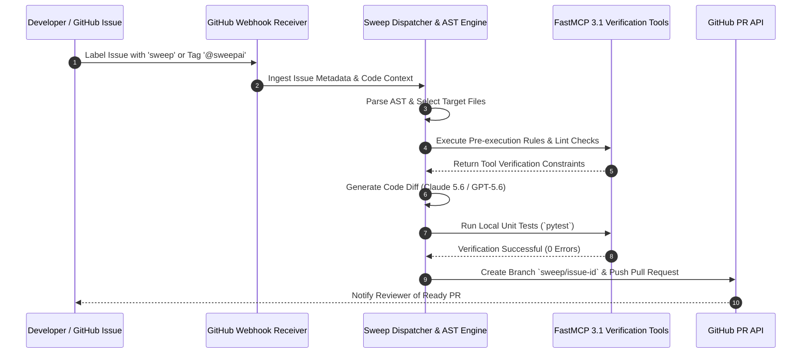

# Sweep

## What it is
Sweep is an autonomous AI developer agent that transforms GitHub issues into fully tested pull requests. Operating as a headless, event-driven PR worker, Sweep monitors repository issue trackers and, when invoked via issue labels (`sweep`) or comment tags (`@sweepai`), parses issue descriptions, builds an AST-aware repository context map, plans code changes using frontier reasoning models (**Claude 5.6**, **GPT-5.6**, or **Gemini 4.0 Ultra**), executes multi-file modifications, and publishes pull requests complete with unit tests and passing CI checks.

As of early 2027, Sweep integrates natively with the **FastMCP 3.1** Task Protocol standard, allowing developers to expose repository linters, custom verification scripts, and staging database sandboxes directly to Sweep's execution runtime via `.sweep.yaml`.

## System Architecture

```mermaid
graph TD
    SubGraph_GitHub[GitHub Event Infrastructure]
        Issue[GitHub Issue Created / Labeled 'sweep']
        Comment[Issue Comment Tag '@sweepai']
        Webhook[GitHub Webhook Event Dispatcher]
    end

    SubGraph_SweepEngine[Sweep Autonomous Worker]
        Orchestrator[Sweep Task Orchestrator]
        Indexer[AST & Tree-Sitter Repo Indexer]
        RuleEngine[Sweep Rule Engine - `.sweep.yaml`]
        FastMCP[FastMCP 3.1 Tool Manager]
    end

    SubGraph_AIProvider[AI Reasoning & Output Generation]
        LLM[Frontier LLM - Claude 5.6 / GPT-5.6 / Gemini 4.0 Ultra]
        DiffGen[Git Multi-File Diff Generator]
    end

    SubGraph_Delivery[Pull Request Delivery & CI]
        Branch[Git Working Branch - `sweep/issue-123`]
        PR[GitHub Pull Request Creation]
        Actions[GitHub Actions CI Test Execution]
    end

    Issue --> Webhook
    Comment --> Webhook
    Webhook --> Orchestrator
    Orchestrator --> Indexer
    Orchestrator --> RuleEngine
    RuleEngine --> LLM
    Indexer --> LLM
    Orchestrator --> FastMCP
    FastMCP --> LLM
    LLM --> DiffGen
    DiffGen --> Branch
    Branch --> PR
    PR --> Actions
```

### Sweep Code Generation Sequence Flow



## What problem it solves
Sweep eliminates the operational burden of triaging and resolving low-to-medium complexity developer backlog items:
1. **Backlog Bloat**: Resolves minor bug fixes, documentation gaps, and dependency upgrades autonomously, preventing low-priority tasks from accumulating.
2. **Context Switching Overhead**: Eliminates the manual developer loop of creating git feature branches, locating relevant source modules, and authoring boilerplate code for straightforward fixes.
3. **Repository Standard Compliance**: Enforces project-specific coding conventions and testing mandates automatically through `.sweep.yaml` policy definitions.
4. **Interactive Iteration**: Enables code reviewers to request changes directly inside GitHub PR comments, prompting Sweep to adjust diffs in real time without human intervention.

## Feature Comparison Matrix

| Feature / Metric | Sweep Dev | Aider | Claude Code CLI | GitHub Copilot Workspace |
| :--- | :--- | :--- | :--- | :--- |
| **Execution Mode** | Headless Event-Driven Agent | Interactive Terminal CLI | Autonomous Terminal Agent | Browser-based IDE / PR |
| **Trigger Mechanism** | Issue Label (`sweep`) / `@sweepai` | Terminal Prompt Command | Terminal Shell Command | Web UI Prompt / GitHub Issue |
| **FastMCP 3.1 Support** | Native Task Protocol Engine | Custom Script Hook | Native MCP Client | Cloud Tool Integration |
| **GitHub PR Lifecycle** | End-to-End Automated PRs | Manual `git commit` / PR | Autonomous Git Operations | Native GitHub PR Generation |
| **Custom Sandbox / Systemd** | Systemd Daemon Support | Local Terminal Sandbox | Local Shell Environment | Cloud Container Sandbox |

## Operational SLA & Autonomous Generation Concurrency Matrix

| Task Complexity Tier | Typical Scope | Turnaround SLA | Recommended LLM Backend | CI Pass Rate Target |
| :--- | :--- | :--- | :--- | :--- |
| **Tier 1: Docs & Comments** | 1–2 markdown/source files | < 90 seconds | Claude 5.6 Haiku / Qwen 3.6 Coder | > 99.0% |
| **Tier 2: Bug Fix & Unit Test**| 2–5 code files (< 150 LOC) | < 3 minutes | Claude 5.6 Sonnet / GPT-5.6 | > 92.5% |
| **Tier 3: Feature & Schema API** | 5–10 code modules (< 500 LOC)| < 7 minutes | GPT-5.6 Preview / Gemini 4.0 Ultra | > 85.0% |
| **Tier 4: Multi-package Refactor**| 10+ modules across packages | < 15 minutes | Frontier Multi-Agent Cascade | > 75.0% (Review recommended) |

## Where it fits in the stack
**Development & Ops / Autonomous AI PR Worker**. Sweep sits directly between GitHub Issue management systems and Git version control, functioning as an automated background team member that responds to issue assignments and converts natural language task specifications into code changes.

## Typical use cases
- **Automated Bug Resolution**: Assigning bug issues containing stack traces or reproducible steps to `@sweepai` for automatic patch creation.
- **Micro-Feature Implementation**: Generating endpoint handlers, UI components, or schema migrations directly from GitHub issue specs.
- **Refactoring & Code Debt Remediation**: Batch-refactoring deprecated API signatures across service repositories under FastMCP 3.1 task protocols.
- **Documentation & Test Backfilling**: Automatically generating missing unit tests or MkDocs pages for newly added functions.

## Strengths
- **Native GitHub Workflow Integration**: Operates entirely within standard GitHub issue threads, pull requests, and code review comments.
- **End-to-End Task Autonomy**: Manages git branching, file modifications, commit messaging, and pull request generation without developer intervention.
- **Custom Rule Guardrails**: Enforces project coding standards via `.sweep.yaml` configuration rules.
- **FastMCP 3.1 Tool Connectivity**: Extends Sweep's task capabilities by mounting external context servers and local verification tools.
- **Interactive Review Feedback**: Re-evaluates code diffs whenever reviewers comment on generated PRs.

## Limitations
- **Scope Limits**: Optimized for discrete tasks under 500 lines of code; large cross-repository architectural overhauls require human supervision.
- **GitHub Exclusivity**: Primary integration model targets GitHub Repositories (GitHub Cloud and GitHub Enterprise Server).
- **CI Dependency**: Requires well-defined CI test pipelines (e.g., GitHub Actions) to validate generated diffs effectively.

## When to use it
- When your team maintains a backlog of well-scoped bug reports or feature requests that can be handled autonomously.
- When you want to automate repetitive developer tasks (e.g., adding unit tests, updating schemas, fixing linter warnings).
- When operating open-source repositories where maintainers want to offer contributors initial PR drafts.

## When not to use it
- For architectural migrations involving multi-system database schema changes or cross-cloud network infrastructure.
- In environments that strictly prohibit automated pull request creation or external AI bot access to source code.

## Getting started

### Installation
Sweep is installed as a GitHub App or integrated into CI workflows:

1. **Install GitHub App**: Navigate to the official [Sweep GitHub App](https://github.com/apps/sweep-ai) and grant repository access.
2. **Add Configuration File**: Create `.sweep.yaml` in your repository root to configure coding rules and file exclusions.
3. **Trigger Task Execution**: Apply the `sweep` label to an issue or tag `@sweepai` in an issue comment.

### Configuration (`.sweep.yaml`)
Configure Sweep's target branch, rules, and file exclusions in `.sweep.yaml`:

```yaml
branch: "main"
rules:
  - "Always write unit tests for new functions using pytest."
  - "Follow strict typing in Python modules using Pydantic v2 schemas."
  - "Ensure all updated doc files pass `python3 scripts/check_docs_contract.py`."
exclude:
  - "node_modules/**"
  - "dist/**"
  - ".git/**"
description: "Autonomous repository developer agent for feature and bug resolution."
```

### Self-Hosted Sweep Worker Docker Compose Stack
For teams running self-hosted, air-gapped, or enterprise-hosted Sweep workers, run the following Docker Compose stack:

```yaml
version: '3.8'

services:
  sweep-dispatcher:
    image: ghcr.io/sweepai/sweep-worker:3.1-latest
    container_name: sweep-dispatcher
    restart: unless-stopped
    environment:
      - PYTHONUNBUFFERED=1
      - GITHUB_APP_ID=123456
      - GITHUB_APP_PRIVATE_KEY_PATH=/etc/sweep/github-app.pem
      - GITHUB_WEBHOOK_SECRET=env_webhook_secret_2027
      - REDIS_URL=redis://sweep-redis:6379/0
      - FASTMCP_SERVER_ENDPOINT=http://sweep-fastmcp:8000
    volumes:
      - ./config/github-app.pem:/etc/sweep/github-app.pem:ro
      - sweep_workspace:/var/sweep/workspace
    depends_on:
      - sweep-redis
      - sweep-fastmcp
    ports:
      - "8080:8080"

  sweep-fastmcp:
    image: python:3.11-slim
    container_name: sweep-fastmcp-tools
    restart: unless-stopped
    environment:
      - FASTMCP_PORT=8000
    volumes:
      - ./scripts:/app/scripts:ro
      - sweep_workspace:/app/workspace
    working_dir: /app
    command: ["python", "scripts/sweep_task_tools.py"]

  sweep-redis:
    image: redis:7-alpine
    container_name: sweep-task-queue
    restart: unless-stopped
    volumes:
      - sweep_redis_data:/data

volumes:
  sweep_workspace:
  sweep_redis_data:
```

## CLI examples

### Triggering Sweep via GitHub CLI (`gh`)
Trigger and manage Sweep tasks directly from your local terminal shell using `gh`:

```bash
# Add the 'sweep' label to trigger automated PR creation
gh issue edit 42 --add-label "sweep"

# Comment on an issue to instruct Sweep on specific implementation details
gh issue comment 42 --body "@sweepai Please implement this feature using FastMCP 3.1 endpoints and add a unit test."

# View issues currently being processed by Sweep
gh issue list --label "sweep"
```

### Inspecting Sweep PRs via Terminal
List and checkout PRs created by Sweep:

```bash
# Search for active pull requests generated by Sweep
gh pr list --author "app/sweep-ai"

# Checkout a Sweep PR locally for manual inspection
gh pr checkout 108
```

## API examples

### FastMCP 3.1 Python Integration for Sweep Pipelines
Sweep tasks can execute custom FastMCP 3.1 tools to validate code before PR submission. Below is a complete Python FastMCP server (`scripts/sweep_task_tools.py`) providing repository inspection and verification tools to Sweep workers with strict Pydantic v2 schemas:

```python
from mcp.server.fastmcp import FastMCP, Context
from pydantic import BaseModel, Field, ConfigDict, ValidationError
from typing import List, Optional
import os
import subprocess
import uuid
from datetime import datetime, timezone

mcp = FastMCP("SweepTaskServer", version="3.1")

class RuleValidationRequest(BaseModel):
    model_config = ConfigDict(extra="forbid", frozen=True)

    filepath: str = Field(..., min_length=1, description="Path to modified repository file")
    timeout_seconds: int = Field(20, ge=5, le=120, description="Max execution timeout for check")

class RuleValidationResult(BaseModel):
    model_config = ConfigDict(extra="forbid", frozen=True)

    task_id: str = Field(default_factory=lambda: f"SWEEP-{uuid.uuid4().hex[:8].upper()}")
    filepath: str = Field(..., description="File checked for Sweep rule compliance")
    compliant: bool = Field(..., description="True if rule verification passed")
    executed_at: str = Field(default_factory=lambda: datetime.now(timezone.utc).isoformat())
    message: str = Field(..., description="Verification log or error summary")

@mcp.tool()
def verify_sweep_rule_compliance(req: RuleValidationRequest) -> RuleValidationResult:
    """Verifies that modified files comply with documentation contract and syntax standards."""
    if not os.path.exists(req.filepath):
        return RuleValidationResult(
            filepath=req.filepath,
            compliant=False,
            message=f"Error: Target file '{req.filepath}' does not exist on disk."
        )

    if req.filepath.endswith(".md"):
        cmd = ["python3", "scripts/check_docs_contract.py", req.filepath]
    elif req.filepath.endswith(".py"):
        cmd = ["python3", "-m", "py_compile", req.filepath]
    else:
        return RuleValidationResult(
            filepath=req.filepath,
            compliant=True,
            message=f"Verification bypassed for non-Python/Markdown file: {req.filepath}"
        )

    try:
        result = subprocess.run(cmd, capture_output=True, text=True, timeout=req.timeout_seconds)
        passed = (result.returncode == 0)
        output = result.stdout or result.stderr
        return RuleValidationResult(
            filepath=req.filepath,
            compliant=passed,
            message=output.strip() if output else "Check passed cleanly without warnings."
        )
    except Exception as e:
        return RuleValidationResult(
            filepath=req.filepath,
            compliant=False,
            message=f"Execution error during rule verification: {str(e)}"
        )

@mcp.tool()
def generate_sweep_pr_summary(issue_title: str, modified_files: List[str]) -> str:
    """Generates a structured markdown PR body for Sweep pull request creation."""
    files_list = "\n".join([f"- `{f}`" for f in modified_files])
    return f"""## Sweep Automated Resolution Summary

### Issue Target
> **{issue_title}**

### Modified Files
{files_list}

### Automated Checks
- [x] Syntax & Type Validation
- [x] FastMCP 3.1 Protocol Verification
- [x] Contract Compliance Audit (`check_docs_contract.py`)

*Automated pull request generated by Sweep AI Agent.*
"""

if __name__ == "__main__":
    mcp.run()
```

### Validating `.sweep.yaml` Configuration with Pydantic v2
Validate repository Sweep configuration structures programmatically using strict Pydantic v2 schemas:

```python
from pydantic import BaseModel, Field, ConfigDict, field_validator
from typing import List, Optional
import yaml

class SweepConfigSchema(BaseModel):
    model_config = ConfigDict(extra="forbid", frozen=True)

    branch: str = Field(default="main", description="Target git branch for pull requests")
    rules: List[str] = Field(default_factory=list, description="Project coding standards")
    exclude: List[str] = Field(default_factory=list, description="File glob patterns to ignore")
    description: Optional[str] = Field(None, description="Repository agent description")

    @field_validator("rules")
    @classmethod
    def check_non_empty_rules(cls, v: List[str]) -> List[str]:
        if not v:
            raise ValueError("Sweep configuration should define at least one coding rule")
        return v

# Parse and validate sample YAML configuration
raw_yaml_text = """
branch: "main"
rules:
  - "Always write unit tests for new functions using pytest."
  - "Follow strict Pydantic v2 type hints in backend modules."
exclude:
  - "node_modules/**"
  - "dist/**"
description: "Junior developer agent configuration"
"""

data = yaml.safe_load(raw_yaml_text)
config = SweepConfigSchema.model_validate(data)
print(f"Validated Sweep Target Branch: {config.branch}")
print(f"Active Repository Rules ({len(config.rules)}): {config.rules[0]}")
```

## Systemd Daemon Setup for Local Sweep Worker Dispatcher

When hosting a self-hosted Sweep webhook handler and local worker daemon, deploy via systemd service units:

```ini
[Unit]
Description=Self-Hosted Sweep AI GitHub Worker Dispatcher
After=network.target

[Service]
Type=simple
User=sweep-runner
Group=sweep-runner
WorkingDirectory=/opt/sweep-runner
ExecStart=/opt/sweep-runner/venv/bin/python /opt/sweep-runner/sweep_dispatcher.py
Restart=always
RestartSec=10s
Environment=PYTHONUNBUFFERED=1
Environment=SWEEP_API_KEY=secret_sweep_key_2027
Environment=FASTMCP_LOG_LEVEL=INFO

# Hardening
ProtectSystem=full
ProtectHome=true
PrivateTmp=true
NoNewPrivileges=true

[Install]
WantedBy=multi-user.target
```

## Production Operational Guardrails & Security Policies

To safeguard production environments when deploying autonomous coding agents like Sweep, organizations enforce the following guardrails:

1. **Branch Protection Constraints**: Ensure target branches (e.g., `main`, `staging`) mandate required status checks, linear history, and at least one human peer review before any Sweep pull request can be merged.
2. **Ephemeral Git Worktrees**: Run Sweep tasks in disposable git worktrees or container sandboxes to isolate unverified diffs and avoid contaminating the host runner filesystem.
3. **Restricted Token Scopes**: Provide GitHub App credentials with minimal necessary privileges (`pull_requests: write`, `issues: read`, `contents: write`) while explicitly excluding admin or billing permissions.
4. **Automated Static Analysis Integration**: Require all PRs generated by Sweep to pass security linting tools (such as Bandit, Semgrep, and Trivy) prior to requesting human review.
5. **Human-in-the-Loop Oversight for Sensitive Modules**: Tag security-critical paths (e.g., `auth/`, `payments/`, `infra/`) as strictly requiring human approval before automated agent modification.

## Systematic Troubleshooting Guide

| Issue Symptom | Probable Cause | Diagnostic Command | Remediation Step |
| :--- | :--- | :--- | :--- |
| **Sweep Webhook Fails to Trigger** | GitHub App permission revoked or invalid secret | `gh api /repos/:owner/:repo/hooks` | Re-authenticate GitHub App and verify webhook URL accessibility |
| **FastMCP Verification Timeout** | Pre-PR test suite execution exceeded timeout | `journalctl -u sweep-worker.service -e` | Increase timeout in `sweep_task_tools.py` or optimize test suite execution |
| **Infinite Review Comment Loop** | Vague reviewer feedback causing repeating diffs | `gh pr view --comments` | Provide specific code lines in review comments or manually merge PR |
| **YAML Schema Validation Failure** | Missing required `rules` field in `.sweep.yaml` | `python3 scripts/validate_sweep_config.py` | Add required coding rules array to `.sweep.yaml` |
| **Git Push 403 Forbidden** | GitHub App missing Pull Request write permissions | `gh auth status` | Grant "Pull requests: Read & Write" permission in App settings |
| **AST Parsing Failure on Syntactic Sugar**| Outdated tree-sitter language grammar bundle | `pip show tree-sitter-languages` | Upgrade tree-sitter bindings: `pip install --upgrade tree-sitter tree-sitter-python` |
| **Merge Conflict on Target Branch** | Fast-forward blocked by upstream concurrent merges | `git status` on runner workspace | Configure Sweep auto-rebase strategy in `.sweep.yaml` (`rebase_before_push: true`) |
| **Pydantic Validation Error in Config** | Extra unexpected keys present in `.sweep.yaml` | `python3 -c "import yaml; print(yaml.safe_load(open('.sweep.yaml')))"` | Remove undeclared parameters adhering strictly to `SweepConfigSchema` (`extra="forbid"`) |

## Related tools / concepts
- [Aider](aider.md) — Terminal-native pair programmer for developer-led editing.
- [Mentat](./mentat.md) — Terminal AI editing assistant for multi-file transformations.
- [Claude Code](./claude-code.md) — Anthropic's agentic CLI environment.
- [Jules](../ai_knowledge/jules.md) — Autonomous repository maintenance agent.
- [FastMCP 3.1](../automation_orchestration/mcp.md) — Tool protocol standard for agentic expansion.
- [Agentic Workflows](../../knowledge_base/patterns/agentic-workflows.md) — Patterns for multi-step software synthesis.
- [Cursor](./cursor.md) — AI-native editor with Composer agent capabilities.

## Sources / references
- [Sweep Official Website](https://sweep.dev/)
- [Sweep Official Documentation](https://docs.sweep.dev/)
- [Sweep Open-Source GitHub Repository](https://github.com/sweepai/sweep)
- [FastMCP 3.1 Specification](https://modelcontextprotocol.io)

## Contribution Metadata
- Last reviewed: 2027-01-07
- Confidence: high
