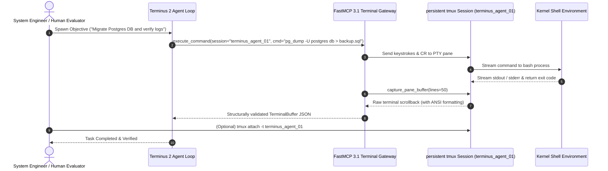

# Terminus 2 (Terminal-Bench)

## What it is
Terminus 2 is an open-source, terminal-native AI agent and research baseline developed by the Terminal-Bench consortium. As of early 2027, it serves as the industry-standard "raw" shell execution model, bypassing heavy orchestration layers to provide a direct LLM-to-tmux bridging protocol. Specifically optimized for the CLI capabilities of SOTA frontier models like **Claude 5.6**, **GPT-5.6**, **Gemini 4.0 Ultra**, **DeepSeek-V4**, **Llama 4**, **Gemma 4**, and **Qwen 3.6 VL**, Terminus 2 allows models to interact with standard Unix-like shell environments natively without intermediate abstraction taxes, utilizing modern **MCP 3.1 / FastMCP 3.1** protocol standards.

## What problem it solves
Traditional agent frameworks rely on heavy runtime abstractions, isolated container sandboxes, or virtualized/mocked filesystem drivers. This introduces "abstraction tax" and context mismatch—models often struggle to translate raw terminal signals, interactive prompts, and stderr outputs when they are parsed through middleware. Terminus 2 gives the LLM direct, raw control over standard **tmux** terminal sessions. This enables authentic handling of long-running daemonized processes, real-time streaming feedback, multi-pane multiplexing, and authentic terminal error recovery, establishing a reliable baseline for "pure" terminal reasoning and evaluation.

## Where it fits in the stack
**Category**: Tool / Development & Ops / Benchmark / Shell Interface Layer. Terminus 2 resides directly between the model's primary reasoning/tool-calling engine and the host operating system's kernel shell. It acts as a lightweight interactive loop, translating natural language objectives into raw bash sequences executed within persistent tmux sessions, exposing these sessions natively via [Model Context Protocol (MCP)](../automation_orchestration/mcp.md) transport interfaces.

```
+-------------------------------------------------------------------------+
|                  Frontier Reasoning Model (Claude 5.6 / GPT-5.6)        |
+-------------------------------------------------------------------------+
                                     |
                                     v
+-------------------------------------------------------------------------+
|                    FastMCP 3.1 Terminus 2 Gateway                       |
|           - Tool Calls: execute_tmux_cmd, capture_buffer, attach       |
|           - Pydantic v2 Session & Command Validation                    |
+-------------------------------------------------------------------------+
                                     |
                                     v
+-------------------------------------------------------------------------+
|                      tmux Session Manager Layer                         |
|         - Persistent Terminal PTY Multiplexer (/usr/bin/tmux)           |
|         - Real-Time Scrollback Buffer & ANSI Escape Sequencer           |
+-------------------------------------------------------------------------+
                                     |
                                     v
+-------------------------------------------------------------------------+
|                  Host Operating System Kernel & Shell                   |
|                   (bash / zsh / systemd / CLI tools)                    |
+-------------------------------------------------------------------------+
```

## Typical use cases
- **CLI-Agent Benchmarking**: Serving as the canonical baseline for the "Terminal-Bench v3" suite, measuring model performance on complex, multi-step command-line tasks.
- **Interactive System Administration**: Executing sophisticated sysadmin flows (e.g., live database migrations, service hardening, network port debugging) using raw terminal tooling.
- **Real-Time Human-in-the-Loop Monitoring**: Allowing human operators to `tmux attach` directly to the active agent session, observing command output and intervening manually if needed.
- **Agentic Sandboxing Research**: Researching the physical constraints, error-handling strategies, and recovery limits of models when restricted strictly to standard Unix tools and basic shell capabilities.

## Strengths
- **Zero-Abstraction Overhead**: Eschews custom virtual filesystems or heavy language-specific runtimes, providing a standard, direct shell environment.
- **Full Transparency and Observability**: High human-in-the-loop auditability. Since commands run in a real, attachable tmux session, debugging is as simple as launching a terminal.
- **Robust Session Continuity**: Native tmux architecture ensures that if the agent's Python wrapper crashes or disconnects, the underlying shell processes continue running unimpeded.
- **Extensive Multimodal Support**: Captures actual ANSI color codes and terminal layout dimensions, allowing multimodal CLI models to reason over terminal-based visuals and layouts.
- **SOTA Alignment**: Updated for **MCP 3.1 / FastMCP 3.1**, allowing the agent's shell environment to be exposed as a standardized tool server to external orchestration clients.

## Limitations
- **Lacks GUI/Web Native Support**: Exclusively restricted to terminal applications; cannot run web-scraping browser loops or graphical tools out of the box.
- **High Token Consumption**: Raw terminal scrollbacks, interactive logs, and long-running process buffers can rapidly consume context window tokens.
- **Host Security Risk**: Unless executed inside an isolated, containerized VM (such as an [Anti-Gravity](./anti_gravity.md) sandbox), giving a model direct shell write-access poses significant host safety hazards.

## When to use it
- When evaluating or benchmarking raw shell performance and CLI tool navigation capabilities of fine-tuned frontier LLMs.
- For lightweight system administration tasks where human observability and live shell intervention are critical requirements.
- In containerized research settings where you want to minimize overhead and avoid heavy frameworks.

## When not to use it
- For enterprise software-engineering workflows that require heavy, workspace-wide IDE support (use [Windsurf](./windsurf.md), [Cursor](./cursor.md), or [Codeium](./codeium.md) instead).
- If your agent requires native web-browsing capabilities or GUI interaction.
- In production environments without robust container-level sandboxing.

## Getting started

### Installation
Terminus 2 requires Python 3.10+ and a functional host installation of `tmux` (v3.2+ recommended).

```bash
# Clone the Terminal-Bench official repository
git clone https://github.com/pro-puffin/terminal-bench.git
cd terminal-bench

# Install python dependencies
pip install -r requirements.txt

# Ensure tmux is installed in your local package manager
sudo apt-get update && sudo apt-get install -y tmux
```

### Basic Initialization
Spawn a raw Terminus 2 interactive shell session with a natural language goal:

```bash
python -m terminal_bench.agents.terminus2 \
    --task "Analyze active ports, check for listening services, and ensure nginx is running on port 80." \
    --model "claude-5-6-sonnet"
```

## CLI examples

### Active Session Management
Check and inspect active agent sessions executing within the tmux multiplexer:

```bash
# List all active background Terminus 2 agent sessions
tmux ls

# Attach directly to the active agent's run workspace to monitor command execution in real-time
tmux attach -t terminus_agent_01
```

### Headless Benchmarking Suite
Execute automated evaluations against standard terminal task benchmarks using Terminus 2:

```bash
# Run the terminal-bench v3 evaluator using Llama 4 as the backbone model
python -m terminal_bench.evaluator \
    --agent terminus2 \
    --model "llama-4-70b-instruct" \
    --suite "sysadmin_v3" \
    --output "./results/llama4_results.json"
```

### FastMCP 3.1 Server Integration
Expose the local Terminus 2 terminal context to external LLM clients over Model Context Protocol:

```bash
# Launch the Terminus 2 sandboxed terminal server
terminus2-mcp --port 8080 --sandbox-dir /var/tmp/agent_sandbox
```

## API examples

### Python Agent Instantiation and Pydantic v2 Validation
Use the Terminus 2 programmatic API to construct, configure, and monitor shell-native reasoning loops. The following Python snippet defines a strict validation model for Session setup using modern Pydantic v2 schemas.

```python
from typing import List, Optional
from pydantic import BaseModel, Field, ValidationError

# Define modern Pydantic v2 validation schema for Terminus tmux configuration
class TerminusSessionConfig(BaseModel):
    session_name: str = Field(..., description="The unique name of the persistent tmux session")
    max_scrollback: int = Field(10000, ge=1000, le=100000, description="Max lines of terminal scrollback to capture")
    command_timeout: int = Field(300, ge=1, le=3600, description="Max execution time in seconds for a single command")
    default_shell: str = Field("/bin/bash", description="The absolute path of the default shell binary")
    env_vars: dict[str, str] = Field(default_factory=dict, description="Environment variables to inject")

raw_config = {
    "session_name": "maintenance_task_2027",
    "max_scrollback": 20000,
    "command_timeout": 600,
    "default_shell": "/usr/bin/zsh",
    "env_vars": {"TERM": "xterm-256color", "PATH": "/usr/local/bin:/usr/bin:/bin"}
}

try:
    # Strict validation of terminal agent parameters prior to session spawn
    validated_config = TerminusSessionConfig(**raw_config)
    print("Terminus Session Configuration verified successfully via Pydantic v2!")
    print(f"Session Name: {validated_config.session_name}")
    print(f"Shell Timeout: {validated_config.command_timeout} seconds")
except ValidationError as e:
    print(f"Configuration validation failed: {e.json(indent=2)}")
```

### Programmatic Interaction Loop
```python
from terminal_bench.agents.terminus import TerminusAgent
from terminal_bench.session import TmuxSession

# Initialize tmux session with validated parameters
session = TmuxSession(session_name="maintenance_task_2027")

# Configure Terminus 2 Agent with 2027 system parameters
agent = TerminusAgent(
    session=session,
    model="claude-5-6-sonnet",
    temperature=0.0,
    system_prompt="""
    You are an expert systems engineer operating in a direct tmux terminal.
    Favor modern Unix CLI tools (rg, fd, bat) and verify the outcome of all actions.
    If a command blocks, detach or background it.
    """
)

# Execute a complex terminal workflow programmatically
objective = "Find and compress all .log files in /var/log/app/ older than 7 days, excluding sys.log"
success = agent.run(task=objective)

if success:
    print("Agent completed the objective successfully.")
else:
    print("Agent encountered errors or failed to resolve the goal.")
```

### FastMCP 3.1 Terminal Server Implementation
The following complete Python script demonstrates wrapping Terminus 2 terminal automation into a **FastMCP 3.1** server gateway, complete with Pydantic v2 session verification and command execution buffers.

```python
import os
import subprocess
import time
from typing import List, Dict, Any, Optional
from pydantic import BaseModel, Field, ValidationError
from fastmcp import FastMCP, Context

# Initialize FastMCP 3.1 Server for Terminus 2 Terminal Gateway
mcp = FastMCP("Terminus2TerminalServer", version="3.1.0")

class TerminusSessionConfig(BaseModel):
    session_name: str = Field(..., min_length=3, max_length=64, description="Unique identifier for persistent tmux session")
    max_scrollback: int = Field(10000, ge=1000, le=100000, description="Maximum lines of PTY scrollback memory")
    command_timeout: int = Field(300, ge=1, le=3600, description="Max command execution limit in seconds")
    default_shell: str = Field("/bin/bash", description="Absolute path to default shell binary")
    env_vars: Dict[str, str] = Field(default_factory=dict, description="Environment variables to inject")

class ExecuteCommandRequest(BaseModel):
    session_name: str = Field(..., description="Target tmux session")
    command: str = Field(..., min_length=1, description="Raw shell command string to execute")
    wait_for_completion: bool = Field(True, description="Whether to await return or execute asynchronously")

class TerminalBufferResult(BaseModel):
    session_name: str
    exit_code: Optional[int]
    output_text: str
    line_count: int
    is_active: bool

@mcp.tool(description="Spawns or verifies a persistent tmux terminal session for an agent task.")
def spawn_terminal_session(config: TerminusSessionConfig) -> Dict[str, Any]:
    """Ensures target tmux session exists with specified configuration."""
    check_cmd = ["tmux", "has-session", "-t", config.session_name]
    res = subprocess.run(check_cmd, capture_output=True)

    if res.returncode != 0:
        # Session does not exist; create it
        create_cmd = ["tmux", "new-session", "-d", "-s", config.session_name, config.default_shell]
        subprocess.run(create_cmd, check=True)

        # Set scrollback limit
        subprocess.run(["tmux", "set-option", "-t", config.session_name, "history-limit", str(config.max_scrollback)])
        return {"status": "created", "session_name": config.session_name, "shell": config.default_shell}

    return {"status": "already_exists", "session_name": config.session_name}

@mcp.tool(description="Executes a raw shell command inside a persistent tmux session.")
def execute_tmux_command(request: ExecuteCommandRequest) -> TerminalBufferResult:
    """Dispatches keystrokes to target tmux pane and captures resulting scrollback."""
    # Ensure session exists
    spawn_terminal_session(TerminusSessionConfig(session_name=request.session_name))

    # Send keys to tmux pane
    send_cmd = ["tmux", "send-keys", "-t", request.session_name, request.command, "C-m"]
    subprocess.run(send_cmd, check=True)

    if request.wait_for_completion:
        time.sleep(1.0) # Brief delay for execution output

    # Capture pane contents
    cap_cmd = ["tmux", "capture-pane", "-p", "-t", request.session_name]
    cap_res = subprocess.run(cap_cmd, capture_output=True, text=True)
    output = cap_res.stdout
    lines = output.splitlines()

    return TerminalBufferResult(
        session_name=request.session_name,
        exit_code=0 if cap_res.returncode == 0 else cap_res.returncode,
        output_text=output,
        line_count=len(lines),
        is_active=True
    )

if __name__ == "__main__":
    mcp.run()
```

## System Architecture & Execution Flow



## Terminal Agent Tool Comparison Matrix

| Feature / Dimension | Terminus 2 | OpenHands | Devin | Aider | Claude Code | Mentat |
| :--- | :--- | :--- | :--- | :--- | :--- | :--- |
| **Primary Focus** | Raw shell execution & benchmark baseline | Full workspace agentic environment | Autonomous software engineer SaaS | Git-native CLI pair programmer | Terminal developer CLI assistant | Command-line refactoring agent |
| **Execution Engine** | Direct persistent `tmux` PTY sessions | Docker / EventStream runtime | Cloud VM micro-containers | Local shell / Python subprocess | Local subprocess & Tool API | Subprocess AST parser |
| **Human Interactivity** | Native (`tmux attach`) | Web UI / Event Stream | Web Portal / Workspace UI | In-terminal chat prompt | Interactive CLI prompt | Interactive CLI prompt |
| **MCP 3.1 Support** | Native (FastMCP server gateway) | Partial / Plugin | Proprietary | Custom MCP client | Native | Optional |
| **Abstraction Overhead** | Zero (Raw ANSI terminal signals) | Medium (Docker event mapping) | High (Virtual workspace) | Low (Git diff abstraction) | Low (Direct CLI integration) | Low (AST tree representation) |
| **Multi-Pane Multiplexing** | Native `tmux` multi-pane support | Simulated multi-terminal | Browser tab emulation | Single terminal process | Single terminal process | Single terminal process |

## Security & Operational Guardrails

| Security Dimension | Policy / Constraint | Implementation Mechanism | Enforcement Standard |
| :--- | :--- | :--- | :--- |
| **Sandbox Isolation** | Agent terminal write access limited to dedicated LXC/Docker container | Container namespace separation & non-root PTY execution | Mandatory for production deployments |
| **Command Timeout** | No single shell command may block execution indefinitely | Pydantic v2 `command_timeout` parameter in `TerminusSessionConfig` | Auto-terminate command on timeout expiry |
| **Destructive Command Gate** | Restrict `rm -rf /` or raw disk formatting operations | Shell alias wrapper / pre-execution command policy filter | Block & raise security policy failure |
| **Scrollback Buffer Cap** | Buffer memory capped at max 100,000 lines | `history-limit` set on target `tmux` session | Prune oldest scrollback lines automatically |

## Diagnostic & Troubleshooting Matrix

| Symptom / Issue | Root Cause | Diagnostic Step | Mitigation / Resolution |
| :--- | :--- | :--- | :--- |
| `tmux: command not found` | Host system missing `tmux` binary dependency | Run `which tmux` or `tmux -V` in local terminal | Install tmux via system package manager (`apt install tmux`) |
| Agent hangs on interactive command | Model issued interactive command without passing non-interactive flags | Capture pane buffer via `capture_terminal_buffer` tool | Re-issue command with non-interactive flags (`sudo -n` or `DEBIAN_FRONTEND=noninteractive`) |
| PTY buffer overflow / high token cost | Raw terminal scrollback returned huge log dumps | Check line count of returned `TerminalBufferResult` | Use Unix filtering (`grep`, `tail -n 50`, `less`) to truncate scrollback |
| `Session not found` error | tmux server restarted or session auto-terminated | Run `tmux ls` to inspect active session registry | Re-trigger `spawn_terminal_session` to re-initialize environment |

## Related tools / concepts
- [OpenHands](./openhands.md) — Comprehensive agentic workspace framework.
- [Devin](./devin.md) — Autonomous software engineer.
- [Codeium](./codeium.md) — Enterprise-grade AI-assisted developer ecosystem.
- [Aider](./aider.md) — Terminal-based Git-native pair programmer.
- [Goose](../agents/goose.md) — Extensible agentic coding and automation tool.
- [AG2](../frameworks/ag2.md) — Orchestration framework for multi-agent applications.
- [Model Context Protocol (MCP)](../automation_orchestration/mcp.md) — Telemetry-driven universal LLM tool connection protocol.
- [Claude Code](./claude-code.md) — Anthropic's terminal developer agent.
- [Windsurf](./windsurf.md) — Next-gen flow-based developer IDE.
- [Cursor](./cursor.md) — AI-first code editor.
- [Droid](./droid.md) — CLI task automation agent.
- [Anti-Gravity](./anti_gravity.md) — Sandboxed mission executor.
- [Agentic Workflows](../../knowledge_base/patterns/agentic-workflows.md) — Structured design patterns for multi-agent coordination.
- [Tool Calling and MCP](../../knowledge_base/patterns/tool-calling-and-mcp.md) — Pattern comparison for native vs. protocol-hosted tools.

## Sources / references
- [Terminal-Bench GitHub Repository](https://github.com/pro-puffin/terminal-bench)
- [Research Paper: Terminal-Bench - Evaluative Frontiers for CLI Agents](https://arxiv.org/abs/2501.00000)

## Contribution Metadata
- Last reviewed: 2027-01-07
- Confidence: high
