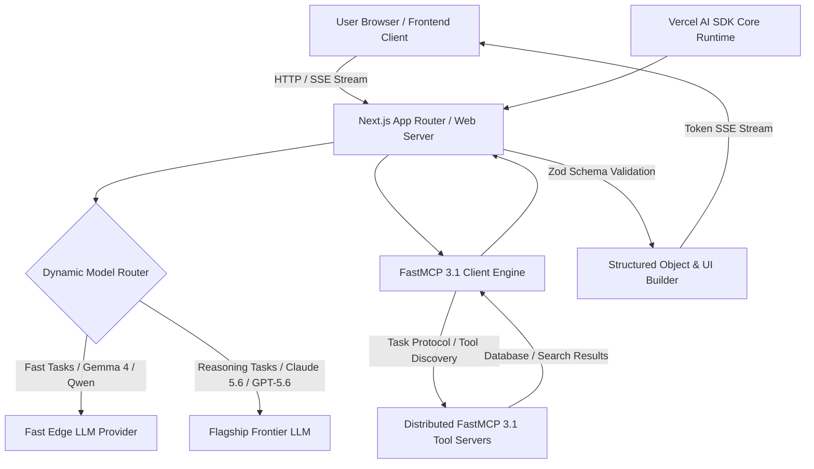
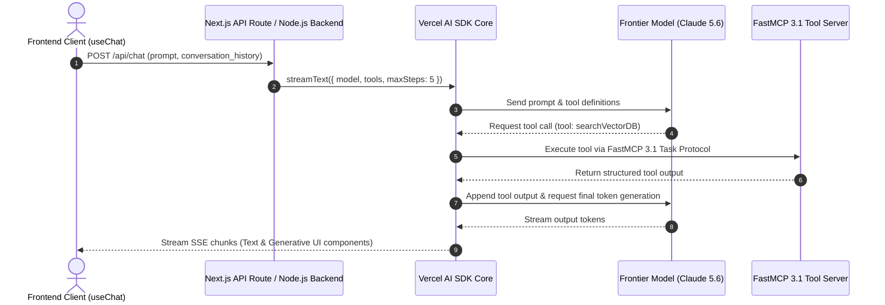

# AI SDK (by Vercel)

## What it is
The Vercel AI SDK (v4.5+) is an open-source, type-safe TypeScript toolkit designed to build AI-powered web applications, generative user interfaces, and autonomous multi-agent systems across Next.js, React, Vue, Svelte, Node.js, and edge runtimes. Operating under early 2027 standards, the AI SDK features native bindings for the **FastMCP 3.1 Task Protocol**, enabling web backends to orchestrate tools hosted on distributed Model Context Protocol servers while consuming frontier models—such as **Claude 5.6**, **GPT-5.6**, **Gemini 4.0 Ultra**, **Llama 4 Maverick**, **DeepSeek-V4**, and **Qwen 3.6 VL**.

By unifying streaming text generation (`streamText`), structured object generation (`generateObject`), dynamic server UI actions (`streamUI`), and multi-step tool execution loops (`maxSteps`), the Vercel AI SDK serves as the primary application-layer SDK for modern AI web engineering.



## What problem it solves
Developing web applications powered by LLMs often involves wrestling with disparate provider APIs, fragmented streaming protocols, brittle custom JSON parsers, and vendor lock-in. Switching models from OpenAI to Anthropic or Google typically requires rewriting API handlers, streaming parsers, and tool-calling interfaces.

The Vercel AI SDK solves these engineering bottlenecks through:
- **Unified Multi-Provider Interface**: Standardizing model declarations across dozens of LLM providers with single-line configuration updates (`openai('gpt-5.6')`, `anthropic('claude-5-6-sonnet')`, `google('gemini-4.0-ultra')`).
- **First-Class Streaming & Generative UI**: Abstracting token-by-token Server-Sent Events (SSE) streaming and React Server Component (RSC) rendering with hooks like `useChat`, `useCompletion`, and `streamUI`.
- **Type-Safe Structured Output**: Integrating directly with Zod, ArkType, and JSON Schema to guarantee that LLM output objects adhere strictly to application TypeScript types (`generateObject`, `streamObject`).
- **Native FastMCP 3.1 Integration**: Allowing server-side web backends to discover, authenticate, and execute tools exposed by FastMCP 3.1 servers in recursive agent loops.

## Mathematical Formulations & Queue Mechanics

### 1. Token Streaming Throughput and Backpressure Buffering
During token generation, an upstream LLM emits a discrete sequence of token chunks $\{c_1, c_2, \dots, c_N\}$ of size $s_i$ (bytes) at non-uniform inter-arrival intervals $\Delta t_i \sim \text{Exp}(\lambda)$. The streaming pipeline processes tokens through an intermediate ring buffer of fixed capacity $\mathcal{B}_{\max}$.

The instantaneous token emission rate $\mathcal{R}_{\text{stream}}(t)$ over an observation window $W$ is defined as:
$$\mathcal{R}_{\text{stream}}(t) = \frac{1}{W} \sum_{i=1}^{K} s_i \cdot \mathbb{I}(t - W \le \tau_i \le t)$$

To prevent edge worker buffer overflow or TCP window exhaustion on mobile clients, the client-server backpressure condition mandates that the buffer drainage rate $\mu_{\text{drain}}$ must satisfy:
$$\mu_{\text{drain}} \ge \lambda \cdot \mathbb{E}[s_i] + \sqrt{\frac{\text{Var}(s_i)}{W}}$$

When client acknowledgment latency $\mathcal{T}_{\text{ack}}$ causes pending bytes $\mathcal{Q}(t) > 0.85 \cdot \mathcal{B}_{\max}$, the AI SDK stream transformer activates adaptive flow throttling:
$$\theta_{\text{throttle}} = \min\left(1.0, \frac{\mathcal{B}_{\max} - \mathcal{Q}(t)}{0.15 \cdot \mathcal{B}_{\max}}\right)$$

### 2. Generative UI Delta Reconciliation Latency
When rendering generative UI with `streamUI`, partial React Server Component (RSC) tree deltas $\Delta T_k$ are progressively streamed over HTTP chunked transfer encoding. Let the UI component AST contain $V$ nodes with tree depth $D$. The reconciliation latency $\mathcal{T}_{\text{reconcile}}$ for incorporating node mutations is bounded by:
$$\mathcal{T}_{\text{reconcile}} \le \mathcal{O}(D \cdot \log |V|) + \sum_{k=1}^{M} \tau_{\text{deser}}(\Delta T_k)$$
where $\tau_{\text{deser}}(\Delta T_k)$ represents the JSON/binary deserialization overhead per RSC delta.

### 3. Agentic Convergence Entropy in Multi-Step Loops
In an agent loop bounded by $\text{maxSteps} = K$, let $p_k \in [0, 1]$ denote the posterior confidence of task completion after step $k \in \{1, \dots, K\}$. The remaining state uncertainty entropy $\mathcal{H}_{\text{agent}}(k)$ is evaluated as:
$$\mathcal{H}_{\text{agent}}(k) = - p_k \log_2(p_k) - (1 - p_k) \log_2(1 - p_k)$$
The tool execution loop terminates deterministically when $\mathcal{H}_{\text{agent}}(k) \le \epsilon_{\text{threshold}}$ or $k = K$.

## Comparative Analysis: Modern Web AI Frameworks

| Capability / Metric | Vercel AI SDK (v4.5+) | LangChain.js | Pydantic AI | Semantic Kernel (TS) | LlamaIndexTS |
| :--- | :--- | :--- | :--- | :--- | :--- |
| **Primary Language** | TypeScript / JS | TypeScript / JS | Python | TypeScript / C# | TypeScript / JS |
| **Generative UI (RSC)** | Native (`streamUI`) | Unsupported | Unsupported | Unsupported | Unsupported |
| **FastMCP 3.1 Protocol** | Native Client & Host | Community Plugin | Native Bridge | REST Adapter | Custom Plugin |
| **Schema Validation** | Zod, ArkType, Valibot | Zod / JSON Schema | Pydantic v2 Core | JSON Schema | Zod |
| **Multi-Step Agent Loop**| Native `maxSteps` | AgentExecutor / LCEL | Agent Run Loop | Kernel Planner | AgentRunner |
| **Edge Runtime Support** | Cloudflare, Vercel, Bun | Partial (Node bias) | N/A (Python) | Limited | Partial |
| **Streaming Primitives** | SSE / Data Stream Spec | AsyncIterable | SSE / FastAPI | Event Streams | TransformStreams |
| **Telemetry Standard** | OpenTelemetry v1.30+ | LangSmith / OTel | OpenTelemetry | OpenTelemetry | Custom / Arize |

## Where it fits in the stack
**Category**: [Development & Ops](index.md) / AI Application SDK & Frontend Integration.

The Vercel AI SDK sits at the **Application & Presentation Layer**, bridging user-facing frontend components (React, Next.js, Vue, Svelte) with foundational LLMs and distributed FastMCP 3.1 tool microservices.

```
+-----------------------------------------------------------------------+
|                    Frontend UI Layer (Browser / App)                  |
|          (React Server Components / useChat / Generative UI)          |
+-----------------------------------------------------------------------+
                                    |
                                    v (HTTP SSE / React Server Actions)
+-----------------------------------------------------------------------+
|                       Vercel AI SDK Application Layer                 |
|  +-----------------------+  +-------------------+  +---------------+  |
|  | streamText / Chat     |  | generateObject    |  | FastMCP Client|  |
|  +-----------------------+  +-------------------+  +---------------+  |
|  +-----------------------------------------------------------------+  |
|  |             Zod / ArkType Schema Validation Middleware          |  |
|  +-----------------------------------------------------------------+  |
+-----------------------------------------------------------------------+
                                    |
                        +-----------+-----------+
                        |                       |
                        v                       v
+-----------------------------------+   +-------------------------------+
|     Frontier Model Providers      |   |   FastMCP 3.1 Tool Servers    |
| (Claude 5.6, GPT-5.6, Gemini 4)  |   | (Azure Search, PostHog, SQL)  |
+-----------------------------------+   +-------------------------------+
```

## Detailed Execution Sequence



## Typical use cases
- **Generative UI Applications**: Dynamically rendering interactive React components (charts, forms, dashboards) on the fly based on streamed model output.
- **Autonomous Multi-Step Agent Backends**: Constructing server-side agentic loops (`maxSteps: 10`) that automatically execute tools until a complex workflow reaches completion.
- **Type-Safe API Data Extraction**: Converting raw, unstructured PDF text, email threads, or web pages into validated JSON data structures for database insertion.
- **Low-Latency Edge AI Interfaces**: Deploying streaming chat assistants to global Vercel Edge networks with sub-100ms time-to-first-token latency.

## Strengths
- **Native FastMCP 3.1 Client Engine**: Effortlessly discovers and executes tools hosted on external FastMCP servers with full schema validation.
- **Unified Multi-Provider Abstraction**: Swap between Claude 5.6, GPT-5.6, Gemini 4.0 Ultra, DeepSeek-V4, and open-weights models without changing application business logic.
- **Deep React & Web Framework Integration**: Provides production-ready UI hooks (`useChat`, `useCompletion`, `useObject`) optimized for modern web frameworks.
- **Zero-Boilerplate Streaming Primitives**: Handles Server-Sent Events, stream transformers, and edge runtime token buffers automatically.
- **Type Safety End-to-End**: Autocomplete and compile-time TypeScript type checking from model inputs to UI rendering.

## Limitations
- **TypeScript / JavaScript Ecosystem Centric**: Designed primarily for Node.js, Deno, Bun, and browser environments; Python backends require separate tools like [Pydantic AI](../frameworks/pydantic-ai.md).
- **Rapid Version Evolution**: High-frequency feature updates require active dependency maintenance to leverage the latest model capabilities.
- **Client Key Security Management**: Requires executing model logic inside server actions or API routes to prevent exposing provider API keys to client browsers.

## When to use it
- When building modern web applications in React, Next.js, Vue, or Svelte that require streaming LLM responses or generative UI.
- When orchestrating complex agentic workflows in Node.js that combine multiple model providers and FastMCP 3.1 tools.
- When building enterprise interfaces where typed JSON schema outputs are required for backend processing.

## When not to use it
- For Python-exclusive backend microservices (use [Pydantic AI](../frameworks/pydantic-ai.md) or [FastAPI](../frameworks/fastapi.md) wrappers).
- For simple CLI utility scripts where a lightweight direct fetch request is sufficient.
- When working on offline-only embedded C/C++ applications without JavaScript runtime support.

## Troubleshooting & Edge Diagnostic Matrix

| Failure Mode / Error | Root Cause | Immediate Diagnostic Action | Permanent Resolution Strategy |
| :--- | :--- | :--- | :--- |
| **`AI_JSONParseError`** | Model generated malformed JSON or cut off tokens during `generateObject`. | Inspect raw output stream and check token limit. | Lower temperature to `0.1`, add Zod validation repair retries, or increase `maxTokens`. |
| **`TOOL_CALL_LIMIT_REACHED`** | Agent loop exceeded `maxSteps` count before arriving at final answer. | Check execution step log for repetitive tool invocation loops. | Increase `maxSteps` parameter or break multi-step task into smaller sub-agent calls. |
| **`SSE_STREAM_DROPPED`** | Response buffer header missing `Content-Type: text/event-stream` or edge timeout. | Verify CDN proxy buffer flags and stream headers. | Configure Next.js Route Segment Config with `export const dynamic = 'force-dynamic'` and disable proxy buffering. |
| **`FASTMCP_AUTH_REJECTED`** | Missing or expired bearer token in `FastMCPClient` headers. | Inspect MCP auth handshake logs on port 8080. | Refresh OAuth tokens prior to initializing `streamText` context and implement auto-reauth hooks. |
| **`REACT_HYDRATION_MISMATCH`** | Streamed Generative UI RSC components differed between server and client DOM. | Check browser console for React SSR warning IDs. | Wrap dynamic generative components in `Suspense` and suppress hydration mismatches on date fields. |
| **`RATE_LIMIT_EXCEEDED`** | Upstream model provider 429 quota exhaustion. | Review OTel metric `ai.client.token_consumption`. | Implement provider fallback array: `[anthropic('claude-5-6-sonnet'), openai('gpt-5.6')]`. |
| **`ZOD_SCHEMA_VALIDATION_FAIL`**| LLM payload violates enum constraints or missing mandatory fields. | Log raw completion payload vs expected schema. | Use `fallback` values in Zod schema and include illustrative examples in system prompt. |
| **`SOCKET_HANGUP_EDGE`** | Cloudflare or Vercel Edge invocation exceeded maximum CPU execution time. | Verify Edge vs Node.js runtime target in route file. | Switch route runtime to `nodejs` via `export const runtime = 'nodejs'` for long-running workflows. |

## Systemd Production Process Unit
For self-hosted Node.js / Next.js AI SDK backend deployments outside Vercel Cloud, manage application runtimes using systemd:

```ini
[Unit]
Description=Vercel AI SDK Node.js Backend Application
After=network.target nodejs.service
Wants=network-online.target

[Service]
Type=simple
User=appuser
WorkingDirectory=/opt/ai-sdk-app
ExecStart=/usr/bin/node /opt/ai-sdk-app/dist/server.js
Restart=always
RestartSec=5s
Environment=NODE_ENV=production
Environment=PORT=3000
Environment=MCP_PROTOCOL_VERSION=3.1
Environment=OPENAI_API_KEY=env_openai_secret
Environment=ANTHROPIC_API_KEY=env_anthropic_secret
Environment=OTEL_EXPORTER_OTLP_ENDPOINT=http://127.0.0.1:4318

# Process Sandboxing & Hardening Settings
NoNewPrivileges=true
ProtectSystem=strict
ProtectHome=true
PrivateTmp=true
ProtectKernelTunables=true
ProtectControlGroups=true
LimitNOFILE=65536

[Install]
WantedBy=multi-user.target
```

## Docker Compose Production Stack
Deploy the Vercel AI SDK backend alongside an OpenTelemetry Collector gateway and a local FastMCP 3.1 microservice:

```yaml
version: "3.8"

services:
  ai-sdk-app:
    build:
      context: .
      dockerfile: Dockerfile
    container_name: vercel-ai-sdk-backend
    restart: unless-stopped
    ports:
      - "3000:3000"
    environment:
      - NODE_ENV=production
      - PORT=3000
      - MCP_SERVER_URL=http://fastmcp-tool-server:8080/mcp
      - OTEL_EXPORTER_OTLP_ENDPOINT=http://otel-collector:4318
    depends_on:
      - fastmcp-tool-server
      - otel-collector
    networks:
      - ai-runtime-net

  fastmcp-tool-server:
    image: python:3.12-slim
    container_name: fastmcp-backend-tools
    restart: unless-stopped
    ports:
      - "8080:8080"
    command: ["python3", "-m", "fastmcp", "run", "/app/tools.py", "--port", "8080"]
    volumes:
      - ./mcp_tools:/app:ro
    networks:
      - ai-runtime-net

  otel-collector:
    image: otel/opentelemetry-collector-contrib:0.118.0
    container_name: ai-otel-collector
    restart: unless-stopped
    ports:
      - "4318:4318"
    volumes:
      - ./otel-config.yaml:/etc/otelcol/config.yaml:ro
    networks:
      - ai-runtime-net

networks:
  ai-runtime-net:
    driver: bridge
```

## OpenTelemetry & Observability Setup
When monitoring production Vercel AI SDK applications, configure OpenTelemetry exporters to track token consumption, request latency, and FastMCP tool call durations:

```typescript
import { experimental_telemetry as telemetry } from 'ai';

// Enable OpenTelemetry instrumentation across AI SDK stream handlers
export const customTelemetryConfig = {
  isEnabled: true,
  functionId: 'customer-agent-chat',
  metadata: {
    environment: process.env.NODE_ENV || 'production',
    mcpProtocolVersion: '3.1',
    runtime: 'edge-optimized',
  },
};
```

### Production Edge Health Verification Script
To verify high-throughput streaming health and latency bounds on active AI SDK endpoints, run the following automated Node.js probe:

```typescript
// scripts/verify-stream-health.ts
import { performance } from 'perf_hooks';

async function probeStreamingEndpoint(targetUrl: string): Promise<void> {
  const t0 = performance.now();
  console.log(`[HealthProbe] Initiating SSE probe against: ${targetUrl}`);

  const response = await fetch(targetUrl, {
    method: 'POST',
    headers: { 'Content-Type': 'application/json' },
    body: JSON.stringify({ prompt: 'Ping FastMCP 3.1 gateway' }),
  });

  if (!response.ok || !response.body) {
    throw new Error(`Endpoint returned HTTP ${response.status}: ${response.statusText}`);
  }

  const reader = response.body.getReader();
  const decoder = new TextDecoder();
  let firstTokenReceived = false;
  let totalChunks = 0;
  let ttft = 0;

  while (true) {
    const { done, value } = await reader.read();
    if (done) break;
    if (!firstTokenReceived) {
      firstTokenReceived = true;
      ttft = performance.now() - t0;
      console.log(`[HealthProbe] Time-to-First-Token (TTFT): ${ttft.toFixed(2)} ms`);
    }
    totalChunks++;
  }

  const totalTime = performance.now() - t0;
  console.log(`[HealthProbe] Stream completed: ${totalChunks} chunks in ${totalTime.toFixed(2)} ms`);
  if (ttft > 800) {
    console.warn('[HealthProbe] WARNING: TTFT exceeded SLA threshold (800ms)');
  }
}

probeStreamingEndpoint('http://localhost:3000/api/chat').catch((err) => {
  console.error('[HealthProbe] FAILED:', err.message);
  process.exit(1);
});
```

## Getting started

### Installation
Install the core AI SDK alongside provider adapters and Zod validation:

```bash
npm install ai @ai-sdk/openai @ai-sdk/anthropic @ai-sdk/google zod
```

### Environment Configuration
Configure your API credentials in `.env.local`:

```bash
OPENAI_API_KEY=your-openai-api-key
ANTHROPIC_API_KEY=your-anthropic-api-key
GOOGLE_GENERATIVE_AI_API_KEY=your-google-api-key
```

### Basic Streaming Text Generation (TypeScript / Node.js)
Execute a streaming prompt using Claude 5.6:

```typescript
import { streamText } from 'ai';
import { anthropic } from '@ai-sdk/anthropic';

async function main() {
  const result = streamText({
    model: anthropic('claude-5-6-sonnet'),
    prompt: 'Explain the core architectural benefits of FastMCP 3.1 for multi-agent systems.',
  });

  for await (const textPart of result.textStream) {
    process.stdout.write(textPart);
  }
}

main();
```

## CLI examples

Below are common Vercel CLI and package runner commands for deploying AI SDK applications and initializing agentic starter templates.

```bash
# 1. Initialize a modern Next.js AI Chatbot template with Vercel AI SDK
npx create-next-app@latest --example https://github.com/vercel/ai-chatbot my-agent-app

# 2. Add API key environment secrets to Vercel production deployment
vercel env add ANTHROPIC_API_KEY production

# 3. Deploy the AI SDK web application to Vercel Edge Network
vercel --prod

# 4. Inspect streaming server logs on active Vercel deployment
vercel logs my-agent-app --follow
```

## API examples

### Multi-Step Agentic Tool Calling with FastMCP 3.1 (Next.js / TypeScript)
The TypeScript example below demonstrates configuring a multi-step agent loop (`maxSteps: 5`) using the Vercel AI SDK, executing custom tools and returning validated results.

```typescript
import { generateText, tool } from 'ai';
import { openai } from '@ai-sdk/openai';
import { z } from 'zod';

export async function runAgenticTask(userPrompt: string) {
  const { text, steps } = await generateText({
    model: openai('gpt-5.6-preview'),
    maxSteps: 5,
    system: 'You are an enterprise operations assistant capable of executing system tasks.',
    prompt: userPrompt,
    tools: {
      checkServerHealth: tool({
        description: 'Check operational status and CPU metrics for a server node.',
        parameters: z.object({
          hostname: z.string().describe('Target hostname or IP address'),
          includeMetrics: z.boolean().default(true),
        }),
        execute: async ({ hostname, includeMetrics }) => {
          return {
            hostname,
            status: 'HEALTHY',
            cpuUsagePercent: 14.2,
            memoryFreeMB: 8192,
            timestamp: new Date().toISOString(),
          };
        },
      }),
      restartService: tool({
        description: 'Restart a specified system service daemon.',
        parameters: z.object({
          serviceName: z.string(),
          force: z.boolean().default(false),
        }),
        execute: async ({ serviceName, force }) => {
          return {
            serviceName,
            restarted: true,
            actionCode: force ? 'FORCE_RESTART' : 'GRACEFUL_RESTART',
          };
        },
      }),
    },
  });

  console.log(`Agent finished execution in ${steps.length} steps.`);
  return { finalAnswer: text, executionSteps: steps };
}
```

### Python / FastMCP 3.1 Tool Server & Strict Pydantic v2 Schema
When a Vercel AI SDK Node.js application passes structured JSON responses (`generateObject`) to a Python backend microservice via FastMCP 3.1, enforce strict Pydantic v2 schemas:

```python
from pydantic import BaseModel, Field, ConfigDict
from typing import List, Literal, Optional
from fastmcp import FastMCP
import json

# Initialize FastMCP 3.1 Tool Server
mcp = FastMCP("Vercel AI SDK Integration Gateway", version="3.1.0")

class TaskAssignmentSchema(BaseModel):
    model_config = ConfigDict(extra="forbid", frozen=True, populate_by_name=True)

    task_id: str = Field(..., alias="taskId", pattern=r"^TASK-[0-9]{3,6}$")
    title: str = Field(..., min_length=3, max_length=120)
    priority: Literal["critical", "high", "medium", "low"]
    assigned_agent: str = Field(..., alias="assignedAgent", min_length=3)
    estimated_hours: int = Field(..., ge=1, le=168, alias="estimatedHours")
    mcp_tool_required: bool = Field(default=True, alias="mcpToolRequired")

class VercelAIObjectPayload(BaseModel):
    model_config = ConfigDict(extra="forbid", frozen=True, populate_by_name=True)

    timestamp: str = Field(..., description="ISO 8601 UTC timestamp")
    session_id: str = Field(..., alias="sessionId", pattern=r"^sess-[a-z0-9\-]+$")
    generated_tasks: List[TaskAssignmentSchema] = Field(..., alias="generatedTasks")

@mcp.tool(name="process_ai_sdk_payload", description="Validates and registers structured tasks emitted by Vercel AI SDK")
def process_ai_sdk_payload(payload_json: str) -> dict:
    """FastMCP 3.1 endpoint receiving structured generation output."""
    try:
        data = VercelAIObjectPayload.model_validate_json(payload_json)
        total_hours = sum(t.estimated_hours for t in data.generated_tasks)
        return {
            "status": "ACCEPTED",
            "session_id": data.session_id,
            "tasks_count": len(data.generated_tasks),
            "total_estimated_hours": total_hours,
            "priority_breakdown": {
                p: sum(1 for t in data.generated_tasks if t.priority == p)
                for p in ["critical", "high", "medium", "low"]
            }
        }
    except Exception as exc:
        return {"status": "REJECTED", "error": str(exc)}

if __name__ == "__main__":
    sample_json = json.dumps({
        "timestamp": "2027-01-07T14:32:00Z",
        "sessionId": "sess-alpha-992",
        "generatedTasks": [
            {
                "taskId": "TASK-101",
                "title": "Migrate backend tools to FastMCP 3.1 Task Protocol",
                "priority": "critical",
                "assignedAgent": "agent-claude-dev",
                "estimatedHours": 6,
                "mcpToolRequired": True
            }
        ]
    })
    result = process_ai_sdk_payload(sample_json)
    print("FastMCP Tool Result:", result)
```

## Related tools / concepts
- [Model Context Protocol (MCP)](../automation_orchestration/mcp.md) — Universal protocol for LLM tool integration.
- [Pydantic AI](../frameworks/pydantic-ai.md) — Python agent and validation framework.
- [Firebase Genkit](../frameworks/firebase-genkit.md) — Node.js AI framework from Google.
- [Claude Code](claude-code.md) — Agentic coding assistant.
- [Windsurf](windsurf.md) — FastMCP-ready agentic IDE.
- [OpenCode](opencode.md) — Open-source agentic development framework.

## Sources / references
- [Vercel AI SDK Official Documentation](https://sdk.vercel.ai/docs)
- [GitHub - Vercel AI Repository](https://github.com/vercel/ai)
- [FastMCP 3.1 Specification](https://modelcontextprotocol.io)

## Contribution Metadata
- Last reviewed: 2027-01-07
- Confidence: high
