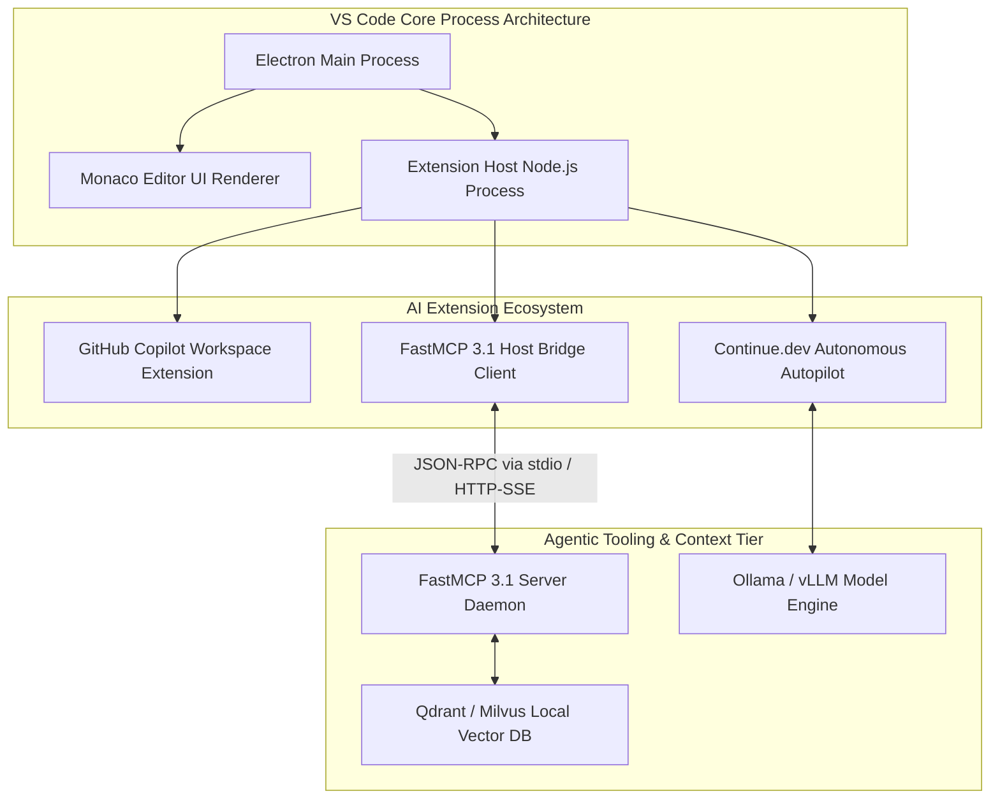
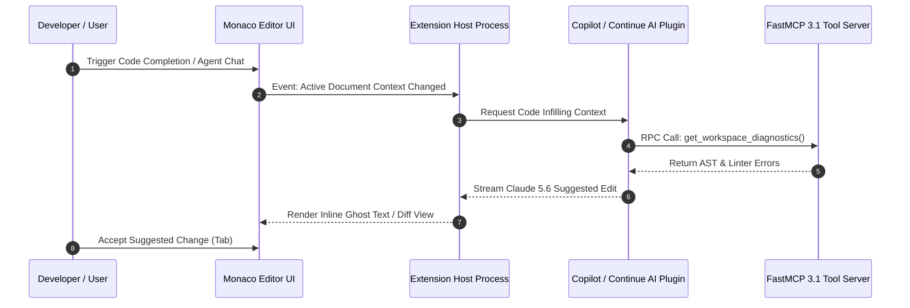

# Visual Studio Code (VS Code)

## What it is
**Visual Studio Code (VS Code)** is a lightweight, cross-platform source code editor developed by Microsoft that runs on desktop operating systems (Windows, macOS, Linux) and web environments (code-server, GitHub Codespaces). It combines built-in support for TypeScript, JavaScript, Python, and Node.js with a vast ecosystem of tens of thousands of community extensions.

As of early 2027, VS Code serves as a primary reference host environment for the **Model Context Protocol ([FastMCP 3.1](../automation_orchestration/mcp.md)) Task Protocol**. Through native extension bridges, VS Code orchestrates multi-agent coding sessions, local LLM serving engines, and enterprise vector databases across frontier model plugins powered by **Claude 5.1**, **Claude 5.6**, **GPT-5.5**, **GPT-5.6**, and **Gemini 4.0 Pro**.



## What problem it solves
Modern software development requires switching between code editing, terminal commands, version control, debugger inspection, and AI assistant interactions. Heavy traditional Integrated Development Environments (IDEs) often introduce slow startup times and high memory usage, while minimalist text editors lack integrated debugging and extension bridges.

VS Code solves this balance by decoupling the UI rendering thread from background extension runtimes. Its process-isolated Extension Host ensures high editor responsiveness while allowing AI coding assistants and FastMCP 3.1 tool servers to analyze large codebases, perform semantic vector searches, and execute agentic code modifications in parallel.



## Where it fits in the stack
**Category**: Development & Ops / Source Code Editor & Agent Host. It functions at the **Developer Workspace & Agent Orchestration Layer**, serving as the primary user interface for writing code and hosting AI assistants.

- **Editor Layer**: Provides Monaco Editor UI, terminal, breakpoint debugger, and Git visual diffs.
- **Extension Layer**: Hosts AI extension engines like GitHub Copilot, Continue.dev, Codeium, and Aider.
- **MCP Host Layer**: Direct host and client manager for [FastMCP 3.1](../automation_orchestration/mcp.md) tool daemons.

## Typical use cases
- **AI-Assisted Pair Programming**: Utilizing inline code completion and multi-file editing agents powered by Claude 5.6 and GPT-5.6.
- **Remote Development**: Connecting seamlessly to cloud containers, WSL2 environments, or remote SSH servers using the Remote Development Extension Pack.
- **FastMCP 3.1 Agent Tool Hosting**: Connecting local workspace diagnostics, linters, and vector search tools directly to AI assistants.
- **Full-Stack Web & API Debugging**: Multi-target debugging across Python backends, Node.js services, and frontend web applications.

## Key Features & Capabilities
- **Strict Process Isolation Architecture**: Electron main process, Chromium UI renderer, and Node.js extension host operate in separate processes.
- **Native FastMCP 3.1 Support**: Extension bridges expose workspace files, symbols, git diffs, and linters as FastMCP resource providers.
- **Remote Development Suite (SSH, Containers, WSL)**: Edit and debug code running inside Docker containers or remote cloud instances without local file syncing.
- **Multi-Model AI Flexibility**: Run multiple AI tools simultaneously (e.g., Copilot for inline completions, Continue for local Ollama models, Aider in the terminal).
- **Integrated Source Control**: Visual git status, staging, side-by-side diff views, and branch management built-in.

## Performance & Diagnostic Troubleshooting Matrix

| Issue / Symptom | Root Cause | Diagnostic Steps | Resolution / Action |
| :--- | :--- | :--- | :--- |
| **High Extension Host CPU Usage** | Malfunctioning AI extension indexing codebase synchronously | Open Command Palette -> `Developer: Open Process Explorer`. | Identify high-CPU extension PID and disable workspace background indexing. |
| **Slow Editor Typing Response** | Main thread blocked by conflicting inline completion plugins | Run `code --disable-extensions` to isolate core editor speed. | Disable duplicate AI extensions (e.g. run Copilot OR Codeium, not both simultaneously). |
| **FastMCP Connection Refused** | Stdio path incorrect or daemon crashed in background | Inspect `Output` channel -> `Model Context Protocol` log stream. | Verify executable path in `mcp.servers` setting and test daemon manually via terminal. |
| **Remote SSH Reconnection Loops** | SSH keepalive timeout or remote server memory exhaustion | Check `Output` -> `Remote - SSH` logs for `Connection reset`. | Add `ServerAliveInterval 60` to `~/.ssh/config` or increase remote swap space. |
| **Language Server Crash (LSP)** | Out of memory error on large multi-gigabyte codebases | Inspect language server output channel for `JavaScript heap out of memory`. | Increase LSP memory limit via `"typescript.tsserver.maxTsServerMemory": 8192`. |

## Strengths
- **Unrivaled Ecosystem**: Tens of thousands of extensions covering every programming language, theme, and AI framework.
- **Best-in-Class Remote Support**: Remote SSH, Container, and WSL development experiences are industry standards.
- **Multi-Assistant Support**: Freedom to integrate any LLM provider (Anthropic, OpenAI, Google, Ollama) via extensions.
- **Active Community**: Continuous monthly feature updates from Microsoft and global open-source contributors.

## Limitations
- **Resource Consumption**: Running multiple AI extensions and Language Servers can consume 4GB+ of system memory.
- **Configuration Complexity**: Managing complex `settings.json` configurations across team workspaces requires discipline.
- **Non-Native AI Core**: Unlike ground-up AI editors like [Cursor](cursor.md) or [Windsurf](windsurf.md), AI features are added via extensions.

## When to use it
- When needing a battle-tested, highly extensible editor supporting any language or framework.
- When performing remote development on cloud servers, Kubernetes pods, or Docker containers.
- When orchestrating custom FastMCP 3.1 tool servers inside your development environment.

## When not to use it
- When requiring a minimal-memory text editor for low-power hardware (consider [Zed](zed.md) or Neovim).
- When seeking a purely AI-native editor with deep custom renderer hooks (consider [Cursor](cursor.md)).

## Getting started

### Installation
Install VS Code on macOS or Linux:

```bash
# On macOS via Homebrew Cask
brew install --cask visual-studio-code

# On Ubuntu/Debian via apt
sudo apt update && sudo apt install code
```

### Quickstart Example
Create a project folder and launch VS Code:

```bash
mkdir my-agent-workspace && cd my-agent-workspace
echo 'print("VS Code FastMCP 3.1 Workspace Initialized")' > main.py
code .
```

## CLI examples

### 1. Managing Extensions via Command Line
Install and inspect active extensions via the `code` CLI:

```bash
# Install GitHub Copilot extension
code --install-extension github.copilot

# List installed extensions with versions
code --list-extensions --show-versions
```

### 2. Side-by-Side Visual Diffing
Compare two files or git revisions from the terminal:

```bash
code --diff file_v1.py file_v2.py
```

### 3. Launching Safe Mode for Troubleshooting
Start VS Code with all extensions disabled to diagnose performance bottlenecks:

```bash
code . --disable-extensions
```

## API examples

### FastMCP 3.1 VS Code Workspace Bridge Server (Python)
The following Python script implements a FastMCP 3.1 tool server that inspects active VS Code workspace settings, active linter diagnostics, and Git status for an AI agent:

```python
import os
import json
import subprocess
from typing import Dict, Any, List
from pydantic import BaseModel, Field, ConfigDict
from mcp.server.fastmcp import FastMCP, Context

class WorkspaceStatus(BaseModel):
    model_config = ConfigDict(extra="forbid")
    workspace_path: str = Field(..., description="Absolute path to active VS Code workspace")
    has_settings: bool = Field(default=False, description="True if .vscode/settings.json exists")
    active_git_branch: str = Field(default="unknown", description="Active git branch name")
    settings_summary: Dict[str, Any] = Field(default_factory=dict)

mcp = FastMCP("vscode-workspace-inspector", version="3.1.0")

@mcp.tool(name="inspect_vscode_workspace", description="Inspects VS Code settings and git branch for an active workspace")
async def inspect_vscode_workspace(workspace_path: str, ctx: Context) -> str:
    """Reads .vscode/settings.json and queries git status to return structured workspace diagnostics."""
    if not os.path.exists(workspace_path):
        return f"Error: Workspace path '{workspace_path}' does not exist."

    settings_file = os.path.join(workspace_path, ".vscode", "settings.json")
    has_settings = os.path.exists(settings_file)
    settings_data = {}

    if has_settings:
        try:
            with open(settings_file, "r") as f:
                settings_data = json.load(f)
            ctx.info(f"Loaded workspace settings from {settings_file}")
        except Exception as e:
            ctx.warning(f"Failed to parse settings.json: {e}")

    # Query git branch
    git_branch = "non-git"
    try:
        res = subprocess.run(
            ["git", "-C", workspace_path, "rev-parse", "--abbrev-ref", "HEAD"],
            capture_output=True, text=True, check=True
        )
        git_branch = res.stdout.strip()
    except Exception:
        pass

    status = WorkspaceStatus(
        workspace_path=workspace_path,
        has_settings=has_settings,
        active_git_branch=git_branch,
        settings_summary=settings_data
    )
    return status.model_dump_json(indent=2)

if __name__ == "__main__":
    mcp.run()
```

### Programmatic Pydantic v2 VS Code Settings Validator
Validate team-wide `.vscode/settings.json` configurations prior to committing to Git:

```python
from typing import Dict, List, Optional
from pydantic import BaseModel, Field, ConfigDict

class MCPServerEntry(BaseModel):
    model_config = ConfigDict(extra="forbid")
    command: str = Field(..., description="Executable binary path")
    args: List[str] = Field(default_factory=list)
    env: Dict[str, str] = Field(default_factory=dict)

class VSCodeTeamSettings(BaseModel):
    model_config = ConfigDict(extra="forbid", populate_by_name=True)
    format_on_save: bool = Field(default=True, alias="editor.formatOnSave")
    tab_size: int = Field(default=4, alias="editor.tabSize")
    copilot_model: str = Field(default="claude-5.6-opus", alias="github.copilot.advanced.model")
    mcp_servers: Dict[str, MCPServerEntry] = Field(default_factory=dict, alias="mcp.servers")

if __name__ == "__main__":
    sample_settings = {
        "editor.formatOnSave": True,
        "editor.tabSize": 4,
        "github.copilot.advanced.model": "claude-5.6-opus",
        "mcp.servers": {
            "workspace_inspector": {
                "command": "python3",
                "args": ["/usr/local/bin/vscode_inspector.py"]
            }
        }
    }

    validated = VSCodeTeamSettings.model_validate(sample_settings)
    print(f"Validated Copilot Model: {validated.copilot_model}")
    print(f"MCP Servers Configured: {list(validated.mcp_servers.keys())}")
```

### Systemd Service Configuration for Headless code-server
Deploying a headless VS Code web server (`code-server`) as a systemd background daemon on remote development servers:

```ini
[Unit]
Description=VS Code Headless code-server Web Interface
After=network.target

[Service]
Type=simple
User=developer
Group=developer
WorkingDirectory=/home/developer
ExecStart=/usr/bin/code-server --bind-addr 127.0.0.1:8080 --auth password
Restart=always
RestartSec=5s
Environment=PASSWORD=secure_dev_password
LimitNOFILE=65536

[Install]
WantedBy=multi-user.target
```

## Production Security & Workspace Best Practices
- **Version Control Workspace Settings**: Commit `.vscode/settings.json` and `.vscode/extensions.json` to source repositories to guarantee consistent linter rules, formatting styles, and recommended AI plugins across developer workstations.
- **FastMCP Tool Process Isolation**: Run custom FastMCP tool daemons in containerized environments or virtualenv sandboxes rather than granting unrestricted root host permissions.
- **Secret Management**: Never commit plain-text API keys or OAuth tokens inside `.vscode/settings.json`. Leverage environment variable expansion or system keychains via extension authentication APIs.
- **Extension Audit Policy**: Periodically run `code --list-extensions` in CI pipelines to check installed extension IDs against approved security allowlists.
- **Telemetry Opt-Out**: Set `"telemetry.telemetryLevel": "off"` in global settings for strict air-gapped security compliance.

## Related tools / concepts
- [Windsurf](windsurf.md) — AI-powered IDE from Codeium.
- [Zed](zed.md) — High-performance Rust-based editor alternative.
- [Cursor](cursor.md) — Fork of VS Code with deep AI integration.
- [Aider](aider.md) — Terminal-based AI pair programmer.
- [Claude Code](claude-code.md) — Anthropic's CLI coding assistant.
- [GitHub Copilot](github_copilot.md) — Flagship AI coding extension.
- [Model Context Protocol](../automation_orchestration/mcp.md) — Open standard for AI tool integration.

## Sources / references
- [Official Website](https://code.visualstudio.com/)
- [VS Code Extension API Documentation](https://code.visualstudio.com/api)
- [Remote Development in VS Code](https://code.visualstudio.com/docs/remote/remote-overview)

---
## Contribution Metadata
- Last reviewed: 2027-01-07
- Confidence: high
