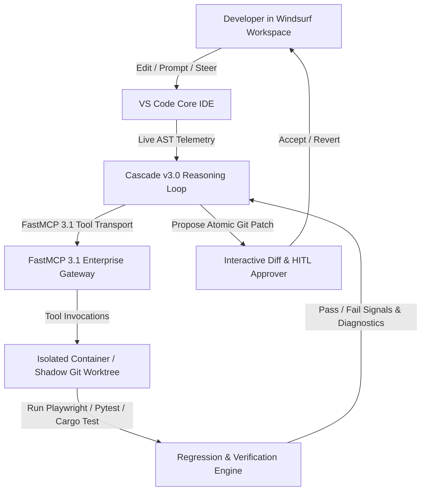
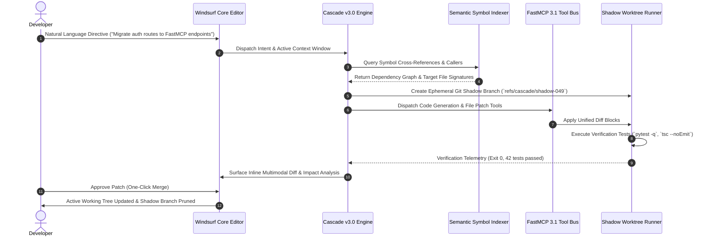

# Windsurf IDE

## What it is
**Windsurf** is the world's first agentic integrated development environment (IDE), developed by **Codeium** and deeply integrated with **Cognition's Devin 3.0** reasoning engine and the **FastMCP 3.1 Task Protocol**. Under early January 2027 SOTA standards, it is built on top of an optimized VS Code core featuring the enhanced **Cascade v3.0** AI interaction model. Cascade moves beyond standard chat interfaces into autonomous, multi-file execution, speculative background refactoring, real-time environment management, and Playwright verification loops for frontier models like **Claude 5.6**, **GPT-5.6**, **Gemini 4.0 Ultra**, **Llama 4 Maverick**, **Gemma 4**, **DeepSeek-V4**, and **Qwen 3.6 VL**.

Unlike legacy extensions that treat LLMs as passive completion engines, Windsurf establishes an asynchronous dual-thread orchestration framework. The developer works within a primary active workspace while Cascade spins up parallel background sandbox workers to analyze dependency graphs, run non-blocking test suites, generate FastMCP 3.1 tooling layers, and propose atomic Git patches with inline visual diffs.

## Architecture & Cascade v3.0 Execution Lifecycle

Windsurf splits developer workflows into foreground editing and background agent execution loops. Codeium's AST indexing engine coordinates with FastMCP 3.1 agents across sandboxed execution layers.



## Detailed Agentic Interaction Sequence



## Mathematical Formulations & Agent Execution Mechanics

### 1. Speculative Background Refactoring Convergence
Cascade models multi-file refactoring as an iterative graph transformation over an Abstract Syntax Tree (AST) directed graph $G = (V, E)$, where vertices $v_i \in V$ represent modules, classes, and function symbols, and edges $e_{ij} = (v_i, v_j) \in E$ represent dependency, inheritance, or invocation links.

The refactoring objective minimizes the residual compile and lint error function $\mathcal{L}_{\text{error}}$ across step iterations $t \in [1, T]$:

$$\mathcal{L}_{\text{error}}(t) = \sum_{v \in V} \left( \alpha \cdot \mathbb{I}_{\text{syntax}}(v, t) + \beta \cdot \mathbb{I}_{\text{type}}(v, t) + \gamma \cdot \sum_{e \in E} \mathbb{I}_{\text{contract}}(e, t) \right)$$

Where:
- $\mathbb{I}_{\text{syntax}}(v, t) \in \{0, 1\}$ denotes syntax validity of node $v$ after modification at step $t$.
- $\mathbb{I}_{\text{type}}(v, t) \in \mathbb{R}_{\ge 0}$ quantifies static typing diagnostic penalties emitted by language servers (e.g., Pyright, TypeScript compiler).
- $\mathbb{I}_{\text{contract}}(e, t) \in \{0, 1\}$ denotes contract breaking changes between callers and callees across edge $e_{ij}$.
- $\alpha, \beta, \gamma$ are weighting hyper-coefficients with typical tuning values $\alpha = 1.0, \beta = 0.65, \gamma = 0.85$.

Convergence is guaranteed when the change delta satisfies $\mathcal{L}_{\text{error}}(t) = 0$ and the test regression suite passes with zero regressions:

$$\Delta \mathcal{R}_{\text{suite}} = \sum_{k=1}^{K} \big( \text{Test}_{k}(t) - \text{Test}_{k}(0) \big) \ge 0$$

### 2. AST Symbol Resolution Latency Roofline
Semantic code retrieval in Windsurf utilizes an in-memory vector-symbolic dual index. Symbol retrieval time $T_{\text{lookup}}$ across a repository with $N$ files and $M$ total tokens is bounded by:

$$T_{\text{lookup}} = \mathcal{O}\left( \log |V| \right) + \frac{d_{\text{embedding}} \cdot |K_{\text{candidates}}|}{\mathcal{B}_{\text{SIMD}}}$$

Where:
- $|V|$ represents total indexed nodes in the tree-sitter AST hierarchy.
- $d_{\text{embedding}} = 1536$ is the dense semantic vector dimensionality.
- $|K_{\text{candidates}}|$ is the pruned nearest-neighbor candidate set (typically $|K| \le 128$).
- $\mathcal{B}_{\text{SIMD}}$ is the CPU AVX-512 / Apple Silicon NEON vectorized memory bandwidth (bytes/sec).

### 3. FastMCP Serialization Overhead & Patch Latency Bounds
Tool dispatch between Cascade and external FastMCP 3.1 servers occurs over Unix Domain Sockets or standard input/output pipes (`stdio`). The end-to-end tool call latency $T_{\text{tool}}$ is formalized as:

$$T_{\text{tool}} = T_{\text{serialize}}(\mathcal{P}) + \frac{\text{len}(\mathcal{P})}{\text{Bandwidth}_{\text{pipe}}} + T_{\text{execution}} + T_{\text{deserialize}}(\mathcal{R})$$

Where $\mathcal{P}$ is the Pydantic v2 validated payload and $\mathcal{R}$ is the JSON-RPC response envelope. For local IPC sockets, transmission delay is negligible ($\le 12\ \mu\text{s}$), ensuring total tool roundtrip times are dominated strictly by LLM generation and sandbox compilation.

## What problem it solves
Traditional AI assistants in IDEs act as passive inline autocompleters or isolated side-panel chat widgets. Windsurf eliminates both the "context gap" and the "execution gap" by allowing Cascade to index massive multi-gigabyte repositories, inspect active terminal outputs, manage containerized microservices, run Playwright verification loops, and perform non-blocking background edits. It supports [Agentic Session Orchestration](../../knowledge_base/agent_protocols.md) with strict human-in-the-loop validation checkpoints.

Specific developer pain points addressed by Windsurf include:
- **Context Fragmentation**: Manually copying file snippets or error logs into chat windows is replaced by sub-millisecond semantic graph retrieval across full enterprise codebases.
- **Execution Bottlenecks**: Developers no longer need to copy generated code, apply it manually, run test scripts in a separate terminal, and fix syntax errors iteratively. Cascade executes terminal commands autonomously inside sandboxed containers.
- **Protocol Incompatibility**: Custom internal APIs, local databases, and legacy vector stores are unified under the standardized FastMCP 3.1 protocol, allowing agents to query live infrastructure directly.
- **Regression Sprawl**: Speculative background refactoring isolates edits in shadow working trees, running regression suites before presenting diffs to human maintainers.

## Where it fits in the stack
**Category**: Tool / Development & Ops / Agentic IDE. It serves as the primary developer "Command Center" bridging text editing, terminal execution, containerized testing, and multi-agent coordination.

```
┌─────────────────────────────────────────────────────────────────────────┐
│                        WINDSURF AGENTIC IDE WORKSPACE                   │
│                                                                         │
│  ┌─────────────────────────┐            ┌────────────────────────────┐  │
│  │    VS Code Core Editor  │            │     Cascade v3.0 Panel     │  │
│  │ (Active File Editing)   │            │  (Devin 3.0 Loop Engine)   │  │
│  └────────────┬────────────┘            └─────────────┬──────────────┘  │
│               │                                       │                 │
│               ▼                                       ▼                 │
│  ┌───────────────────────────────────────────────────────────────────┐  │
│  │                 FastMCP 3.1 Protocol Bus Layer                    │  │
│  └──────┬──────────────────────┬──────────────────────┬──────────────┘  │
└─────────┼──────────────────────┼──────────────────────┼─────────────────┘
          │                      │                      │
          ▼                      ▼                      ▼
┌───────────────────┐  ┌───────────────────┐  ┌───────────────────┐
│ Local Postgres DB │  │ Container Sandbox │  │ Remote Agent Pool │
│ (FastMCP Server)  │  │ (Docker/Playwright│  │ (Claude 5.6/GPT5) │
└───────────────────┘  └───────────────────┘  └───────────────────┘
```

## Typical use cases
- **Legacy Stack Migration**: Directing Cascade to "Convert this legacy Express.js microservice to Rust/Axum with Pydantic v2 schema endpoints" with automated build and test validation loops.
- **Autonomous Feature Scaffolding**: Generating full-stack features (React UI, FastMCP 3.1 endpoints, database migrations) from natural language requirements.
- **Continuous Background Debugging**: Cascade monitoring background build logs and automatically suggesting or applying targeted patches to failing tests.
- **Large-Scale Structural Refactoring**: Renaming APIs or updating data structures across hundreds of files with semantic precision.
- **Multi-Agent CI/CD Remediation**: Interfacing with remote agent swarms (via FastMCP 3.1) to diagnose and fix failing GitHub Actions or GitLab pipelines.
- **Automated Frontend Verification**: Combining Playwright MCP servers with visual diffing tools to verify responsive UI changes across multiple viewport sizes.

## Strengths
- **Native FastMCP 3.1 Support**: Out-of-the-box support for FastMCP 3.1 Task Protocol, enabling seamless integration with external databases, vector stores, and custom agent tools.
- **Devin 3.0 Reasoning Engine**: Leverages Cognition's latest long-horizon reasoning loops for complex multi-step refactoring tasks.
- **Real-Time Indexing**: Semantic indexing system processes code diffs in sub-millisecond timeframes without locking system resources.
- **VS Code Extension Ecosystem**: Full compatibility with the standard VS Code plugin ecosystem and customization capabilities.
- **Shadow Branch Sandboxing**: Runs experimental agent modifications in isolated background Git branches without contaminating the active worktree.
- **Multi-Model Orchestration**: Dynamic model routing allows switching between Claude 5.6 for heavy reasoning, GPT-5.6 for fast syntax generation, and local Gemma 4 models for privacy-sensitive offline tasks.

## Limitations
- **Cloud Dependency**: Advanced Cascade autonomous agent features require active cloud connectivity to Codeium infrastructure.
- **Proprietary Agent Architecture**: The Cascade control plane and Devin reasoning layers remain closed-source.
- **Resource Footprint**: Indexing large repositories alongside active LLM reasoning sessions requires at least 16GB RAM and dedicated GPU acceleration recommended.
- **Rate Limit Constraints**: High-frequency multi-agent reasoning runs can rapidly consume model token quotas if not properly throttled.

## When to use it
- When developing complex enterprise applications requiring multi-file context and automated testing feedback loops.
- If you want an IDE that can autonomously run terminal commands, execute test suites, and fix errors in background sessions.
- When expanding development workflows with FastMCP 3.1 enterprise tools and remote agent infrastructure.
- For teams maintaining large polyglot codebases where multi-language refactoring requires deep semantic awareness.

## When not to use it
- In strictly air-gapped or offline development environments where external API access is blocked and local model weights cannot be loaded.
- For lightweight single-file script editing where full agentic indexing overhead is unnecessary.
- If your development workflow mandates an entirely open-source editor and backend model stack.
- When working under strict regulatory compliance policies that prohibit transmitting codebase telemetry to cloud processing engines.

## Comparative Empirical Matrix: SOTA Agentic IDEs

The table below contrasts Windsurf against leading agentic IDEs and developer CLI runtimes under early 2027 enterprise benchmarks:

| Capability / Metric | Windsurf IDE (Cascade 3.0) | Cursor (Composer Mode) | Claude Code CLI | Aider (v0.72) | Devin CLI (Agent 3.0) |
| :--- | :--- | :--- | :--- | :--- | :--- |
| **Primary Interaction Paradigm** | Multimodal IDE + Shadow Worktrees | Multi-file Chat & Inline Composer | Terminal REPL + Headless Agent | Terminal Git Agent | Cloud Sandbox Web & CLI |
| **Protocol Support** | Native FastMCP 3.1 & Model Context Protocol | Custom MCP Stdio | Claude MCP Protocol | Direct Shell / Python APIs | Cognition Engine API |
| **Verification Loop** | Playwright MCP + AST Static Checks | Terminal command execution | Subprocess test execution | Auto Git commits & pytest | Dockerized full cloud sandbox |
| **Multi-File Context Window** | 1,000,000+ tokens (Hybrid AST Graph) | ~200k tokens active context | Dynamic repo grep/globbing | Repo-map (tree-sitter AST) | 2,000,000+ tokens full container |
| **Shadow Branch Isolation** | Automatic ephemeral Git shadow worktrees | In-place editor buffer diffs | Working tree in-place edits | Git branch or dirty worktree | Isolated VM micro-container |
| **Multi-Model Support** | Claude 5.6, GPT-5.6, Gemini 4.0, Gemma 4 | Claude 3.7 Sonnet, GPT-4o, Cursor Tab | Anthropic Claude frontier family | 40+ LLM providers via LiteLLM | Custom Devin Cognition fine-tune |
| **Self-Hosting / Offline** | Hybrid (Local editor, Cloud agent) | Cloud proprietary | Local CLI with API endpoint | 100% Local with Ollama / vLLM | 100% Cloud hosted |
| **License** | Proprietary Commercial (Codeium) | Proprietary Commercial | Proprietary Commercial | Apache 2.0 Open Source | Commercial Enterprise |

## Getting started

### Local Installation
1. Download the Windsurf installer for your OS (macOS, Linux, Windows) from the official website.
2. Complete the setup wizard and configure default tool permissions.
3. Authenticate with your Codeium account to activate **Cascade v3.0** and **FastMCP 3.1** capabilities.

### Configuring FastMCP 3.1 Tools
Add FastMCP 3.1 servers to `~/.codeium/windsurf/mcp_config.json` to grant Cascade access to databases, local terminal runners, and web tools:

```json
{
  "mcpServers": {
    "google-search": {
      "command": "npx",
      "args": ["-y", "@modelcontextprotocol/server-google-search"]
    },
    "postgres": {
      "command": "npx",
      "args": ["-y", "@modelcontextprotocol/server-postgres", "postgresql://localhost:5432/production"]
    },
    "playwright-runner": {
      "command": "python3",
      "args": ["-m", "mcp_playwright_server", "--headless"]
    }
  }
}
```

## CLI examples

```bash
# Launch Windsurf in the current workspace
windsurf .

# Open a specific file and line in Cascade mode with pre-loaded prompt
windsurf -g src/api/router.py:45 --prompt "Refactor endpoint to use FastMCP 3.1 schema"

# Compare diffs using Windsurf's interactive agentic diff view
windsurf --diff legacy_handler.py new_handler.py

# Launch Windsurf with explicit FastMCP configuration override
windsurf . --mcp-config ./config/custom_mcp.json --model claude-5.6-sonnet

# Trigger Cascade headless batch refactor over terminal
windsurf --headless --prompt "Update all Pydantic v1 @validator to v2 @field_validator in src/" --branch cascade-batch-refactor
```

## API examples

### FastMCP 3.1 Cascade Orchestration Bridge
The following Python script implements a production-ready FastMCP 3.1 server that integrates with Windsurf's Cascade engine, exposing sandbox command execution, shadow git branch management, and Playwright verification with strict Pydantic v2 schemas:

```python
from mcp.server.fastmcp import FastMCP
from pydantic import BaseModel, Field, ConfigDict
from typing import List, Dict, Optional, Literal
import subprocess
import json
import os

# Initialize FastMCP 3.1 server for Windsurf IDE integration
mcp = FastMCP(
    "Windsurf Developer Bridge",
    instructions="Provides automated environment execution and shadow branch management for Windsurf Cascade v3.0 agents."
)

class CommandRequest(BaseModel):
    model_config = ConfigDict(extra="forbid", frozen=True)

    command: str = Field(..., description="Bash command to execute in workspace sandbox")
    working_dir: str = Field(default=".", description="Target directory for command execution")
    timeout_seconds: int = Field(default=30, ge=1, le=300, description="Execution timeout limit")
    environment_variables: Dict[str, str] = Field(default_factory=dict, description="Custom env vars")

class CommandResponse(BaseModel):
    model_config = ConfigDict(extra="forbid", frozen=True)

    stdout: str = Field(..., description="Standard output stream")
    stderr: str = Field(..., description="Standard error stream")
    exit_code: int = Field(..., description="Process exit return code")
    executed_command: str = Field(..., description="Normalized executed command string")

class ShadowBranchRequest(BaseModel):
    model_config = ConfigDict(extra="forbid", frozen=True)

    base_branch: str = Field(default="main", description="Source branch to fork shadow workspace")
    task_id: str = Field(..., description="Unique alphanumeric identifier for the Cascade task")

class ShadowBranchResponse(BaseModel):
    model_config = ConfigDict(extra="forbid", frozen=True)

    shadow_branch: str = Field(..., description="Created shadow git branch name")
    status: Literal["created", "existing", "failed"] = Field(..., description="Lifecycle status")
    working_path: str = Field(..., description="Local path to shadow worktree directory")

@mcp.tool(name="execute_sandbox_command", description="Executes a sandboxed bash command for build verification or testing within Windsurf IDE.")
def execute_sandbox_command(request: CommandRequest) -> CommandResponse:
    """Executes a sandboxed bash command for build verification or testing within Windsurf IDE."""
    env = os.environ.copy()
    env.update(request.environment_variables)

    try:
        process = subprocess.run(
            request.command,
            shell=True,
            cwd=request.working_dir,
            capture_output=True,
            text=True,
            timeout=request.timeout_seconds,
            env=env
        )
        return CommandResponse(
            stdout=process.stdout,
            stderr=process.stderr,
            exit_code=process.returncode,
            executed_command=request.command
        )
    except subprocess.TimeoutExpired as e:
        return CommandResponse(
            stdout=e.stdout.decode() if isinstance(e.stdout, bytes) else (e.stdout or ""),
            stderr=f"Command timed out after {request.timeout_seconds} seconds",
            exit_code=124,
            executed_command=request.command
        )

@mcp.tool(name="create_shadow_worktree", description="Creates an isolated Git worktree for non-blocking Cascade refactoring.")
def create_shadow_worktree(request: ShadowBranchRequest) -> ShadowBranchResponse:
    """Creates a temporary shadow worktree allowing speculative edits without dirtying the developer workspace."""
    shadow_name = f"cascade/{request.task_id}"
    target_path = f"/tmp/windsurf-shadows/{request.task_id}"

    os.makedirs("/tmp/windsurf-shadows", exist_ok=True)
    cmd = f"git worktree add -b {shadow_name} {target_path} {request.base_branch}"
    res = subprocess.run(cmd, shell=True, capture_output=True, text=True)

    status: Literal["created", "existing", "failed"] = "created" if res.returncode == 0 else "failed"
    return ShadowBranchResponse(
        shadow_branch=shadow_name,
        status=status,
        working_path=target_path
    )

if __name__ == "__main__":
    mcp.run()
```

### Programmatic Configuration Validation with Pydantic v2
The following Python module demonstrates modeling and validating a Windsurf IDE session profile and FastMCP 3.1 client configuration under early January 2027 SOTA standards:

```python
from pydantic import BaseModel, Field, ConfigDict, field_validator
from typing import List, Dict, Optional, Literal
import json

class MCPServerConfig(BaseModel):
    model_config = ConfigDict(extra="forbid", frozen=True)

    command: str = Field(..., min_length=1)
    args: List[str] = Field(default_factory=list)
    env: Dict[str, str] = Field(default_factory=dict)
    enabled: bool = Field(default=True)

class WorkspaceSettings(BaseModel):
    model_config = ConfigDict(extra="forbid", frozen=True)

    auto_save: str = Field(default="afterDelay")
    tab_size: int = Field(default=4, ge=2, le=8)
    format_on_save: bool = Field(default=True)

class WindsurfConfig(BaseModel):
    model_config = ConfigDict(
        extra="forbid",
        frozen=True,
        populate_by_name=True,
        json_schema_extra={
            "example": {
                "mcpServers": {
                    "postgres": {
                        "command": "npx",
                        "args": ["-y", "@modelcontextprotocol/server-postgres", "postgresql://localhost:5432/mydb"],
                        "enabled": True
                    }
                },
                "cascade_version": "3.0",
                "devin_reasoning_enabled": True,
                "max_autonomous_steps": 250,
                "primary_model": "claude-5.6-sonnet"
            }
        }
    )

    mcp_servers: Dict[str, MCPServerConfig] = Field(..., alias="mcpServers")
    cascade_version: Literal["3.0", "3.1"] = Field(default="3.0")
    devin_reasoning_enabled: bool = Field(default=True)
    max_autonomous_steps: int = Field(default=250, ge=10, le=1000)
    primary_model: str = Field(default="claude-5.6-sonnet")
    fallback_models: List[str] = Field(default_factory=lambda: ["gpt-5.6-turbo", "gemma-4-27b"])
    workspace: WorkspaceSettings = Field(default_factory=WorkspaceSettings)

    @field_validator("primary_model")
    @classmethod
    def validate_model_selection(cls, v: str) -> str:
        allowed = {"claude-5.6-sonnet", "gpt-5.6-turbo", "gemini-4.0-ultra", "llama-4-maverick"}
        if v not in allowed:
            raise ValueError(f"Model {v} is not in allowed SOTA models list: {allowed}")
        return v

def validate_windsurf_config(payload: dict) -> str:
    """Validates Windsurf IDE configuration payload using Pydantic v2."""
    try:
        config = WindsurfConfig.model_validate(payload)
        return json.dumps({
            "status": "success",
            "validated_config": config.model_dump(by_alias=True)
        }, indent=2)
    except Exception as e:
        return json.dumps({
            "status": "error",
            "validation_errors": str(e)
        }, indent=2)

if __name__ == "__main__":
    test_payload = {
        "mcpServers": {
            "postgres-db": {
                "command": "npx",
                "args": ["-y", "@modelcontextprotocol/server-postgres", "postgresql://localhost:5432/homelab"],
                "env": {"PGPASSWORD": "secure_secret"},
                "enabled": True
            }
        },
        "cascade_version": "3.0",
        "devin_reasoning_enabled": True,
        "max_autonomous_steps": 300,
        "primary_model": "claude-5.6-sonnet"
    }
    print(validate_windsurf_config(test_payload))
```

## Docker Compose Sandboxed Developer Environment

To run Windsurf background tool execution and FastMCP 3.1 microservices within an isolated multi-container runtime, deploy the following `docker-compose.yml`:

```yaml
version: "3.9"

services:
  windsurf-bridge:
    image: python:3.12-slim
    container_name: windsurf-fastmcp-bridge
    restart: unless-stopped
    volumes:
      - /var/run/docker.sock:/var/run/docker.sock
      - ./workspace:/workspace:rw
      - shadow-worktrees:/tmp/windsurf-shadows:rw
    environment:
      - MCP_PORT=8096
      - CODEIUM_API_KEY=${CODEIUM_API_KEY}
      - ANTHROPIC_API_KEY=${ANTHROPIC_API_KEY}
    command: >
      bash -c "pip install --no-cache-dir fastmcp pydantic &&
               python /workspace/windsurf_mcp_bridge.py"
    ports:
      - "127.0.0.1:8096:8096"
    networks:
      - windsurf-net

  playwright-verifier:
    image: mcr.microsoft.com/playwright:v1.49.0-jammy
    container_name: windsurf-playwright-runner
    ipc: host
    volumes:
      - ./workspace:/workspace:ro
      - ./test-reports:/reports:rw
    command: npx -y @modelcontextprotocol/server-playwright
    networks:
      - windsurf-net

volumes:
  shadow-worktrees:
    driver: local

networks:
  windsurf-net:
    driver: bridge
```

## Production Systemd Service Unit Configuration

For team workstations or dedicated remote development servers running persistent FastMCP 3.1 execution gateways for Windsurf, configure `/etc/systemd/system/windsurf-mcp-gateway.service`:

```ini
[Unit]
Description=FastMCP 3.1 Tool Gateway for Windsurf IDE Cascade Engine
After=network.target docker.service
Wants=docker.service

[Service]
Type=simple
User=developer
Group=developer
WorkingDirectory=/opt/windsurf-gateway
Environment="PATH=/opt/windsurf-gateway/venv/bin:/usr/local/bin:/usr/bin"
Environment="WINDSURF_GATEWAY_PORT=8096"
Environment="PYTHONUNBUFFERED=1"
ExecStart=/opt/windsurf-gateway/venv/bin/python3 -m mcp.server.fastmcp windsurf_mcp_bridge.py
Restart=always
RestartSec=5
LimitNOFILE=65536

# Sandboxing and Security Hardening
ProtectSystem=strict
ProtectHome=read-only
ReadWritePaths=/opt/windsurf-gateway /tmp/windsurf-shadows
NoNewPrivileges=true
PrivateTmp=true

[Install]
WantedBy=multi-user.target
```

Enable and activate the service:
```bash
sudo systemctl daemon-reload
sudo systemctl enable --now windsurf-mcp-gateway.service
sudo systemctl status windsurf-mcp-gateway.service
```

## Systematic Diagnostic Troubleshooting Matrix

| Issue / Error Symptom | Probable Root Cause | Verification Diagnostic Command | Remediation Strategy |
| :--- | :--- | :--- | :--- |
| **Cascade Stalled in Autonomous Loop** | Max step limit reached or circular tool failure. | Inspect Cascade logs via Command Palette: `Developer: Toggle Developer Tools`. | Increase `max_autonomous_steps` or insert human checkpoint directive to break cycle. |
| **FastMCP Server Connection Timeout** | FastMCP JSON-RPC subprocess crashed or pipe blocked. | `tail -n 100 ~/.codeium/windsurf/logs/mcp.log` | Restart MCP daemon or check binary path in `~/.codeium/windsurf/mcp_config.json`. |
| **Shadow Git Worktree Collision** | Leftover lockfile or branch already exists from crash. | `git worktree list && git branch -a \| grep cascade/` | Run `git worktree prune` and delete stale branch `git branch -D cascade/<task_id>`. |
| **Pydantic Validation Rejection** | MCP tool input contains extra prohibited parameters. | Check stderr for `pydantic_core.ValidationError: Extra inputs are not permitted`. | Ensure tool payloads strictly match Pydantic schema with `extra="forbid"`. |
| **High Memory Usage on Large Monorepo** | AST indexing attempting to parse build artifacts and vendor dirs. | `du -sh ~/.codeium/windsurf/index/` | Add heavy paths (`node_modules`, `target`, `dist`, `.venv`) to `.windsurfname` ignore file. |
| **Playwright MCP Headless Display Error** | Missing Xvfb or host IPC configuration in container. | `docker logs windsurf-playwright-runner` | Add `ipc: host` to Docker Compose service or ensure `--headless` flag is passed. |
| **Devin 3.0 Reasoning Timeout** | High network latency or upstream API throttling. | `curl -Iv https://api.codeium.com/v1/health` | Configure automatic model fallback to `gpt-5.6-turbo` or local Gemma 4 model. |
| **Permission Denied in Sandbox Command** | Systemd unit strict isolation blocking write to workspace. | `journalctl -u windsurf-mcp-gateway.service -e` | Add target workspace directory to `ReadWritePaths=` in systemd unit file. |

## Related tools / concepts
- [Cursor](cursor.md) — Competitor AI IDE featuring Composer mode.
- [Aider](aider.md) — Terminal-native git-integrated agentic coding assistant.
- [Claude Code](claude-code.md) — Anthropic's interactive developer agent CLI.
- [Model Context Protocol (MCP)](../automation_orchestration/mcp.md) — Universal protocol for extending IDE capabilities.
- [NanoClaw](nanoclaw.md) — Containerized personal assistant framework.
- [OpenClaw](openclaw.md) — Gateway for agentic workflows and tool safety.
- [Playwright MCP](../automation_orchestration/playwright-mcp.md) — Visual testing and browser automation extension for FastMCP.
- [Docker MCP](docker-mcp.md) — Containerized testing environments for agent execution loops.

## Sources / References
- [Windsurf Official Documentation](https://docs.windsurf.com/)
- [Codeium Release Notes (January 2027)](https://codeium.com/blog/windsurf-v3-release)
- [FastMCP 3.1 Specification](https://modelcontextprotocol.io/specification/3.1)
- [Cognition Devin 3.0 Architecture Whitepaper](https://cognition-labs.ai/devin-3.0-whitepaper)

## Contribution Metadata
- Last reviewed: 2027-01-07
- Confidence: high
