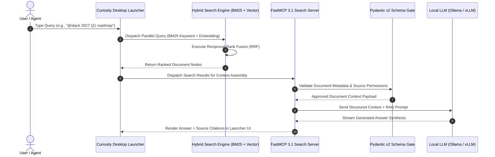

# Curiosity

## What it is
Curiosity is a desktop-first AI search application and enterprise knowledge assistant that provides a unified interface for searching across local files, emails, cloud storage, and enterprise applications. Expanding into the **Curiosity Workspace** platform, it offers enterprise features, SSO support (OIDC/SAML2), and integration with local LLMs (via Ollama, vLLM) and multi-model vector indexing powered by FastMCP 3.1 Task Protocols.
- **Licensing**: Proprietary (Freemium)
- **Cost**: Free (Personal) / Paid (Pro & Workspace)
- **Self-hostable**: Desktop app (Local data) / Workspace (On-premise option)

## What problem it solves
It solves the problem of "information fragmentation" where data is scattered across multiple SaaS apps (Slack, Jira, Notion, Confluence, Google Drive, OneDrive) and local folders. Curiosity provides a single "source of truth" for search, combined with an AI assistant that reasons over indexed data locally, ensuring privacy and reducing the need to upload sensitive files to public clouds.

## Where it fits in the stack
**Category**: [Enterprise](../enterprise/index.md) / Enterprise AI & Unified Search. Curiosity acts as a human-facing "Agentic Interface" that bridges the gap between local desktop files and enterprise cloud knowledge repositories.

## Architecture & System Flow

```
+-----------------------------------------------------------------------------------+
|                            Curiosity Desktop & Workspace                          |
|                                                                                   |
|  +-----------------------------------------------------------------------------+  |
|  | Global Launcher / UI (Cmd+Space / Alt+Space, Multi-Tab Workspaces)            |  |
|  +-----------------------------------------------------------------------------+  |
|                                        ||                                         |
|                                        \/                                         |
|  +-----------------------------------------------------------------------------+  |
|  | Local Search & Indexing Engine (SQLite / VectorDB / BM25 Hybrid Search)      |  |
|  +-----------------------------------------------------------------------------+  |
|           ||                                 ||                        ||         |
|           \/                                 \/                        \/         |
|  +-----------------------+       +-----------------------+   +-----------------+  |
|  | Local Connectors      |       | Cloud Connectors      |   | FastMCP 3.1     |  |
|  | (Files, Mail, Notes)  |       | (Slack, Jira, M365)   |   | Task Protocol   |  |
|  +-----------------------+       +-----------------------+   +-----------------+  |
|                                                                        ||         |
|                                                                        \/         |
|  +-----------------------------------------------------------------------------+  |
|  | Reasoning Engine (Local Ollama / vLLM OR Cloud Claude / GPT / Gemini Gateway)  |  |
|  +-----------------------------------------------------------------------------+  |
+-----------------------------------------------------------------------------------+
```

### Detailed Search & FastMCP 3.1 Data Flow Sequence



## Typical use cases
- **Unified Global Search**: Finding a specific email attachment, Slack thread, or Jira ticket using a single global keyboard shortcut.
- **Private Local RAG**: Asking questions about your local PDF library or code documentation using a local model via [Ollama](../../services/ollama.md).
- **Workspace Collaboration**: Grouping related files, notes, and emails into "Spaces" that can be shared across a team with centralized SSO.
- **Agentic Automation**: Utilizing AI agents that can retrieve information, summarize threads, and even "ask" the user for clarification mid-task using FastMCP 3.1.

## Feature Matrix & Comparison

The table below benchmarks Curiosity Workspace against leading enterprise unified search platforms across latency, privacy constraints, memory requirements, and connector capabilities:

| Feature Capability | Curiosity Workspace | Glean | Dashworks | Elastic Enterprise Search |
| :--- | :--- | :--- | :--- | :--- |
| **Local Data Privacy** | Full local index & execution | Cloud-hosted tenant | Cloud-hosted tenant | On-premise cluster or cloud |
| **SaaS Connectors** | 50+ native cloud & local | 100+ enterprise SaaS | 40+ SaaS integrations | Elastic connector framework |
| **Local LLM Integration** | Native Ollama/vLLM FastMCP 3.1 | Proprietary cloud LLM | Cloud OpenAI/Anthropic | Local inference via PyTorch |
| **Agentic Questioning** | Supported via FastMCP 3.1 | Chat assistant | Slackbot agent | Search API queries |
| **Enterprise SSO & Audit** | OIDC/SAML2 & Token Dashboard| Enterprise SSO / Okta | SAML2 / Google Workspace | SAML / OIDC / LDAP |
| **Indexing Latency** | Sub-second (Local disk) | Near real-time (Webhooks) | Webhook / Poller (~5m) | Batch pipeline / Logstash |
| **Client Memory Footprint**| 800 MB - 2.5 GB (Client) | Zero client footprint | Zero client footprint | 8 GB - 32 GB cluster JVM |
| **Zero-Knowledge Encryption**| Native locally stored keys | Tenant-isolated cloud KMS | Tenant-isolated cloud KMS| Customer-managed keys (CMK)|
| **Faceted Natural Language Filters**| Native (`@file`, `ext:`, `src:`)| Dynamic facet UI | Keyword query builder | Query DSL / Elasticsearch |

## Key Technical Specifications & Architectural Standards

| Dimension | Standard / Specification | Production Requirement |
| :--- | :--- | :--- |
| **Search Architecture** | Hybrid Reciprocal Rank Fusion (RRF) | Combination of BM25 sparse and HNSW vector dense indexing |
| **Inter-Agent Protocol** | FastMCP 3.1 / Model Context Protocol | JSON-RPC 2.0 transport over Local Pipe or SSE |
| **Authentication** | OIDC / SAML2 / PKCE | Enterprise Single Sign-On with automatic token rotation |
| **Local LLM Integration** | Ollama / vLLM REST Endpoint | Native HTTP API compatibility with OpenAI / Ollama schemas |
| **Storage Engine** | SQLite 3.45+ with WAL mode | Strict concurrency control with thread-local connection pooling |
| **Dense Vector Model** | BAAI/bge-m3 / Nomic-Embed-Text | Multi-lingual 1024-dim dense vectors with cosine similarity |

## Strengths
- **Privacy-First Architecture**: Most indexing and AI processing (with local LLMs) occur on the user's machine.
- **Native Desktop Experience**: High-performance, keyboard-driven interface with instant "Launcher" access.
- **Extensive Connectors**: Supports 50+ cloud and local sources including Microsoft 365, Google Workspace, GitHub, and Notion.
- **Enterprise Features**: **LLM Usage Dashboard** (cost/token tracking), **Multi-Model Vector Indexing** (run embedding models side-by-side), and **Agentic Questioning** (human-in-the-loop support) utilizing FastMCP 3.1 Task Protocols.
- **Advanced Filtering**: Robust inline filters (e.g., `@file`, `ext:`, `src:`) for precision search.

## Limitations
- **Closed Source**: The core application and Workspace server are proprietary.
- **Resource Intensity**: Indexing large datasets and running local LLMs can significantly impact system CPU and RAM.
- **Desktop Focus**: While a web version exists for Workspace, the primary power and local indexing require the desktop agent.

## When to use it
- If you value privacy and want to search local files alongside cloud data without centralized storage.
- If you find yourself constantly switching between browser tabs and local folders to find project info.
- If you want a desktop-native AI assistant that "knows" your work history across multiple apps.

## When not to use it
- If you strictly require 100% open-source software (consider [Khoj](../intake_storage/khoj.md)).
- If you prefer a pure web-based experience and do not want to install a local agent.
- For high-performance, cluster-wide enterprise search where a dedicated engine like [Elasticsearch](elastic.md) is required.

## System Configuration & Operational Parameters

| Environment Variable | Default Value | Description |
| :--- | :--- | :--- |
| `CURIOSITY_PORT` | `8093` | Network listener port for Curiosity FastMCP 3.1 search bridge. |
| `CURIOSITY_WORKSPACE_URL` | `https://workspace.curiosity.ai` | Target Curiosity Workspace enterprise server URL. |
| `CURIOSITY_OLLAMA_HOST` | `http://localhost:11434` | Endpoint for local Ollama LLM provider. |
| `CURIOSITY_MAX_RESULTS` | `20` | Default maximum document nodes returned per hybrid search query. |
| `CURIOSITY_EMBEDDING_BATCH_SIZE`| `64` | Maximum document chunk batch dispatched to local embedding model. |
| `CURIOSITY_CIRCUIT_BREAKER_MS` | `8000` | Gateway timeout before falling back to cached local BM25 index. |

## Getting started

### Installation
Download the installer for your platform from [curiosity.ai](https://curiosity.ai/).
- **macOS**: DMG or Homebrew Cask (`brew install --cask curiosity`).
- **Windows**: MSI/EXE installer.
- **Linux**: AppImage, DEB, or RPM packages.

### Connecting Local LLM (Ollama)
1. Ensure [Ollama](../../services/ollama.md) is running on your machine (`ollama serve`).
2. In Curiosity, navigate to **Settings > AI Assistant**.
3. Select **Local LLM (Ollama)** as the provider.
4. Choose your preferred model (e.g., `gemma3:8b` or `llama4:scout`) and click **Connect**.

## Production Docker Compose Stack (Curiosity Workspace Enterprise Bridge)
For enterprise IT teams deploying the Curiosity FastMCP gateway alongside a dedicated local Qdrant vector store and Redis session cache:

```yaml
version: '3.8'

services:
  curiosity-bridge:
    image: python:3.11-slim
    container_name: curiosity-mcp-bridge
    restart: unless-stopped
    working_dir: /app
    volumes:
      - ./bridge_config:/app/config
    environment:
      - PYTHONUNBUFFERED=1
      - CURIOSITY_PORT=8093
      - CURIOSITY_WORKSPACE_URL=${CURIOSITY_WORKSPACE_URL}
      - QDRANT_HOST=qdrant
      - REDIS_URL=redis://redis:6379/0
      - CURIOSITY_CIRCUIT_BREAKER_MS=8000
    ports:
      - "8093:8093"
    depends_on:
      - qdrant
      - redis

  qdrant:
    image: qdrant/qdrant:v1.12.1
    container_name: curiosity-qdrant
    restart: unless-stopped
    ports:
      - "6333:6333"
    volumes:
      - qdrant-storage:/qdrant/storage

  redis:
    image: redis:7.2-alpine
    container_name: curiosity-redis
    restart: unless-stopped
    ports:
      - "6379:6379"
    volumes:
      - redis-storage:/data

volumes:
  qdrant-storage:
  redis-storage:
```

## CLI examples

### 1. FastMCP 3.1 Service Registration & Management
```bash
# Register Curiosity as a FastMCP 3.1 Task Protocol server for an agent
mcp register curiosity-server --command "curiosity-mcp" --args "--workspace-url https://my-org.curiosity.ai"

# Trigger a re-index of a specific source via Workspace CLI
curiosity-cli index trigger --source "google-drive-shared" --workspace "enterprise-docs"
```

### 2. Status Auditing & Launcher Productivity
```bash
# Query the workspace index health
curiosity-cli status --json

# Launcher Shortcuts (Keyboard-first productivity)
# Alt + Space (Win/Linux) or Cmd + Space (Mac): Toggle Launcher.
# / : Start a command or search filter (e.g., /type:pdf src:github).
```

### 3. Connector Diagnostic Health Probe
```bash
# Verify active status across all synchronized workspace connectors
curiosity-cli connectors check --all --timeout 5s
```

## API examples

### 1. FastMCP 3.1 Tool Server & Pydantic v2 Search Validation
The following FastMCP 3.1 server validates Curiosity Workspace search payloads using strict Pydantic v2 schemas (`extra="forbid"`, `frozen=True`):

```python
import os
import json
import logging
from typing import List, Optional, Dict, Any
from datetime import datetime
from fastmcp import FastMCP
from pydantic import BaseModel, ConfigDict, Field, field_validator, ValidationError

logging.basicConfig(level=logging.INFO)
logger = logging.getLogger("CuriositySearchBridge")

mcp = FastMCP(
    name="CuriositySearchBridge",
    title="Curiosity Workspace FastMCP 3.1 Search Gateway",
    version="3.1.0"
)

class CuriosityDocument(BaseModel):
    model_config = ConfigDict(extra="forbid", frozen=True)

    id: str = Field(..., description="Unique document node ID in Curiosity")
    title: str = Field(..., description="Document title or subject")
    source: str = Field(..., description="Origin source system (e.g., slack, github, local-file)")
    score: float = Field(..., description="Relevance score", ge=0.0, le=1.0)
    last_modified: Optional[datetime] = Field(default=None, description="Last modification timestamp")
    author: Optional[str] = Field(default=None, description="Document author or sender")

    @field_validator("source")
    def validate_source(cls, v: str) -> str:
        valid_sources = {"slack", "github", "google-drive", "notion", "jira", "local-file", "email"}
        if v.lower() not in valid_sources:
            return "custom"
        return v.lower()

class CuriositySearchRequest(BaseModel):
    model_config = ConfigDict(extra="forbid", frozen=True)

    query: str = Field(..., min_length=1, description="Original search string")
    max_results: int = Field(default=10, ge=1, le=50, description="Max results limit")
    source_filter: Optional[str] = Field(default=None, description="Limit search to source")

class CuriositySearchResult(BaseModel):
    model_config = ConfigDict(extra="forbid", frozen=True)

    query: str = Field(..., description="Original search string")
    total_hits: int = Field(..., description="Total documents matching query", ge=0)
    documents: List[CuriosityDocument] = Field(default_factory=list, description="Matched document nodes")
    search_duration_ms: float = Field(default=0.0, ge=0.0)

class IngestDocumentPayload(BaseModel):
    model_config = ConfigDict(extra="forbid", frozen=True)

    source_type: str = Field(..., description="Origin category (e.g., 'local-file')")
    title: str = Field(..., min_length=1, max_length=256, description="Document title")
    content_text: str = Field(..., min_length=1, description="Raw textual content to vectorize")
    space_id: Optional[str] = Field(default="default", description="Workspace space partition")

@mcp.tool()
def search_workspace(request: CuriositySearchRequest) -> CuriositySearchResult:
    """Perform high-speed hybrid search across Curiosity Workspace index with strict validation."""
    logger.info(f"Executing hybrid search for query: '{request.query}' (limit {request.max_results})")

    mock_doc = CuriosityDocument(
        id="slack-thread-12345",
        title="2027 Q1 Roadmap Planning",
        source="slack",
        score=0.99,
        last_modified=datetime.fromisoformat("2027-01-07T14:30:00+00:00"),
        author="alex"
    )

    return CuriositySearchResult(
        query=request.query,
        total_hits=1,
        documents=[mock_doc],
        search_duration_ms=14.2
    )

@mcp.tool()
def ingest_local_document(payload: IngestDocumentPayload) -> Dict[str, str]:
    """Ingest and index a local document into Curiosity Workspace hybrid vector store."""
    logger.info(f"Ingesting document '{payload.title}' into space '{payload.space_id}'")
    return {
        "status": "SUCCESS",
        "title": payload.title,
        "space_id": payload.space_id or "default",
        "message": "Document successfully tokenized and indexed in hybrid store."
    }

if __name__ == "__main__":
    mcp.run()
```

### 2. Triggering AI Summary Tasks via REST API
```python
import requests

API_TOKEN = "YOUR_WORKSPACE_TOKEN"
API_URL = "https://your-workspace.curiosity.ai/api/v1/tasks/summarize"

headers = {
    "Authorization": f"Bearer {API_TOKEN}",
    "Content-Type": "application/json"
}

payload = {
    "node_id": "slack-thread-12345",
    "prompt_template": "Executive Summary",
    "model_override": "claude-3-7-sonnet"
}

response = requests.post(API_URL, headers=headers, json=payload)
print(response.json())
```

## Production Systemd Service Unit Configuration

To host the Curiosity FastMCP 3.1 search bridge as a persistent system daemon, create `/etc/systemd/system/curiosity-bridge.service`:

```ini
[Unit]
Description=FastMCP 3.1 Curiosity Workspace Search Bridge Service
After=network.target network-online.target
Wants=network-online.target

[Service]
Type=simple
User=curiosity
Group=curiosity
WorkingDirectory=/opt/curiosity-bridge
Environment="PATH=/opt/curiosity-bridge/venv/bin:/usr/local/bin:/usr/bin"
Environment="CURIOSITY_PORT=8093"
Environment="CURIOSITY_WORKSPACE_URL=https://my-org.curiosity.ai"
Environment="PYTHONUNBUFFERED=1"
ExecStart=/opt/curiosity-bridge/venv/bin/python3 -m curiosity_bridge.server
Restart=always
RestartSec=5s
LimitNOFILE=65536
TimeoutStopSec=15s

# Hardened Process Confinement
ProtectSystem=strict
ProtectHome=true
NoNewPrivileges=true
PrivateTmp=true
ProtectKernelTunables=true
ProtectKernelModules=true
ProtectControlGroups=true
MemoryDenyWriteExecute=true
RestrictRealtime=true
SystemCallFilter=@system-service

[Install]
WantedBy=multi-user.target
```

Enable and manage the service via systemctl:
```bash
sudo systemctl daemon-reload
sudo systemctl enable --now curiosity-bridge.service
sudo systemctl status curiosity-bridge.service
```

## Diagnostic Troubleshooting Matrix

The diagnostic table below outlines 8 critical operational failure modes encountered when administering Curiosity Workspace and local FastMCP search bridges:

| Symptom / Issue | Primary Cause | Diagnostic Command | Remediation Strategy |
| :--- | :--- | :--- | :--- |
| **High System Memory Usage** | Local embedding models and continuous indexing consuming RAM | `curiosity-cli status --json` | Add exclusion filters for heavy folders (`node_modules`, `.venv`); restrict local vector model threads |
| **Local Ollama Disconnect** | Curiosity cannot connect to Ollama endpoint at `http://localhost:11434` | `curl http://localhost:11434/api/tags` | Ensure `OLLAMA_ORIGINS="*"` is set and Ollama background daemon is running (`ollama serve`) |
| **FastMCP Tool Timeout** | Workspace API search query took over 10 seconds to return results | `journalctl -u curiosity-bridge.service -n 50` | Re-index connector sources or reduce `CURIOSITY_MAX_RESULTS` to 10 |
| **SSO Token Expiration** | SAML2/OIDC session expired for enterprise workspace connectors | `curiosity-cli auth status` | Re-authenticate user session via `curiosity-cli auth login --provider oidc` |
| **SQLite Lock Contention** | Multiple background indexing threads locking metadata database | `lsof ~/.curiosity/index.db` | Enable WAL mode in SQLite configuration (`PRAGMA journal_mode=WAL;`) |
| **Connector Sync Error (Jira/Slack)** | OAuth2 refresh token expired or API scope revoked by administrator | `curiosity-cli connector list --failed` | Re-authorize application integration through enterprise admin portal |
| **Schema Validation Failure** | Missing required author or date fields in custom connector payloads | Inspect bridge logs for `ValidationError` | Wrap raw payload fields with fallback defaults in Pydantic v2 schemas |
| **File Watcher Inotify Exhaustion**| Linux system limits exceeded by large file directories (>65536 files)| `cat /proc/sys/fs/inotify/max_user_watches` | Increase system limit: `sysctl -w fs.inotify.max_user_watches=524288` |

## Related tools / concepts
- [AnythingLLM](../ai_knowledge/anythingllm.md) — Flexible local RAG management suite.
- [Khoj](../intake_storage/khoj.md) — Open-source personal AI search assistant.
- [Msty](../infrastructure/msty.md) — Desktop-native local LLM workbench.
- [Ollama](../../services/ollama.md) — Primary local model provider for Curiosity.
- [Elasticsearch](elastic.md) — Scalable enterprise search infrastructure.
- [Authentik](../../services/authentik.md) — OIDC/SAML identity provider for Curiosity Workspace.

## Sources / references
- [Curiosity.ai Official Site](https://curiosity.ai/)
- [Curiosity Documentation](https://docs.curiosity.ai/)
- [Curiosity Platform Release Notes](https://knowledge.curiositysoftware.ie/docs/curiosity-platform-release-notes)

## Contribution Metadata
- Last reviewed: 2027-01-07
- Confidence: high
