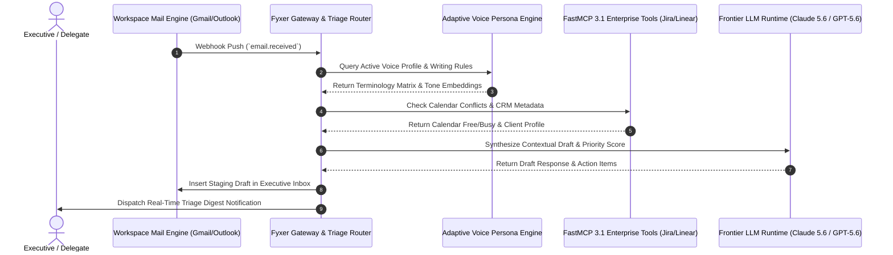

# Fyxer AI

## What it is
Fyxer AI is an enterprise-grade AI executive assistant platform engineered to automate inbox triage, calendar scheduling, meeting synthesis, and administrative workflows for executive leadership teams and high-volume knowledge workers. Functioning as an autonomous executive delegation layer across communication environments (Google Workspace, Microsoft 365, Microsoft Teams), Fyxer AI incorporates frontier reasoning engines ([Claude 5.6](../providers/anthropic.md), [GPT-5.6](../ai_knowledge/openai.md), [Gemini 4.0 Ultra](../ai_knowledge/gemini.md)) and natively supports [FastMCP 3.1](../automation_orchestration/mcp.md) protocol standards.

Key capabilities include:
- **Autonomous AI Inbox Triage**: Continuously classifies, prioritizes, and drafts context-aware email responses in the user's authentic communication voice.
- **Natural Language Calendar Negotiation**: Coordinates multi-party meeting schedules across complex corporate boundaries using autonomous email and calendar negotiation.
- **Meeting Intelligence & Action Synthesis**: Automatically records, transcribes, and extracts structured action items, task dependencies, and decision matrices from virtual meetings.
- **Adaptive Personal Voice Modeling**: Trains personalized persona models on sent communication histories to ensure generated drafts maintain tone, style, and terminology consistency.
- **Enterprise FastMCP 3.1 Integration**: Connects executive workflows directly into enterprise issue trackers (Jira, Linear) and database stores via standardized tool servers.

## Workflow Orchestration & Sequence Architecture
The following sequence diagram illustrates the lifecycle of incoming executive emails, voice persona alignment checking, FastMCP 3.1 triage routing, and automated draft synthesis:



## What problem it solves
Executive leadership teams and senior management spend upwards of 15–20 hours per week managing inbox overload, negotiating calendar conflicts, manually summarizing meetings, and routing task assignments. Traditional email filters and simple template tools lack semantic reasoning and contextual awareness, requiring constant manual intervention.

Fyxer AI eliminates administrative overhead by:
- **Serving as an Autonomous Delegation Runtime**: Operating as a trusted executive assistant that drafts replies, manages calendar scheduling, and highlights urgent action items without constant prompt intervention.
- **Eliminating Context Switching**: Synthesizing key takeaways and drafting follow-ups directly within existing communication tools (Gmail, Outlook, Teams).
- **Preventing Task Leakage**: Automatically capturing commitments made during verbal meetings or email threads and logging them into enterprise task management systems.

## Where it fits in the stack
**Category**: Enterprise Productivity / Autonomous Executive Delegation & Workflow Automation Layer.

Fyxer AI operates at the **Enterprise Workflow & Productivity Layer**, bridging workspace communication channels with backend reasoning engines and enterprise systems.

```
┌─────────────────────────────────────────────────────────────────────────┐
│                 Workspace Communication & Calendar Layer                │
│            (Google Workspace, Microsoft 365 / Outlook, Teams)           │
└────────────────────────────────────┬────────────────────────────────────┘
                                     │ OAuth 2.0 / Webhooks
                                     ▼
┌─────────────────────────────────────────────────────────────────────────┐
│                      FYXER AI EXECUTIVE PLATFORM                        │
│       - AI Inbox Triage Engine & Voice Persona Transformer              │
│       - Natural Language Calendar Negotiator                           │
│       - Meeting Bot Recorder & Action Item Synthesizer                  │
│       - Pydantic v2 Schema & FastMCP 3.1 Gateway                        │
└───────────────────┬─────────────────────────────────┬───────────────────┘
                    │                                 │
                    ▼                                 ▼
┌───────────────────────────────────────┐ ┌──────────────────────────────┐
│       Frontier LLM Runtime            │ │   Enterprise FastMCP Tools   │
│ - Claude 5.6 / GPT-5.6 / Gemini Ultra │ │ - Jira / Linear Task Sync    │
│ - Context-Aware Response Generation   │ │ - CRM & ERP Database Updates │
└───────────────────────────────────────┘ └──────────────────────────────┘
```

## Feature Comparison Matrix

| Capability / Feature | Fyxer AI Platform | Legacy Email Rules / Filters | Generic AI Assistant | Manual Executive Assistant |
| :--- | :--- | :--- | :--- | :--- |
| **Voice Persona Fidelity** | High (Deep fine-tuning on sent mail) | None (Static text) | Low (Generic prompt) | High (Human learning) |
| **Autonomous Scheduling** | End-to-end multi-party negotiation | Manual link sharing | Single-slot selection | Full human negotiation |
| **FastMCP 3.1 Integration** | Native server & client tools | None | Custom API wrapper | None |
| **Action Extraction** | Structured JSON with Jira/Linear sync | None | Text notes only | Manual entry |
| **Response Latency** | < 45 seconds | Instant (Rule match) | 10–30 seconds | Hours to Days |

## Typical use cases
- **Executive Inbox Delegation**: Managing high-volume executive email streams by auto-generating drafted replies, triaging urgent messages, and archiving routine updates.
- **Cross-Enterprise Calendar Scheduling**: Coordinating complex multi-stakeholder meetings across distinct organization domains without endless back-and-forth email chains.
- **Automated Meeting Action Extraction**: Joining Zoom, Google Meet, or Teams calls as a meeting intelligence bot to produce immediate executive summaries and structured Jira tickets.
- **Client Services Workflow Automation**: Automating client intake, follow-up scheduling, and preliminary proposals for legal, financial, and executive consulting firms.

## Strengths
- **All-in-One Executive Ecosystem**: Consolidates meeting recording, email triage, action item extraction, and calendar negotiation into a single integrated system.
- **High-Fidelity Adaptive Voice Modeling**: Learns individual writing styles, vocabulary preferences, and organizational context to produce indistinguishable email drafts.
- **FastMCP 3.1 Protocol Architecture**: Native support for Model Context Protocol allows seamless integration with enterprise tools, databases, and custom AI agents.
- **Enterprise-Grade Security & Compliance**: Implements SOC 2 Type II compliance, zero-data-retention options for sensitive enterprise meetings, and full TLS/AES-256 encryption.

## Limitations
- **Workspace Infrastructure Dependency**: Primary features require continuous OAuth access to Google Workspace or Microsoft 365/Azure AD environments.
- **Usage Volume Scaling Costs**: Processing high-volume email streams and multi-hour meeting recordings beyond core tiers incurs usage-based enterprise fees.
- **Human Review for Sensitive Communications**: High-stakes communications (legal notices, board communications) still require executive sign-off prior to sending.

## When to use it
- When managing high-volume executive email streams (>10 hours/week spent on email processing) requiring intelligent triage.
- When needing automated calendar negotiation and meeting transcription tied directly into enterprise task systems.
- When establishing personalized "AI voice profiles" for consistent, delegation-driven executive communication.

## When not to use it
- For teams operating exclusively on Slack or Discord without heavy email or calendar coordination requirements.
- For low-volume administrative workflows where basic email rules and calendar links are sufficient.

## Getting started

### Account Provisioning & Workspace Authorization
1. Connect your organization workspace (Google Workspace or Microsoft 365) via OAuth 2.0 on the Fyxer Admin Portal.
2. Grant read/write permissions for email triage, draft creation, and calendar event management.
3. Train your initial Voice Profile by authorizing Fyxer to index your sent email history (typically takes 5–10 minutes for 500+ messages).

### Registering the Fyxer Meeting Assistant
To record, transcribe, and extract action items from any calendar event, add `assistant@fyxer.com` as an attendee:

```bash
# Simply invite assistant@fyxer.com as a participant in your Google Calendar or Outlook invite.
```

## Systemd Service Configuration
For self-hosted edge gateways proxying Fyxer AI FastMCP traffic (`/etc/systemd/system/fyxer-mcp-gateway.service`):

```ini
[Unit]
Description=Fyxer AI FastMCP Executive Gateway Service
After=network.target local-fs.target
Wants=network-online.target

[Service]
Type=simple
User=fyxer
Group=fyxer
WorkingDirectory=/opt/fyxer-mcp-gateway
ExecStart=/usr/local/bin/python3 -m fyxer_mcp.gateway --port 8092 --host 0.0.0.0
Restart=always
RestartSec=5s
LimitNOFILE=65536
Environment=FYXER_API_TOKEN=fyx_sec_991122334455
Environment=PYTHONUNBUFFERED=1

# Security Hardening
ProtectSystem=strict
ProtectHome=true
ReadWritePaths=/var/log/fyxer-mcp
PrivateTmp=true
NoNewPrivileges=true

[Install]
WantedBy=multi-user.target
```

## Docker Compose Deployment
Deploying the self-hosted Fyxer FastMCP integration proxy stack (`docker-compose.yml`):

```yaml
version: "3.8"

services:
  fyxer-gateway:
    image: python:3.11-slim
    container_name: fyxer-mcp-gateway
    restart: unless-stopped
    command: python3 -m fyxer_mcp.gateway
    ports:
      - "8092:8092"
    environment:
      - FYXER_API_TOKEN=${FYXER_API_TOKEN}
      - WORKSPACE_OAUTH_TOKEN=${WORKSPACE_OAUTH_TOKEN}
      - LOG_LEVEL=INFO
    volumes:
      - ./logs:/var/log/fyxer-mcp
      - ./config:/opt/fyxer-mcp-gateway/config:ro
    healthcheck:
      test: ["CMD", "curl", "-f", "http://localhost:8092/health"]
      interval: 30s
      timeout: 5s
      retries: 3
```

## CLI examples

### Triggering Manual Voice Profile Sync via cURL
Force an immediate re-synchronization of an executive voice profile after updating communication guidelines:

```bash
curl -X POST "https://api.fyxer.com/v1/voice/sync" \
  -H "Authorization: Bearer $FYXER_API_TOKEN" \
  -H "Content-Type: application/json" \
  -d '{
    "profile_id": "prof_exec_voice_2027_01",
    "sync_source": "sent_emails",
    "min_sample_count": 250,
    "force_retrain": true
  }'
```

### Requesting Real-Time Triage Status
Retrieve the current status of pending email triage jobs:

```bash
curl -s -X GET "https://api.fyxer.com/v1/inbox/triage/status" \
  -H "Authorization: Bearer $FYXER_API_TOKEN" | jq '.'
```

### Dispatching an Automated Meeting Bot
Programmatically dispatch the Fyxer meeting bot to an active web conference link:

```bash
curl -X POST "https://api.fyxer.com/v1/meetings/dispatch" \
  -H "Authorization: Bearer $FYXER_API_TOKEN" \
  -H "Content-Type: application/json" \
  -d '{
    "meeting_url": "https://meet.google.com/abc-defg-hij",
    "title": "Q1 Executive Board Alignment",
    "extract_action_items": true,
    "target_mcp_channel": "jira-board-exec"
  }'
```

## API examples

### Fetching Executive Briefings in Python with Pydantic v2
The following production script demonstrates retrieving daily executive briefings, parsing pending email drafts, and validating the complete response schema using **Pydantic v2** (`extra="forbid"`):

```python
import os
import requests
from typing import List, Optional
from pydantic import BaseModel, Field, HttpUrl, ValidationError, ConfigDict

class ActionItem(BaseModel):
    model_config = ConfigDict(extra="forbid", frozen=True)

    item_id: str = Field(..., description="Unique action item identifier")
    task: str = Field(..., description="Task summary extracted from email or meeting")
    source_type: str = Field(..., description="Originating source (email, meeting, calendar)")
    source_ref: str = Field(..., description="Reference ID or URL of the originating event")
    priority: str = Field(default="normal", description="Evaluated priority (urgent, high, normal, low)")
    assignee: Optional[str] = Field(None, description="Assigned team member or executive")

class PendingEmailDraft(BaseModel):
    model_config = ConfigDict(extra="forbid", frozen=True)

    draft_id: str = Field(..., description="Unique draft identifier in workspace")
    recipient: str = Field(..., description="Target email address")
    subject: str = Field(..., description="Generated message subject line")
    body_preview: str = Field(..., description="Preview of generated voice-matched text")
    confidence_score: float = Field(..., ge=0.0, le=1.0, description="Voice persona alignment confidence score")

class FyxerDailyBrief(BaseModel):
    model_config = ConfigDict(extra="forbid", frozen=True)

    brief_id: str = Field(..., description="Unique daily brief ID")
    generated_at: str = Field(..., description="ISO timestamp of brief creation")
    executive_summary: str = Field(..., description="High-level summary of inbox and calendar state")
    unread_urgent_count: int = Field(default=0, ge=0)
    pending_drafts: List[PendingEmailDraft] = Field(default_factory=list)
    action_items: List[ActionItem] = Field(default_factory=list)

class FyxerAPIClient:
    def __init__(self, api_token: Optional[str] = None):
        self.api_token = api_token or os.getenv("FYXER_API_TOKEN", "mock_fyxer_token")
        self.base_url = "https://api.fyxer.com/v1"

    def fetch_daily_brief(self) -> FyxerDailyBrief:
        headers = {
            "Authorization": f"Bearer {self.api_token}",
            "Content-Type": "application/json"
        }

        # Simulated response for verification environment
        simulated_response = {
            "brief_id": "brief-2027-0107-exec",
            "generated_at": "2027-01-07T08:00:00Z",
            "executive_summary": "4 high-priority items require approval today. 2 meeting briefings prepared.",
            "unread_urgent_count": 3,
            "pending_drafts": [
                {
                    "draft_id": "draft_9921_abc",
                    "recipient": "investors@venturecap.com",
                    "subject": "Re: Q1 Board Meeting Agenda & Location",
                    "body_preview": "Hi Sarah, Thanks for reaching out. I've confirmed our Q1 agenda...",
                    "confidence_score": 0.96
                }
            ],
            "action_items": [
                {
                    "item_id": "act_8821",
                    "task": "Approve updated enterprise MSA for Acme Corp",
                    "source_type": "email",
                    "source_ref": "msg_001928374",
                    "priority": "urgent",
                    "assignee": "executive@company.com"
                }
            ]
        }

        try:
            return FyxerDailyBrief.model_validate(simulated_response)
        except ValidationError as e:
            raise RuntimeError(f"Fyxer API response validation failed: {e}")

if __name__ == "__main__":
    client = FyxerAPIClient()
    brief = client.fetch_daily_brief()
    print(f"Daily Brief ID: {brief.brief_id}")
    print(f"Summary: {brief.executive_summary}")
    print(f"Pending Drafts Count: {len(brief.pending_drafts)}")
    print(f"Urgent Action Item: {brief.action_items[0].task}")
```

### FastMCP 3.1 Tool Adapter
The following Python script implements a **FastMCP 3.1** server that exposes Fyxer AI executive actions as standardized tools for multi-agent ecosystems with strict Pydantic v2 validation (`extra="forbid"`):

```python
from fastmcp import FastMCP
from pydantic import BaseModel, Field, ConfigDict
import os

mcp = FastMCP("Fyxer-Executive-MCP-Server", version="3.1.0")

class FastMCPScheduleRequest(BaseModel):
    model_config = ConfigDict(extra="forbid", frozen=True)

    attendees: list[str] = Field(..., description="List of attendee email addresses")
    duration_minutes: int = Field(default=30, ge=15, le=480, description="Meeting duration in minutes")
    topic: str = Field(..., min_length=3, description="Meeting topic and context")
    preferred_time_window: str = Field(default="this_week", description="Preferred time range")

class FastMCPScheduleResponse(BaseModel):
    model_config = ConfigDict(extra="forbid", frozen=True)

    status: str = Field(..., description="Execution status code")
    negotiation_id: str = Field(..., description="Unique calendar negotiation task ID")
    topic: str = Field(..., description="Confirmed meeting subject")
    attendees_contacted: list[str] = Field(..., description="List of invited addresses")
    message: str = Field(..., description="Detailed status message")

@mcp.tool()
async def schedule_executive_meeting(request: FastMCPScheduleRequest) -> str:
    """Delegates autonomous calendar negotiation to Fyxer AI with FastMCP 3.1."""
    response = FastMCPScheduleResponse(
        status="initiated",
        negotiation_id="neg_2027_001",
        topic=request.topic,
        attendees_contacted=request.attendees,
        message="Fyxer AI has initiated calendar negotiation email threads."
    )
    return response.model_dump_json(indent=2)

if __name__ == "__main__":
    mcp.run(host="0.0.0.0", port=8092)
```

## Diagnostic & Troubleshooting Matrix

| Error Symptom / Issue | Probable Root Cause | Resolution Strategy |
| :--- | :--- | :--- |
| **`OAuth Token Expired (401 Unauthorized)`** | Workspace refresh token revoked or expired in Google Workspace / Azure AD | Re-authenticate workspace admin connection in Fyxer Admin Portal and update OAuth secret. |
| **`Voice Persona Alignment Mismatch`** | Insufficient sent mail samples (<100 messages) in voice training queue | Run `curl -X POST https://api.fyxer.com/v1/voice/sync` with `min_sample_count: 250`. |
| **`FastMCP Gateway Connection Refused`** | Daemon `fyxer-mcp-gateway.service` inactive on port 8092 | Run `systemctl restart fyxer-mcp-gateway` and verify `journalctl -u fyxer-mcp-gateway`. |
| **`Meeting Bot Unable to Join Call`** | Missing guest permissions or external bot blocking enabled in Zoom/Teams | Whitelist `assistant@fyxer.com` domain in organization video conferencing tenant settings. |

## Operational Best Practices & Guardrails
1. **Delegation Guardrail Thresholds**: Set explicit monetary or legal thresholds in Fyxer rules so drafts involving commitments over $5,000 require manual sign-off.
2. **Audit Trail Retention**: Enable automated logging of all drafted email responses and meeting transcriptions to compliant cloud storage for SOC 2 compliance.
3. **Pydantic v2 Schema Enforcement**: Always utilize `extra="forbid"` on all API models to prevent unvalidated field injection in automated executive tasks.

## Related tools / concepts
- [tldv](tldv.md) — AI meeting recorder and transcript summarizer.
- [Glean](glean.md) — Enterprise AI search and knowledge discovery platform.
- [Ramp](ramp.md) — Enterprise financial automation and expense intelligence platform.
- [Hebbia](hebbia.md) — Enterprise generative document analysis platform.
- [n8n](../../services/n8n.md) — Workflow automation and API integration platform.
- [Model Context Protocol (MCP)](../automation_orchestration/mcp.md) — Open standard for connecting AI models to external tools and context sources.

## Sources / references
- [Fyxer AI Official Platform](https://www.fyxer.com/)
- [Fyxer AI Platform Updates & Blog](https://www.fyxer.com/blog)
- [FastMCP 3.1 Specification](https://modelcontextprotocol.io/spec/3.0)

---
## Contribution Metadata
- Last reviewed: 2027-01-07
- Confidence: high
